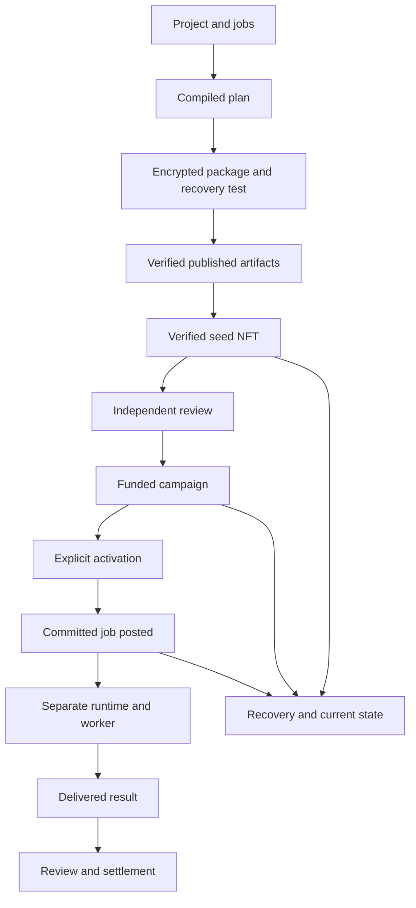

[Project notice](../DISCLAIMER_SNIPPET.md)

# Nova-Seed Studio: formats and security model

The Studio adds a browser workflow to the existing Ascension Lab and MARK wallet. It reuses the capsule cipher
and the MARK transaction pipeline. The [user guide](NOVA_SEED_STUDIO.md) explains the journey; the
[acceptance record](NOVA_SEED_STUDIO_ACCEPTANCE.md) separates test evidence from operational qualification.

## Boundaries and states

Preparation is local. Public artifact storage is a separate service. The wallet alone signs. Chain state,
independent participants and an optional execution runtime remain distinct sources of evidence.

The diagram describes the lifecycle, not automatic transitions or proof that a mainnet profile is commissioned.
Every chain transition requires the appropriate actor and a new explicit transaction. UI completion flags,
imported receipts and cached green-review badges cannot substitute for live state.

The shared transaction states include awaiting wallet, submission unknown, submitted, mined without finality,
effect unverified, authorization mismatch, finalized, reverted, replaced, cancelled and reorged. Finality concerns
the observed transaction's canonical block. Application success also requires the correct event and readback.
Unsupported smart-account envelopes must not be interpreted as a successful direct EOA call.

Receipt reconciliation accepts explicit ordinary transaction types `0x0`, `0x1` and `0x2` only. Missing,
malformed or unsupported types, including type 4, and a nonempty authorization list remain unresolved rather
than certifying extra authorization side effects as the prepared direct call.

An observed terminal job is distinct from confirmed settlement. Confirmation requires a matching terminal
state and result at a canonical finalized block. A missing event or unsuccessful semantic readback keeps the
durable transaction barrier in place even if the receipt itself is successful and finalized.

## Hash conventions

| Value | Exact meaning |
| --- | --- |
| Inner commitment | SHA-256 of existing canonical JSON of `{blind, payload}` |
| Mint `capsuleHash` | `0x` plus `hashObject(finalSealedCapsule)` over the complete sealed object |
| Artifact byte digest | SHA-256 of actual published/retrieved UTF-8 bytes |
| FusionPlan leaf | Keccak-256 of Keccak-256 of the ABI-encoded indexed specification |
| FusionPlan root | Sorted-pair Keccak tree; unmatched node promoted unchanged |
| Evidence commitment | SHA-256 of the canonical public evidence artifact |
| Artifact `profileHash` | `0x` plus SHA-256 of canonical `deploymentDescriptor(profile)` |
| Storage reference | Locator/content address returned by the adapter |
| Recovery-kit checksum | Integrity digest of the declared kit payload |

These values are not interchangeable. Pretty-printed bytes can differ from canonical object bytes. A CID is
neither a capsule hash nor proof of continued hosting. The inner commitment is not the mint commitment.
Evidence and kit checksums are not votes, wallet signatures or independent attestations.

Canonical JSON follows the existing `docs/assets/ascension/crypto.mjs` behavior: plain acyclic JSON, sorted
object keys, ordinary JSON encoding, a depth bound and a UTF-8 byte bound. It is an existing repository format,
not a claim to implement every external canonical-JSON standard. Token quantities are decimal integer strings;
they must not pass through JavaScript floating point. No normalization may silently change committed text.

The leaf input types are `uint32, bytes32, bytes32, uint96, uint32, uint16`: index, Keccak(goal),
Keccak(successMetric), bounty in base units, duration in seconds, and price weight. Plans contain 1–128 jobs.
Each goal and success metric must be nonempty and at most 512 UTF-8 bytes. Bounty is at least 100 base units
and below `2**96`. Duration is 1–7,776,000 seconds. Price weight is 0–10,000. A valid individual job does not
guarantee that the complete plan fits its envelope or the campaign's aggregate arithmetic bounds.

The immutable descriptor uses schema `agialpha.deployment-identity.v1`: chain ID, deployment name, contract
addresses and runtime hashes, source/ABI hashes, and genesis/deployment-block anchors. The complete original
profile is retained as provenance. Mutable qualification evidence, allowed-action lists, expiration and canary
transaction scope are excluded from the artifact identity so reviewed renewal or canary-to-public promotion
can preserve already minted commitments. Changed contract, code or source identity still fails to match.

## Capsule compatibility and privacy

The existing payload schema is `agialpha.novaseed.genome.v1`, with the compiled `onchain_plan` added before
encryption. The sealed schema remains `agialpha.novaseed.sealed.v1`. It uses PBKDF2-HMAC-SHA256 with 600,000
iterations, a random 16-byte salt, AES-256-GCM with a random 12-byte IV and a 128-bit tag. A random 32-byte blind
is inside the plaintext; the canonical header is authenticated as additional data. This reuses Web Crypto,
not a wallet-signature-derived key or a new cipher.

The old cipher's canonical document bound is 250,000 UTF-8 bytes. Ciphertext/base64 and complete plan proofs
consume space too; accepting a 250 KB plaintext is insufficient to prove a mintable final capsule fits.
Validate complete sealed and exported envelopes. Do not change the old reader's schema to accommodate a
larger new package. Wrong passphrases and modified ciphertext must fail authentication.

| Outer format | Contents and limit |
| --- | --- |
| `agialpha.novaseed.executable-package.v1` | Capsule, plan/proofs, evidence, profile, commitments; 1,000,000 bytes |
| `agialpha.novaseed.metadata.v1` | Public identity, artifact references/hashes and plan summary |
| `agialpha.novaseed.publication.v1` | Verified artifact references, metadata and per-artifact byte/canonical digests |
| `agialpha.novaseed.recovery-kit.v1` | Checksummed package/publication/IDs/receipts/journal/guide; 2,000,000 bytes |

New envelope parsing rejects duplicate keys, prototype-related keys, malformed Unicode, excessive nesting
(more than 24 levels), unsafe integer JSON numbers and oversized UTF-8 input. The recovery kit is private:
its plan and proofs are plaintext. The existing capsule's encryption and canonical hash convention are not
redefined by the larger outer-envelope limit. A local decrypt-and-verify success is required; importing a
boolean called `recoveryVerified` must never manufacture that evidence.

The in-session recovery proof binds the capsule hash, plan root, immutable deployment hash and evidence hash
together. Swapping a different otherwise-valid outer plan cannot inherit the original capsule's decrypt check.

Old unminted capsules without an executable plan require explicit conversion to a new package while keeping
the original. Existing minted records require artifacts matching the original commitments. Passphrases,
wallet secrets and decrypted project text do not belong in journals. Public plans, evidence, addresses and
project associations are still potentially sensitive. JavaScript cannot promise perfect memory erasure.

## Publication adapter

The supplied adapter uploads public JSON with a session-only Pinata credential to
`https://uploads.pinata.cloud/v3/files`, then retrieves the uploaded artifacts through an allowlisted gateway.
The supported retrieval origins are `https://gateway.pinata.cloud` and `https://ipfs.io`. References use a bare
CID; alternate hosts, credential-bearing URLs, query strings, fragments and paths beneath a CID are rejected.
Redirects are denied, retrieval omits credentials and each request has a 30-second timeout. JSON retrieval is
stream-bounded to 250,000 bytes. Remote error strings are not forwarded to avoid credential echoing.

The adapter uploads only the encrypted capsule, public evidence and public metadata. It never uploads the
private recovery kit. Upload credentials are held in an instance's private session field and can be cleared.
No provider fee/retention claim is embedded in the app; the user must review their storage account's terms.
Upload success is followed by content retrieval and digest verification. Before minting, publication must
be verified again. A test adapter or HTTP fixture is not evidence that a real Pinata account upload succeeded.

## Native work and result evidence

The work envelope is `agialpha.novaseed.work-package.v1`. It binds chain/profile, seed/job/index, specification,
plan/proof, artifact commitments, deadlines and delivery requirements. Its exact routed index must come from
a verified `MissionRouted` receipt. Identical job specifications have the same marketplace specification hash;
that alone does not identify their different indexed plan leaves.

Export the raw `agialpha.ascension.fusion-plan.v1` plan separately for the existing `alpha-agent ascension-check`
and `alpha-agent ascension-deliver` commands. The outer work package does not change those native interfaces.
The [factory guide](FACTORY_GUIDE.md) documents native setup, review and delivery.

Native delivery uses `agialpha.ascension.reviewed-delivery.v1` inside an Ed25519-signed envelope. Verification
must use an independently trusted public key and the exact signed body bytes, retaining Python's canonical
number spelling and Unicode key order. Do not reserialize native-signed data using the capsule's JavaScript
canonicalizer: those formats can differ. The result commitment is Keccak-256 over the complete exact delivery
bytes. A matching signature and plan/job association do not establish computational replay, an authenticated
running agent or on-chain acceptance. Those statuses remain separate.

Native delivery parsing has its own 2 MiB envelope limit and preserves large integer lexemes such as Python
nanosecond timestamps without rounding. This opt-in native reader does not relax the capsule parser's integer
rules. The browser verifies untouched signed body bytes; the native verifier performs computational replay.

## Deployment and transaction policy

The production build permits the recorded October 11 profile for inspection and the policy's legitimate
completion/recovery actions. Its new-exposure flag remains false. Unknown or changed profiles fail closed.
The archive's exact code and bindings are checked; publishing current Solidity cannot upgrade those addresses.

Exact-source local testing uses a separately built profile pinned into a copied test application. Its chain
is local, not mainnet; source/ABI identities, runtime digests and chain/deployment anchors must match. That test
artifact is not a production profile or authorization to enable funding. Production must not package a
test-only profile flag, fixture-reset RPC or runtime override.

The qualification adapter also implements source-registered `canary` and `public` stages. The production
`BUILD_PROFILES` registry is empty: this release contains no commissioned mainnet write profile. A qualified
entry pins the complete canonical profile and SHA-256, source/ABI identities, code and bindings, namespace
roots, owners/pending owners, economic parameters, token/ENS/optional-wrapper runtime, and reviewed authority
observations. A declared proxy additionally pins its implementation pointer and implementation runtime.
These reads run again before confirmation; a changed value blocks the action. Evidence digests identify
review records; they do not cryptographically prove the truth of those reviews.

Canary authorization is a separately pinned `authorizationJSON` and SHA-256, bound to the full profile hash.
It specifies approval evidence, expiration and each exact action, sender, destination, calldata, zero value,
nonce and gas-unit ceiling. Keeping this scope separate avoids a circular dependency between metadata's
deployment identity, its published URI and the approved mint calldata. Preparation and confirmation check
the exact scope and fresh nonce. Receipt reconciliation also rejects an actual wallet transaction exceeding
the prepared gas limit. A gas-unit ceiling does **not** cap gas price or total ETH fee; operator authorization
and the wallet review must cover the fee budget separately.

Public qualification requires the reviewed canary and public-approval evidence. Expiration blocks new
exposure while leaving inspection and explicitly source-approved recovery/continuation actions available.
Zero-amount allowance/availability revocation is recovery; a positive amount is new exposure. All actions
retain code, binding, authority and simulation checks. The UI can select only registered profiles; runtime
JSON, URL parameters and recovery imports cannot add a profile or override the archive's policy.

Preparation binds the sender, chain, provider epoch, destination, action, encoded arguments, zero transaction
value, deployment/profile and artifacts. The preview expires and is invalidated when the context changes.
Confirmation repeats deployment checks, simulation, account, nonce and gas validation. The public intent is
saved before `eth_sendTransaction`. No hidden write retry follows a timeout or uncertain wallet response.

The existing narrow MARK ABI implementation must be differentially tested against the pinned ethers version
for every added function/event, including dynamic strings, tuple/array offsets and receipt decoding. Selector
agreement alone is insufficient. Receipt recovery checks actual transaction intent, not only a returned hash.

## Threat model and residual limits

| Threat | Required control |
| --- | --- |
| Malicious wallet/RPC | Explicit selection; exact code/binding/intent and canonical-block checks |
| Wrong deployment/stale build | Profile, ABI and code binding; no runtime exposure override |
| Stale account/review/allowance | Invalidate preview; fresh reads and simulation before send |
| Double click/tabs/lost response | Atomic Web Lock, shared journal and unresolved-send barrier |
| Metadata/import injection | Bounded parsing, reject ambiguous keys/prototypes, render as text |
| Publication substitution | Retrieve exact bytes, verify digests, restrict endpoints and limits |
| Secret disclosure | Session-only passphrase/credentials; explicit public artifact review |
| Allowance misuse | Exact spender/amount; separate approval/purchase; revocation path |
| Role confusion | Live eligibility and distinct business, funding, validator and worker contexts |
| Runtime overclaim | Separate handoff, connection, result and settlement states |

A provider can lie consistently; qualification needs independent observations. In-page checks cannot establish
the integrity of compromised hosting or its supply chain. State can change before inclusion. Web Locks cover
one origin/browser profile, not other devices. Imports remain untrusted when checksummed. Public on-chain and
routed job data remain visible; storage retention needs monitoring. An allowance can survive a rejected
purchase. Address separation does not prove beneficial independence, and a static page is not a running keeper.

All executable dependencies are local, with pinned provenance/license. No arbitrary remote script, metadata
HTML or provider-supplied SVG should execute. Endpoint permissions are part of the reviewed build, not a
wildcard added to make publication work. Storage credentials must stay out of URL query strings and logs.

GitHub Pages response headers have limits: a CSP meta tag does not enforce header-only directives such as
`frame-ancestors`. Another page path on the same origin is not a security boundary. Same-origin scripts and
service workers can affect the wallet workspace; keep sensitive routes out of offline demo caches and retain
origin-wide supply-chain review. A stale/offline page must never report live readiness.

Reviewers should inspect [commissioning and recovery](NOVA_SEED_STUDIO_COMMISSIONING.md) together with this
document. This threat model is engineering documentation, not an independent audit certification.
