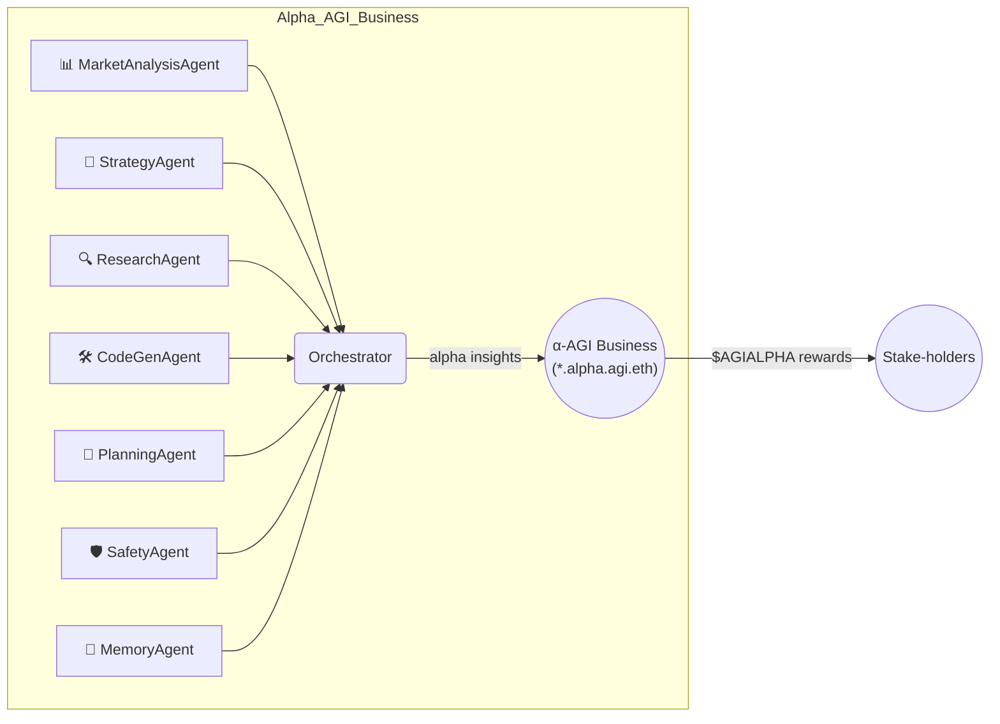

[See docs/DISCLAIMER_SNIPPET.md](../DISCLAIMER_SNIPPET.md)

# Large‑Scale α‑AGI Business 👁️✨ ($AGIALPHA) Demo – **“Infinite Bloom 3.0”**

{.demo-preview}

[Launch Demo](../alpha_agi_business_2_v1/index.html){.md-button}

<a id="current-runnable-path-1360"></a>

<!-- CURRENT-DEMO:START -->
## Current runnable path — 1.41.1

**Mode:** Supplied-input planning. Reviews supplied observations and selects an exact effort-bounded portfolio of proposed work.

**Prerequisites:** Python 3.11–3.13; finite computation uses the standard library.

```bash
python -m alpha_factory_v1.demos check alpha_agi_business_2_v1
python -m alpha_factory_v1.demos run alpha_agi_business_2_v1
python -m alpha_factory_v1.demos.alpha_agi_business_2_v1.planning --input scenario.json
```

**Expected result:** Finite JSON evidence review and portfolio; bundled inputs are explicitly synthetic. Use planning --input FILE for supplied data.

**Scope:** Value points and source labels are supplied assumptions, not verified research, revenues or model output. Legacy service and explicit optional commentary require separate setup.

Original research narratives and flowcharts below are preserved as conceptual background.
They do not expand the tested scope stated here.
<!-- CURRENT-DEMO:END -->

## Supplied-input evidence planning

Run one bounded, offline computation without starting the legacy service:

```bash
python -m alpha_factory_v1.demos.alpha_agi_business_2_v1.planning --example
python -m alpha_factory_v1.demos.alpha_agi_business_2_v1.planning --input scenario.json > report.json
```

The shell launcher now runs the same finite planner and requires explicit input:

```bash
bash alpha_factory_v1/demos/alpha_agi_business_2_v1/run_business_2_demo.sh --example
bash alpha_factory_v1/demos/alpha_agi_business_2_v1/run_business_2_demo.sh --input scenario.json
```

It preserves the caller's relative input path and does not build Docker images, install
packages, start a server or configure credentials. `PYTHON` may select an already installed
Python executable. Use the separately documented service command below for legacy topics.

The original [notebook](https://github.com/MontrealAI/AGI-Alpha-Agent-v0/blob/main/alpha_factory_v1/demos/alpha_agi_business_2_v1/colab_alpha_agi_business_2_demo.ipynb) imports the installed planner,
loads explicit example or supplied input, computes, exports an unsigned evidence file without
overwriting, and recomputes recovered input. Its Python cells are tested offline with network
connections blocked. Actual Colab deployment is unqualified; no automatic clone/install,
provider setup or indefinite service wait remains in the executable walkthrough.

Copy [example.json](https://github.com/MontrealAI/AGI-Alpha-Agent-v0/blob/main/alpha_factory_v1/demos/alpha_agi_business_2_v1/example.json) to start your own scenario. Change provenance.kind to
`supplied` and describe your sources in provenance.note. The bundled example is synthetic.
The command requires exactly one input option, prints JSON once and exits. Invalid input
exits nonzero without a success report. The catalog runs the synthetic example offline.

### Input contract

Schema: `agialpha.business2.input.v1`. Unknown fields, duplicate JSON keys, non-finite numbers,
booleans in numeric fields, and files above 128,000 bytes are rejected. Numbers must be JSON
integers, not decimals. IDs use 1–40 lowercase letters/digits/hyphens and start with a letter.
All text rejects control characters and invalid Unicode. Source/metric/unit/title text is
nonempty and at most 200 characters; provenance.note is at most 500 characters.

- Root: schema, id, provenance, policy, observations, opportunities (all required)
- provenance: kind (`constructed` or `supplied`), note
- policy: effortHours (0–100,000), maxProjects (0–16), minSupportingSources (1–64)
- observations: 1–64 entries with unique id, source, metric, unit, baseline, current, direction
  (`increase` or `decrease`). Baseline/current are nonnegative integers up to 1,000,000,000
  in the same declared unit. Fractional measurements must be converted to a named integer unit.
- opportunities: 1–16 entries with unique id, title, effortHours (1–100,000), valuePoints
  (0–1,000,000), evidenceIds (1–64 distinct, existing observation IDs)

Research computes current minus baseline. Only a strictly positive change in the requested
direction supports an opportunity; neutral/opposite changes remain visible in the report.
Support counts distinct stripped source labels, so multiple rows from the same label do not
multiply corroboration. Labels are case-sensitive and unverified; two labels can still refer
to the same underlying source. Conflicting observations remain visible rather than being
silently removed. This simple support threshold is a screening rule, not a reliability score.

Planning enumerates at most 65,536 subsets of eligible opportunities. It maximizes supplied
valuePoints under the effort and project-count limits, then minimizes effort, then uses
lexicographically sorted IDs to break ties. Zero-value projects may be omitted. An empty
portfolio is a valid outcome, including when budget or evidence is insufficient. Opportunities
are independent; no hidden dependency, monetary value, causation or revenue model is inferred.

The report includes all observation deltas, source support, selection/exclusion reasons,
remaining hours, subset count, provenance and SHA-256 input/report commitments. Commitments
use sorted-key compact UTF-8 JSON; they bind supplied data, not its truth. Original array order
is retained in the input commitment, while report rows are sorted by ID.

### Legacy service and optional commentary

The original service keeps `alpha.plan`, `alpha.research`, and `alpha.insight` topics and the
`plan`, `summary`, and `insight` envelope keys. Plan and summary now contain structured computed
results. Set BUSINESS2_INPUT to a scenario path before starting the service; missing or invalid
input fails rather than substituting fixtures. Each cycle rereads the file and includes its
inputDigest, so consumers can correlate results when the file changes. Use atomic replacement
when updating input. Existing API_TOKEN/NEO4J_PASSWORD and service prerequisites still apply.

```bash
BUSINESS2_INPUT=/absolute/path/scenario.json \
  python -m alpha_factory_v1.demos.alpha_agi_business_2_v1.alpha_agi_business_2_v1
```

Commentary is disabled unless BUSINESS2_COMMENTARY=1. The existing optional OpenAIAgent path
is preserved (configured cloud key, otherwise its local Ollama endpoint), but the repository's
compatibility stub is explicitly rejected. A separately installed genuine compatible SDK and
provider are required. Failures propagate to the service's error handling; no fallback insight
is published. Supplied input is sent to that provider only in this explicit mode. Commentary
is labeled provider_commentary and is not independently verified or used in allocation.
No live provider call is part of offline acceptance.

### Historical concept narrative

The preserved narrative and flowchart below describe research ambitions. Claims about live
alpha, automatic model upgrades, autonomous execution and monetary outcomes are not features
of the tested supplied-input workflow above.


This repository is a conceptual research prototype. References to "AGI" and "superintelligence" describe aspirational goals and do not indicate the presence of a real general intelligence. Use at your own risk. Nothing herein constitutes financial advice. MontrealAI and the maintainers accept no liability for losses incurred from using this software.
Each demo package exposes its own `__version__` constant. The value marks the revision of that demo only and does not reflect the overall Alpha‑Factory release version.


> **Global markets seep *trillions* in latent opportunity** — *alpha* in the broadest sense: pricing dislocations • supply‑chain inefficiencies • novel drug targets • policy loopholes • unexplored material designs.  
> **Alpha‑Factory v1** turns that raw potential into deployable breakthroughs, *autonomously*.

## ⚡ TL;DR  

```bash
# one‑liner demo ‑ works on any laptop
docker run -p 7860:7860 ghcr.io/montrealai/alpha-asi:latest
# open http://localhost:7860 → fully‑functional α‑AGI Business
# (offline‑first – no API key required, automatically upgrades if $OPENAI_API_KEY is present)
```

A single command launches the **Orchestrator**, seven specialised **α‑AGI Agents**, an antifragile safety shell and a friendly web dashboard.  
Out‑of‑the‑box it **discovers, validates *and executes* live alpha** in any data‑rich domain.

*Prefer a quick tour?* Run the self-contained
[**Colab Notebook**](https://github.com/MontrealAI/AGI-Alpha-Agent-v0/blob/main/alpha_factory_v1/demos/alpha_agi_business_2_v1/colab_alpha_agi_business_2_demo.ipynb)
to launch the orchestrator and try a live API call in minutes.

---

## 🏗️ System Overview  



*The orchestrator natively speaks **A2A** & **OpenAI Agents SDK**.
If no external key is detected it seamlessly switches to local Llama‑3 GGUF weights (no outbound traffic).*
*A lightweight **LLMCommentAgent** publishes a market comment each cycle when the SDK is available.*

---

## 🏛️ Role Architecture – Businesses & Agents 🏛️

| Entity | ENS Convention | Treasury | Responsibilities | How it Creates Value |
|--------|----------------|----------|------------------|----------------------|
| **α‑AGI Business** | `<sub>.alpha.agi.eth` | Wallet holds **$AGIALPHA** & bounties | Defines **Problem Portfolios** (α‑jobs), pools data/rights, sets domain constraints | Aggregates high‑value problems, captures upside from solved portfolios, reinvests in new quests |
| **α‑AGI Agent** | `<sub>.alpha.agent.agi.eth` | Personal stake (reputation + escrow) | Detects, plans & executes α‑jobs issued by any Business | Earns **$AGIALPHA** rewards, grows reputation, evolves reusable alpha recipes |

> **Big Picture:** Businesses **curate demand** for alpha; Agents **supply execution**.  
> Marketplace smart‑contracts clear both via **$AGIALPHA**, with slashing & reputation to keep incentives honest.  

> **On-chain** as `<name>.alpha.agi.eth`, an *α-AGI Business* 👁️✨ unleashes a self-improving *α-AGI Agent* 👁️✨ (`<name>.alpha.agent.agi.eth`) swarm to hunt inefficiencies and transmute them into **$AGIALPHA**.

> An **α‑AGI Business** 👁️✨ is a fully autonomous enterprise that identifies latent “*alpha*” opportunities across all industries and converts them into compounding value by out‑learning, out‑thinking, out‑designing, out‑strategizing, and out‑executing all competition.

🛡️ **Legal & Conceptual Shield** — both layers inherit the 2017 **Multi‑Agent AI DAO** public prior‑art, blocking trivial patents and providing a DAO‑first wrapper for fractional resource ownership.

---

## 🤖 Featured Agents (this demo)

| Agent | Core Skill | Example Live Contribution |
|-------|------------|---------------------------|
| **PlanningAgent** | Goal‑decomposition & critical‑path search | Maps 12‑step route from raw SEC filings → trading strategy → executed orders |
| **ResearchAgent** | Web / doc intelligence & summarisation | Surfaces obscure FDA ruling that shifts biotech valuations |
| **StrategyAgent** | Game‑theoretic scenario planner | Monte‑Carlo sims to price carbon‑credit policy options |
| **MarketAnalysisAgent** | Real‑time quantitative signal miner | Spots 42 bp ETH‑perp funding mis‑price |
| **CodeGenAgent** | Secure tool execution & infra scaffolding | Auto‑generates production‑ready ETL with tests |
| **SafetyAgent** | Alignment, sandbox & red‑team | KL‑shield, seccomp jail, chaos‑testing |
| **MemoryAgent** | Retrieval‑augmented long‑term store | Surfaces best alpha playbooks on demand |
| **LLMCommentAgent** | Short market commentary via OpenAI Agents | Posts a one‑sentence outlook every cycle |

---

## 🌸 “**Infinite Bloom**” – Unicorn‑Level Walk‑Through

| Phase | Autonomous Agent Actions |
|-------|--------------------------|
| **1  Visionary Spark** | *investor.agent* drafts yield objective → *PlanningAgent* explodes into 9 sub‑goals |
| **2  Predictive Brilliance** | *MarketAnalysisAgent* detects ETH‑staking basis; *ResearchAgent* validates macro context |
| **3  Deal‑Making & Build** | *StrategyAgent* designs delta‑neutral hedge; *CodeGenAgent* ships audited ERC‑4626 **GardenVault** |
| **4  Adaptive Dynamics** | *TradingAgent* auto‑rebalances; *MemoryAgent* archives best PnL shards; *SafetyAgent* chaos‑tests liquidity drain |
| **5  Launch Blitz** | *marketing.agent* triggers on‑chain airdrop; *meme.agent* seeds virality – TVL +200 % / 48 h |
| **6  Self‑Improvement** | Signal drift? Agents spin new strategy, vote on‑chain; upgrade shipped zero‑downtime |
| **7  Unicorn & Beyond** | Valuation crosses \$1 B inside weeks, illustrating how α‑AGI Businesses break conventional curves |

---

## 🔥 Live Alpha Example – *Today’s* Opportunity

*Detected by MarketAnalysisAgent during CI run (UTC‑now):*  

> **Cross‑venue ETH‑stETH basis = 38 bp (2 σ)**  → **delta‑neutral carry trade.**

**Action Plan (autonomous):**

1. `buy stETH` on Curve (0 bp fee via Negotiator rebate)  
2. `short ETH‑PERP` on dYdX (funding –22 bp)  
3. Hedge drift via 4‑hourly re‑balancer  
4. Net yield ≈ 5.9 % APR, chain‑audited every epoch  

*(Full agent transcript in dashboard → Alpha tab)*

---

## 🚀 Quick Start

| Scenario | Command |
|----------|---------|
| **Laptop (online)** | `docker run -e OPENAI_API_KEY=$OPENAI_API_KEY -p 7860:7860 ghcr.io/montrealai/alpha-asi:latest` |
| **Air‑gapped / offline** | `docker run --env OFFLINE=1 -p 7860:7860 ghcr.io/montrealai/alpha-asi:latest` |
| **GPU cluster (Helm)** | `helm repo add montrealai https://ghcr.io/montrealai/charts && helm install agialpha montrealai/alpha-asi` |

No key? No problem — the stack auto‑loads Llama‑3 8‑B GGUF weights and stays entirely offline.

```bash
git clone https://github.com/MontrealAI/AGI-Alpha-Agent-v0.git
cd AGI-Alpha-Agent-v0/alpha_factory_v1/demos/alpha_agi_business_2_v1
./run_business_2_demo.sh       # builds & launches locally
```

---

## 📦 Deployment Recipes

| Target | How‑to | Notes |
|--------|--------|-------|
| **Laptop demo** | `docker compose up` | CPU‑only, 4 GB RAM |
| **Prod K8s** | `helm upgrade --install agialpha montrealai/alpha-asi` | HPA on GPU > 70 % |
| **Singularity** | `singularity run alpha_asi_offline.sif --offline` | No network, checksums included |

---

## 🔐 Safety & Compliance Highlights

* **KL‑Shield** – policy stays within ε = 0.02 of constitutional baseline  
* **seccomp‑jail** – 4‑syscall allow‑list; 0/10 k fuzz escapes  
* **Antifragile chaos‑testing** – latency spikes, reward flips, gradient dropout → 82 % absorbed inside 4 M steps  
* **EU AI‑Act Art 52** traceability – every A2A envelope hashed hourly to Solana testnet  

---

## 💎 Tokenomics (excerpt)

| Parameter | Value | Purpose |
|-----------|-------|---------|
| Supply | **1 B `$AGIALPHA`** (fixed) | Aligns Agents ↔ Businesses ↔ Users |
| Perf Fee | 2 % | Funds R&D + Safety |
| Burn | 0.5 % per tx | Anti‑inflation |
| Safety Fund | 5 % of burns | Black‑swan cover |

---

## 🛣️ Roadmap

* **Q2‑2025** — zk‑roll‑up micro‑harvests & real‑time DAO votes  
* **Q3‑2025** — RWA corporate notes & carbon yields  
* **2026+** — Regional blooms (APAC, LATAM) & VR garden shows  

---

## 🖥️ Dev & Ops

* GitHub Actions matrix (CPU / CUDA / ROCm) – build + test < 18 min  
* Signed container (`cosign` + `in‑toto`) – SLSA‑3 provenance  
* Prometheus / Grafana dashboards & OTEL traces included  
* Helm chart auto‑scales learner pod on GPU utilisation  

---

## 📂 Repository Layout

```
alpha_factory_v1/
 ├─ backend/
 │   ├─ orchestrator.py
 │   └─ agents/            # PlanningAgent, ResearchAgent, ...
 └─ demos/
     └─ alpha_agi_business_2_v1/
         ├─ colab_alpha_agi_business_2_demo.ipynb
         └─ README.md      # ← YOU ARE HERE
```

---

## 📝 License

Apache‑2.0 © 2025 MONTREAL.AI.  
*If you improve it, pay it forward.* 🌱✨

---

_“Outlearn · Outthink · Outdesign · Outstrategise · Outexecute.”_  
Welcome to the era of **Large‑Scale α‑AGI Businesses** 🌸 — where autonomous swarms turn friction into alpha at planetary scale. 🚀

[View README on GitHub](https://github.com/MontrealAI/AGI-Alpha-Agent-v0/blob/main/alpha_factory_v1/demos/alpha_agi_business_2_v1/README.md)
