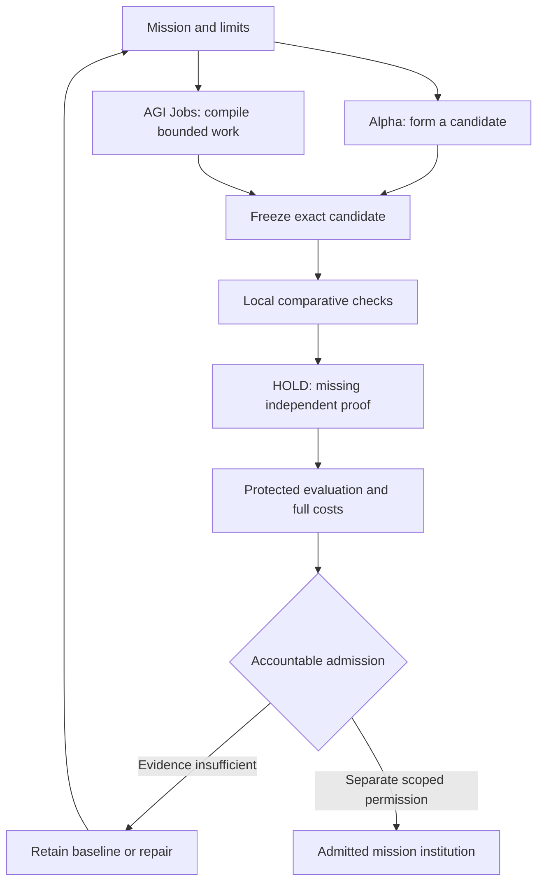

# Build your own SUCCESSOR Ω with Alpha Agent + AGI Jobs

**[Open the workshop](https://montrealai.github.io/AGI-Alpha-Agent-v0/successor/build/)** ·
**[Français](https://montrealai.github.io/AGI-Alpha-Agent-v0/successor/build/?lang=fr)** ·
[AGI Jobs companion](https://montrealai.github.io/AGIJobsv0/successor/build/)

Name your Ω, run a real computing experiment, inspect 21 bounded job drafts, and download the complete
working lab. No account, wallet, token payment, model download or installation is required in the browser.

The example uses **both projects' actual code**: Alpha's fixed candidate formation/evaluation engine and
AGIJobsv0's mission validator, work-order compiler, portfolio templates and canonical digest implementation.
It is a local, reproducible workshop. It does not post jobs, fund escrow, establish independent proof or
admit a production SUCCESSOR Ω.

## A useful first mission

Atlas Ω is a synthetic service-metrics analyst. Given event records, calculate the count, total duration,
maximum duration and error count for every day/service pair. Exact outputs and malformed-input rejection
are mandatory. The experiment measures four candidate configurations and compares the frozen choice with
both the existing scan-based implementation and a deterministic map baseline on six further workloads.

These public cases are reproducible teaching cases. They are not protected from the producer. Timing is
measured on the user's device, is sensitive to ordering/JIT/load, and can favor either baseline. A local
speedup is not independent mission dominance, economic advantage or Specialist ASI.

1. Give the candidate a nickname and choose a workload size.
2. Set an illustrative planning allowance. The default 2,100 AGIALPHA is **not a quote** or funded balance.
3. Choose **Build & test my Ω**. Inspect correctness and comparative timings.
4. Open each of the six work phases to inspect the 21 compiler templates and their concrete deliverables.
5. Download the working HTML, the full JSON package, readable job briefs and/or the native Alpha request.
6. Reopen the HTML offline in a desktop browser. Saved results are historical notes; rerun to make new evidence.

The compiler divides the illustrative allowance into 21 integer base-unit reservations. Any rounding
remainder stays unallocated. The allowance excludes real estimates for gas, stakes, review, model use,
maintenance and unwind. Zero funds are transferred. Producer/verifier/acceptor/admitter labels are distinct
schema identities, not authenticated people. Every work order remains `DRAFT` and `UNSIGNED_COMMITMENT`.

## What the two systems do



Alpha supplies candidate configurations, an exact engine identity, measured results and a native-compatible
request. Jobs supplies a dependency graph, mission limits, rights declarations, verifiers, acceptance
criteria, rollback terms and reproducible unsigned commitments. No adapter connects either deployed market
in this workshop. The result is a concrete starting package for an operator and reviewer to refine.

## What you take home

| Download | Contents and intended use |
| --- | --- |
| `My-SUCCESSOR-Omega-Builder.html` | All working code, styles, licenses, full contract directory, settings and historical notes; reopens offline |
| `successor-build-pack.json` | Mission, sealed draft graph, candidate attempts, frozen manifest, comparison, limits and local Chronicle note |
| `successor-job-briefs.md` | All 21 deliverables, acceptance criteria, expiry, role labels, rollback and unsigned commitment digests |
| `request.json` | A valid input for `alpha-agent successor-run`; same mission/seed/workload as the browser run |

The build package has the schema `successor-build-example/v1`. It is **not** a native backup, a signed
receipt, a live settlement instruction or an import into the existing personal-lab format. Checksums show
consistency, not authenticity. Notes are not saved automatically. Downloads are not encrypted.

## Run and verify locally

From this repository, with the Node.js version specified by `.nvmrc`:

```sh
node examples/build-successor/run.mjs successor-build-output
node --test examples/build-successor/test.mjs
python scripts/generate_successor_build.py
```

The runner refuses an existing output directory. It makes no provider or blockchain requests. The generated
page is `docs/successor/build/index.html`; opening it directly in a current desktop browser runs the same code.

With the native Alpha runtime already installed:

```sh
alpha-agent successor-run successor-build-output/request.json --output result.json
```

Use the full [Alpha workspace](https://montrealai.github.io/AGI-Alpha-Agent-v0/successor/) for native-result
inspection. Native execution is another local rehearsal; it does not create independent proof.

To check the exported job package **using the companion AGIJobsv0 checkout's own compiler**:

```sh
cd ../AGIJobsv0
node scripts/pages/verify-successor-build.mjs ../AGI-Alpha-Agent-v0/successor-build-output/successor-build-pack.json
```

Expected output includes `recompilation: MATCH`, `independentProof: false`, `authority: []`, and
`settlement: NOT_CONNECTED`. This is a historical consistency check at the recorded creation time,
not proof of current rights, mission correctness, independent review or operational readiness.

## The shared mainnet token and deployed contracts

**Both recorded deployed systems use the same $AGIALPHA token on Ethereum mainnet (chain ID 1), 18 decimals:**

**[0xA61a3B3a130a9c20768EEBF97E21515A6046a1fA](https://etherscan.io/address/0xA61a3B3a130a9c20768EEBF97E21515A6046a1fA#code)**

The workshop contains selectable full addresses, plain-language roles and explorer links for all **5 Alpha
Ascension contracts and 24 AGI Jobs instances**. The source-pinned directory is maintained in
[`contracts.json`](../../docs/assets/ecosystem/contracts.json). These are dated 11–12 October 2026 records,
not a fresh RPC attestation. Existing source/readiness distinctions are retained.

Alpha MARK is fixed to Alpha's own market. It cannot route funding directly to AGIJobsv0. The shared token
creates no automatic bridge, shared escrow, shared approval or permission. Before any live activity,
resolve the Alpha deployed/current-source differences and each system's participant commissioning,
identity configuration, independent reviewers, budgets and settlement evidence. See the
[Alpha record](../../docs/agent/MAINNET_DEPLOYMENT.md) and
[Jobs readiness](https://github.com/MontrealAI/AGIJobsv0/blob/main/docs/production/readiness.md).
The separate AGIJobManager project is outside this example.

## From this candidate to your own mission institution

Replace the teaching mission only after specifying public or licensed nonpersonal inputs, measurable
outcomes, credible alternatives, unacceptable failures, independent review capacity and a rollback route.
Models, tools and world programs can become separate bounded jobs. Count formation, operating, review,
repair, dependency and unwind costs. Test an export-and-rebuild path and establish rights to commissioned
artifacts. The open-source licenses do not grant exclusive IP or ownership of outside services.

Freeze the complete release; arrange fresh, representative evaluation under independent custody. A
separate accountable principal may then decide whether to reject, limit, repair or admit it under a scoped,
versioned, monitored, expiring and revocable authority envelope. A future successor may inherit useful
permitted methods and history, never proof or authority automatically.

## Source guidance and provenance

This example translates the four user-supplied publications into a narrow, executable teaching journey:

| Publication | Concepts used |
| --- | --- |
| GoalOS Singularity Navigator Ω + SEIZE, v5.0.0, 9 August 2026 | Small reversible mission; alternatives; full economics; proof before authority |
| GoalOS Gym · Specialist ASI · Successor Ω, v2.1.0, 10 August 2026 | Teaching Gym; policy versus institution; fresh proof; no inherited authority |
| SUCCESSOR Ω × AGI Jobs, v2.0.0, 12 August 2026 | Bounded job graph; distinct execution, acceptance and admission; Chronicle |
| Neural-Symbolic SUCCESSOR Ω, 25 August 2026 | Replaceable models; executable tools; ownership and rebuild; claims earned through evidence |

The maintained Jobs portfolio combines Gym/benchmark formation and separates accountable acceptance,
while keeping 21 templates. The workshop shows that implementation's exact titles and fields. It does not
claim implementation of every research component described in the publications.

The four MIT-licensed Jobs modules in `vendor/agijobs/` are copied **unchanged** from the exact revision in
[`provenance.json`](vendor/agijobs/provenance.json); their SHA-256 hashes are checked during generation and tests.
The Alpha engine is bundled directly from this checkout and its SHA-256 is embedded in the candidate.
The generator uses only Python's standard library, embeds both licenses and hashes its inline CSP assets.
No CDN, remote model, wallet provider, telemetry or browser storage is used.

The AGIJobsv0 website mirrors the generated HTML byte for byte with an explicit source manifest. Regenerate
here, run the tests and browser checks, then update that mirror and manifest together. Never edit the mirror
or vendored compiler to silently diverge from their declared sources.
