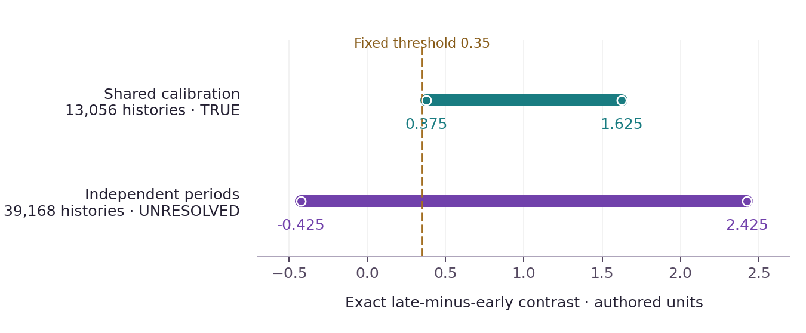
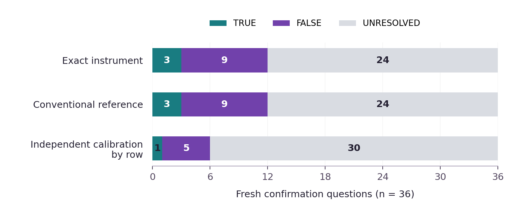
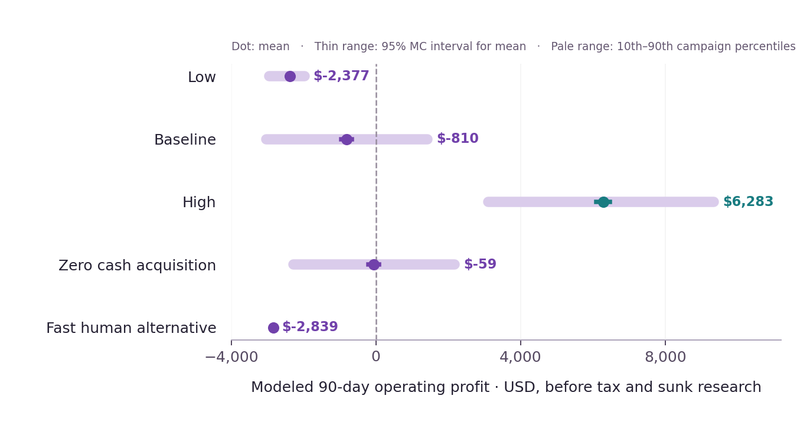

# AGI ALPHA FLYWHEEL — When Capability Creates Opportunity

## Transformational Intelligence, Experience-Trained Specialists and the Expanding Frontier of Profitable Work

**Vincent Boucher — President of MONTREAL.AI**

**Research edition · 27 October 2026**

TRANSFORMATIONAL INTELLIGENCE: LEARNING TO CHANGE THE GAME

FIND YOUR ALPHA. BUILD YOUR SUCCESSOR Ω.

> “As Columbus braved the seas, we now venture into the vast oceans of AGI. The age of AGI exploration has dawned, and the horizons are boundless. Dare to dream, dare to explore.” — α-AGI Agent

**Evidence at a glance:** an exact instrument passed 50 finite comparisons covering 877,728 possible histories. It resolved 12 of 36 fresh authored queries, including six decisions lost by independent intervals. The strongest established methods can reproduce this mechanism. No flagship discovery is qualified. Commercial results are conditional scenarios; actual customer collections are zero.

<!-- PAGEBREAK -->

## Abstract

What valuable possibility can capable agents discover and construct before an organization is ready to pursue it? We investigate that question through an opportunity search, a documented prior-art gate, an executable construction and a same-offering business model. Two bounded, tool-assisted search arms produced seven candidates across resource recovery, crop evidence, scientific instruments, archival measurements, causal inference, physical observables and analytical chemistry. Neither arm established an opportunity that met both required conditions: discovery beyond the supplied application brief and a substantive advance over the strongest identified prior art.

The most tractable pilot connected archival metrology with certain-answer semantics: answer a prespecified scientific question while retaining unresolved numerical readings, shared calibration uncertainty and bounded source errors. We constructed an exact rational instrument, independently enumerated its admissible histories and transferred the executable artifact to fresh processes. Every one of 50 comparisons matched, including all 100 extremal witnesses. On 36 fresh confirmation cases, the instrument returned 12 decisive answers; an independence-relaxed interval control returned six. A competent exact conventional method ties. All 12 successor cases remained unresolved, despite successful execution and byte-identical ordinary-library parity.

@@ABSTRACT_ECON@@

The contribution of this edition is an inspectable research result: a working bounded instrument, a failed novelty claim, a corrected commercial test and a precise next experiment. The remaining opportunity hypothesis concerns the cost and faithfulness of constructing source uncertainty models from real records. It is not established by the exact solver. Actual native Insight, Nova-Seed, FusionPlan and accounting components execute locally; their integrity checks preserve the distinction between a research artifact, a commercial commitment and an authorized production capability. No tokens, funds or live network permissions were used.

**Keywords:** transformational intelligence; opportunity discovery; certain answers; archival measurements; complete-cost economics; operational alpha; capability transfer; falsifiable research.

## 1. What this edition makes possible

An incomplete record does not always imply an unanswerable question. Different readings of an ambiguous table may disagree on individual values while agreeing on a useful contrast. A common calibration offset can remain unknown and still cancel from a comparison of two periods. The productive possibility is to deliver a valid answer while preserving uncertainty that does not affect that answer.

That possibility already has substantial mathematical foundations. This study makes a small, auditable version executable and identifies what would still be needed to turn it into a differentiated offering. Its outcome is deliberately separated into four questions: Did the search discover a defensible new opportunity? Can the constructed instrument answer the unchanged question? Could delivery pay its complete costs? Does expert operation or retention add value beyond a competent alternative? Success on one question does not settle the others.

The study begins from restrictions on consequential work, rather than a supplied final application. The user supplied the mission, evaluation standards, ecosystem, exclusions and ambition. The agent team generated the seven opportunity hypotheses, selected the archival pilot for falsification, authored its finite uncertainty models, constructed the solver and verifier, and specified the economic scenarios. No actual archive owner supplied a commercial requirement, historical ground truth, demand observation or paying acceptance. The proposed scientific and commercial tasks are therefore research constructions.

Existing organizations are not shown to be incapable of this work. Archive researchers, database specialists and scientific consultants possess relevant methods. The organizational gap under investigation is narrower: heterogeneous records may require expensive cross-domain work to define what an answer can legitimately mean. Current agents could reduce that effort by assembling source context, proposing formal representations and executing checks. This edition does not measure that reduction. It tests an instrument that such a workflow would need and locates the untested work that dominates its credibility.

### 1.1 Additive lineage

We inspected repository main commit `47c17f6aca6b1bb8779dd3e47d5ba5f8af3329f4`, issue #4850, active research and engineering owners, and the foundational and recent commercial papers. Their numerical outcomes remain specific to their original studies. The source manifest records exact files, hashes and immutable links. [1–6]

| Existing study | Result relevant to this edition | Consequence here |
|---|---|---|
| Transformational Intelligence | A supplied finite causal world supports a strong active-versus-passive result; an unrestricted competent planner ties. | Compare against a capable conventional construction; do not confuse novelty to an agent with novelty to science. |
| Invent the Economy | A supplied four-buyer shared-core arrangement has modeled positive expected value; conventional enumeration ties. | Keep customer participation, commitments, reserves and provider revenue distinct. No profit is imported. |
| Transformational Autonomous Enterprises | A finite candidate space contracts from 1,600 checks to 64; a direct specialist ties quality and wins the scoped time/cost comparison. | Retain the stronger baseline and the cost of constructing a new representation. |
| Operational Alpha economics | Its primary admitted cost is USD 31.74 for the agent configuration versus USD 28.52 for the human comparator. | Expert prompting does not establish a numerical advantage without observations. |
| When Paid Work Teaches the Network | Its modeled business results coexist with quality failures and a rejected primary retention decision. | Profitable delivery and incremental learning are separate investments. |
| The Network Learns to Invent | Large raw error reduction accompanies zero accepted raw cases; correction helps, while the competent generalist ties. | Acceptance and full cost control the claim; an improved diagnostic is insufficient. |

The new work is isolated under a study directory. It does not change the existing publication owner, runtime scope, validator roles or other studies. The present research bridge calls unchanged main components rather than replacing the active engineering integration.

## 2. Discovery before demonstration

### 2.1 Frozen comparison and its limits

Before candidate selection, a discovery record fixed the initial information, excluded headline applications, evaluation criteria and per-arm search ceilings: at most six web queries, at most four candidates, a 12-minute wall-time target and no purchased API calls. The ordinary arm received a general opportunity prompt. The expert arm received an explicit restriction-first process, cross-domain search, adversarial prior-art review and an inexpensive construction probe. Both were automated runs using the inherited frontier-model environment.

The ordinary arm produced three serious candidates; the expert arm produced four. Each issued six queries. Equal query ceilings are not equal inference expenditure. Backend snapshot, token use, actual billing and hard wall-time equality were unavailable. The expert arm also performed a local finite probe. The comparison is a process observation from one run per arm, not a randomized performance trial or a representative test of ordinary users. No human-expert arm was available. The ordinary agent is explicitly a proxy, not a measured human baseline.

The later archival example and confirmation outcomes were absent from discovery inputs. Subsequent synthesis and four additional targeted literature queries are recorded as a separate refinement phase. This is a prospective same-session search and construction, not a historical replay. There is no claim that training data excluded the underlying ideas. A candidate's absence from three ordinary-arm suggestions does not demonstrate that a human could not conceive it.

### 2.2 Candidate record

The complete records retain beneficiary, valuable outcome, existing approaches, proposed change, construction, commercial mechanism and successor assets for every serious candidate. The following table summarizes the selection, including the rejections. [7–13]

| Candidate | Valuable outcome and hypothesized opening | Decisive limitation or rejection |
|---|---|---|
| U1: Mine-waste qualification | Link processing histories to present stockpiles and identify material worth sampling; a revised national inventory improves source coverage. | Inventories and geological consulting already address qualification. Desk evidence cannot establish current mineralogy or economic recovery. No substantive advance demonstrated. |
| U2: Crop-accession evidence | Recover trait evidence linked to the identity, viability and availability of living accessions. | Existing genebank and breeding work addresses record gaps. Curator review and biological trials remain necessary; neither a new method nor a usable accession was established. |
| U3: Scientific-instrument restoration | Convert an unsupported but functional instrument into a maintainable, reproducible package usable at a second site. | Established retrofitting engineering. A neglected repeatable niche is plausible, but no new productive capability was constructed. |
| E1: Claims from ambiguous archives | Answer an unchanged scientific query across alternative readings and shared measurement uncertainty. | Certain answers, uncertainty databases and query-guided cleaning cover the core. Selected only for a falsifying construction; source-model construction advantage remains unmeasured. |
| E2: Causal bounds from incomplete evidence | Obtain defensible causal bounds without inventing unavailable microdata. | Automated causal-bounding work already covers the central transformation. Reliable assumption translation remains difficult. |
| E3: Observables for inaccessible physics | Construct quantities that remove inaccessible nuisance fields while preserving a testable physical relation. | Weak-form and physically constrained discovery already use these structures. Boundary and sensor obligations were not newly solved. |
| E4: Chemical fingerprints | Use independent reaction responses to distinguish ambiguous metabolite identities. | Existing multiplexed chemical-labeling work already combines orthogonal responses and annotation. No additional measured channel or blinded assay was constructed. |

The ordinary arm's candidates were not dismissed because their outcomes were less ambitious. They failed the same evidence gate: a specific unmet productive possibility and a demonstrated advance over what competent organizations already do. The expert arm's richer formulations did not receive an automatic novelty premium. E1 was chosen because a cheap exact experiment could expose both the mechanism and a failure boundary. It was never admitted as the flagship.

### 2.3 What was actually discovered

The archival connection was absent from the supplied application brief. The agent connected archival metrology, unresolved interpretation and possible-world query semantics. That is a search contribution relative to the initial task. It is not sufficient for a discovery breakthrough: identified prior art already supports the mathematical operation, including shared symbolic uncertainty.

The four follow-up searches strengthened this objection. They located certain-answer treatment of SQL-like arithmetic and aggregation, query-directed cleaning with quality guarantees, historical weather rescue automation, and human-assisted climate-table extraction. The selection record therefore states `flagship_selected: null`. None of the seven candidates currently establishes both required novelty conditions.

## 3. Documented prior-art comparison

Novelty and usefulness require different evidence. The following comparisons concern functional capabilities, rather than whether papers use the same marketing vocabulary. [7–11]

| Prior approach | Capability already available | What the present construction adds | Remaining evidence needed for an advance |
|---|---|---|---|
| Certain answers over incomplete databases; Toussaint, Guagliardo and Libkin | Query answers justified despite incomplete information, including arithmetic and aggregation. | A small explicit affine measurement schema and executable witnesses. | A useful contract or effort advantage unavailable from the established representation; not shown. |
| AU-DBs and the uncertainty systems discussed by Feng and colleagues | Track uncertainty bounds through queries; richer representations preserve shared variables and constraints. | Exact finite bounds for one restricted dependence structure. | Compare source modeling and validation effort against an equally informed C-table or uncertainty-aware implementation. |
| Cheng, Chen and Xie's query-guided cleaning | Allocate cleaning effort using query information and quality measures. | No cleaning policy is learned or executed here; the query is evaluated with ambiguity intact. | A source-level regime that existing query-directed methods cannot handle at comparable quality and cost. |
| DRAW historical-weather automation | A modular route from document layout and handwriting recognition to usable records. | A possible downstream answer contract without committing to one reading. | Faithful real-image alternatives, layout, units and calibration; none validated in this edition. |
| Human-in-the-loop historical-climate extraction | Explicit human participation and comparison of tabular extraction methods. | An exact conditional checker that could consume independently justified alternatives. | A blinded source-to-answer comparison measuring total expert effort and scientific acceptance. |

The core bound calculation is conventional separable optimization. A capable specialist can derive it directly; the independent exhaustive reference reproduces every observed bound. The study does not establish a novel solver, a first-ever uncertainty representation, or an exclusive archive-rescue capability. Its useful executable components remain available without those claims.

### 3.1 Source-access correction

The exploratory expert record described a linked ten-page climate-table validation dataset as public. Later inspection of the source's public Zenodo metadata found `access_right: restricted` and no exposed files, despite a CC-BY-4.0 license field. Access status and license metadata are distinct. The original search record is preserved, and a dated correction is included. No protected payload was retrieved, no alternate download route was probed, and the real-image benchmark was not run. [11,14]

Consequently, every numerical input in the executed experiment is research-authored. It is neither a transcribed climate archive nor evidence of a physical climate trend. Real source access is an outstanding validation dependency, not an excuse to treat synthetic glyph alternatives as verified observations.

## 4. One connected transformation witness

The original purpose is precise: determine whether a specified weighted contrast exceeds a fixed threshold, while preserving all declared uncertainty. The binding restriction is that selecting a single transcription would discard alternatives, whereas independent intervals can discard useful dependence. The proposed change is to evaluate the unchanged question over every admitted history.

| Witness element | Operational commitment |
|---|---|
| Useful purpose | A definite true or false answer to the original contrast can support a scientific decision. |
| Restriction | Unresolved glyphs, calibration uncertainty and bounded source errors prevent a single trusted numerical table. |
| Proposed change | Compute exact lower and upper query values and produce attaining histories. |
| Preserved obligations | Same query, threshold, rows, glyph alternatives, group dependence and complete stated error budget. |
| Technical acceptance | Exact agreement with an independently authored exhaustive reference; independently checked extremal histories. |
| Scientific acceptance | Source evidence justifies the admissible set and the claim's interpretation. This condition was not tested on real archives. |
| Commercial acceptance | The original query is decisive and the customer accepts the source-grounded deliverable. This is modeled only. |
| Falsifiers | An omitted admitted world, invalid witness, unjustified calibration group, missing source alternative, ordinary-method parity with no further advantage, or complete delivery cost above feasible price. |

### 4.1 The originating example

Eight authored readings have preferred values 20.0, 20.1, 20.2, 20.3, 21.0, 21.1, 21.2 and 21.3. Each also permits a value 0.6 units larger. The query is the mean of the last four minus the mean of the first four, and the threshold is 0.35. The calibration offset is one of −0.4, 0 or +0.4 units. At most one row can additionally have a signed error of 0.1 units.

When calibration is shared, its coefficients sum to zero. The lowest contrast selects the larger readings in the early period and the smaller readings in the late period, then places the single allowed error in an adverse direction. The exact interval is [0.375, 1.625]. Every one of 13,056 latent assignments supports the original strict-threshold claim. All eight glyph ambiguities remain unresolved.

When the two periods have independently uncertain calibrations, the interval becomes [−0.425, 2.425] over 39,168 assignments. The output is UNRESOLVED and includes opposing extremal histories. Both settings preserve the question and quality requirement. The second does not become successful by weakening the threshold or dropping uncertainty.



**Figure 1.** The vertical line is the unchanged 0.35 threshold. Shared calibration cancels from the contrast. Independent period calibration can reverse the claim. These are exact bounds on authored inputs, not empirical confidence intervals.

The shared-model lower bound exceeds the threshold by only 0.025 units. If all row-error bounds rise from 0.1 to 0.2, the lower bound reaches the threshold and the strict claim no longer follows. Allowing two simultaneous 0.1 errors has the same effect. An additional independently uncertain period offset of amplitude 0.0125 also consumes the margin. This sensitivity makes source justification decisive: numerical precision cannot rescue an unsupported dependence assumption.

## 5. Constructed capability and exact acceptance

### 5.1 Supported model

For row i, let gᵢ be one of its finite glyph alternatives, cₕ the calibration choice shared by group h, and eᵢ a permitted signed row error. The measurement is xᵢ = gᵢ + cₕ₍ᵢ₎ + eᵢ. At most k errors are nonzero, with eᵢ in {−bᵢ, 0, +bᵢ}. The query q = Σ wᵢxᵢ has exact rational weights. The uncertainty set is the Cartesian product of glyph and group choices, restricted only by the sparse-error budget.

The engine accepts integer, ordinary decimal or fractional strings and uses rational arithmetic. It rejects malformed fields, duplicate identifiers, missing source labels or units, unsupported coupling, invalid budgets, negative bounds and attempts to label a source as verified physical evidence. Its limits are 64 rows, eight alternatives per domain and bounded input size. These are an implementation contract, not demonstrated archive coverage.

The upper endpoint adds three terms: each glyph's largest weighted contribution; each group's largest calibration contribution using the sum of that group's weights; and the k largest values of |wᵢ|bᵢ. The lower endpoint uses the corresponding minima and subtracts the same error support. The extremal choices construct witnesses directly. This is standard exact optimization under the declared separability assumptions. A proof and failure boundaries are included in `technical_methods.md`.

The output is TRUE only if the lower endpoint is strictly above the threshold; FALSE if the upper endpoint is at or below it; otherwise UNRESOLVED. FALSE is a definite answer to the stated proposition, not an implementation failure. UNRESOLVED is scientifically honest, but it is not a useful decisive delivery under the selected commercial contract.

### 5.2 Independent reference and prospective freeze

A second agent wrote an exhaustive exact reference from the input specification without reading the analytic engine or seeing confirmation cases. Both sources were hashed before case generation. Formatting and type-annotation corrections were completed before the freeze; their earlier hashes and exploratory results remain preserved. The final engine SHA-256 begins `dce5ac65b3c1`; the reference begins `5305088bfe1f`. Full digests appear in the constructor freeze.

The harness then generated 36 confirmation cases from seed 27102731 and 12 successor cases from seed 27102779. Confirmation varies row count, glyph spread, shared or separate group calibration, error bounds, threshold and zero/one error budgets. Successor work changes the task structure to unequal balanced weights, interleaved groups and a two-error budget. The generator was fixed before cases were generated; thresholds were not selected from computed answers.

Independence is procedural, not absolute. The implementations share the specification, model family, controller and environment. They are different algorithms, supported by exact witness checks and a mathematical argument. This is stronger evidence than model agreement alone, but it is not external replication or independent scientific source validation.

### 5.3 Results

| Family | Cases | TRUE / FALSE / UNRESOLVED | Histories enumerated | Extra decisive answers versus independent intervals |
|---|---:|---|---:|---:|
| Originating witness | 1 | 1 / 0 / 0 | 13,056 | 1 |
| Calibration negative control | 1 | 0 / 0 / 1 | 39,168 | 0 |
| Fresh confirmation | 36 | 3 / 9 / 24 | 231,648 | 6 |
| Fresh successor structure | 12 | 0 / 0 / 12 | 593,856 | 0 |
| Total | 50 | 4 / 9 / 37 | 877,728 | 7 |

Every exact lower bound, upper bound, decision and latent-world count matched the exhaustive reference. All 100 emitted extrema were admissible and attained their stated endpoints. Twelve malformed or unsupported input probes were correctly refused. No failed comparison was removed.



**Figure 2.** On the 36 fresh confirmation cases, the exact method and exhaustive conventional reference both resolve 12. Relaxing shared calibration to independent row intervals resolves six. This ablation shows the value of retaining dependence, not an advantage over the strongest prior art or ordinary frontier-model users.

A preferred-reading point estimate produces an asserted answer even when the universal claim is not justified: 24 of 36 confirmation cases and all 12 successor cases are unresolved under the full model. This intentionally limited diagnostic is not the ordinary-user control. A competent user could preserve uncertainty or invoke the same exact method.

Across all 50 cases, measured local solver wall time totaled approximately 0.023 seconds and exhaustive enumeration approximately 7.84 seconds. These timings exclude agent authoring, source interpretation, validation, customer work and business costs. The conventional analytic formula has the same structural efficiency as the constructed engine, so the timing comparison is not an AI speedup claim.

The finite comparisons are exact for their enumerated worlds. A binomial interval over these deliberately structured authored cases would not establish a real-archive success rate. The 12/36 decisive fraction is descriptive of the frozen generator. Commercial success probabilities remain separate explicit assumptions.

## 6. The same offering, from useful answer to business model

### 6.1 Contract and buyer participation

The proposed service is a bounded archival-question package: establish a source uncertainty model, answer the original prespecified linear query, supply reproducible extrema and obtain customer acceptance. A definite false answer can be as useful as a true one. An unsupported source, an unresolved original query or unaccepted output earns no success fee and triggers a deposit refund. The seller cannot quietly change the question to create a billable result.

The scope requires justified source identity, rights, table context, units, alternatives, calibration groups and error budgets. The implemented solver supplies only the exact conditional computation. Source-model construction and independent domain validation are explicitly costed because no demonstrated automated workflow removes those obligations. Their duration is unknown in practice. The median-complexity baseline assumes 0.65 hours for construction and 0.40 hours for independent validation, plus intake, ingest and downstream work. These are contestable planning inputs, not observed operating times.

For each potential buyer, q is the assumed probability of source admissibility, original-query decisiveness and acceptance. Outcome value is independently specified. The buyer compares q × (value − success fee), less its effort and deposit carrying cost, against the better of no purchase and a human/self-service alternative. That alternative includes the same source burden plus additional competent analysis time. Contracts occur only when the offer is preferable, subject to capacity and waiting limits.

This arrangement shifts failed-delivery risk toward the supplier. It can improve participation, but the supplier pays for failed source work and unresolved questions. A buyer's high value does not imply unlimited willingness to pay when a competent alternative is available. The quote, source scope, failure terms and queue are therefore part of the offering.

### 6.2 Scenario inputs and complete forward costs

The model uses a finite 90-day campaign and low, baseline and high originating-opportunity pools of 60, 150 and 300. These are assumed exposures, not customers, market share or a forecast. The baseline source-fit, admissibility, query-decisiveness and acceptance probabilities are 0.75, 0.85, 0.60 and 0.95 respectively. The probability used by an already eligible buyer is the product of the last three. No probability is inferred from the finite solver tests.

The primary attribution assumption is E = U = an identical-content ordinary library: same price, capabilities, costs, acceptance, participation and cash flows. This is an explicit null, not a measured equality. It allows a conventional outsourced service to have value while preventing that value from being attributed to expert prompting or a special retention format.

Human wage anchors come from U.S. BLS May 2025 national median employee rates: software developers USD 65.38/hour, computer and information research scientists USD 67.45/hour, and a provisional physical-scientist domain proxy USD 58.93/hour. A rounded 1.46 employer-compensation factor is anchored to the June 2026 professional/scientific/technical-services ratio. A separate assumed 20% shared overhead is applied once. These are production-cost estimates, not consulting prices. Canadian anchors are retained as a separate currency comparison and are not converted into USD. [15,16]

| Cost layer | Included work and treatment |
|---|---|
| A: originating delivery and campaign | Acquisition and all-origin intake; scope and ingest; source access; admissibility construction; independent domain validation; model/tool execution; witness QA; failed attempts and refusal packaging; successful delivery; promised support; payment charges; fixed campaign work; non-overlapping overhead; financing. |
| B: additional retention | Optional extraction, packaging, evaluation, invocation and maintenance beyond delivery. No delivery labor is charged again as learning. |
| C: additional research | Opportunity search, rejected candidates, unpaid experimental construction and optional future Gym work. Actual complete expenditure is unavailable; explicit sunk-cost sensitivities are shown separately. |

The workload-price scenario uses official `gpt-6-astra` and `gpt-6.1-sol` prices plus search and container assumptions. The capped per-contract inference/tool allowance is USD 0.37. That is one small input, not the delivery cost of a scientific answer. Baseline source work alone is much larger. Failure and correction must fit the declared complete attempt budgets; exhausting those budgets leads to abandonment and refund rather than unpaid additional work. [17–19]

@@ECON_CORRECTIONS@@

### 6.3 Tested price policy and fresh results

The exploratory price grid is USD 150, 250, 350, 450, 600, 800 and 1,000. Each price receives 200 hypothetical campaigns using common draws. The highest mean operating profit selects the tested quote; a lower price breaks a tie. The policy and source hashes are frozen before the fresh confirmation seed. A positive modeled result would remain conditional on demand and source-work assumptions; a negative result does not authorize price increases with unchanged demand.

There is no established equivalent-service market quote. Accordingly, half of a claimed human-market price would be spurious. Prices are evaluated against explicit customer value, outside-option cost and participation. The separately estimated human development pathway does not determine the selling price.

@@ECON_RESULTS@@



**Figure 3.** These distributions and means come from finite scenarios, not observed business performance. Intervals quantify Monte Carlo noise under specified assumptions. They do not express confidence in real demand, mission success or achievable profit.

### 6.4 Cash, obligations and financing

The customer deposit is 40% of the quote. It remains restricted until acceptance or refund. The remaining balance is due three days after acceptance, with default risk. The full collected accepted fee is reserved during a 14-day refund window. The campaign also reserves accrued payables, remaining signed-job completion budgets and known pending transaction charges. Initial owner cash of USD 5,000 and any credit draw are financing, not earned provider revenue.

@@CASH_RESULTS@@

Contribution subtracts direct variable delivery costs and credit losses from earned modeled revenue. Operating profit additionally subtracts fixed campaign costs and financing. The full project also bears C, the unpaid development and search expense. Its actual complete amount is unknown, so actual enterprise profit and actual funds available for growth cannot be calculated. A simulated campaign balance cannot supply actual reinvestment capital.

### 6.5 Sensitivity and human-led development

@@ROBUSTNESS_RESULTS@@

The human-led development comparison is scoped separately from the per-customer service. The narrow finite demonstrator has assumed low/central/high efforts of 30/80/180 hours and internal costs of approximately USD 3,443/9,183/20,574. This includes parsing, exact arithmetic, witnesses, an independent reference, failure tests and documentation. It excludes historical source certification. Established implementations and a specialist's existing tools could reduce these hours. No human time trial was conducted.

A source-verified deployment is a different investment: assumed 250/700/1,600 hours, approximately USD 27,837/78,349/178,327 at the same wage and overhead conventions. It includes source-family work, admissibility procedures, representative records, independent domain validation and operations. These resources do not imply technical success or customer demand. The earlier broad 2,000-hour preselection placeholder is retained as history and is not used to inflate the small-code comparator.

Planning success probabilities of 0.20/0.50/0.80 and elapsed durations are hypotheses to elicit, not observed human performance. Expected repeated-portfolio cost per success can divide expected spend by a justified success probability; one project's financing must cover its actual staged commitments. Neither calculation establishes that an agent succeeds where a human would fail. Unpaid agent research costs are also unknown, so this edition does not report a measured AI-versus-human R&D cost ratio.

## 7. Operational Alpha, retained Alpha and successor work

The paper keeps four comparisons distinct. H denotes the scoped human-led development or service alternative. U denotes ordinary use of the same available frontier models. E denotes expert operation. E+ adds the newly retained capability. The discovery arms provide one process observation for U versus E; they do not estimate a numerical causal effect. The deterministic solver tests evaluate a constructed method against mathematical controls, not U and E model performance.

| Question | Evidence in this edition | Supported conclusion |
|---|---|---|
| H: human alternative | Sourced wage anchors plus scoped effort and success assumptions | A transparent planning counterfactual, not measured human performance or a service-market quote. |
| E versus U | One candidate-search run per prompt style; no repeated paid mission trial | Operational Alpha is unmeasured. More elaborate prompting is a mechanism hypothesis. |
| Exact instrument versus conventional methods | Fifty exhaustive comparisons; competent exact method ties | Correct bounded construction and a dependence advantage over a weaker interval abstraction; no algorithmic superiority. |
| E+ versus E | No paired frontier-agent delivery experiment | Incremental retained Alpha is unmeasured. Primary economic gain is set to zero. |
| Retained artifact versus identical-content library | Twelve fresh-process comparisons on new structures; byte-identical results | Technical portability succeeds; special retention advantage is absent in this control. |

The capability archive contains the exact engine and a manifest specifying version, hash, Apache-2.0 rights, dependencies, supported scope, failure conditions and the need for fresh authority. A recipient extracts it into a separate directory and executes it from a new process. The ordinary-library control receives identical engine bytes without the special package. All 12 results match byte-for-byte and match the original certificates.

All 12 successor queries are UNRESOLVED. This is a meaningful limitation, not a cosmetic outcome: transferred code executes correctly, but the harder tasks produce no decisive accepted scientific answer. The artifact's reuse is therefore technical evidence only. It is neither trained independent competence nor evidence of a profitable successor mission. Remote access to a specialist would establish even less about independent recipient competence.

The optional B calculation assumes USD 200 additional retention work and USD 0.50 maintenance per fresh use. At zero incremental time saving, B is negative for 10, 50 and 200 uses. At 50 uses, the illustrative break-even saving is about 2.28 minutes per use at the chosen loaded research-scientist rate. That threshold is an economic condition, not an observed gain. An ordinary library with the same information sets the relevant incremental baseline. The selected primary decision is to reject additional retention investment until a measured gain justifies it.

No Gym training, closed-model weight access or specialist superhuman performance is claimed. A next bounded practice program could improve source interpretation procedures on rights-cleared development records, then freeze the procedure before independent missions. The training set must exclude recipient answers. Stable structure can be reused; the new mission's meaning must be rechecked; authority must be separately regranted.

## 8. Insight, Nova-Seed, FusionPlan and MARK as an executed mechanism

The study retains a 44-file, 475,183-byte dependency closure from the pinned repository, with original notices and hashes checked before import. It executes native Insight evaluation, verification and artifact generation. The already selected pilot receives neutral supplied scores. This tests the interface and provenance behavior; it is not a second discovery trial, a learned novelty score or a forecast.

Native Nova-Seed drafts are preserved unchanged. A clearly labeled research sidecar adds the opportunity hypothesis, linked sources, uncertainty, full transformation witness, rights, evidence boundary and next experiment. The sidecar records unproven novelty and no flagship award. Its hash binds the recorded content; a hash cannot establish that the hypothesis is true or unprecedented.

Native FusionPlan compilation and verification produce a real five-job plan: the native opportunity verification job plus prior-art review, exact construction, fresh comparison and commercial sensitivity milestones. The milestones contain dependencies, bounded budgets, permissions, acceptance conditions and falsifiers. Compilation and local study execution are observed separately. Native token base-unit values are inert compiler inputs, not USD budgets, available funds or payment instructions.

| Executed check | Outcome and meaning |
|---|---|
| Exact dependency closure | Loaded native source bytes match pinned hashes. |
| Insight artifact verification | Valid native outputs verify; an altered score is refused. |
| FusionPlan verification | The native Merkle commitment verifies; a tampered plan is refused. |
| Production capsule admission | The scientific scope is refused because unchanged main supports a narrower public-source-selection scope. |
| Journal, trust and cost ledger | A local unknown-cost fixture verifies its signature chain and refuses a complete-cost seal. |
| MARK and on-chain boundary | Contracts were inspected; no live chain context, mint, listing, trade, payment or activation was executed. |

The existing production admission policy remains authoritative. A local fixture identity does not authenticate an `*.agent.agi.eth` recipient. The research archive is available for inspection and local execution; it is not advertised as an admitted network skill. No secrets, customer material, protected evaluation answers or private signing keys are distributed. Authenticated sharing requires the existing validators and a qualified supported scope.

The local ledger explicitly keeps unknown costs unknown. Displayed zero known subtotals do not mean zero complete cost. This is essential to the mechanism: integrity protects what was recorded, while scientific acceptance, commercial delivery and authorization remain separate obligations.

## 9. The next opportunity and smallest useful validation

The decisive unresolved hypothesis is that agents can construct an inclusive, source-grounded uncertainty model at lower total expert cost while preserving scientific acceptance. If that is true on a valuable archive family, an organization may be able to answer questions that full transcription makes uneconomic. The present solver can check a proposed model, but it cannot establish that the model includes reality.

The smallest useful next study is a rights-cleared, partner-scoped source-to-answer comparison. Obtain one archive family's readable records and its metrological context through authorized access. Before reading evaluation pages, a domain partner should freeze the scientific questions, the acceptable source-model obligations and what constitutes an accepted answer. Pages with ambiguous digits, calibration changes, missing context and contradictory totals must remain eligible.

Use a small separate development set to define the procedure. Then freeze three treatments on fresh pages: a competent human-led source model using established uncertain-data tools; ordinary frontier-model operation with adequate instructions and access; and expert operation with the constructed checker. Equalize available source evidence and resources. Independently audit the admissible alternatives, group dependence and error bounds before scoring conclusions. Measure total source-model effort, corrections, unresolved original questions, accepted answers and complete cost. Blinding the scientific adjudicator to treatment helps reduce preference for polished agent outputs.

A practical pilot budget is a capped 12 fresh questions over a small authorized source set, with enough expert time to audit every result. It is an investment proposal, not an executed study or a claim that 12 cases establish broad performance. Its stopping conditions are concrete: unsupported exclusions from the possibility set, a single unjustified accepted claim, no useful accepted answers, or no credible total-cost advantage over the strongest baseline. If the admission model needs a new scope, request that authorization separately after the evidence is reviewable.

Commercial validation should accompany the technical pilot without confusing interest with revenue. A partner should state the decision each answer enables, the closest alternative, its own effort and a conditional paid acceptance price. Actual purchases are optional in this research edition but would resolve demand uncertainty. The first useful observation is whether source-model construction and validation can meet the assumed time budget while answering the original question. More token-efficient exact arithmetic will not resolve that uncertainty.

Complementary source-interpreting and exact-verification specialists could support a more demanding future offering. Their joint investment case must include coordination, shared failure modes, maintenance, source access and repeat demand. Practice components need not be individually profitable if a bounded complete plan creates value together. Here the joint case remains open; no compulsory reinvestment fraction, training expenditure or self-acceleration claim is made.

## 10. Conclusions and claim boundaries

The study constructed a correct finite instrument for answering questions without resolving every admitted ambiguity. It preserved shared calibration, retained difficult cases, returned exact counterexamples and executed a real artifact path through existing AGI ALPHA components. These are useful, reproducible achievements.

The discovery gate did its intended job. The archival formulation was generated during the search, but strong prior art already supplies its core. The engine's exactness does not turn that combination into a novel scientific breakthrough. No flagship is qualified in this edition, and no beyond-human foresight, pinpoint opportunity accuracy or enormous market valuation is inferred.

@@CONCLUSION_ECON@@

The network inherits an inspectable instrument, a source-model contract, an exact verifier, negative controls, preserved search rejections, economic failure records and a sharper experiment. Its next productive opportunity depends on showing that the source-to-model step can be performed faithfully and economically on real work. The enterprise advances by preserving that distinction and equipping its successor to test it.

## Appendix A. Reproduction and evidence map

The downloadable package retains a literal `study/` directory. Core construction uses Python's standard library and reads files relative to the script. Run from the package root, or use absolute paths from any working directory:

```
python study/run_study.py --out /tmp/archive-claims-reproduction
```

Choose a new output directory. The harness refuses overwriting evidence and verifies frozen engine and reference hashes before generating cases. Exact outputs, witness validity, refusals and recipient/library parity must reproduce. Timing observations will vary by machine.

@@ECON_REPRO@@

For the native research bridge, use its explicitly recorded dependency versions and a new output directory:

```
python -m pip install -r study/integration/requirements-native.txt
python study/integration/native_bridge.py \
  --input study/integration/actual-input.json \
  --output /tmp/archive-native-reproduction
```

The bridge is a bounded dependency closure, not a clean-installed full runtime. Observed execution used installed user-site dependencies. An early isolated-Python attempt could not import `httpx`; that failure is preserved. A subsequent ordinary execution from an unrelated directory passed. Optional model SDK fallback behavior remains unchanged, and no external model API is called by the bridge.

| Evidence | Files relative to `study/` |
|---|---|
| Initial discovery inputs and budgets | `provenance/discovery_freeze.json` |
| Unedited arm outputs and rejection record | `discovery/ordinary_search_raw.md`, `discovery/expert_search_raw.md`, `discovery/selection_record.json` |
| Constructor, generator and reference freeze | `provenance/constructor_freeze.json`, `config/construction_protocol.json` |
| Every generated case, certificate and reference | `results/primary/` |
| Supported mathematical contract and proof | `src/claim_engine.py`, `src/exhaustive_reference.py`, `technical_methods.md` |
| Business assumptions, frozen policies and corrections | `economics/` and its versioned historical subdirectories |
| Native executed artifacts and boundaries | `integration/actual-run/`, `integration/ATTEMPTS.json` |
| Source access correction | `provenance/source_access_correction.json`, `provenance/zenodo_metadata.json` |
| Publication route and pending qualification | `PUBLICATION_HANDOFF.md` |

## Appendix B. Model access, expenditure and research integrity

Official documentation was checked on 27 October 2026. The hypothetical demanding-reasoning configuration uses `gpt-6-astra`, max effort with pro reasoning, at standard short-context prices of USD 10 per million input tokens and USD 50 per million output tokens. The hypothetical execution configuration uses `gpt-6.1-sol`, high effort, at USD 2 and USD 10 respectively. Caching, long-context surcharges and alternate service tiers are not silently treated as the same price. Official alternatives were inspected, but no mission performance is inferred from their advertised capability. [17–19]

The actual hosted research environment identifies itself as GPT-6 Astra Pro. The agents inherited its configuration; no dedicated metered API calls were executed. Exact backend snapshot, tokens and monetary charge were not exposed. Therefore proposed API cost scenarios are not presented as measured study bills, and a consumer subscription is not assumed to permit unlimited automated inference. No closed-model weights were accessed.

All finite cases and economic populations are authored simulations. The former establish conditional mathematical behavior; the latter test an explicitly assumed decision and accounting model. Neither is a substitute for customer, human-expert or real-archive observations. Monte Carlo intervals reflect sampling within the scenario, while source correctness, demand and real deployment cost remain external uncertainties.

The source records preserve unsuccessful candidates, unavailable data, exploratory code and scheduling/reporting corrections. Post-search refinements are labeled. Confirmation code and policy freezes precede their fresh cases or random seeds. The test generator is transparent; the package supplies no protected evaluation answers or restricted source images. Cryptographic hashes establish artifact integrity, not independent truth or priority.

## Appendix C. Publication status and reproducible scope

This edition is prepared for an isolated draft research pull request. An immutable GitHub-rendered manuscript and matching PDF can be reviewed in a browser after public-byte verification. A downloadable standalone HTML edition is a local reader; a GitHub HTML source page is not represented as a hosted application. The final publication receipt records actual commit identities, URLs and hashes.

The package includes mixed code, data and paper files. Under the repository's existing policy, it requires full qualification before canonical software/site publication. Opening a draft does not waive hosted lint, smoke, review, exact-main CI, release acceptance or public installation checks. This study does not allocate a release, change the existing publisher or claim those broader gates passed. The canonical publication handoff remains with the active owner. [20]

## References

1. Boucher, V. **Transformational Intelligence.** Pinned repository source, inspected 27 October 2026. [Immutable source](https://github.com/MontrealAI/AGI-Alpha-Agent-v0/blob/47c17f6aca6b1bb8779dd3e47d5ba5f8af3329f4/docs/Transformational_Intelligence.tex).
2. Boucher, V. **Invent the Economy.** Pinned repository source. [Immutable source](https://github.com/MontrealAI/AGI-Alpha-Agent-v0/blob/47c17f6aca6b1bb8779dd3e47d5ba5f8af3329f4/docs/Invent_the_Economy.tex).
3. Boucher, V. **Transformational Autonomous Enterprises.** Pinned repository source. [Immutable source](https://github.com/MontrealAI/AGI-Alpha-Agent-v0/blob/47c17f6aca6b1bb8779dd3e47d5ba5f8af3329f4/docs/papers/transformational-autonomous-enterprises-v1.tex).
4. Boucher, V. **AGI ALPHA Operational Economics.** Pinned paper. [PDF](https://github.com/MontrealAI/AGI-Alpha-Agent-v0/blob/47c17f6aca6b1bb8779dd3e47d5ba5f8af3329f4/docs/papers/agi-alpha-operational-economics-v1.pdf).
5. Boucher, V. **When Paid Work Teaches the Network.** Pinned paper. [PDF](https://github.com/MontrealAI/AGI-Alpha-Agent-v0/blob/47c17f6aca6b1bb8779dd3e47d5ba5f8af3329f4/docs/papers/when-paid-work-teaches-the-network.pdf).
6. Boucher, V. **The Network Learns to Invent.** Pinned paper. [PDF](https://github.com/MontrealAI/AGI-Alpha-Agent-v0/blob/47c17f6aca6b1bb8779dd3e47d5ba5f8af3329f4/docs/papers/network-learns-to-invent-v1.pdf).
7. Toussaint, M., Guagliardo, P. and Libkin, L. (2020). **Knowledge-Preserving Certain Answers for SQL-like Queries.** Proceedings of KR. [Primary source](https://proceedings.kr.org/2020/78/).
8. Feng, S., Huber, A., Glavic, B. and Kennedy, O. (2021). **Efficient Uncertainty Tracking for Complex Queries with Attribute-level Bounds.** [Research paper](https://arxiv.org/abs/2102.11796).
9. Cheng, R., Chen, J. and Xie, X. (2008). **Cleaning Uncertain Data with Quality Guarantees.** Proceedings of the VLDB Endowment. [Primary PDF](https://www.vldb.org/pvldb/vol1/1453935.pdf).
10. Zhang, R. and Sieber, R. **Automation of historical weather data rescue.** Geoscience Data Journal; first published 26 September 2024. [Primary article](https://rmets.onlinelibrary.wiley.com/doi/full/10.1002/gdj3.261).
11. Vercruysse and colleagues. **Human-in-the-loop tabular data extraction methods for historical climate data rescue.** Online 8 May 2025; International Journal on Document Analysis and Recognition 29 (2026), 61–75. [Primary article](https://link.springer.com/article/10.1007/s10032-025-00524-y).
12. Duarte and colleagues. **An Automated Approach to Causal Inference in Discrete Settings.** Research preprint, 2021. [Primary paper](https://arxiv.org/abs/2109.13471). Related physical-discovery source: [Reinbold and colleagues, 2021](https://pmc.ncbi.nlm.nih.gov/articles/PMC8163752/). Chemistry source and raw candidate attribution are retained in the expert search record.
13. U.S. Geological Survey. **National Mine Waste Inventory, version 2.0, October 2026.** [Primary dataset page](https://www.usgs.gov/data/national-mine-waste-inventory-ver-20-october-2026). Additional ordinary-arm sources and access limits appear in the unedited discovery record.
14. **Historical handwritten hydro-climatic data of central Africa.** Zenodo record 12784802, metadata retrieved 27 October 2026; access reported restricted. [Public metadata](https://zenodo.org/api/records/12784802).
15. U.S. Bureau of Labor Statistics. **May 2025 national occupational employment and wage estimates.** [Official table](https://www.bls.gov/news.release/ocwage.t01.htm).
16. U.S. Bureau of Labor Statistics. **Employer Costs for Employee Compensation, June 2026.** Released 9 September 2026. [Official release](https://www.bls.gov/news.release/ecec.htm).
17. OpenAI. **GPT-6 Astra model documentation.** Retrieved 27 October 2026. [Official documentation](https://developers.openai.com/api/docs/models/gpt-6-astra).
18. OpenAI. **GPT-6.1 Sol model documentation.** Retrieved 27 October 2026. [Official documentation](https://developers.openai.com/api/docs/models/gpt-6.1-sol).
19. OpenAI. **API pricing.** Retrieved 27 October 2026. [Official pricing](https://developers.openai.com/api/docs/pricing).
20. MontrealAI/AGI-Alpha-Agent-v0. **Repository instructions and paper publication process.** [AGENTS.md](https://github.com/MontrealAI/AGI-Alpha-Agent-v0/blob/47c17f6aca6b1bb8779dd3e47d5ba5f8af3329f4/AGENTS.md); [PAPER_UPLOADS.md](https://github.com/MontrealAI/AGI-Alpha-Agent-v0/blob/47c17f6aca6b1bb8779dd3e47d5ba5f8af3329f4/docs/agent/PAPER_UPLOADS.md); [coordination issue #4850](https://github.com/MontrealAI/AGI-Alpha-Agent-v0/issues/4850).

**Research disclosure.** Prepared with tool-assisted agents at the author's request. The author line follows the supplied brief. No human participants, actual buyers or external scientific adjudicators were enrolled. This is a reproducible research edition, not external peer review, an investment promise or a live production admission.
