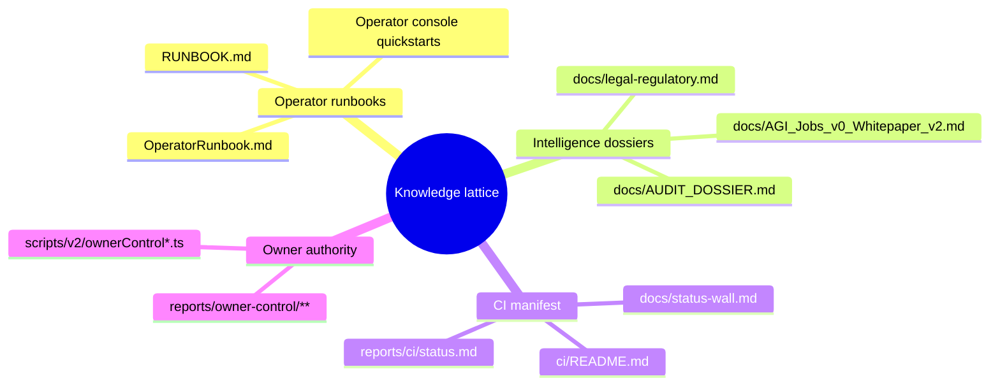
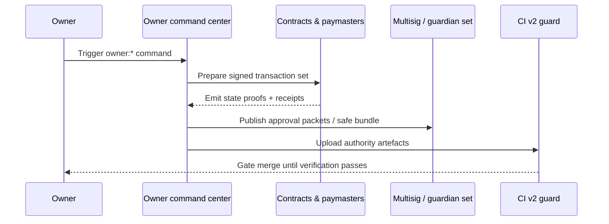

> **[SUCCESSOR Ω flagship — Build an advantage worth owning →](https://montrealai.github.io/AGIJobsv0/successor/mission/)** · [Français](https://montrealai.github.io/AGIJobsv0/successor/mission/fr/)
> Start with a valuable real mission. Use Computer Use to investigate it, discover and improve strategies, and examine whether a different formulation could unlock a better outcome. Keep the mission, methods, experiments and evidence as models change.
> **[Mission Studio guide](docs/successor/MISSION_STUDIO.md)** · [Native Computer Use and reproducible laboratory](docs/successor/COMPUTER_USE_LEVELS.md) · [Research-to-usefulness journey](docs/successor/FIND_YOUR_ALPHA.md).
> Free mission workspace · No account or wallet. Prepare an exact task for your own Computer Use runtime or an operator-led Work session. Keep your current approach until a better one earns the change.

# AGI Jobs v0 (v2)

**[Install the bounded Discovery receiver](docs/successor/DISCOVERY_INSTALLED_RELEASE.md)** · rc.21 targets the exact Alpha1.41 source and preserves the historical rc.20 release. Local zero-cap review; external execution and settlement require separate qualification.

## AGI Alpha Agent + AGI Jobs: one shared ecosystem

**Explore ideas. Define useful work. Check the result.** AGI Alpha Agent helps develop a promising plan; AGI Jobs supplies work orders, evidence, review and settlement rules. Their deployed Ethereum suites share **$AGIALPHA**, with 18 decimals on Ethereum mainnet:

**[0xA61a3B3a130a9c20768EEBF97E21515A6046a1fA](https://etherscan.io/token/0xA61a3B3a130a9c20768EEBF97E21515A6046a1fA)**

**[See how they work together →](https://montrealai.github.io/AGIJobsv0/ecosystem/) · [Inspect both current recorded suites: 5 Alpha + 25 Jobs contracts](https://montrealai.github.io/AGIJobsv0/ecosystem/#contracts) · [Read the ecosystem guide and source evidence](docs/ECOSYSTEM.md)**

The current Jobs directory uses the [version-pinned October 18 deployment snapshot](https://github.com/MontrealAI/AGIJobsv0/blob/284351148d96c5390a655aec1f9db806284f2400/docs/production/mainnet-2026-10-18/deployment-snapshot.json): all 25 contracts and deployed-source provenance. The snapshot records paused managed modules; current repository source equivalence is not assumed.

The pairing is strongest for bounded digital tasks with checkable outputs. A shared token does not create an automatic mainnet bridge: compatible job interfaces, admitted identities and operational commissioning remain necessary. The guide distinguishes recorded deployments from readiness for live work.

## Ideas behind the ecosystem

[Read four selected essays](https://montrealai.github.io/AGIJobsv0/#reading) on provider selection, demonstrated talent, invention and review economics. Each links to the current $AGIALPHA ecosystem guides. [Reading notes / Notes de lecture](docs/READING.md).

## New here? Start with one simple step.

**[Open the guided welcome page →](https://montrealai.github.io/AGIJobsv0/start/) · [Commencer en français →](https://montrealai.github.io/AGIJobsv0/start/fr/)**

**See it before you start:** [try a simple example](https://montrealai.github.io/AGIJobsv0/start/example/) · [essayer en français](https://montrealai.github.io/AGIJobsv0/start/fr/example/). Help a fictional local club improve its website: follow the request, compare two prepared pages and practice checking the result. No account, payment or technical knowledge is needed.

Choose what you want to do: request work, connect an agent, review a result, or explore. The three-step guide has plain language, large controls, optional larger text, and editable examples. Prepare and save a job draft without an account, wallet, installation or payment. Continue straight into the detailed planner when you are ready. This is a public planning preview; live jobs require a separately configured service.

**Easy to return to:** keep your progress when refreshing or switching English/French in the same tab, undo an example, and save or reopen your editable draft directly in the guide. Download a readable request or print it for someone helping you. Browser text preferences and enlarged text are supported, including narrow screens; storage restrictions are explained on the page.

**Help at every step:** open a short explanation beside the guide, edit your finished request directly, or copy it for someone helping you. If your browser cannot copy automatically, the guide selects a readable copy with clear instructions. Saved drafts and printing are available under labeled, keyboard-accessible sections, keeping the main path easy to follow in English and French.

[](https://github.com/MontrealAI/AGIJobsv0/actions/workflows/ci.yml)
[](https://github.com/MontrealAI/AGIJobsv0/actions/workflows/ci.yml?query=workflow%3A%22ci+%28v2%29%22+is%3Asuccess+branch%3Amain)
[](https://github.com/MontrealAI/AGIJobsv0/actions/workflows/static-analysis.yml)
[](https://github.com/MontrealAI/AGIJobsv0/actions/workflows/fuzz.yml)
[](https://github.com/MontrealAI/AGIJobsv0/actions/workflows/webapp.yml)
[](https://github.com/MontrealAI/AGIJobsv0/actions/workflows/containers.yml)
[](https://github.com/MontrealAI/AGIJobsv0/actions/workflows/orchestrator-ci.yml)
[](https://github.com/MontrealAI/AGIJobsv0/actions/workflows/e2e.yml)
[](https://github.com/MontrealAI/AGIJobsv0/actions/workflows/scorecard.yml)

AGI Jobs v0 (v2) brings together job contracts, agent gateways, validators, operator consoles, orchestration, simulations, and demos. The architecture aims to support verifiable agent work with owner-controlled governance and observable execution.

**Develop enduring mission intelligence:** [SUCCESSOR Ω local guide](docs/successor/README.md) · [Architecture and trust boundaries](docs/successor/architecture.md). Run `npm run successor:demo` to compile sealed work, examine an invoice, search executable world models, compare resource plans, and restore knowledge without permissions. Synthetic rehearsal does not establish independent proof or production authority.

**Start here:** [Local setup and role guide](docs/START_HERE.md) · [Production readiness and remaining blockers](docs/production/readiness.md) · [Demo guide and complete catalog](demo/README.md) · [Documentation catalog](docs/readme-catalog.md).

**Design useful work:** [Job planner](https://montrealai.github.io/AGIJobsv0/work/) · [Machine labor delivery workflow](docs/MACHINE_LABOR.md). Ten concrete work categories, exact proposal amounts, source boundaries and downloadable tasks compatible with the existing admitted computer-work adapter.

**Review delivered work:** [Evidence reviewer](https://montrealai.github.io/AGIJobsv0/review/) · [Review guide](docs/EVIDENCE_REVIEW.md). Compare the admitted task with a worker receipt, verify exact artifact bytes and record acceptance findings locally. Hash consistency does not establish provider provenance or authorize settlement.

**Run a reviewed validator:** [Service setup and recovery](apps/validator/README.md). Admit an exact chain/round/specification/result decision; retain reveal secrets before broadcast and reconcile uncertain outcomes after restart.

**Explore the demos visually:** [AGI Jobs Demo Observatory](https://montrealai.github.io/AGIJobsv0/) — searchable collection, individual demo pages, original guides and flowcharts, and a browser-only job walkthrough. [Website source and publishing instructions](website/README.md).

**Coordinate computer-based work:** the [computer-work integration](docs/computer-work.md) connects admitted jobs to isolated OpenClaw workers, including their configured native Codex Computer Use capabilities. Start with the [supplier-desk browser lab](demo/One-Box/computer-work/README.md): it produces real browser evidence and separately checks both a correct and an incorrect recommendation. Live workers require explicit task admission, protected credentials and independent acceptance review. The vision's **$40T/year** opportunity is a planning assumption, not a verified market-size or revenue claim.

**Exercise the production gates locally:** run `npm run production:rehearse` after dependency setup in a clean committed checkout. The [production rehearsal](docs/production/rehearsal.md) combines real cryptographic checks, HTTP fault injection, adversarial contract tests, and three settled local jobs into an inspectable, signed simulation report.

**Prepare a deployment:** use the [current Hardhat guide](docs/deployment-v2-agialpha.md) or the [plain-language coordinator guide](docs/production/nontechnical-mainnet-deployment.md). Start with `npm run deploy:local` after compiling: it selects an explicit disposable Hardhat fixture with separate creator, governor and treasury roles. Then use `npm run deploy:plan` for read-only public-network inspection. The current bounded authority audit cannot clear public activation; see the guide for the new-journal requirement and remaining qualification. The staged script preserves recovery evidence and hands off all eight managed modules paused.

**Seeing compiler warnings on Etherscan?** Read the [plain-language compiler update and existing-deployment guide](docs/production/compiler-warnings-2026-10-13.md). New builds use Solidity 0.8.37; existing addresses retain their original bytecode. The guide explains the four advisories, remaining dependency/tooling notices, and the steps needed before any replacement deployment.

**Deployment status:** the [source-pinned mainnet directory](docs/ECOSYSTEM.md#the-deployed-contract-directory) identifies the current recorded 25 Jobs contracts and 5 Alpha contracts, with full explorer links and separate readiness guidance. The four previously oversized Jobs contracts use [fixed implementations and staged deployment](docs/production/fixed-implementations.md). Live operations require their own authorization, commissioning and passing gates. Local tests do not provide mainnet certification. All existing architectural diagrams and demonstration surfaces are retained.

**Latest mainnet evidence:** the [October 18 version-pinned record](https://github.com/MontrealAI/AGIJobsv0/blob/284351148d96c5390a655aec1f9db806284f2400/docs/production/mainnet-2026-10-18/deployment-snapshot.json) records 25/25 runtime matches, 25 exact source-metadata matches and 46/46 named state checks at finalized block 26221285. All eight managed modules were paused; the creator owned none of the 25 contracts. Deployment configuration records `jobStakeBps=1000` (10%); only the listed getters were freshly rechecked. The [October 12 record](docs/production/mainnet-deployment-2026-10-12.md) remains historical and is not this deployment's configuration. Deployed source identity and current repository source identity remain explicit and separate.

```mermaid
flowchart LR
    classDef core fill:#f3e8ff,stroke:#7c3aed,color:#2e1065,stroke-width:1px;
    classDef guard fill:#dcfce7,stroke:#16a34a,color:#14532d,stroke-width:1px;
    classDef ops fill:#e0f2fe,stroke:#0284c7,color:#0c4a6e,stroke-width:1px;
    classDef owner fill:#fef3c7,stroke:#d97706,color:#7c2d12,stroke-width:1px;

    OwnerConsole[[Owner command center CLI]]:::owner --> AuthorityMatrix[Owner authority matrix<br/>`npm run owner:verify-control`]:::guard
    AuthorityMatrix --> Contracts{{Contracts + Paymasters}}:::core
    Contracts --> Agents{{Agent gateway & orchestrators}}:::core
    Agents --> Demos{{Demonstration suites + simulations}}:::core
    Demos --> Observability[[Observability fabric<br/>`reports/**`]]:::ops
    Observability --> CIStatus[[CI v2 status wall]]:::guard
    CIStatus --> BranchProtection[[Branch protection guard]]:::guard
    BranchProtection --> OwnerConsole
```



The loop above describes the intended verification path. CI checks owner authority manifests and generates telemetry artifacts; effective merge protection also depends on the repository rules. A passing test run does not replace contract deployability checks, deployment verification, or operational commissioning.

## Documentation lattice

The repository’s manuals, runbooks, and subsystem READMEs are catalogued in [`docs/readme-catalog.md`](docs/readme-catalog.md). Use it to locate operator instructions and subsystem diagrams. The [demo guide](demo/README.md) adds a generated inventory of every tracked demo directory and its nested guides; the [Demo gallery workflow](.github/workflows/demo-gallery.yml) rejects a stale demo inventory. Document indexing and test results establish their stated coverage, not automatic verification of every narrative claim.



Use the catalogue to jump directly into any subsystem; the documents are regenerated whenever directories shift so the map never falls out of sync with the codebase.

## Owner command authority

The contract owner controls the documented governance entry points. Owner-control commands produce reviewable artefacts (`reports/owner-control/**`), and CI checks the configured authority manifests. Effective merge enforcement additionally requires active repository branch rules; a workflow alone does not prevent an unchecked merge.

| Capability | Command | Output |
| ---------- | ------- | ------ |
| Prove governance posture | `npm run owner:verify-control` | Authority matrix, role bindings, guardian quorum reports. ([package.json](package.json)) ([ci.yml](.github/workflows/ci.yml)) |
| Pause or resume execution | `npm run owner:system-pause` / `npm run owner:emergency` | Transaction scripts + pause certificates ready for multisig execution. ([package.json](package.json)) ([systemPauseAction.ts](scripts/v2/systemPauseAction.ts)) |
| Reconfigure parameters | `npm run owner:parameters` | Parameter matrix CSV/JSON for rapid reprogramming across contracts, agents, and paymasters. ([package.json](package.json)) ([ownerParameterMatrix.ts](scripts/v2/ownerParameterMatrix.ts)) |
| Stage upgrades | `npm run owner:upgrade` / `npm run owner:upgrade-status` | Upgrade queue diffs, bytecode fingerprints, upgrade state proofs. ([package.json](package.json)) ([ownerUpgradeQueue.ts](scripts/v2/ownerUpgradeQueue.ts)) |
| Generate dashboards | `npm run owner:dashboard` / `npm run owner:command-center` | Owner dashboards, command plans, and compliance briefings for non-technical operators. ([package.json](package.json)) ([ownerCommandCenter.ts](scripts/v2/ownerCommandCenter.ts)) |

Owner commands have different side effects and prerequisites. Read the command-specific runbook before execution: live checks require RPC access, and transaction commands may write on-chain. Use only the preview and output flags supported by that command. Combine them with `npm run owner:plan:safe` to produce multisig-ready transaction bundles when deploying from custodial safes. ([package.json](package.json)) ([run-owner-plan.js](scripts/v2/run-owner-plan.js))



The resulting artefacts feed the `Owner control assurance` CI job and the branch protection guard so every production deployment is traceable back to an approved owner command path. ([ci.yml](.github/workflows/ci.yml))

## Release provenance lattice

Every release tag must be cryptographically attributable to the guardians who shepherd AGI Jobs v0 (v2). The `.github/signers/allowed_signers` register contains illustrative placeholders, not usable maintainer keys. Preserve the examples for reference and replace them with authorized SSH public keys before a production release. ([allowed_signers](.github/signers/allowed_signers)) Execute `npm run ci:verify-signers` to enforce actual OpenSSH key parsing, namespace scoping, and duplicate detection. This check intentionally fails on the shipped placeholders. ([package.json](package.json)) ([check-signers.js](scripts/ci/check-signers.js))

```mermaid
flowchart LR
    classDef register fill:#fef3c7,stroke:#d97706,color:#7c2d12,stroke-width:1px;
    classDef guardian fill:#dcfce7,stroke:#16a34a,color:#14532d,stroke-width:1px;
    classDef ci fill:#0ea5e9,stroke:#0284c7,color:#0f172a,stroke-width:1px;
    classDef release fill:#ede9fe,stroke:#7c3aed,color:#312e81,stroke-width:1px;
