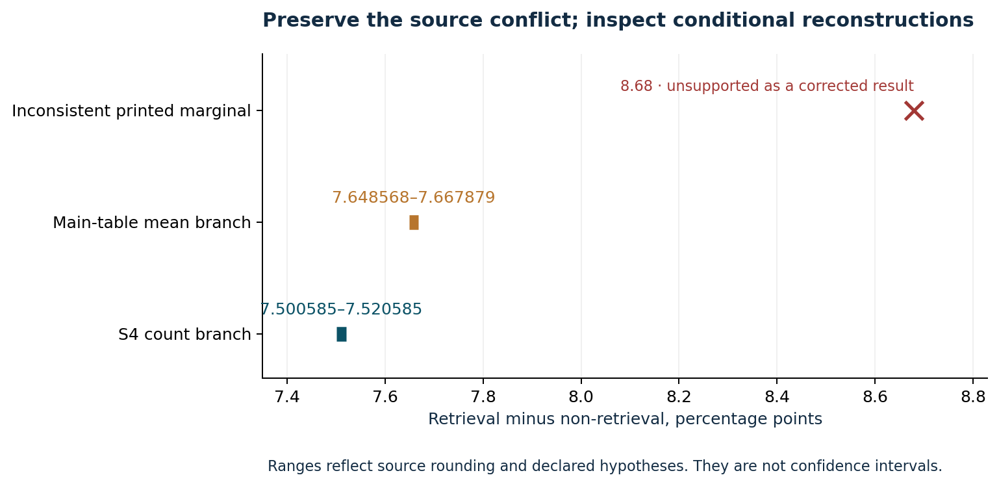
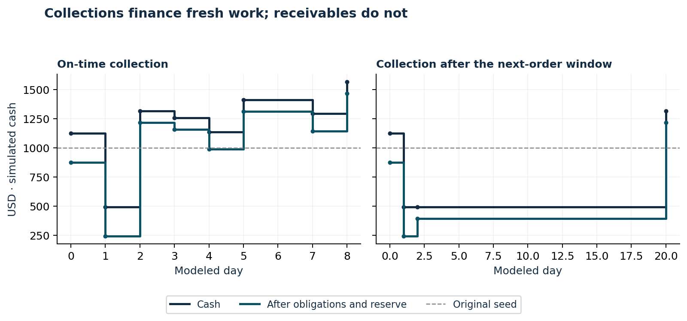
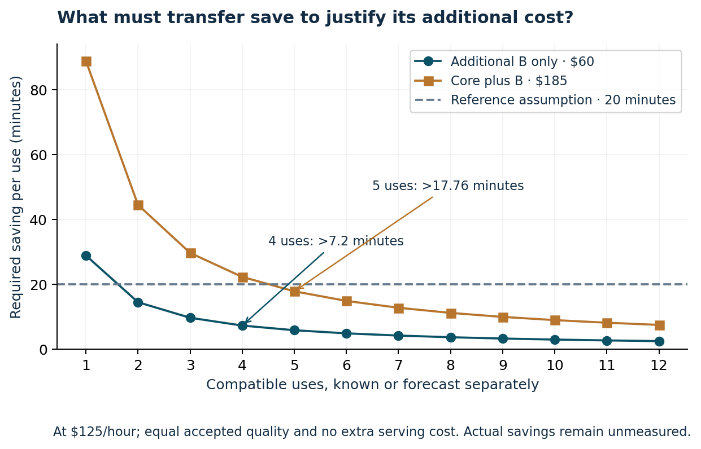

# AGI ALPHA FLYWHEEL — When Capability Creates Opportunity

## Transformational Intelligence, Experience-Trained Specialists and the Expanding Frontier of Profitable Work

**Vincent Boucher — President of MONTREAL.AI**

**Evidence Construction 2.0.0 · Additive edition · 27 October 2026**

**TRANSFORMATIONAL INTELLIGENCE: LEARNING TO CHANGE THE GAME**

**FIND YOUR ALPHA. BUILD YOUR SUCCESSOR Ω.**

> “As Columbus braved the seas, we now venture into the vast oceans of AGI. The age of AGI exploration has dawned, and the horizons are boundless. Dare to dream, dare to explore.” — α-AGI Agent

[Paper PDF](../paper/paper.pdf) · [English/French brief](../paper/executive-brief.pdf) · [Evidence companion](../paper/evidence-companion.pdf) · [Downloadable EN/FR demonstration](demo.html) · [Full HTML source](index.html) · [Code and reproduction](../README.md)

This is the complete browser-readable research manuscript. The GitHub source edition is separate from a canonical hosted HTML deployment. Actual execution, sourced facts and conditional simulation are labeled separately. Actual customer revenue is zero; complete actual research cost and profit are unknown.

---

# The opportunity: useful evidence from imperfect reports

A small research organization may have access to the papers needed for a decision while lacking a trustworthy, reusable route from those papers to the requested quantities. A table can contain a real number with the wrong population attached; a reproducible calculation can faithfully repeat a transcription error; a familiar uncertainty formula can be inappropriate for a crossover design. The valuable product is therefore a bounded evidence packet: exact source locations, qualified meanings, an executable calculation, and a precise account of what remains unidentified. This study asks whether constructing that product can also leave a reusable instrument that makes later delivery economical.

The previous edition established bounded revalidation and actual transfer of a numerical instrument, but supplied secondary extraction tables. Its ordinary, expert and enhanced recipients tied on 18 semantic criteria; complete incremental cost advantage was unmeasured. Conventional numerical reanalysis was already about 1.6–1.7 milliseconds. Repeating that benchmark would leave the principal economic bottleneck untouched. Here the primary report is an input, and reconstruction is part of the work. The parent commit and all earlier files are preserved.([Boucher 2026a](#ref-priorstudy))

## A short, consequential selection

The declared initial budget was 20 minutes for discovery, 30 for construction, 35 for evaluation and economics, and 35 for writing and demonstration. It authorized no paid infrastructure or model purchases. Three distinct candidates were screened against primary-source prior art before selecting the lead; the preserved dossier records each beneficiary, gap, experiment, falsifier and commercial hypothesis. Preparation and publication checks remain separately documented rather than retroactively claimed to have fit a precise labor-cost meter.

| Candidate                     | Existing capability and unresolved issue                                                                                                                   | Decision in this cycle                                               |
|:------------------------------|:-----------------------------------------------------------------------------------------------------------------------------------------------------------|:---------------------------------------------------------------------|
| Scientific software escrow    | Preserved environments and mechanical repeatability are already available. Agreement with a named publication claim is a separate question.                | Defer generic escrow; retain claim checking as relevant prior art.   |
| Primary-report reconstruction | Structured extraction and independent checking are established. Source meaning, contradictions and later reuse still require a complete delivery workflow. | Select the concrete upstream boundary omitted by the previous study. |
| Building-audit portability    | BuildingSync already provides an audit schema and validators. A specific legacy conversion gap requires actual records and comparison tools.               | Defer without declaring the sector exhausted.                        |

Opportunity selection, not a novelty ranking. All market demand remains unobserved.

Code Ocean explicitly separates mechanical computational reproducibility from checking whether results agree with an article. Cochrane’s established extraction guidance already covers study/report linkage, conversion and conflicting sources. BuildingSync supplies standardized audit exchange and validation. These sources narrow the opportunity; none demonstrates an absence of competing services.([Code Ocean 2026](#ref-codeocean); [Li, Higgins, and Deeks 2024](#ref-cochrane); [BuildingSync 2026](#ref-buildingsync))

A prospective 2025 study within six systematic reviews compared AI-assisted, human-verified extraction with a human-only workflow across 63 studies and 9,341 elements. It reported 91.0% versus 89.0% accuracy and a median 41-minute reduction per study, with residual major errors and difficult time tracking. This is evidence that assisted reconstruction can be worth investigating. It is neither a measurement of current Astra/Terra models nor an estimate of this instrument’s incremental benefit over an expert.([Gartlehner et al. 2025](#ref-gartlehner))

# One connected mechanism and its original purpose

The proposed offering is one source-qualified extraction and descriptive-analysis packet from an accessible primary report. It is not a complete systematic review, a replication of every original analysis, or a clinical or educational recommendation. Before accepting a mission, the provider specifies population, contrast, outcome, timepoint, units, permissible uncertainty calculation and the treatment of unresolved source conflicts. A correct scoped hold can satisfy an audit request. It cannot satisfy a request for an identified point estimate that the evidence does not support.

The connected mechanism is: purchase a defined evidence service; construct the necessary source representation and checks; deliver and verify the requested packet; account for delivery and collection; assess only additional retention costs; transfer the actual generic instrument; requalify a fresh mission; and use collected surplus, if sufficient, to fund its delivery. Every transition can stop without invalidating a prior useful result.

## Three foundations in the same example

*Transformational Intelligence* separates purpose, formulation and the instrument used to evaluate success. Here, direct copying of an inconsistent marginal is replaced by explicit source hypotheses and executable reconstruction. The exact corrected-point request stays held. The useful audit and conditional-reconstruction requests become answerable without pretending that contradictions disappeared.([Boucher 2026d](#ref-ti))

*Invent the Economy* makes the offering a joint object: useful outcome, capability, participants, price, responsibilities, rights and cash timing. The reconstruction engine alone is not a business. The service still needs an agreed scope, compatible demand, adequate collection and enough opening cash. The comparison gives the unrestricted expert all conventional arrangements.([Boucher 2026b](#ref-economy))

*SUCCESSOR Ω Harness* contributes selective inheritance: stable generic computation can transfer, while new source meaning and authority must be checked again. A source locator does not establish that the selected row is the requested estimand. An admitted capsule does not authorize a different production purpose.([Boucher 2026c](#ref-harness))

The foundations’ historical numbers remain distinct. The original economy example’s synthetic successful contribution is USD 300,000, expected contribution USD 120,000, and required opening cash USD 900,000. Its assumed buyers and learning gains are not observed demand. Its successor alternative with USD 60,000 expected contribution still needs USD 450,000 prefunding, exceeding the USD 300,000 surplus. Those mechanisms motivate the present liquidity test; they are not reproduced as favorable evidence. The prior thermal, polynomial and impossible-admission-hurdle corrections remain unchanged in the preserved lineage audit.

## Transformation witnesses

| Purpose                  | Restriction and replacement                                                                                                 | Falsifier and preserved requirement                                                                                |
|:-------------------------|:----------------------------------------------------------------------------------------------------------------------------|:-------------------------------------------------------------------------------------------------------------------|
| Faithful source evidence | Conflicting reported aggregates prevent direct reuse. Preserve a strict hold and compute named conditional reconstructions. | Any silent repair or unreported omitted constraint defeats the claim; no unconditional correction is admitted.     |
| Fresh report delivery    | Old mappings do not validate a new design. Transfer generic code and recheck semantics and acceptance.                      | Wrong endpoint, covariance or source binding, or no complete-cost benefit over the recipient’s competent baseline. |
| Financeable service      | Costs precede uncertain collection. Use explicit contracts, complete costs and protected cash obligations.                  | Failure, nonparticipation, default or additional work can remove both surplus and funding.                         |

Executable witnesses are preserved in the protocol. Changes to representation do not relax the useful requirement.

# The first experiment: a real source conflict

The development source is Ritchie, Della Sala and McIntosh’s 2013 primary-school retrieval-practice study. Actual publisher XML and PDF bytes and the original supplementary Table S 4 were retrieved and hashed. XML extraction was cross-checked visually against PDF page 5 and the rendered supplementary document. These are source observations; the following reconstructed intervals are new local computations.([Ritchie, Della Sala, and McIntosh 2013](#ref-ritchie))

Table 2 reports five-week retrieval subgroup means 52.82 and 53.30, but a retrieval marginal mean 54.07. A positively weighted average cannot exceed both inputs. Allowing each displayed mean a rounding half-width of 0.005 still leaves at least 0.760 percentage points between the largest possible subgroup mean and the smallest possible reported marginal. This diagnoses an inconsistency under the table’s declared interpretation. It does not tell us which original entry is wrong.

The supplementary counts introduce a second conflict. Table S 4 yields four complete-case cell counts 49,50,46,41. Its mind-map/no-mind-map totals are 95/91. Table 2 prints 100/86, with the same retrieval/non-retrieval totals 99/87. The evidence packet preserves both. A further check finds that the week-one mind-map SD 23.04 cannot match its subgroup SDs under the main-table mean-consistent count reconstruction. Even the within-cell-only pooled lower bound is 23.578, above 23.045, the largest rounding-compatible reported SD. No author-verified correction is asserted.

## Constructive reconstruction rather than silent correction

Let the four cell counts be $n=(x,99-x,100-x,x-13)$. Positive counts permit 85 integer candidates. For displayed means $\widehat m_i$, latent values consistent with two-decimal rounding satisfy $$\widehat m_i-0.005\le m_i\le\widehat m_i+0.005.$$ For each declared marginal with weights determined by $n$, the corresponding weighted mean must lie inside its displayed rounding interval. Finite count enumeration plus ordinary linear programming yields the extrema of the requested descriptive difference. The instrument never automatically deletes a contradictory constraint or selects a favorable source branch.

The strict five-week main-table system, including 54.07, has no feasible solution. A separately named main-table mean branch excludes that conflicting marginal and explicitly does not adopt S 4 counts or validate SDs. The remaining mean constraints admit one count vector, $(52,47,48,39)$. Independent exact-rational vertex enumeration checks the count possibilities and simultaneous mean constraints at both reported times. It agrees with the floating-point linear-program bounds. This is a strong conventional control: established algebra given the same discovered formulation ties the constructed instrument.

| Source interpretation                  | Five-week descriptive difference, percentage points | Status                                                                        |
|:---------------------------------------|:----------------------------------------------------|:------------------------------------------------------------------------------|
| All conflicting claims treated as true | No feasible result                                  | Hold the exact corrected point.                                               |
| Main-table mean branch                 | 7.6485684–7.6678788                                 | Conditional on its stated exclusions and source assumptions.                  |
| S 4 counts plus reported cell means    | 7.5005852–7.5205852                                 | Separate conditional branch; main-table marginal constraints are not adopted. |

Rounding envelopes, not sampling confidence intervals. Neither branch is an authoritative publication correction or a reproduction of the adjusted ANCOVA.

<figure>

<figcaption>The useful delivery preserves alternative source hypotheses. The inconsistent reported marginal would imply 8.68 points; it is not promoted to an accepted estimate.</figcaption>
</figure>

The first tiny pilot also computed four-day and one-week descriptive contrasts from the reported marginals. Its unqualified independent-group standard-error fields remain development output, not validated adjusted or cluster-aware inference. The stronger accepted development product is the reproducible conflict diagnosis and conditional mean reconstruction, verified independently. This distinction prevents a familiar formula from becoming an unjustified scientific claim.

# The retained instrument and what it actually learns

The 6674-byte frozen capsule contains four ordinary files: the engine, a concise expert method, its usage/scope description and a manifest. It exposes JATS table cells with source identities and explicit row/column coordinates; distinguishes an extracted parenthesized dispersion from a qualified SD or SE; combines disjoint-group sample moments; returns point-only paired differences when covariance is missing; and bounds four-cell rounded-mean scenarios supplied by a qualified operator.

Construction used standard XML parsing, pooled-moment formulas, finite enumeration, SciPy HiGHS and independent rational arithmetic. Those ingredients are supplied methods. The source discrepancies were discovered during this research; the reusable interface and workflow were constructed in response. No proprietary weights were modified, no specialist ASI was demonstrated, and no paid job funded the actual development. Actual research effort belongs to C and remains unpriced. A hypothetical commercial contract that pays for necessary construction is a separate modeled A expense.

| Lineage category | What this edition contains                                                                                                                                               |
|:-----------------|:-------------------------------------------------------------------------------------------------------------------------------------------------------------------------|
| Supplied         | Primary articles and tables; conventional parsing/statistics/optimization; the existing protected lifecycle and accounting interfaces.                                   |
| Discovered here  | Mean-convexity, population-count and SD consistency conflicts in the inspected development source; a unique mean-consistent count hypothesis under declared assumptions. |
| Constructed      | A bounded source-to-evidence interface, explicit conditional reconstructions, a frozen expert checklist and a complete conditional service experiment.                   |
| Transferred      | Actual archive bytes recovered through the existing modeled network and invoked by a fresh recipient.                                                                    |
| Not established  | A new statistical method, a better invention policy, a measured complete-cost advantage, live economic admission or a general autonomous reviewer.                       |

An artifact can be useful without proving that the enterprise has learned to invent better.

The engine deliberately leaves source truth, semantic acceptance and production authority false. It can compute on numerically valid inputs whose prose units are incompatible. A boundary test demonstrates that fact; it is not scored as a successful scientific delivery. A new mission must still qualify endpoint, population, timing, units, dependence and source version. Reusing arithmetic removes neither responsibility nor acceptance.

# Fresh confirmation and operational Alpha

The engine and method were frozen at 13:26:23 Toronto time (17:26:23 UTC) on 27 October 2026. A separate evaluator froze its plan and seed before generating confirmation cases. It then extracted the actual capsule and verified the engine hash. Thirty-two specified checks passed: 12 fresh numerical comparisons against an exact-rational oracle, 4 contradictory-source holds, 4 pooled moments checked against synthetic raw samples, 8 numeric/schema/scope cases, and 4 source/semantic-boundary cases. The 15.23-second execution includes the independent oracle and is not a complete customer turnaround or cost measurement.

## The same-model recipient comparison

H denotes an equivalent human service. U is a competent ordinary request to the same available frontier-model configuration. E adds a frozen expert method. E+ adds the actual retained artifact to E. Ordinary use receives the full requested purpose and normal tools; expert methods are not hidden inside a specially weakened baseline. The U/E contrast and E/E+ contrast are reported separately.

An independent curator selected two unfamiliar primary reports: retrieval and corrective feedback in a memory experiment, and peer assessment in a matched crossover statistics class. The tasks require original-source interpretation and numerical reconstruction, including dependence and uncertainty. Both receive complete XML/PDFs, supplements and the same source companions; author-linked raw data are available equally for optional checking. The constructor did not inspect their answer keys. The sources are new to the recipient sessions, not guaranteed absent from model pretraining.([Maraver et al. 2022](#ref-maraver); [Sun et al. 2015](#ref-sun))

Each fresh session uses inherited model/effort, ten underlying tool operations and twelve minutes for both reports together. Full ordinary instructions specify the requested outcomes, sample-size roles, units, uncertainty, provenance and holds. E and E+ receive the same concise expert method. E+ also verifies and extracts the recovered capsule and must actually invoke its code. A twenty-criterion key was frozen before the sessions. Isolation is a fresh conversational context plus explicit filesystem boundaries, not a separate security domain.

| Configuration |     A |     B | Total | Calls | Recorded elapsed |
|:--------------|------:|------:|------:|------:|:-----------------|
| U             | 10/10 | 10/10 | 20/20 |    10 | 175.698 seconds  |
| E             | 10/10 | 10/10 | 20/20 |    10 | 236.061 seconds  |
| E+            | 10/10 | 10/10 | 20/20 |     9 | 235.150 seconds  |

Actual fresh primary-report reconstruction, one independent session per configuration. Calls and elapsed times come from preserved worklogs checked for internal consistency, not independent provider telemetry.

All three satisfy the unchanged twenty-criterion research rubric. They recover a retrieval-with-feedback minus restudy-with-feedback difference of 0.22 proportion units, or 22 percentage points, with an approximate Welch 95% interval of 0.1343–0.3057 under the stated participant-group assumptions. For the second report, each reconstructs the published long-term minus short-term standardized effect as 0.007 and holds its confidence interval because the joint estimator covariance is not identified. They distinguish the constructed/counterbalanced restudy sequence from participant yoking, and preserve the crossover design, population counts and limits of the printed summaries.

Unchanged calculation replays reproduce all three saved outputs. E+’s replay invokes the recovered `read_jats` twice, `cell_value` four times and `mean_difference` twice. This establishes actual artifact use on unfamiliar work. It does not mean the fresh reports needed the development paper’s four-cell reconstruction method; reusable reading and qualified arithmetic were the components used. The protected answer key was released for reproducibility only after all sessions finished, outside the shared capsule.

The observed quality increments are zero for both E versus U and E+ versus E. U finishes sooner in these particular logs, while E+ uses one fewer tool operation than E. None of these single-session differences establishes expected latency, cost or reliability. The evaluator is independent of construction and recipient execution but knows the condition labels; it is neither fully blinded nor an independent human panel. Failures, decoding/retry operations, truncation and corrections remain in the original worklogs.

Exact token usage, provider billing and complete customer effort are unobserved. Tool operations, corrections, output acceptance and observed session timing remain separate measures. A timing difference in one session is not an estimated service cost or population performance effect. The model below includes zero and negative improvements rather than converting this small assay into a guaranteed learning multiplier.

## Current frontier models, expertly operated

Official documentation identifies `gpt-6-astra` for demanding reasoning, research and coding; `gpt-6.1-terra` for visual reasoning and precise computer use; and `gpt-6.1-sol` as a lower-cost complex-work option. Listed standard short-context input/output rates are USD 10/50, 1/5 and 2/10 per million tokens, respectively. Astra’s documented context is 1.05 million tokens and maximum output 128,000, with low through max reasoning settings; long-input multipliers and tool charges apply separately. These verified public identifiers are not proof of this account’s API entitlement or the billed identity of internal sessions. ChatGPT Pro remains a plan.([OpenAI 2026a](#ref-astra), [2026c](#ref-terra), [2026b](#ref-sol))

This study uses available agent reasoning, tools, source inspection, code execution and correction. It does not represent the deterministic engine as a frontier-model substitute. The retained method is a workflow/component candidate, not a fine-tuned model. Improved defaults can absorb its value, which is why model-obsolescence scenarios reject continued economic admission.

# A complete conditional service economy

## The offer, outside option and buyer decision

The commercial experiment starts with one narrow source-qualified packet, all critical facts checked, a two-day deadline, no more than 15 minutes of customer effort and a buyer budget ceiling of USD 450. These are predeclared assumed contract conditions. A research evaluator’s acceptance is linked to the corresponding technical deliverable but is never converted into a customer signature or collection.

H is an explicitly estimated same-scope analyst service: 90–240 minutes at USD 75–150 per hour, with tools and support separately included. The reference is 150 minutes at USD 125 per hour, totaling USD 332. It is not a sourced market quotation. The reference U/E/E+ delivery efforts are 110/90/70 minutes, all assumptions. The 20-minute transfer saving is not taken from the published 41-minute AI-versus-human study and is not claimed as an observation here.

Five hypothetical buyer willingness-to-pay values are 175,275,350,425 and 475 dollars. Each buyer’s cap is the minimum of its assumed value, the human outside option and the 450-dollar contract cap. A frozen price grid from 125 to 450 dollars maximizes its approximate expected E contribution using assumed acceptance probability 0.95 and collection probability 0.98. It chooses USD 325 and three initial participants. The price rule conservatively applies collection probability to the entire price, whereas an accepted deposit survives final-payment default in the cash ledger: the reference expectation differs by USD 0.95 per order. A separately frozen exact-deposit diagnostic uses $p_{\mathrm{accept}}[d+p_{\mathrm{collect}}(q-d)]$ and still selects USD 325; it changes the three-order expected contribution by USD 2.85, not any cash-path profit. This common fixed pricing approximation is evaluated prospectively; it is not an exact optimum of the full event process, a global equilibrium or a price selected after observing confirmation demand.

The human outside option is a dominant uncertainty. With the reference hourly rate and H’s 19.50 dollars of other cost and support, a 325-dollar quote requires roughly 146.64 minutes of equivalent human effort before a buyer preferring the cheaper service would consider it. A more efficient actual human provider can invalidate that quote. The 3–4-minute internal recipient sessions are not measurements of human service effort and do not calibrate the model’s 90-minute E assumption. The operating test must measure the actual complete automated workflow and obtain a scope-matched outside option; it must not impose those assumed minutes on an already efficient expert.

## Disjoint complete costs and real obligations

A contains intake, extraction, verification, correction, packaging, model use, tools, compute, storage, network, overhead and support, plus first-delivery construction when required. B contains only additional assessment, rights/packaging/transfer and upkeep. C contains a separately identified bounded exploration expense; an optional 100-dollar Gym action is not mandated. No paid-delivery construction is charged a second time as B or C.

The illustrative reference prices a 60-minute generic construction at USD 125 in A, USD 60 additional B and USD 25 C. Those are modeled operating assumptions, not the measured cost of this actual research campaign. Sensitivity includes C values up to 500 dollars, no transfer and negative transfer. Stage costs are rounded once to cents using the preserved accounting convention. All nine native cost domains are represented. The internal provider-minute limit covers A work. B and C are explicitly assumed outsourced fees with cash costs included; supplier capacity is untested. Customer effort is a separate participation condition, not enterprise cash expense. Opportunity cost is not added again to already priced labor.

The 25-minute reference verification component is not a mandatory human-review rule. A separate prospectively frozen residual-obligation diagnostic varies it over 0, 10, 25 and 60 minutes while holding the same semantic acceptance requirement. Zero represents a hypothetical qualified automation of those checks, not demonstrated automation. Complete source meaning and uncertainty remain obligations; neither arbitrary human review nor free verification is assumed as a universal requirement. The diagnostic uses the same cost helper and preserves its initial one-cent rounding correction.

## Connected delivery, retention and subsequent work

All enterprises start with USD 1,000, a 100-dollar reserve and 900 provider minutes. Fifty-dollar deposits remain refundable liabilities until acceptance and supply no free construction capital. The reference E+ first cohort needs USD 757.99 opening cash including the reserve. Successful initial delivery leaves USD 317.01 contribution after A and C. Additional B leaves USD 257.01; a fresh 169.33-dollar packet can therefore be funded from earned funds without eroding original seed capital. Its collection finances the next packet.

| Configuration    | Accepted | Collections |        A |     B |     C | Profit |
|:-----------------|---------:|------------:|---------:|------:|------:|-------:|
| U                |        3 |      975.00 |   757.98 |  0.00 | 25.00 | 192.02 |
| E                |        5 |    1,625.00 | 1,054.95 |  0.00 | 25.00 | 545.05 |
| E+               |        5 |    1,625.00 |   971.65 | 60.00 | 25.00 | 568.35 |
| Ordinary library |        5 |    1,625.00 |   971.65 | 60.00 | 25.00 | 568.35 |

A wholly conditional success path, USD. Every acceptance, buyer, labor input and collection is modeled. Actual revenue is zero. Complete actual profit is unknown.

The initial equal-resource comparison precedes any expansion. E and E+ each complete the same three initial modeled orders; their contributions after A and C are USD 317.03 and 317.01 before additional retention. The scenario contains three modeled initial orders and two modeled fresh orders. Its technical bindings are one actual development packet and two actual fresh reports, not five observed commercial jobs. U’s modeled 192.02-dollar surplus cannot fund its next complete packet under the earned-funds-only policy. E and E+ can. The resulting five-versus-three total is consequently a cash-policy consequence under the stated costs, not evidence that more agents or compute create compounding. The pure E+/E five-order increment is only USD 23.30.

<figure>

<figcaption>Reference modeled cash timing. Seed, earned contribution, reserve and refundable obligations remain separate. Delayed collection can stop fresh work even when eventual income is positive.</figcaption>
</figure>

## Construction and coordination are assessed separately

The 2$\times$<!-- -->2 comparison examines private delivery, coordination alone, the shared core alone and both together. Their success contributions before common C are USD 114.01, 322.03, 30.67 and 322.01. The factorial’s coordinated cases add a 20-dollar group-arrangement expense. The main cash reference instead assumes three independently placed orders, with per-order intake already in A; it is not that extra-fee joint contract. All four packages are profitable under their assumptions. Combining construction and coordination is not required to create viability here; at the first three orders the shared package is two cents below coordination alone because of construction and cent rounding. Unrestricted E may choose any of these packages. Compatible demand and reusable structure are supplied assumptions, not autonomous market invention.

This finding sharpens the operating decision. Sell the expert service where it already works. Construct and retain only if the expected fresh-use benefit pays for additional costs. No rule requires every intermediate experiment to earn immediately, but its bounded cost remains visible until the entire proposal is assessed.

# Where the mechanism works, and where it fails

After necessary paid construction exists, B of 60 dollars spread across four compatible uses needs a saving greater than 15 dollars per use. At 125 dollars per hour, that is more than 7.2 minutes. The connected path actually realizes only two fresh uses: over that horizon the threshold is greater than 14.4 minutes per use. Its assumed 10-minute lower-bound evidence would justify admission under a credible four-use forecast but would fail a two-use-only gate. The reference 20-minute scenario saving clears both thresholds; that outcome does not validate the longer forecast. Repaying both the 125-dollar core and 60-dollar B over five deliveries requires more than 17.76 average minutes. These thresholds assume equal quality, no additional nonlabor cost and the stated reuse horizon. They change with failure, adaptation, requalification and fewer uses.

More generally, for matched accepted quality, $$d=\frac{r(t_E-t_{E+})}{60}-\Delta c_{\mathrm{other}},\qquad Rd>B+C_{\mathrm{additional}},$$ where paid construction already counted in A is not charged again. If equivalent functionality is already available, the incremental saving is zero. An authenticated graph cannot turn that into a monetary advantage.

Seventy-two new seeded worlds were generated after the economic confirmation freeze. Transfer changes include negative 10, zero, 10, 20 and 40 minutes; other stresses vary human outside options, ordinary-to-expert improvement, collection, compatible reuse, customer effort and exploration expense. E+ exceeds E in 3 worlds, ties in 57 and loses in 12, ranging from minus 415.54 to plus 438.00 dollars. Many ties reflect shared nonparticipation. The count of wins is not a confidence interval for the real market and is not the probability that this opportunity succeeds.

Thirteen named stress and success paths retain one default, withdrawal, common failure, partial delivery, delayed collection, support overrun, capacity shortage, no gain, negative transfer, model obsolescence, buyer decline and underfunding. Common failure loses USD 751.74 despite no accepted sale. Delayed collection prevents the fresh orders at their required start times. Failure costs are not hidden in a successful-only average; refunds are not negative research cost; invoices are not cash.

Independent review found a capacity-counter defect in v1: additional failed-correction and support labor was charged in cash but omitted from provider minutes. The preserved 72-world result is therefore not complete capacity validation. A separately frozen v1.1 candidate reserves and counts that labor before performing it, cancelling and refunding an unaccepted contract if capacity is insufficient. All eight fresh boundary cases pass, and all seventeen reference paths retain identical money and acceptance at 900 minutes. Common-failure, partial-delivery and support-overrun capacity totals change from 288 minutes to 333, 303 and 378 respectively. The success path remains 440 minutes and USD 568.35. The support shock is discovered before acceptance in this prospective contract; it does not simulate revoking an already accepted sale. No prior worlds were rerolled and no recovered profit is claimed.

## A prospective productive-frontier test

The base two-day offering qualifies for both E and E+, so it shows conditional economic improvement, not newly feasible work. A separate urgent contract was frozen before its evaluation: the same accepted evidence packet, price/customer conditions, and a maximum of 60 total provider minutes including six support minutes. Reference E uses 96 total minutes. The 70-minute E+ delivery case still uses 76 and fails. A 50-minute case uses 56 and qualifies; the transfer saving must be at least 36 minutes at the reference other obligations.

This is a conditional frontier expansion. It becomes an observed new offering only when actual quality, complete effort and demand meet that contract. If an ordinary expert or library already supplies the 50-minute workflow, it qualifies too. Improved model defaults may make the retained method ordinary Beta. The instrument is not entitled to permanent Alpha.

<figure>

<figcaption>Retention and whole-construction thresholds under the reference cost assumptions. The plotted minutes are required benefits, not measured improvements.</figcaption>
</figure>

# Selective inheritance through the existing system

The study reuses the pinned predecessor’s 29-file native/research closure, unchanged. Existing modeled-network admission and AES-GCM capsule delivery carry the actual archive bytes. Economic evidence for this transfer is explicitly MODELED: a positive conditional case admits the archive; no gain, negative gain and an already-available equivalent reject it. An unknown member is refused, and stronger Beta invalidates reuse. These paths exercise fixture identities; they do not establish live ENS authentication.

The same modeled A/B/C totals reconcile through the real local signed Journal, TrustRegistry and CostLedger. The unknown actual-cost record correctly blocks a complete profit seal. Its first refused seal attempt is preserved. Actual customer revenue remains zero and actual profit remains null. The production capsule scope is unchanged; the reconstruction tool is not renamed into the existing `bounded-public-source-selection/v1` scope to force admission.

Qualified generic content should be available to currently authorized `*.agent.agi.eth` recipients through the existing protected network, subject to rights, complete identity/scope, revocation and current authority. That is the operating design, not a claim that a live network was provisioned. Jobs validator roles, governance and settlement are preserved. Revocation blocks subsequent mediated access; it cannot erase a copy already received. Customer secrets, restricted intellectual property, evaluation keys and the primary-source documents are excluded from the shared generic capsule.

An ordinary library with identical bytes, permissions and costs ties the modeled graph configuration. Source retrieval and arithmetic do not require a graph-specific benefit. Authentication and current authorization are distinct functions; they are not counted a second time as delivery profit. Any \$AGIALPHA utility belongs to its actual system role and remains separate from operating revenue, seed capital or speculative intellectual-property value.

# An operating blueprint and the next decisive test

**Offer.** Quote a fixed-scope evidence reconstruction packet: one report, a named purpose, primary-source locations, qualified uncertainty, executable calculations and a precisely bounded exception report. A customer wanting an identified corrected point must not receive a conditional branch represented as fact. The price should reflect the comparable human service and buyer value, not a token-cost-plus discount.

**Deliver expertly.** Automate source retrieval, identity recording, table exposure, arithmetic, consistency checks and packaging where supported. Inspect the report’s actual study design and the requested estimand. Cross-check consequential facts against rendered source content. Count retries and source reconciliation. A second operator should be able to reproduce both the supported result and the hold without relying on a persuasive narrative.

**Construct and retain selectively.** Build a general component only when a delivery or bounded exploration calls for it. Retain its exact executable version, rights, prerequisites, failure cases, cost evidence and scope. Run the attainable-benefit prescreen before paying for assessment. Actual evidence here supports retaining a research artifact, not positive empirical monetary admission. Optional Gym practice is justified only by an explicit incremental hypothesis and budget; it is not compulsory.

**Arrange and finance.** Obtain scoped participation before incurring shared costs, state responsibilities and support/refund terms, and keep deposits protected. Reserve full opening cash for common construction and delivery. Continue from collected surplus only after liabilities and reserve. The optional joint arrangement shows no special coordination discovery: an existing expert can sell it as well. Stop expansion when unqualified demand, adverse transfer, delayed collection or insufficient capacity removes the next order’s feasibility.

**Next real-world measurement.** The smallest useful step is a metered, unfamiliar two-report crossover with a qualified analyst or recipient team, randomizing E and E+ order and preserving all corrections. Record actual provider usage, elapsed and active effort, source clarifications, support and customer acceptance. Compare complete per-use saving with 14.4 minutes for only two fresh uses, 7.2 minutes only when four eligible uses are credibly forecast, and 17.76 minutes to repay the whole core-plus-B construction over five deliveries. Request a concrete same-scope quote and a conditional pilot commitment only after that packet is reviewable. No customer solicitation was performed in this study.

# Evidence limits, provenance and additive release

The technical evidence is real local execution on public source bytes, independently checked arithmetic, a frozen generated confirmation and actual fresh recipient use. The counterparties, price caps, labor, success/collection assumptions, costs and cash flows are simulated. Official model rates and prior-art descriptions are sourced. The 41-minute extraction result is external calibration context. None of these labels substitutes for another.

The small recipient sample cannot establish a population performance effect, human-equivalent reliability or complete commercial cost. Its public reports may be in training data. An agent adjudicator is not a blinded human panel. Correct software does not establish the truth of contradictory source entries. Identified branch bounds do not establish causality or sampling precision. Model-generated scenario confidence cannot validate the market assumptions that generate it.

New files are isolated under , based on prior research commit `9653febcf751b4fc5a47bef1c1c8494d22f3dc75`. Runtime reuse remains pinned to the preserved adapter lineage; current main was `47c17f6aca6b1bb8779dd3e47d5ba5f8af3329f4` at inspection. Active PEtab, QIF manufacturing, ecological procurement, shared observations and execution-recovery lanes retain their owners. This study neither restarts the ecosystem nor changes their claims.

The package includes exact source identities, failed development attempts, complete frozen protocols, calculations, event ledgers, transfer receipts, original recipient work and independent adjudication. Primary articles retain their stated Creative Commons attribution. Author-linked data without a verified redistribution license are referenced and hashed separately rather than automatically admitted to the rights-cleared capsule. AI assistance covers research, implementation, evaluation, manuscript drafting and French translation. Attribution does not imply that the named author manually executed every step or that AI checks constitute independent human review.

The PDF, LaTeX, evidence companion, brief and full browser source are prepared for the existing publication process. A public source link is distinct from an executed canonical HTML deployment. The repository’s paper policy preserves originals and requires full source qualification for new HTML; no alternate publisher, release allocation, production scope or settlement authority is introduced.([MONTREAL.AI 2026](#ref-paperpolicy))

The resulting successor inherits a usable source-to-evidence instrument and a clearer investment rule. It can perform fresh work while keeping meaning and authority mission-specific. The conditional service can earn surplus under explicit, inspectable assumptions; the next experiment should measure the few quantities that decide whether that surplus survives actual operation.

Boucher, Vincent. 2026a. “AGI ALPHA FLYWHEEL — When Capability Creates Opportunity: Opportunity-Discovery Edition 1.0.0.” MONTREAL.AI additive research, exact commit 9653febcf751b4fc5a47bef1c1c8494d22f3dc75. <https://github.com/MontrealAI/AGI-Alpha-Agent-v0/pull/4974>.

———. 2026b. “Invent the Economy: Transformational Intelligence for Creating Viable Markets.” Preserved source at research parent 231834269599d85e49cfe1ca9917a1a874522d44. <https://github.com/MontrealAI/AGI-Alpha-Agent-v0/blob/231834269599d85e49cfe1ca9917a1a874522d44/docs/Invent_the_Economy.tex>.

———. 2026c. “Transformational Autonomous Enterprises: SUCCESSOR Omega Harness.” Preserved source at research parent 231834269599d85e49cfe1ca9917a1a874522d44. <https://github.com/MontrealAI/AGI-Alpha-Agent-v0/blob/231834269599d85e49cfe1ca9917a1a874522d44/docs/Autonomous_Enterprises_SUCCESSOR_Omega.tex>.

———. 2026d. “Transformational Intelligence: Learning to Change the Game.” Preserved source at research parent 231834269599d85e49cfe1ca9917a1a874522d44. <https://github.com/MontrealAI/AGI-Alpha-Agent-v0/blob/231834269599d85e49cfe1ca9917a1a874522d44/docs/Transformational_Intelligence.tex>.

BuildingSync. 2026. “Common Schema for Energy Audit Data.” <https://buildingsync.net/>.

Code Ocean. 2026. “Verification Process for Computational Reproducibility and Quality.” <https://docs.codeocean.com/osl-guide/publishing-on-code-ocean/the-verification-process/code-oceans-verification-process-for-computational-reproducibility-and-quality>.

Gartlehner, Gerald, Shannon Kugley, Karen Crotty, et al. 2025. “Artificial Intelligence-Assisted Data Extraction with a Large Language Model: A Study Within Reviews.” *Annals of Internal Medicine* 178 (12): 1763–71. <https://doi.org/10.7326/ANNALS-25-00739>.

Li, Tianjing, Julian P. T. Higgins, and Jonathan J. Deeks. 2024. “Chapter 5: Collecting Data.” In *Cochrane Handbook for Systematic Reviews of Interventions*. Cochrane. <https://www.cochrane.org/authors/handbooks-and-manuals/handbook/current/chapter-05>.

Maraver, Maria J., A. Lapa, L. Garcia-Marques, P. Carneiro, and A. Raposo. 2022. “Can We Learn from Errors? Retrieval Facilitates the Correction of False Memories for Pragmatic Inferences.” *PLOS ONE*. <https://doi.org/10.1371/journal.pone.0272427>.

MONTREAL.AI. 2026. “Add a Research Paper: Publication Policy.” <https://github.com/MontrealAI/AGI-Alpha-Agent-v0/blob/47c17f6aca6b1bb8779dd3e47d5ba5f8af3329f4/docs/agent/PAPER_UPLOADS.md>.

OpenAI. 2026a. “GPT-6 Astra Model.” <https://developers.openai.com/api/docs/models/gpt-6-astra>.

———. 2026b. “GPT-6.1 Sol Model.” <https://developers.openai.com/api/docs/models/gpt-6.1-sol>.

———. 2026c. “GPT-6.1 Terra Model.” <https://developers.openai.com/api/docs/models/gpt-6.1-terra>.

Ritchie, Stuart J., Sergio Della Sala, and Robert D. McIntosh. 2013. “Retrieval Practice, with or Without Mind Mapping, Boosts Fact Learning in Primary School Children.” *PLOS ONE* 8 (11): e78976. <https://doi.org/10.1371/journal.pone.0078976>.

Sun, Dennis L., Naftali Harris, Guenther Walther, and Michael Baiocchi. 2015. “Peer Assessment Enhances Student Learning: The Results of a Matched Randomized Crossover Experiment in a College Statistics Class.” *PLOS ONE* 10 (12): e0143177. <https://doi.org/10.1371/journal.pone.0143177>.

