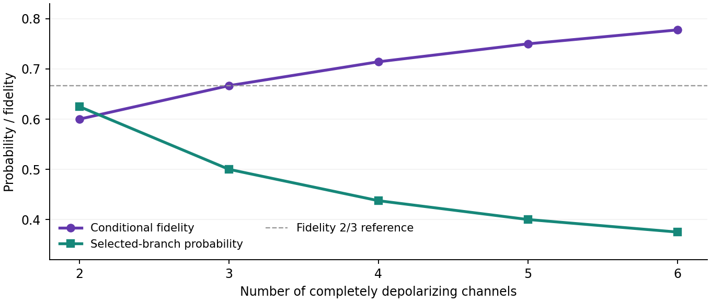
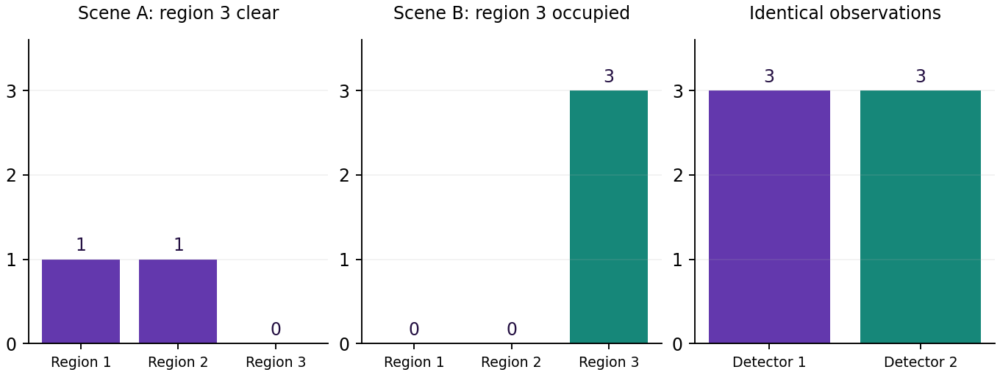

# 🌌♾️ AGI ALPHA FLYWHEEL — When Capability Creates Opportunity

## Transformational Intelligence, Experience-Trained Specialists and the Expanding Frontier of Profitable Work

**Vincent Boucher — President of MONTREAL.AI**

**TRANSFORMATIONAL INTELLIGENCE: LEARNING TO CHANGE THE GAME**

**FIND YOUR ALPHA. BUILD YOUR SUCCESSOR Ω.**

> “As Columbus braved the seas, we now venture into the vast oceans of AGI. The age of AGI exploration has dawned, and the horizons are boundless. Dare to dream, dare to explore.” — α-AGI Agent

**27 October 2026 · Frontier-search research edition 2 · Discovery gate not passed**

### Abstract

AGI ALPHA constructed an executable record that separates plausible opportunities from transformations actually supported by evidence. Two fresh model sessions received the same answer-free brief and declared search budgets. Their eight proposals were followed by four separately labeled mechanism searches. Eight bounded mathematical probes, primary-source comparisons, and a second quantum implementation made the decisions inspectable. The strongest constructed result reproduces a known quantum communication mechanism: four completely depolarizing channels, used in a coherent superposition of cyclic orders, yield a heralded branch with probability 7/16, conditional fidelity 5/7, and an entangled Choi state. That capability is already in prior art and therefore does not qualify as this study's discovery.

**None of the twelve candidates earns flagship selection.** Some broad proposals are anticipated; narrower product specifications remain unconstructed; several submitted guarantees fail under their own measurement assumptions. The negative result is bounded to this search, not a claim that the domains lack opportunity. The package preserves source provenance, original submissions, amendments, counterexamples, corrections, complete code, and local lifecycle artifacts. Commercial delivery, Operational Alpha, retained Alpha, and beyond-human foresight remain unestablished. No customer collections occurred. Actual research expenditure is unknown; a separate cost model provides transparent planning estimates without converting hypothetical value into earned revenue. The successor inherits specific exclusions and reopening experiments, not a manufactured breakthrough.

## 1. What the frontier requires

A productive frontier expands when an agent constructs an output or arrangement that existing approaches cannot adequately supply under the original obligations. More persuasive prose, a faster familiar solver, or a new name for backup capacity does not satisfy that standard. The research question is therefore two-part: what valuable possibility was absent from the supplied brief, and what substantive difference from identified prior art would make it achievable?

This edition applies that standard before investment or flagship selection. The user supplied the mission, methodological requirements, ecosystem, and exclusions. The agents supplied candidate mechanisms, search queries, prior-art comparisons, mathematical probes, and rejection decisions. No application was installed as the intended answer. The selected offering field remains empty because a defensible selection would require novelty, usefulness, technical construction, and commercial plausibility together.

The verified progress is methodological and evidential. It helps the successor avoid specific unsupported claims and specifies what evidence would reopen them. We do not present that progress as the new productive capability requested for the flagship. A competent human or conventional research process could perform these checks; no advantage over such a process has been measured.

### Additive relationship to the ecosystem

The source audit pins main to `47c17f6aca6b1bb8779dd3e47d5ba5f8af3329f4`. The foundational Transformational Intelligence study supplies the obligation to preserve purpose while changing a binding restriction. Invent the Economy separates technical feasibility, participation, profit, liquidity, and actual exchange. Transformational Autonomous Enterprises supplies mission-relative reuse and fresh authority checks. Their finite demonstrations and economic assumptions remain their own evidence [F1–F3].

The refreshed coordination record preserves the #4960/#4961/#4963 implementation lineage, discovery work #4972/#4975, and publication ownership #4973/v1.46.1. It records active #4988 research-access infrastructure and the negative or qualified boundaries of #4989–#4993. Two active proposals use the same opportunity-construction directory; this edition uses a distinct frontier-search namespace. Previous continuity, battery, microscopy, manufacturing, reserve, archive, and coordination work remains supporting lineage. Its profit, acceptance, or transfer counts are not imported here [F4].

## 2. A bounded discovery comparison

The initial brief and protocol were frozen before the two sessions. Each session could submit four candidates across at least three domains, using at most twelve search queries, eight page-open attempts, and 2,400 narrative words. U used a competent ordinary frontier-search approach. E used explicit decomposition around a binding restriction, transformation witness, strongest comparator, falsifier, and commercial mechanism. Both were hosted sessions on the same inherited model route; a vendor snapshot and token-billing receipt were unavailable.

| Element | Frozen rule or observed boundary |
|---|---|
| Initial information | Identical answer-free brief and known occupied-study exclusions |
| Evaluation | Novelty, usefulness, technical feasibility, and commercial plausibility reviewed separately |
| Selection | All four dimensions defensible; otherwise preserve the failure |
| Search execution | U: 12 queries and 8 opens; E: 12 queries and 8 opens |
| Human comparator | No recruited human expert; no model session represented as human |
| Sample size | One session per arm; four proposals each |
| Follow-up | Four additional proposals in separate development searches; not added to U or E |

A shared amendment added newly identified occupied families from #4990. It reached E after four queries and U after the query/open allowance was exhausted. Its content was identical, but timing was not. This imbalance, differences in accessed material and reading depth, unknown hidden compute, and the single-session design prevent a clean causal estimate of expert-search superiority. Several source opens failed; access gaps are retained. Root-level verification and later searches are separate from the declared arm budgets.

This is a prospective record of candidate generation within the session, not a leakage-controlled historical replay. There was no held-out future commercial outcome. No intended opportunity was hidden in a prompt and later “discovered.” Conversely, absence from either four-candidate sample does not demonstrate absence from human foresight. Confidence intervals for a population discovery rate would be misleading because these proposals are neither independent random draws nor validated observations of all available opportunities.

The common brief has SHA-256 `68520318112e8103061be86091db4fc7d8a21a3fa936fe3355bcbe17730ae4cc`. The original U/E submissions remain unchanged after review. The exact query logs, amendment receipt, source-access status, and before/after digests are supplied with the study.

## 3. Twelve proposals, separate judgments

Usefulness is treated as a beneficiary-linked hypothesis until an output is accepted. A technically important problem is not automatically a commercially useful product. Likewise, absence of a novelty claim does not imply that an established technology is commercially worthless.

### 3.1 Frozen ordinary-search proposals

| Candidate and intended beneficiary | Specific proposal and strongest comparison | Decision and reopening requirement |
|---|---|---|
| U1. Absolute-time genomic recorder; cell-biologists studying inaccessible histories | Add reference symbols to distinguish signal duration from variable DNA-writing speed. DNA Typewriter, ENGRAM, and peCHYRON already supply ordered/event recording [B1–B3]. | Shared unknown writer rate admits a time-warp ambiguity. Reopen with a physically independent, calibrated clock and a blinded test under changing writer activity. |
| U2. Closed-channel microreactor with a selective internal membrane; synthesis laboratories | Combine multi-material hollow printing with an internal separation surface. Existing embedded extrusion and thin-film DLP already construct relevant hollow/multi-material geometry [M1–M2]. | Generic geometry is anticipated. The narrower pressure-tight selective membrane is unconstructed; a distinct material mechanism and a pressure/selectivity coupon are required. |
| U3. Single-exposure passive long-wave infrared spectral cube; nonrepeatable-event imaging | Recover unrestricted spectral radiance from one compressed exposure. Thermal upconversion and snapshot spectral imaging are established components [I1–I3]. | The submitted 64-by-192 measurement model has a nullspace. Reopen only with extra independent information or an explicit defensible scene class; neither is a discovery by itself. |
| U4. Recover intact polymer streams from stretch textiles; recyclers | Preserve all streams from cotton/polyester/elastane mixtures. Selective elastane treatment and polycotton processing already have primary demonstrations [T1–T3]. | Broad selective recycling is anticipated. Intact ternary recovery remains unmeasured; a distinct selectivity window and polymer-retention/solvent-cycle evidence are needed. |

U2 and U4 are deliberately not marked “the full proposed product already exists.” The identified art covers important broad capabilities, while the narrower unmet specifications remain open in this dossier. No substantive mechanism that fills those narrower gaps was constructed.

### 3.2 Frozen expert-search proposals

| Candidate and intended beneficiary | Specific proposal and strongest comparison | Decision and reopening requirement |
|---|---|---|
| E1. Recover PFAS fluorine into fluorinating reagents; waste processors and chemical users | Turn destruction residue into a useful chemical input. The 2025 phosphate-enabled mechanochemical study explicitly constructs fluoride reuse [C1]. | Central transformation anticipated. A different feedstock/process capability with complete waste, energy, separation, and product-quality evidence would be needed. |
| E2. Regenerated dry-storable cement binder; demolition recyclers and builders | Recover a hydraulic binder from mixed fines without conventional high-temperature clinker production. Electrochemical cementitious recovery, precursor production, and C–S–H synthesis/regeneration are identified comparators [C2–C5]. | No distinct reactive precursor or bonding mechanism established. Dry storage followed by water-only strength development is a useful specification, not a demonstrated invention. |
| E3. Guaranteed clearance of a hidden region; operators needing safe access | Infer clearance despite ambiguous passive optical transport. Known passive non-line-of-sight methods are comparators [I4–I5]. | A positive transport example gives the same data for a clear and occupied specified region. A sound method may abstain; this does not refute all useful clearance certificates. |
| E4. Heralded quantum transmission through erasing channels; quantum-link developers | Coherently superpose four cyclic channel orders. A 2021 theoretical construction and 2025 chip demonstration already supply the central result [Q1–Q2]. | Reproduced exactly and rejected for novelty. Reopening requires a separated capability regime and a resource-matched coherent-control comparison, not a small parameter variation. |

### 3.3 Follow-up mechanism searches

The first follow-up investigated rank-only diffraction and arbitrary-scan Wigner-distribution deconvolution. Pairwise ordinal diffraction robust to rank-preserving response distortions is directly anticipated by Mroueh's 2014 construction [P1]. A finite probe also shows that rank data alone cannot identify absolute intensity scale. This does not refute recovery up to scale or phase.

Phasebook poses an explicit arbitrary-scan WDD question [P2]. Live WDD and compressive low-dose scanning are already demonstrated directions [P3–P4]. Our disconnected-scan example preserves every measured intensity while changing the relative phase of separate components. It identifies an obstruction, not a solution to the open problem. A generic irregular-scan solver would be an algorithm extension without an established new productive outcome.

The final follow-up examined hard-contact response derivatives and abort-resistant common randomness. A boundary-flux correction recovers the exact derivative 0.5 where an almost-everywhere pathwise derivative gives zero; that is known boundary calculus. Grazing produces derivatives 5, 50, and 500 as the parameter approaches zero, defeating a universal finite-derivative promise. Recent contact-gradient methods remain the required comparators [D1–D3].

For randomness, a valid committed bit plus a reveal-or-fallback rule lets a participant force output zero in both honest-bit cases. The proposed template fails even after allowing a prior commitment phase. This is a two-case attack on that template, not a universal impossibility theorem. The separate one-round lower bound has explicit security-model assumptions, retained in the source dossier [R1–R2].

**All twelve proposals remain unselected.** The candidate inventory is an exploratory dossier, not a complete patent search or proof of global non-novelty. The post-hoc adjudicator also authored E; its assessment is not a blinded external review. Mathematical reruns and source evidence carry more weight than model agreement.

## 4. A connected example with an honest stopping point

The quantum candidate provides the most complete constructed example. Its trace runs from a plausible opportunity through a precise transformation, numerical implementation, prior-art rejection, and research-only lifecycle packaging. The trace stops before a useful new offering or earned revenue. That stopping point is part of the result.

### Transformation witness

| Witness field | Recorded meaning |
|---|---|
| Original useful purpose | Preserve unknown quantum information across a noisy link |
| Binding restriction | Any definite sequence of completely depolarizing channels erases input dependence |
| Proposed change | Coherently control cyclic channel order and postselect the control outcome |
| Preserved obligations | Preserve quantum coherence/entanglement; report herald probability; include coherent-control resources and failed attempts |
| Numerical acceptance | Reproduce the channel on a complete set of qubit test states; verify Choi entanglement and exact success probability |
| Commercial acceptance | A real link must meet throughput, loss, control-stability, verification, customer, and total-cost requirements |
| Novelty falsifier | Identified prior work already constructs the same capability, or the proposed extension follows directly from it |

For N identical completely depolarizing qubit channels and uniform cyclic-order control, the unnormalized accepted map is:

`Phi_N(rho) = I/(2N) + ((N-1)/(4N)) rho`.

Thus `p_N = (N+3)/(4N)`, the conditional pure-state fidelity is `(N+1)/(N+3)`, and the minimum eigenvalue of the normalized Choi partial transpose is `(3-N)/(2(N+3))`. These formulas describe the known construction [Q1]. A negative eigenvalue certifies entanglement of this two-qubit Choi state; it is not a measured field-link rate or an unrestricted capacity theorem.

| Channels N | Herald probability | Conditional fidelity | Minimum partial-transpose eigenvalue |
|---|---|---|---|
| 2 | 0.625000 | 0.600000 | 0.100000 |
| 3 | 0.500000 | 0.666667 | 0.000000, within floating precision |
| 4 | 0.437500 | 0.714286 | −0.071429 |
| 5 | 0.400000 | 0.750000 | −0.125000 |
| 6 | 0.375000 | 0.777778 | −0.166667 |

The originating code enumerates Pauli Kraus operators. The independent numerical implementation uses replacement operators `|a><b|/sqrt(2)` and checks six input states for N=2 through 6. All five parameter cases agree with the closed form within 1e−11. The N=4 experimental paper reports fidelity 0.712 ± 0.013 on a programmable silicon-photonic chip [Q2]; our calculation is not that hardware experiment.

A follow-up proposed distinct full-rank replacement channels. At the known depolarizing point, positive herald probability and a strict negative partial-transpose eigenvalue persist under sufficiently small continuous perturbations. Mere existence of heterogeneous examples is therefore an immediate consequence of the prior construction. An illustrative four-state calculation confirms that neighborhood and also exposes input-dependent herald probabilities. It is recorded as a rejected refinement. Coherent control of paths is an additional required comparator because communication activation is not unique to an indefinite-order description [Q3].

### What customers could value, and why that remains unaccepted

A customer would value verified quantum transmission per unit time, cost, and physical resource under realistic loss and control errors. Conditional fidelity alone is insufficient. Failed heralds consume channel uses, hardware, time, and often verification effort. The study has no operating link, buyer acceptance, throughput evidence, hardware bill, or credible selling-price calibration. Consequently it assigns no venture profit to the quantum calculation. Known scientific usefulness does not establish a new AGI ALPHA offering.

## 5. Counterexamples that preserve the task's meaning

The probes are intentionally small enough to inspect. Their scope matters as much as their numerical outputs.

**A shared molecular writer does not supply an independent clock.** In the submitted model, both event and reference hazards share an unknown rate g(t). A monotone time change preserves the ordered symbol distribution. The supplied two-hour and four-hour signal histories have the same expected reference count 10, signal count 4, and recording-clock event interval [2,4]. A reference with an independently known physical rate is outside this counterexample. The result does not invalidate DNA recording generally.

**A compressed unrestricted cube retains a nullspace.** A positive 64-by-192 operator has rank 64 and nullity 128. Two everywhere-positive radiance vectors differ by approximately 4.08% in relative norm while their predicted measurements differ by at most 3.33e−16. This is a generic operator, not a calibrated optical instrument. Eight fresh positive 12-by-36 cases reproduce the same class of ambiguity. Adding prior structure can change identifiability, but that structure must be part of the disclosed task.

**Regional clearance differs from whole-room vacancy.** For the positive matrix with rows [1,2,1] and [2,1,1], scenes [1,1,0] and [0,0,3] both produce [3,3]. Region 3 is clear in the first scene and occupied in the second. A sound certificate must return unknown for that observation. Both scenes are occupied globally. With a known strictly positive operator and nonnegative scene, a zero observation does identify a wholly empty scene. The original regional witness must not be inflated into a claim about every vacancy-detection method.

Eight fresh regional operators preserve the ambiguous ROI interval [0,3]. The independent confirmation contains 8 spectral cases, 8 regional cases, and 5 quantum parameter cases. These 21 checks validate numerical statements and their limits. They are not 21 independent discoveries, human comparisons, or accepted customer jobs. Separate original and follow-up scripts reproduce all eight probe families, including scale, disconnected phase, contact grazing, and selective abort.

## 6. Commercial evidence and research economics

Commercial delivery is a separate gate, not a reward for an impressive calculation. No candidate in this edition reached a qualified, accepted, novel offering. Consequently the commercial ledger records no selling price, qualified demand, customer acceptance, or recognized revenue. Customer value is hypothesized in the candidate records; it is not booked as provider income. Preliminary candidate unit examples remain explicitly partial arithmetic and cannot support complete profitability claims.

| Quantity | This edition's evidence |
|---|---|
| Selected qualified offering | None |
| Accepted customer deliveries / sales volume | 0 / 0 |
| Actual customer collections | 0 |
| Simulated customer receipts | 0; no venture sales simulation promoted |
| Complete actual research cost | Unknown; hosted inference, tool allocation, and review billing unavailable |
| Actual operating profit | Unknown; zero receipts do not make research free |
| Credible profitable launch region | Not established |
| Earned cash available for optional learning | 0 from this study's collections |

### Human-led comparison and complete-cost boundaries

The executable economic model estimates a comparable broad research scan, not a market price for a new invention. Its North American, October 2026 low/central/high cases itemize prior-art work, domain reasoning, mathematical or software probes, and preparation; optional specialist review is priced separately. Wage anchors and benefits are distinguished from researcher assumptions about hours, specialist premiums, business overhead, tools, and duration. It does not assume that expensive human research would succeed, that AI succeeds at lower cost, or that a buyer would purchase the result.

| Planning case | Person-hours | Compensation, overhead and tools (USD) |
|---|---|---|
| Low | 46 | $3,418.33 |
| Central | 84 | $10,363.26 |
| High | 154 | $32,475.19 |

These are broad-scan estimates [H1–H4], excluding physical experiments, customer work, exhaustive prior-art clearance, and full-paper production. They are neither service selling prices nor confidence intervals.

AI planning scenarios use explicit input/output-token and tool assumptions. Official `gpt-6-astra` standard pricing is $10/$50 per million input/output tokens for the documented base tier; long-context, caching, service tier, and tools can change the bill [A1]. These scenarios are not the session's bill. Optional specialist review is a separate research investment, not a mandatory manual charge inserted into an automated configuration. No consumer subscription is treated as unlimited automated inference.

| Planning case | Assumed input / output tokens | Assumed total (USD) |
|---|---|---|
| Low | 250,000 / 25,000 | $4.75 |
| Central | 1,000,000 / 150,000 | $32.50 |
| High | 5,000,000 / 500,000 | $145.00 |

These are illustrative multi-request budgets, not estimates of actual usage, complete commercial delivery costs, or evidence of observed human/AI savings. All modeled requests remain within the documented base context tier.

All unpaid exploration and necessary construction in this edition is Category C research. There was no originating paid delivery A and no selected additional retained-capability investment B. Preserving research evidence does not transform that work into paid-job learning. Rejected-candidate effort remains in the enterprise research scope. An actual total cannot be reconstructed by setting unknown costs to zero.

### Participation, pricing, and the option to stop

The best supported launch decision is to defer all twelve candidate ventures. This is an evidential decision, not a numerical proof that no profitable price exists. An unknown selling price and unknown demand cannot yield a robust profitable region. Higher prices would require participation evidence; no demand curve is held fixed while a price rises. A 50%-of-human-service package is inapplicable because no equivalent new-offering market price was established.

For a bounded next investigation, the model uses the transparent option threshold `p × V > C`: p is the assumed probability of reaching a decision-changing result, V its incremental value, and C the full additional cost. Cases include p=0 and V=0. Neither parameter is inferred from these twelve proposals. This is a way to expose an investment assumption, not evidence of profitable delivery or a command to spend. Existing research costs are sunk for that forward-looking decision and remain in total enterprise accounting.

## 7. Insight, Nova-Seed, FusionPlan, and MARK

The actual pinned main components are reused locally. The bridge carries the quantum hypothesis, exact prior-art rejection, measured synthetic results, source hashes, rights information, uncertainty, and a next-experiment specification through the existing research lifecycle. The resulting Nova-Seed preserves a rejected hypothesis. The FusionPlan is a plan for further qualified research; it is not an executed venture. MARK-related payload inspection remains local and does not mint, list, trade, settle, or move funds.

The local integration passed **19/19 checks**: eleven source/lifecycle checks and eight companion-guard refusals of unsupported qualification, novelty, transaction, minting, listing, live identity, execution authority, or cash claims. Seven native JavaScript files are pinned by SHA-256 and Git blob identity. The encrypted Nova-Seed opens to the same genome, FusionPlan proofs verify, and hypothetical MARK quote arithmetic runs. These checks validate the research handoff and refusals; they do not re-execute hardware physics or establish a venture.

Native schema acceptance must not be confused with scientific qualification. Where the component's schema does not express the novelty gate, the companion research manifest explicitly keeps `qualified_venture=false`. Cryptographic commitments bind bytes and provenance; they do not establish scientific truth, novelty, commercial acceptance, or foresight accuracy. No live ENS identity, production authorization, or new validator role is asserted.

The unmerged #4988 Insight extension was inspected at exact head `095c11fe33522be6c0e2d7a00043d7bbb5bcb457`. It already supplies search-freeze, submission, review, assessment, research-seed, and research-plan concepts. Its dependency closure was not executed here. An exact exercise plan documents how the result can enter that owner-managed path. No competing registry or production pipeline is introduced.

## 8. Operational Alpha, retention, and successor work

The requested comparisons remain separate. H is a costed human-led research pathway, without a human trial. U and E are actual hosted search sessions, each with zero selected candidates. The design is too small and uneven to estimate a numerical Operational Alpha effect. There was no fresh accepted commercial task on which E could be compared with U. E+ was not admitted as a retained specialist, and no numerical retained-Alpha effect is claimed.

The network can inherit source-linked exclusions, exact probe code, scope corrections, and reopening specifications. These are ordinary research assets. A directory containing the identical files supplies the same information; no graph-specific or cryptographic moat follows. No model weights were trained or accessed. Additional Gym work should begin only after a specific capability hypothesis and complete incremental investment case exist. Cross-agent availability through authenticated `*.agent.agi.eth` remains subject to actual authorization; fixture labels confer none.

The successor instruction is concrete: **REUSE stable structure. RECHECK the new mission's meaning. REGRANT authority separately.** A new beneficiary or signal class changes the task and requires a fresh witness. Adding an external clock, extra sensor, trusted beacon, or stronger scene prior may be legitimate, but its resources and changed assumptions must be explicit.

### Smallest useful next validation

Before another full venture build, obtain a two-page mechanism proposal for one narrow unresolved specification. The dry-storable mixed-fines binder is a useful example of an unresolved specification, not the chosen flagship. The proposal must name a reactive precursor or bonding mechanism different from the identified recovered lime/silica routes, give a mass/charge balance, and predict a measurable difference from composition-matched conventional controls.

The next gate is a primary-art and chemical-feasibility check, followed only if warranted by a small coupon study. Required outcomes would include storage stability, water-only strength development, energy and recovery accounting, and real mixed-feed composition. A comparison with freshly mixed recovered lime and silica is indispensable. Failure to identify a distinct mechanism ends that branch before equipment procurement or commercial pricing. No physical trial, purchasing, outreach, or permission expansion is authorized by the plan itself.

This successor task is deliberately narrower than “find another impressive application.” It asks for a missing productive mechanism and an experiment capable of rejecting it. Alternatively, a genuinely different mechanism can replace this example only through a new recorded discovery search, not by editing the failed candidate into a success.

## 9. Evidence, limits, and reproducibility

The study is AI-assisted research prepared under the requested author line; author review remains appropriate before formal submission. Source access ranges from full text to author abstracts and search excerpts. Paywall, redirect, and challenge failures remain recorded. The candidate review is not an exhaustive prior-art or patent opinion. General impossibility is not inferred from a finite toy instance. Scientific novelty, commercial usefulness, and legal freedom to operate are distinct questions.

Official documentation was checked on 27 October 2026 for `gpt-6-astra`, `claude-fable-5-1`, and `gemini-4-argon` [A1–A3]. Their vendor positioning and prices do not establish mission-specific superiority. Only the inherited hosted route was executed; other vendors were not tested. Exact backend snapshot, temperature, random seed, effective reasoning configuration, and itemized inference cost were not exposed. Local numerical work used Python 3.12.14 and NumPy 2.3.2. Deterministic probe seeds, source digests, and reproduction commands are supplied.

The frozen confirmation file predates the independent numerical run. It specifies eight spectral cases, eight regional cases, N=2–6 quantum checks, a seed of 20261027, and tolerance 1e−11. This is fresh implementation verification under known mathematical expectations, not a protected discovery benchmark. All earlier failures and narrower scope corrections remain available.

The research distribution contains the full candidate dossiers, exact code, configurations, model-access record, source registry, accounting model, local lifecycle results, publication handoff, and LinkedIn draft. `python reproduce.py` reruns the bounded study without model credentials or buyers. The standalone HTML reader and PDF present the same manuscript. Repository publication follows the existing owner process; research-source availability does not mean software release qualification or canonical Pages publication.

The earned conclusion is precise: this bounded effort made twelve opportunity proposals reviewable and executable where possible, and selected none. It leaves successors with sharper tests and preserved evidence. It does not yet answer the mission with a novel, profitable productive capability.

## References and source boundaries

**[B1]** [A time-resolved, multi-symbol molecular recorder via sequential genome editing](https://www.nature.com/articles/s41586-022-04922-8). primary paper search excerpt.

**[B2]** [Symbolic recording of signalling and cis-regulatory element activity to DNA](https://www.nature.com/articles/s41586-024-07706-4). primary paper search excerpts; full-text open failed.

**[B3]** [Open-ended molecular recording of sequential cellular events into DNA](https://www.nature.com/articles/s41589-024-01764-5). primary paper search excerpts; PMC open challenged.

**[M1]** [Additive manufacturing of multi-material and hollow structures by Embedded Extrusion-Volumetric Printing](https://www.nature.com/articles/s41467-025-62057-6). primary paper search excerpt; full-text open failed.

**[M2]** [Thin-film DLP 3D printing of multi-material parts with closed-cell internal voids](https://www.nature.com/articles/s44334-026-00076-x). primary paper substantive open.

**[I1]** [High resolution up-conversion imaging in the 10 micrometre band under incoherent illumination](https://arxiv.org/abs/2505.24367). primary author preprint search abstract; peer review not verified.

**[I2]** [Passive Incoherent Ultrafast Mid-Infrared Upconversion Imaging and Its Calibration](https://arxiv.org/abs/2602.04483). primary author preprint abstract open; peer review not verified.

**[I3]** [Mid-infrared snapshot spectral imaging via nonlinear radial dispersion](https://www.nature.com/articles/s41467-026-74263-x). primary paper search excerpt; full-text open failed.

**[T1]** [Selective chemical disassembly of elastane fibres and polyurethane coatings in textiles](https://pubs.rsc.org/en/content/articlehtml/2023/gc/d3gc02994h). primary paper HTML/PDF search excerpts; HTML open forbidden.

**[T2]** [DES formulation for recycling synthetic fibre textile waste containing elastane](https://pubmed.ncbi.nlm.nih.gov/42456595/). primary author abstract at PubMed; substantive open.

**[T3]** [Polycotton waste textile recycling by sequential hydrolysis and glycolysis](https://www.nature.com/articles/s41467-025-55935-6). primary paper search excerpt.

**[C1]** [Phosphate-enabled mechanochemical PFAS destruction for fluoride reuse](https://www.nature.com/articles/s41586-025-08698-5). blocked publisher.

**[C2]** [Scalable electrified cementitious materials production and recycling](https://pubs.rsc.org/en/content/articlehtml/2024/ee/d4ee03529a). primary publisher search excerpt.

**[C3]** [Low-emission cement clinker precursor production, enabled by electrolytic extraction of calcium from waste cement](https://www.nature.com/articles/s41467-025-64339-5). primary publisher search excerpt.

**[C4]** [Electrochemical Synthesis of Calcium Silicate Hydrate for Low Carbon Cement](https://pubs.acs.org/doi/10.1021/acsenergylett.5c04150). primary publisher search excerpt open blocked.

**[C5]** [Closed-loop electrochemical regeneration of calcium silicate hydrate from waste cement](https://papers.ssrn.com/sol3/papers.cfm?abstract id=7498193). author preprint search excerpt open blocked.

**[I4]** [Using Unknown Occluders to Recover Hidden Scenes](https://openaccess.thecvf.com/content CVPR 2019/html/Yedidia Using Unknown Occluders to Recover Hidden Scenes CVPR 2019 paper.html). primary conference search excerpt open blocked.

**[I5]** [Multi-modal Non-line-of-sight Passive Imaging](https://arxiv.org/abs/1807.02444). author paper abstract read.

**[Q1]** [Quantum and Classical Data Transmission through Completely Depolarising Channels in a Superposition of Cyclic Orders](https://arxiv.org/abs/2005.00618). author paper abstract read PRL2021.

**[Q2]** [Experimental demonstration of genuine quantum information transmission through completely depolarizing channels in a superposition of cyclic orders](https://arxiv.org/abs/2510.07127). author preprint abstract read.

**[Q3]** [Communication through coherent control of quantum channels](https://arxiv.org/abs/1810.09826). author paper search excerpt.

**[P1]** [Robust Phase Retrieval and Super-Resolution from One Bit Coded Diffraction Patterns](https://arxiv.org/abs/1402.2255). primary source; see dossier.

**[P2]** [Phasebook: a survey of selected open problems in phase retrieval](https://link.springer.com/article/10.1007/s43670-025-00117-0). primary source; see dossier.

**[P3]** [Wigner Distribution Deconvolution Adaptation for Live Ptychography Reconstruction](https://arxiv.org/abs/2212.01309). primary source; see dossier.

**[P4]** [Simultaneous High-Speed and Low-Dose 4-D STEM Using Compressive Sensing Techniques](https://arxiv.org/abs/2309.14055). primary source; see dossier.

**[D1]** [Differentiable Simulation of Hard Contacts with Soft Gradients for Learning and Control](https://proceedings.iclr.cc/paper files/paper/2026/hash/44039e59aaf6a41b16f1fc5b27bcd409-Abstract-Conference.html). primary conference paper abstract.

**[D2]** [Ku Onoda, Paavo Parmas, Manato Yaguchi, Yutaka Matsuo. Does “Do Differentiable Simulators Give Better Policy Gradients?” Give Better Policy Gradients? ICLR 2026](https://proceedings.iclr.cc/paper files/paper/2026/hash/4f0a2a0b2ca6ffd5c8d5de26d3e8d54d-Abstract-Conference.html). primary conference paper abstract.

**[D3]** [iLQR for Piecewise-Smooth Hybrid Dynamical Systems](https://arxiv.org/abs/2103.14584). primary author preprint search abstract.

**[R1]** [On the impossibility of actively secure distributed samplers](https://ir.cwi.nl/pub/35805/). primary author institutional repository abstract.

**[R2]** [Guaranteed Output Delivery in O(sqrt(n)) rounds for Round-Robin Sampling Protocols](https://shelat.khoury.northeastern.edu/research/2025-01-13-guaranteed-output-delivery/). primary author description of own research.

**[F1]** [MONTREAL.AI. Transformational Intelligence: Learning to Change the Game](https://github.com/MontrealAI/AGI-Alpha-Agent-v0/blob/47c17f6aca6b1bb8779dd3e47d5ba5f8af3329f4/docs/Transformational Intelligence.tex). Pinned foundation; prior result not transferred.

**[F2]** [MONTREAL.AI. Invent the Economy: Transformational Intelligence for Creating Viable Markets](https://github.com/MontrealAI/AGI-Alpha-Agent-v0/blob/47c17f6aca6b1bb8779dd3e47d5ba5f8af3329f4/docs/Invent the Economy.tex). Pinned foundation; prior result not transferred.

**[F3]** [MONTREAL.AI. Transformational Autonomous Enterprises](https://github.com/MontrealAI/AGI-Alpha-Agent-v0/blob/47c17f6aca6b1bb8779dd3e47d5ba5f8af3329f4/docs/papers/transformational-autonomous-enterprises-v1.tex). Pinned foundation; prior result not transferred.

**[F4]** [MONTREAL.AI. Coordination issue 4850 and current linked studies](https://github.com/MontrealAI/AGI-Alpha-Agent-v0/issues/4850). Owner/lineage audit; exact heads in provenance/current lineage audit.json.

**[A1]** [OpenAI. GPT-6 Astra model and pricing](https://developers.openai.com/api/docs/models/gpt-6-astra). Official source checked 27 October 2026.

**[A2]** [Anthropic. Claude Fable 5.1](https://www.anthropic.com/claude/fable). Official source checked 27 October 2026.

**[A3]** [Google. Gemini Developer API pricing](https://ai.google.dev/gemini-api/docs/pricing). Official source checked 27 October 2026.

**[H1]** [BLS. Computer and Information Research Scientists](https://www.bls.gov/ooh/computer-and-information-technology/computer-and-information-research-scientists.htm). Official source checked 27 October 2026.

**[H2]** [BLS. Software Developers](https://www.bls.gov/ooh/computer-and-information-technology/software-developers.htm). Official source checked 27 October 2026.

**[H3]** [BLS. Technical Writers](https://www.bls.gov/ooh/media-and-communication/technical-writers.htm). Official source checked 27 October 2026.

**[H4]** [BLS. Employer Costs for Employee Compensation, Table 1](https://www.bls.gov/news.release/ecec.t01.htm). Official source checked 27 October 2026.
