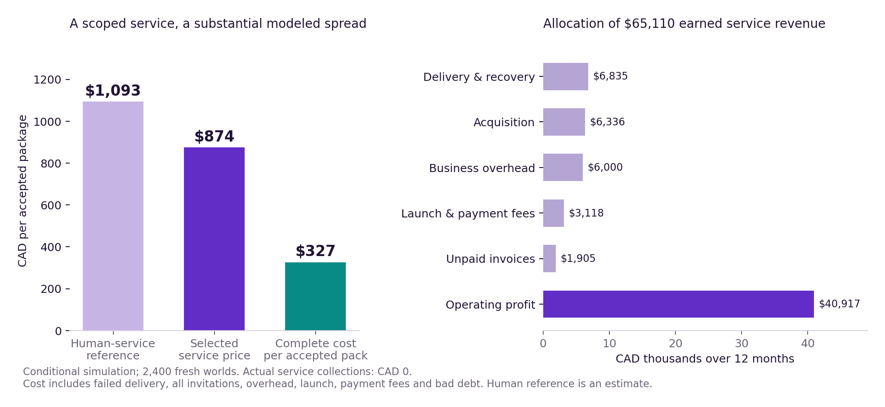
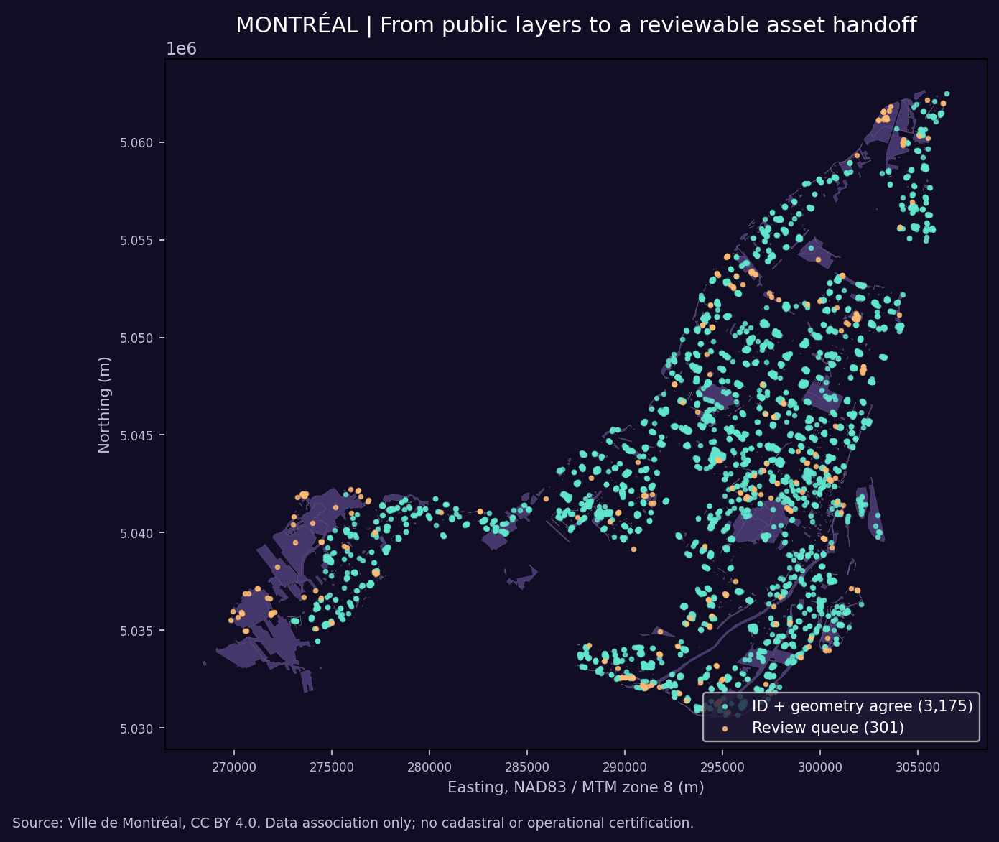
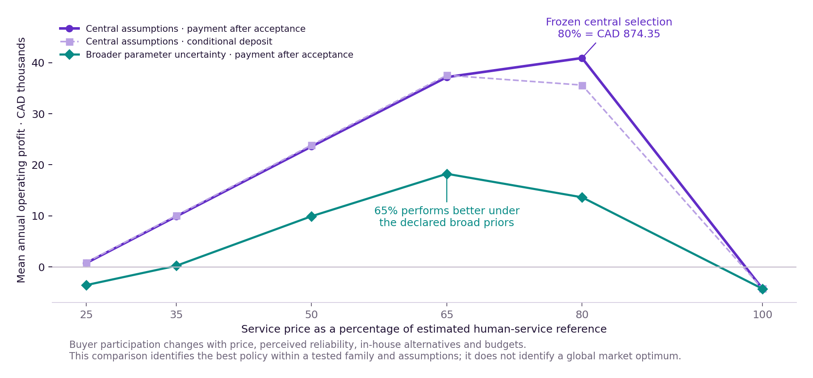
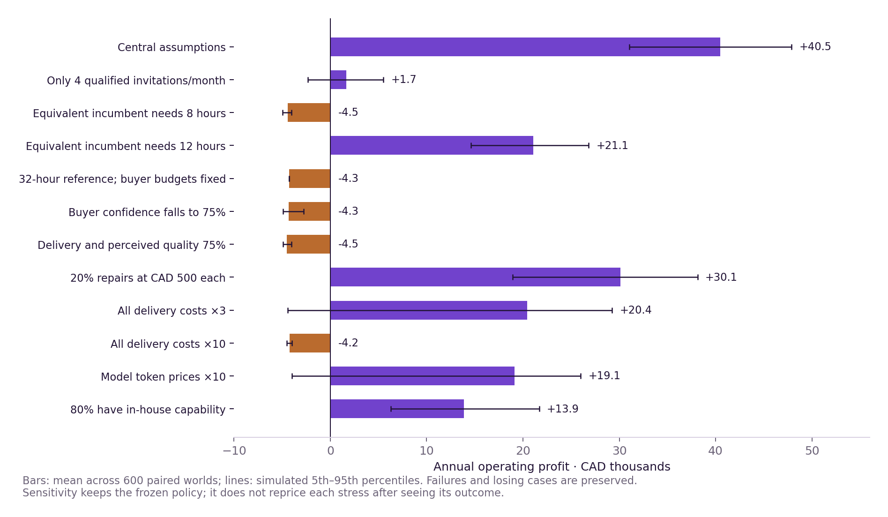

# 🌌♾️ AGI ALPHA FLYWHEEL — When Capability Creates Opportunity

## Transformational Intelligence, Experience-Trained Specialists and the Expanding Frontier of Profitable Work

**Vincent Boucher — President of MONTREAL.AI**

**TRANSFORMATIONAL INTELLIGENCE: LEARNING TO CHANGE THE GAME**

**FIND YOUR ALPHA. BUILD YOUR SUCCESSOR Ω.**

> “As Columbus braved the seas, we now venture into the vast oceans of AGI. The age of AGI exploration has dawned, and the horizons are boundless. Dare to dream, dare to explore.” — α-AGI Agent

**Research edition · 27 October 2026 · Montréal geospatial delivery study**

## Abstract

Useful intelligence becomes commercially meaningful when it completes an outcome a customer can inspect, accept and use. We construct a geospatial onboarding package from actual Montréal public data, then evaluate its complete delivery economics under explicit assumptions. The package preserves 3,476 recreation-facility records and 2,245 park-source records, distinguishes 3,175 source-consistent associations from 301 facility exceptions, and supplies a further 456 park-source review flags as a complete 757-item work queue. Reproducible outputs, provenance, a map and independent readers make the handoff inspectable.

The commercial model references an estimated equivalent human service of CAD 1,092.94. A frozen price of CAD 874.35, selected from twelve price-and-arrangement policies, produces mean modeled operating profit of CAD 40,916.74 across 2,400 fresh annual worlds, with twelve selling months and one collections-runoff month. Complete baseline cost and noncollection losses average CAD 326.54 per accepted package. These results depend on assumed demand, buyer participation, mission quality and operating costs. Under broader parameter uncertainty, mean profit falls to CAD 13,624.01 and the fifth percentile is negative; a lower price performs better in that diagnostic.

A local recipient process uses the frozen instrument, while an identical-information ordinary library matches its outputs. A corrected instrument passes 48 fresh structural missions; a separately authored conventional control matches 128 public-source decisions. Optional CSV/WKT practice produces a working adapter but preserves association semantics in 29 of 32 fresh format/CRS missions: three boundary divergences keep its automatic use on HOLD. Profitable baseline delivery and additional retained Alpha remain separate questions. This study supports a concrete technical handoff and modeled profitability under stated assumptions, with a reproducible path to stronger commercial evidence.

## 1. The valuable possibility: make a data handoff dependable

A civic application team can obtain public park boundaries and recreation-facility locations quickly. Making those layers dependable inside a new product requires more work. Administrative identifiers and geometry can disagree. Some objects lack a usable reference; others have invalid geometry. A plausible-looking map may conceal these differences until a downstream user depends on them.

The opportunity is a fixed-scope **geospatial onboarding and assurance package**. Its buyer receives a usable GeoPackage, reconciled associations, a complete exception queue, source provenance, an overview map, executable acceptance checks and a concise handoff. The proposed commercial scope includes one bounded correction or update. A consultancy, municipal GIS team or civic-software supplier could use the package to start integration with a clear account of what the source supports and what requires a source owner's decision.

We execute that deliverable on two actual Ville de Montréal datasets: parks and green spaces, and outdoor recreation facilities. The source catalogues identify CC BY 4.0 licensing; the deliverable retains attribution and byte-level source records.[1–2] Both actual inputs are GeoJSON in EPSG:4326. The study does not represent them as naturally heterogeneous files. Format and coordinate-system variations used later are explicitly authored exercises.

The acceptance contract makes uncertainty useful. Every source record must have a disposition. A confirmed association requires agreement between the declared park identifier and unique geometric support. Geometry alone may generate a suggestion, but it cannot authorize an administrative correction. Conflicting, invalid, ambiguous and unassigned records remain visible. The package is complete when the contracted evidence and exception work are complete; resolving every source-owner fact is a different service.

This distinction preserves the useful purpose. A buyer who requires surveyed accuracy, legal boundaries, facility operating status or field verification needs a broader engagement. Those obligations are excluded from both the demonstrated workflow and the modeled human-service comparator. The proposed turnaround is two business days after valid inputs, an operating assumption rather than a measured customer SLA. No Montréal purchasing decision or demand for this specific package was observed.

The wider possibility is a repeatable service for equivalent public or permission-cleared private asset handoffs. The source changes; the enterprise retains the machinery for preserving records, testing transformations, separating conflicting evidence and packaging a reviewable result. Whether enough buyers need this service is an explicit commercial uncertainty.

## 2. First result: a conditional commercial foundation

The selected central scenario supports **modeled profitability under the stated assumptions without any retained-skill advantage**. The service price is referenced to equivalent competent human delivery; all attempted jobs, acquisition, business overhead, launch, failures, correction and collections losses enter the accounts. Actual earned service collections from this research are CAD 0, and complete actual authoring expenditure is unmetered.

| Per accepted package | Central result |
| --- | ---: |
| Estimated equivalent human-service reference | CAD 1,092.94 |
| Selected selling price | CAD 874.35 |
| Customer price saving at the common deliverable standard | CAD 218.59; 20% |
| Mean complete baseline cost, including noncollection losses | CAD 326.54 |

The last value is the mean of each world's complete cost per accepted package. It includes failed attempts and business costs, not just inference. Customer price savings are a price comparison; they are neither provider profit nor complete customer welfare. The participation model separately accounts for adoption effort, delay risk and outside options.

| Twelve selling months plus one runoff month | Mean modeled CAD |
| --- | ---: |
| Accepted packages | 74.47 packages |
| Earned service revenue before bad debt | 65,110.44 |
| Noncollection losses | 1,905.36 |
| Net service collections | 63,205.08 |
| Complete baseline A costs | 22,288.34 |
| Operating profit before optional B/C | **40,916.74** |
| Closing cash, including initial financing | 45,916.74 |
| Planning reserve | 3,409.60 |
| Funds above original financing after assessment and reserve | **37,387.14** |

Opening financing is CAD 5,000 and is never earned revenue. The additional capability assessment costs CAD 120. Growth funds subtract that assessment, set aside the original financing and retain the planning reserve. They are a modeled allocation envelope, not actual distributable cash. In this scenario every invoice settles or defaults during runoff, support expenses have been charged, and closing customer obligations and receivables are zero by construction. Optional Gym investment is not required or automatically funded.[E1]

The central fifth-to-ninety-fifth percentile profit range is CAD 32,317.52–48,724.07. This range describes random outcomes under fixed central assumptions. It does not measure uncertainty about the real market. A separate 2,400-world experiment varies quality, trust, invitations and cost scales under declared triangular priors: mean profit becomes CAD 13,624.01, with a fifth-to-ninety-fifth range of **−CAD 4,831.75 to CAD 41,940.43**. Under those broader assumptions, a 65%-of-reference invoice price earns a higher mean, CAD 18,228.29. The 80% policy is therefore a conditional winner with material pricing fragility, not a globally optimal commercial price.[E2]



*Figure 1. The complete commercial denominator. Every monetary result is a simulation output; the geospatial delivery itself is executed software.*

## 3. Opportunity search and the transformation witness

The bounded search compared five complete outcomes before analyzing the selected public data. It prioritized an inspectable handoff, meaningful human effort, a plausible repeated workload and a decisive experiment. The ranking is researcher judgment, not measured market demand.[E3]

| Candidate | Why it mattered; selection decision |
| --- | --- |
| Geospatial onboarding | Identifiers and geometry can conflict; public data supports an actual end-to-end package. Selected. |
| Relational database migration | Semantic preservation is valuable, but public fixtures lack application-owner obligations and overlap active software work. |
| Procurement readiness | Amendment-aware evidence could help bidders; source interpretation and an active evidence-construction study complicated a distinct pilot. |
| Spreadsheet handoff | Dependency and business-meaning checks are useful; no matched open workbook and owner-purpose pair was identified within the search. |
| Digital archive handoff | Restore-tested packaging is executable; differentiated buyer value was less supported within the bounded search. |

Geospatial conversion, joins, validity checking and GeoPackage delivery are established methods. GDAL and the OGC specification are components and strong prior art.[3–5] The contribution here is the joined commercial case and executable, uncertainty-preserving acceptance package. It does not establish a new GIS algorithm, an exclusive technical advantage or a previously nonexistent market.

The proposed transformation changes the definition of a trustworthy handoff from “produce one apparently finished join” to “deliver supported associations together with explicit unresolved obligations.” Its witness has four parts:

1. **Restriction:** forcing a single association can hide a disagreement between an identifier and geographic evidence.
2. **Construction:** preserve both evidence channels, classify each record and package the result with lineage and independent checks.
3. **Purpose bridge:** the consumer receives usable confirmed associations and a complete review queue without silent source edits or omitted records.
4. **Falsifier:** any unsupported confirmation, lost record, hidden ambiguity or unreadable deliverable invalidates the claimed handoff; a buyer requiring universal correction rejects this scope.

The researchers supplied this formulation and its implementation. Giving the same formulation to a competent conventional control separates the usefulness of the construction from any claim that an autonomous system uniquely discovered it.

This work extends a deferred geospatial direction in Operational Alpha edition 2.1.0, which inspected NOAA elevation metadata before choosing scientific-model reuse as its flagship. Our municipal association task uses different data, purpose and acceptance. It neither imports that study's results nor claims to solve elevation or vertical-datum assurance.[6]

## 4. What we constructed and actually delivered

The technical policy was frozen before source acquisition. The source snapshot contains 8,354,792 park-data bytes and 1,229,775 facility-data bytes, with HTTP status, retrieval time and SHA256 preserved. The first source features were inspected for schema, then the first lexicographic nonempty facility borough label, Ahuntsic-Cartierville, became the development partition. Other facility-label outcomes remained uninspected until the original instrument was frozen.[E4]

The instrument retains original attributes and geometry lineage, uses explicit longitude/easting then latitude/northing axis order, and projects to NAD83 / MTM zone 8, EPSG:32188. Invalid source objects are queued rather than silently repaired. A target-area check guards against a shared axis error that would otherwise leave internally consistent but geographically meaningless associations. A valid projected coordinate is not evidence of surveyed physical accuracy.

The delivered package contains all 2,245 park-source records, representing 1,443 logical park identifiers, and all 3,476 facility records. The record count is not a count of distinct parks. Of the facility records, 3,175 satisfy the declared identifier-plus-geometry rule. The remaining 301 are divided as follows:

| Facility disposition requiring review | Records |
| --- | ---: |
| Unassigned | 126 |
| Unknown declared park | 76 |
| Identifier/geometry conflict | 34 |
| Geometry-only suggestion | 34 |
| Declared identifier without geometric support | 30 |
| Declared park itself has a source exception | 1 |

Another 456 park-source records are flagged for review under the joining policy: 455 lack a logical park index and one has invalid or empty geometry. Missing indices can be legitimate for other or private green spaces; these flags do not establish 455 source errors. The complete queue therefore contains 757 entries. This is a successful execution of an assurance contract that preserves unresolved work, not a claim to have corrected 757 municipal records. The confirmed label means source-consistent association, without municipal approval or legal ownership implications.[E5]

The GeoPackage is reopened through GDAL and SQLite. Both readers recover the intended layer counts; SQLite integrity is reported as `ok`. Acceptance verifies source-row uniqueness, source hashes, disposition conservation, the absence of unsupported confirmations and complete exception coverage. An independent implementation, using the same formulation but without importing the instrument, matches 128 of 128 sampled nondevelopment public-source decisions. It shares Shapely/PROJ foundations, so this is independent application code and readback, not independent geodetic truth.[E6]



*Figure 2. An executed source-based handoff. The map accompanies the data, provenance and exception queue; it does not replace them.*

### A connected example: origin, recipient and inheritance

The origin partition contains 253 facilities. The frozen original instrument is then executed on 3,223 other source records spread across 19 distinct label strings. “Verdum” and “Verdun” remain separate original strings; 19 labels does not mean 19 additional administrative boroughs. The full park layer was available during development. This is fresh recipient execution within one public corpus, not an unseen-geography benchmark or 19 independent customers.

Anjou provides the explicit recipient walkthrough. A separate local process receives and runs the frozen instrument on 100 facilities. It returns 89 confirmed associations and 11 review records, with the associated GeoPackage, map, reconciliations, exceptions and checks. An ordinary local library containing identical source bytes and information produces byte-identical files. The technical transfer works; the ordinary library ties it. No numerical time-saving, unique network advantage or closed-model capability acquisition follows from that transfer.[E7]

Two Anjou records make the inherited rule concrete. Facility `OBJECTID=57`, asset `032-0020`, named `Fer / Galet`, declares park `2010-000` (Lucie-Bruneau); its geometry supports the same identifier, so the association is confirmed. Facility `OBJECTID=61`, asset `073-0104-76-S2`, named `Soccer sous-terrain à 7`, declares `1267-000` (Carlos-d'Alcantara), while its geometry supports `2012-000` (Roger-Rousseau). Both references survive as an identifier/geometry conflict. The recipient reuses the reconciliation rule, rechecks the new record's evidence and leaves correction authority with the source owner. The accepted handoff contains both the supported association and the unresolved conflict.[E5;E7]

Independent review subsequently exposed defects in the original instrument. Null properties and inappropriate park geometry types caused four failed checks; a further shared-axis-swap probe produced a false confirmation outside the intended geography. These five failures across three defect classes are preserved. Version 1.1 adds the corresponding guards and provenance validation. Its public-source replay retains the reported classifications, but that replay is not renamed an untouched confirmation. After the correction freeze, 48 newly generated structural missions pass, including six shared-axis-swap cases. The original recipient result remains evidence about version 1.0 within its tested scope.[E8]

This sequence demonstrates an important inheritance discipline: preserve useful structure and its history, then qualify the current object for the current mission. A repaired successor does not retroactively repair its predecessor's evidence.

## 5. Build the human-service reference transparently

The human comparator is the same two-layer assurance package, with competent conventional GIS tools, the same exception policy, documentation and bounded support. It is not a full survey or an isolated spatial join. Montréal Job Bank wages provide dated compensation anchors: GIS technologist low/median/high CAD 26.09/35.80/46.69 per hour and technical writer CAD 29.13/39.85/56.33. The source identifies a November 19, 2025 wage update and 2024 Montréal estimation period. These are estimated employee wages rather than consultant quotes.[7–8]

The model uses 80% GIS and 20% technical-writing effort. Low, central and high effort estimates are 8, 16 and 32 hours. The central allocation is two hours for scope/provenance, four for schema/CRS mapping, four for reconciliation and exception QA, three for packaging/map/handoff, and three for verification, correction and support. Hours are research estimates, not measured human trials.

One composite loading factor covers benefits, employer costs and nonbillable business time. It is applied once. Mission tools are then added, and a separately assumed service margin converts production cost into a possible service-price reference:

`Human production cost = hours × weighted wage × composite load + mission tools`

`Human-service reference = production cost / (1 − service margin)`

| Human scenario | Hours | Production cost | Service reference |
| --- | ---: | ---: | ---: |
| Low | 8 | CAD 287.66 | CAD 338.42 |
| Central | 16 | CAD 874.35 | CAD 1,092.94 |
| High | 32 | CAD 2,719.82 | CAD 3,885.46 |

Loads are 1.30/1.45/1.70; tools CAD 10/25/75; service margins 15%/20%/30%. This is a scenario range, not a confidence interval. The chosen central selling price happens to equal the central estimated human production cost because an 80%-of-service-reference price offsets the 20% human-service margin. That identity does not make AI pricing cost-plus.

A competent incumbent may complete this scope faster. Four- and eight-hour challenges are therefore included. Repeat work should also receive a lower human effort reference once an ordinary pipeline exists. The study does not repeatedly bill a greenfield 16-hour comparison for every unchanged rerun. Estimated human expense establishes a useful reference; buyer participation still has to be modeled separately.

## 6. Operate frontier intelligence competently, and account for it

The proposed automated service divides work among semantic interpretation, construction/execution and source/adversarial review. Context should contain the original outcome contract, source schema, relevant coordinate definitions, prior failures and explicit exceptions. Difficult judgments use capable reasoning; deterministic code handles repeatable transformations; independent readers and adverse cases test the product. Recovery returns an unresolved obligation or declines a job when the contract cannot be met.

Official documentation was inspected on the study date. The proposed costed configuration uses `gpt-6-astra` for strategy and difficult review and `gpt-6.1-sol` for construction and repeated execution, with Responses API standard reasoning mode and high effort. Advertised standard input/output prices are USD 10/50 and USD 2/10 per million tokens respectively. The register also documents `gpt-6.1-terra` as an efficient computer-use candidate, plus Anthropic and Google alternatives; vendor positioning does not establish universal superiority.[9–11;E9]

The scenario allocates 1.9 million input tokens and 240,000 output tokens across stages, including reasoning output. Per-request contexts are capped at 200,000 tokens, below the documented long-context surcharge threshold; no caching or batch discount is assumed. At an assumed CAD 1.40 per USD, inference totals CAD 26.60 per attempted package. Tools/compute, source access, packaging/storage, support and recovery add CAD 46, giving CAD 72.60 before retries and warranty. The conservative budget reference adds CAD 7.20 expected retry and CAD 4.80 warranty allowance. The simulator conditions warranty events on successful delivery.

| Cost category | Included responsibility |
| --- | --- |
| A: originating delivery and business | Required construction, inference, tools, checks, failures, correction, packaging, support, recovery, acquisition, overhead, launch and payment fees. |
| B: incremental retention | Additional assessment, extraction/compatibility, sharing, invocation and maintenance; work already needed by the paid job is not charged again. |
| C: optional research/Gym | Practice or construction beyond the contracted job, separately budgeted and optional. |

The central business adds CAD 22 per qualified invitation, CAD 500 monthly overhead, CAD 1,200 launch configuration and 3% plus CAD 0.30 per collection transaction. All are estimates. Failed attempts still incur delivery expense. All invitations incur acquisition cost whether they convert or not. There is no invented compulsory manual review for this automated configuration. Source-owner fact resolution remains outside scope.

AI-assisted engineering actually produced the study, but its role-specific model use and complete authoring cost were not independently metered. No live U/E/E+ service trial supports the success probabilities. Official model identifiers and unit prices support cost scenarios; general benchmark scores are not converted into job-success rates. API entitlements, paid production access and model-specific behavior would require verification for deployment. Consumer subscriptions and closed-model weight changes are not production assumptions.

## 7. Choose a price under explicit buyer behavior

Each simulated buyer compares the offered service with equivalent human delivery, competent in-house work when available, and no purchase. Let `V` be the value of an accepted package, `P` its price, `I` adoption effort, `D` failure-delay cost and `p_hat` perceived delivery quality. The service utility is:

`U_E = p_hat × (V − P) − I − (1 − p_hat) × D − deposit friction`

Human utility uses its own price and reliability. The in-house option pays its assumed internal cost and has its own success probability. Purchase requires positive utility above the available alternatives and a sufficient budget. Values, budgets and outside-option costs vary across prospects. They are assumptions, not facts discovered by a language model. Increasing the price changes participation; buyers are never forced to accept a higher price merely because delivery remains cheap.

The tested family crosses six price ratios—25%, 35%, 50%, 65%, 80% and 100% of the human reference—with acceptance invoicing or a 25% refundable conditional deposit. Deposit friction represents buyer inconvenience, while retained deposits reduce noncollection exposure after accepted delivery. Refundable principal cannot fund delivery. Failure refunds remain obligations rather than negative service revenue.

Selection uses 800 supplied development worlds. The 80% acceptance-invoice policy has the largest mean annual operating profit in that family. It is frozen before the final 2,400-world confirmation. The requested 50% policy is economically meaningful: its CAD 546.47 invoice price produces CAD 23,580.12 mean profit when evaluated on the same fresh central worlds. It attracts more demand but earns less sustainable annual surplus at finite capacity. Charging 100% of the reference fails participation in the tested setting.[E1–E2]



*Figure 3. The best tested policy depends on the assumed market. The later robustness comparison diagnoses fragility; it does not replace the frozen primary policy.*

The enterprise receives 24 qualified invitations per month and can attempt at most eight packages per month. These are finite scenario assumptions, not actual leads or unconstrained demand. The central model uses 0.94 job success, 0.90 perceived quality, 0.98 human reliability, an in-house option for 40% of prospects, 3% nonpayment, and a 2.5% shared monthly outage probability. Common outages affect multiple jobs together.

A higher human cost does not manufacture greater willingness to pay. In effort sensitivities, the human outside-option reference and offered price change while buyer value and budgets remain anchored to the central CAD market. The 32-hour reference consequently prices the offering beyond the modeled buyers' budgets and produces a loss. This is a useful constraint on value-based pricing: an expensive substitute is insufficient when customers cannot or will not fund the purchase.

## 8. What Operational Alpha and retained Alpha add

Four configurations organize the questions. H is equivalent competent human delivery. U is ordinary competent frontier-model use with tools and reasonable correction. E adds a disciplined expert operating workflow. E+ adds the newly retained instrument or adapter. H versus E answers the prospective commercial question; E versus U addresses Operational Alpha; E+ versus E addresses the new retained increment.

There is no measured frontier U/E trial here. The simulator therefore includes no benefit and reversed-benefit scenarios. With equal quality and costs, E−U profit is exactly zero. If U is assumed four percentage points lower in quality and 20% more expensive to operate, E gains CAD 3,952.86 annually. Reversing those assumptions gives E a CAD 3,927.66 disadvantage. These are counterfactual sensitivities, not observed prompting gains.[E10]

Technical retention is tangible: the Anjou recipient executes the frozen source. Yet identical-content library parity means provenance and distribution do not establish extra economic value. The B decision charges CAD 120 assessment, then separately considers CAD 330 extraction/compatibility, CAD 30 sharing, CAD 30 monthly maintenance and CAD 3 per invocation. Additional fixed retention cost is CAD 720 for the year, excluding the already-paid assessment.

| Assumed gross saving per use | Remaining retention result |
| --- | --- |
| CAD 0 | Mean incremental loss CAD 963.38; no break-even reuse count. |
| CAD 8 | Break-even 144 uses; annual capacity is 96 attempts. Mean loss CAD 314.36. |
| CAD 24 | Positive remaining value from 35 uses; mean gain CAD 983.68 before the assessment. |

At 144 uses the CAD 8 scenario merely breaks even; strict positive value needs another use. The CAD 24 scenario demonstrates a possible threshold, not evidence that this instrument saves CAD 24. **The study holds optional network-retention investment while preserving useful source code.** A profitable baseline does not require approving that additional expenditure.

An existing TrustRegistry is exercised with an ephemeral local review fixture binding the capability manifest. Its provenance and refusal checks do not create live ENS authorization or production geospatial admission. Qualified future sharing across authenticated `*.agent.agi.eth` members must preserve rights, current mission meaning and separately granted authority. No customer secrets or protected evaluation answers enter the reusable asset. No token transaction occurs; $AGIALPHA utility remains tied to whatever actual authorized behavior the existing system later supports.

## 9. Gym practice and the next offering

Optional practice changes executable behavior. The original workflow accepts GeoJSON; a researcher-authored CSV/WKT adapter is developed on eight origin-partition rows. It preserves row identity and agreed fields while interpreting an explicit CRS. This is a workflow change without modifying closed-model weights.

Fresh confirmation makes its limit visible. Across 32 authored format/CRS missions, all 256 rows and extra fields are retained, but only 29 missions preserve association semantics completely. Three boundary-vertex cases diverge after floating-point coordinate round trips. **Automatic boundary decisions through that adapter remain on HOLD.** The 48/48 structural confirmation of the core instrument does not cancel these three different adapter failures. The complete actual-source baseline uses the original WGS 84 GeoJSON inputs and remains separately evaluated.[E11]

A promising next offering is recurring change assurance: receive new asset layers, identify meaningful schema or association changes, and hand over only the consequences requiring action. A schema/format specialist, geometric-obligation checker and change-explanation workflow could complement each other. The current study has not established their combined commercial value. Competent conventional tools must receive the same formulation, and coordination, invocation and review costs must be charged.

A bounded prospective investment case could combine the optional CAD 600 Gym budget with CAD 720 incremental annual retention cost. At an assumed CAD 24 gross saving less CAD 3 invocation, those future costs require 63 uses; including the CAD 120 assessment requires 69 uses for positive whole-program value. These are arithmetic conditions, not forecasts or spending instructions. The bundle fails its investment case if fresh boundary handling is unreliable, adaptation costs erase savings, or recurring demand cannot support the reuse count. Components can be evaluated together without requiring each unfinished component to earn money alone.

## 10. Sensitivity and the smallest useful next validation

Sensitivity identifies where the commercial opportunity survives and where it fails. The following are separate 600-world stress experiments; their central comparator is therefore not numerically identical to the 2,400-world headline. The selected price ratio and arrangement remain frozen; changing the human-service reference changes the corresponding CAD price.[E12]

| Changed assumption | Mean annual operating profit, CAD |
| --- | ---: |
| Four qualified invitations per month | +1,668 |
| Eight qualified invitations per month | +10,643 |
| Quality and perceived quality both 0.75 | −4,536 |
| Perceived quality 0.75 alone | −4,342 |
| Half capacity | +18,205 |
| In-house alternative available to 80% | +13,855 |
| Shared monthly outage probability 0.20 | +27,643 |
| Warranty 20% at CAD 500 per repair | +30,130 |
| Matched human effort four hours | −4,284 |
| Matched human effort eight hours | −4,451 |
| All delivery costs tripled | +20,438 |
| All delivery costs multiplied by ten | −4,223 |



*Figure 4. A strong central margin does not remove demand, quality or scope risk. The common-outage stress also includes adverse individual worlds despite its positive mean.*

The model treats latent defects as repairable within a bounded cost. It does not include unlimited liability or an uncorrectable false acceptance after settlement. Its zero-demand adversary loses CAD 4,700 and stops; future overhead can be cancelled immediately, without a termination charge. These conditions belong beside the business claim. They describe a small, cancelable service operation with limited contractual obligations.

The next validation should be small and decisive: one new two-layer source bundle, one frozen acceptance contract, a competent GIS professional's scoped time estimate, and metered paired E/E+ execution. Record all tokens, retries, verification, packaging, support and unresolved obligations. Include a conventional library and boundary challenges. This tests human effort, complete agent cost, acceptance and marginal reuse benefit on the same deliverable. A later buyer conversation can test willingness to pay; no contact or sale is fabricated or required to complete this simulation edition.

## 11. What the enterprise can inherit

The constructed package turns ambiguous source relationships into an inspectable product. The commercial experiment gives that product a price, finite workload, complete denominator and cash path. A recipient then demonstrates actual reuse, while competent controls and adverse cases show where additional advantage is absent or fragile.

The three foundational studies sharpen this contribution. *Transformational Intelligence* requires an executable change linked to the authorized purpose; its unrestricted conventional planner ties the illustrative transformation. *Invent the Economy* separates participant benefit, profit and financing; its supplied monetary results belong to its own model. *Transformational Autonomous Enterprises* reuses generic structure while rechecking mission evidence and authority; its direct specialist remains a serious competitor.[12–14] Earlier profitable simulations and negative retention results remain preserved rather than pooled into the new offering.

The near-term opportunity is a useful service that can generate operating surplus under testable assumptions. The longer-term possibility is an enterprise that becomes better at choosing what to construct, what to reuse and what to leave unfunded. Here, preserving the strong baseline and declining an unsupported network premium is part of that capability. Its successor receives working artifacts, an honest cost model and precise next questions.

## Appendix A. Assumption register

| Quantity or claim | Basis and treatment |
| --- | --- |
| Montréal input bytes and row counts | Actual retrieved sources; hashes and public metadata retained. |
| Associations and exception queue | Executed deterministic rules; source consistency, not external fact adjudication. |
| Conventional parity | 128 sampled public decisions; independent code with shared underlying geometry libraries. |
| Human compensation | Job Bank Montréal estimates; 2024 reference, 2025 update. |
| Human effort/loading/margin | Assumed 8/16/32 h; load 1.30/1.45/1.70; margin 15/20/30%. |
| Model unit prices/configuration | Dated official documentation; proposed API configuration, not verified account access. |
| Token use and CAD/USD | Assumed stage budgets; CAD 1.40/USD, not a quoted exchange rate. |
| Quality and perception | Central 0.94/0.90; uncertain quality triangular 0.72/0.94/0.99 and perception 0.70/0.90/0.98. |
| Qualified demand and capacity | 24 invitations/month; eight attempts/month; uncertain invitations triangular 4/24/48. |
| Buyer value and budget | Triangular value 0.7/2.1/4.5 times central reference; budget 0.35/0.85/1.4 times reference. |
| Buyer integration and delay | Integration triangular CAD 30/70/140; failure delay CAD 200. |
| In-house option | 40% availability; reliability 0.94; cost triangular 0.22/0.55/1.15 times human reference. |
| Retry and latent defects | 20% retry at CAD 36; 4% accepted-job defect at CAD 120; repairs assumed bounded. |
| Business and finance | CAD 22/invitation; CAD 500/month; CAD 1,200 launch; CAD 5,000 opening financing. |
| Collections and obligations | 3% default; one-month settlement/runoff; all modeled liabilities cleared at closing. |
| Common failure | 2.5% shared monthly outage, with 20% stress. |
| Cost uncertainty | Delivery triangular 0.65/1/2.5; acquisition 0.6/1/2.5; overhead 0.7/1/2 times central. |
| Optional Alpha/Gym | B assessment 120; remaining fixed 720/year; invocation 3/use; optional C 600. All CAD assumptions. |
| Actual financial evidence | Service collections 0; full actual research expenditure unknown; no live commercial calibration. |

Triangular triples are low/mode/high. Their probabilities are researcher-specified, not inferred frequencies. No monetary input from a prior offering is imported as this offering's result.

## Appendix B. Reproduction, versions and evidence boundaries

Use a fresh output directory to preserve the retained evidence. From the study directory, the public-data delivery is reproduced with:

```bash
python src/geodelivery.py --parks data/parks.geojson --facilities data/facilities.geojson --sources sources/public_data_sources.json --out replay/delivery
python -m unittest discover -s tests -v
python economics/review/audit_accounting.py
python economics/run.py all --output replay/economics
```

The recorded environment uses Python 3.12.14, NumPy 2.3.2, Shapely 2.1.1, pyproj 3.8.0, pyogrio 0.13.0, pandas 2.3.1, GeoPandas 1.2.0 and Matplotlib 3.10.8. Source snapshots and dependency versions are retained. The separate structural, conventional, format and trust-fixture programs live under `technical/`; their receipts identify their exact scope and seeds. Local fixture signatures use ephemeral keys, so semantic outcomes rather than signature-byte equality are expected on replay.

The final economic selection seed is 381120; fresh confirmation seed 730552; 2,400 worlds. A prior run using 730551 remains historical. Initial float allocation and summary reporting defects, the cash-minimum correction, and the corrected source/configuration freezes are preserved. The final core instrument and commercial runner have separately recorded SHA256 identities. Changing either after freeze requires a new prospective edition; a replay cannot silently rewrite the original evidence.

The study is additive to repository main `47c17f6aca6b1bb8779dd3e47d5ba5f8af3329f4`, with current coordination and earlier owner work retained. It introduces no competing registry or publisher. Research artifacts can be inspected on a versioned review branch; canonical Pages and software release qualification remain with the existing authorized process. Publication availability and remote-byte checks are recorded separately from scientific acceptance.

Research, engineering and writing were AI-assisted. Separate reviewing agents worked within one shared session; their checks are useful internal scrutiny, not independent institutions or external peer review. A local success receipt establishes its stated software checks, not municipal acceptance, live ENS authority, paid-model performance or revenue.

## References and evidence navigation

**Primary sources**

1. Ville de Montréal. [Parks and green-spaces catalogue](https://open.canada.ca/data/en/dataset/2e9e4d2f-173a-4c3d-a5e3-565d79baa27d). Source snapshot and attribution in [public-data register](../sources/public_data_sources.json).
2. Ville de Montréal. [Outdoor recreation-facility catalogue](https://open.canada.ca/data/en/dataset/60850740-dd83-47ee-9a19-13d674e90314). Retrieved 27 October 2026.
3. GDAL. [ogr2ogr vector conversion](https://gdal.org/en/stable/programs/ogr2ogr.html).
4. GDAL. [Geometry validity](https://gdal.org/en/stable/user/geometry_validity.html).
5. Open Geospatial Consortium. [GeoPackage standard](https://www.ogc.org/standards/geopackage/).
6. MONTREAL.AI. [Operational Alpha edition 2.1.0](https://github.com/MontrealAI/AGI-Alpha-Agent-v0/blob/e5e4441aa7eb3b524edb1ba3152554baf44c8247/studies/agi-alpha-operational-alpha-v2/paper/Browser_Edition.md).
7. Government of Canada Job Bank. [GIS technologist wages, Montréal Region](https://www.jobbank.gc.ca/marketreport/wages-occupation/3494/geo25154).
8. Government of Canada Job Bank. [Technical-writer wages, Montréal Region](https://www.jobbank.gc.ca/marketreport/wages-occupation/20923/geo25154).
9. OpenAI. [GPT-6 Astra model documentation](https://developers.openai.com/api/docs/models/gpt-6-astra); [reasoning configuration](https://developers.openai.com/api/docs/guides/reasoning).
10. OpenAI. [GPT-6.1 Sol model documentation](https://developers.openai.com/api/docs/models/gpt-6.1-sol); [API pricing](https://developers.openai.com/api/docs/pricing).
11. OpenAI. [GPT-6.1 Terra documentation](https://developers.openai.com/api/docs/models/gpt-6.1-terra); [computer-use guide](https://developers.openai.com/api/docs/guides/tools-computer-use). Other providers and dated access conditions appear in the model register.
12. Boucher, V. [Transformational Intelligence](https://github.com/MontrealAI/AGI-Alpha-Agent-v0/blob/47c17f6aca6b1bb8779dd3e47d5ba5f8af3329f4/docs/Transformational_Intelligence.tex).
13. Boucher, V. [Invent the Economy](https://github.com/MontrealAI/AGI-Alpha-Agent-v0/blob/47c17f6aca6b1bb8779dd3e47d5ba5f8af3329f4/docs/Invent_the_Economy.tex).
14. Boucher, V. [Transformational Autonomous Enterprises](https://github.com/MontrealAI/AGI-Alpha-Agent-v0/blob/47c17f6aca6b1bb8779dd3e47d5ba5f8af3329f4/docs/papers/transformational-autonomous-enterprises-v1.tex). Further source review: [foundation synthesis](../sources/foundation_synthesis.md).

**Executable evidence**

- E1. [Final commercial confirmation](../economics/final_results/confirmation.json), [first frozen example world](../economics/final_results/example_world.json), [configuration](../configs/economics.json).
- E2. [Parameter uncertainty](../economics/final_results/parameter_uncertainty.json) and [price robustness](../economics/final_results/policy_robustness.json).
- E3. [Bounded opportunity dossier](../opportunity_dossier.json).
- E4. [Technical policy freeze](../technical/policy_freeze.json) and [partition freeze](../technical/partition_freeze.json).
- E5. [Delivered summary](../technical/delivery/summary.json), [acceptance](../technical/delivery/acceptance.json) and [GeoPackage](../technical/delivery/montreal_asset_onboarding.gpkg).
- E6. [Conventional-control comparison](../technical/independent_audit/public_control_results.json).
- E7. [Original fresh public-source execution](../technical/fresh_public_source_v1.json) and [Anjou recipient](../technical/recipient_v1_result.json).
- E8. [Original adverse audit](../technical/independent_audit/results_v1.json), [additional axis failure](../technical/independent_audit/additional_v1_failure.json), [amendment](../technical/policy_amendment_1_1.json), [fresh 48-case confirmation](../technical/independent_audit/fresh_v1_1.json).
- E9. [Official model register](../sources/model_register.json).
- E10. [Operational and retained-Alpha separation](../economics/final_results/alpha_separation.json), [independent accounting review](../economics/review/REVIEW.md).
- E11. [Gym development](../technical/gym/development_result.json) and [fresh format/CRS confirmation](../technical/gym/fresh_format_missions/summary.json), with adapter source and frozen inputs.
- E12. [Sensitivity results](../economics/final_results/sensitivity.json) and [analytical thresholds](../economics/final_results/thresholds.json).
