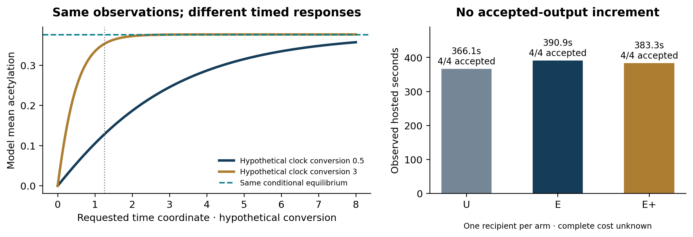
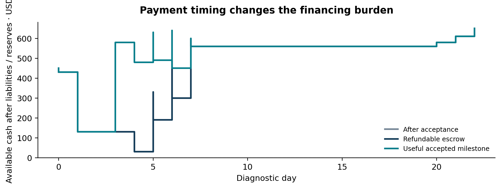
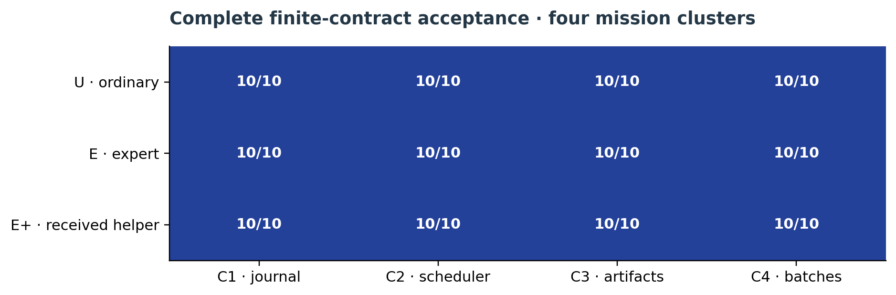
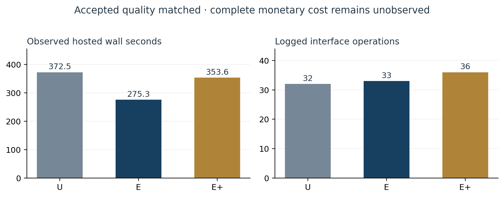
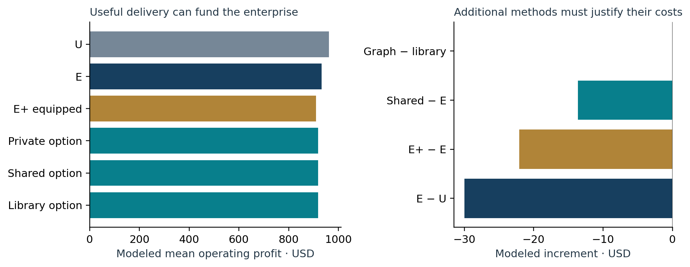
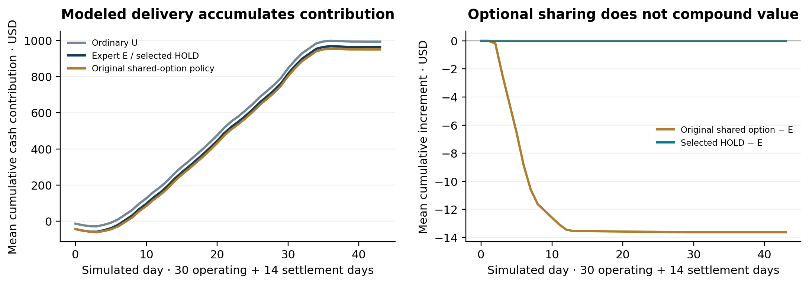
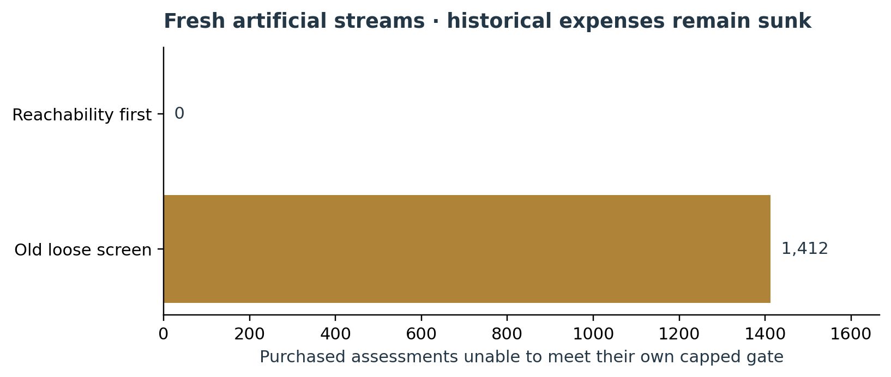

# AGI ALPHA FLYWHEEL — When Capability Creates Opportunity

## Transformational Intelligence, Experience-Trained Specialists and the Expanding Frontier of Profitable Work

**Vincent Boucher — President of MONTREAL.AI**

**FIND YOUR ALPHA. BUILD YOUR SUCCESSOR Ω.**

> “As Columbus braved the seas, we now venture into the vast oceans of AGI. The age of AGI exploration has dawned, and the horizons are boundless. Dare to dream, dare to explore.” — α-AGI Agent

**Additive research edition 2.1.0 · 27 October 2026.** This is the complete narrative of the LaTeX paper, with the same evidence and limitations. Prior papers, corrections and study records remain preserved.

[Paper PDF](paper.pdf) · [Executive brief](executive_brief.pdf) · [Evidence companion](evidence_companion.pdf) · [English/French demonstration](../browser/index.html) · [Reproduction guide](../REPRODUCTION_ALL.md)

**Result:** U, E, E+ and a conventional construction each pass all four scientific mission requirements. The received instrument works within scope; no incremental accepted-output advantage or positive complete-cost commercial crossing is established. Actual collections are $0; complete actual cost and profit are unknown.

---

## Abstract

What consequential opportunity becomes feasible when broadly available intelligence is operated expertly, reusable capabilities are constructed and commercial arrangements are designed with their technical dependencies? We investigate this question through a declared opportunity search rather than selecting a familiar numerical benchmark. Six candidates are assessed against existing products, methods, evidence and decisive experiments. A bounded follow-up identifies a documented scientific-model reuse gap: execution of a fitted model does not by itself qualify a new requested prediction.

We construct a versioned instrument binding model, observations, assumptions, requested quantity and evidence. On an actual sixteen-state H4 model, it preserves conditional equilibrium use, exhibits a missing physical-clock calibration, propagates a separately labeled hypothetical calibration, and withdraws the inherited witness for a different finite-time model. The formulation is supplied to competent ordinary use U, an established expert workflow E and E plus the received instrument, E+. All share the same model access, source files, acceptance and observable resource limits. All three recipients and an independently constructed conventional solution pass all four mission classes. Exact instrument bytes are transported through source-verified existing interfaces and used by the recipient. This establishes technical construction and scoped transfer, not incremental accepted-output superiority, complete-cost advantage or biological discovery.

An exact arrangement checker separates shared construction, coordinated commitments and their combination, while giving an unrestricted conventional entrepreneur the same alternatives. It preserves nonparticipation, common failure, withdrawal, partial acceptance, default, refunds, support and dated cash obligations. Its unmeasured-saving default selects conventional delivery. A separate timing illustration shows why positive contribution and refundable escrow do not eliminate opening-capital requirements. All money is explicitly diagnostic or simulated; no customer sale occurs.

The edition preserves earlier software H/U/E/E+ trials, a composition task, corrected historical studies and original negative optional-learning economics. A prospectively frozen HOLD supplement avoids modeled assessment losses on fresh worlds; it does not recover old profit or demonstrate shared Alpha. Human-service comparison, actual cost measurement, mission-specific qualification and current authority remain necessary before commercial launch. The contribution is a reproducible way to connect exploration, purpose-preserving construction, selective inheritance and financing, together with evidence identifying where its claimed advantage has not yet been earned.

**Keywords:** opportunity discovery; transformational intelligence; model reuse; operational expertise; capability inheritance; participation; liquidity; productive frontier.

## Explore the gap before choosing the instrument

The useful outcome is a decision a scientific modeling team can act on: *does this published model support the particular prediction we now want, and what evidence is missing if it does not?* A model can execute, reproduce its supplied fit and remain inappropriate for a new temporal interpretation. An undifferentiated approval can send a successor toward an unjustified experiment. An undifferentiated rejection can discard valid uses. A service that distinguishes those cases has a concrete deliverable: source-bound computations, an explicit qualification, a counterexample where needed, and a precise next evidence obligation.

This opportunity was selected after exploration. The earlier software workflow study was already complete when the research brief was sharpened to require opportunity discovery. Its results remain intact as supporting controls; they are not retrospectively presented as the product of the later search. We also preserve the earlier numerical planning, thermal, scheduling and control studies. None becomes the flagship merely because its evaluator is convenient.

### A bounded opportunity dossier

The declared first search covered six serious candidates in three tracks. Each track allowed up to twelve search queries and sixteen primary-source openings; these are research limits, not a monetary budget. Follow-up inventories were bounded before construction. Their records distinguish the initial candidates, reasons to defer, later source findings and the final selection. Research labor and hosted-model bills remain unknown. This is a researcher-directed discovery process, not a randomized comparison of autonomous invention policies.

| Candidate                    | Specific useful need and existing alternatives                                                                                                                                                                       | Decision before flagship construction                                                                                                             |
|:-----------------------------|:---------------------------------------------------------------------------------------------------------------------------------------------------------------------------------------------------------------------|:--------------------------------------------------------------------------------------------------------------------------------------------------|
| S1: mechanism experiments    | Distinguish histone-acetylation mechanisms with a more informative experiment. Existing H4 work already addresses the broad mechanism question and supplies calibrated model-selection machinery.                    | Defer the biological-discovery claim: no new unresolved pathway or physical assay was established. Follow the documented model-reuse gap instead. |
| S2: protocol relocation      | Move a laboratory procedure to a different instrument without losing its meaning. LabCompiler is close current prior art for protocol compilation and execution [\[labcompiler\]](https://arxiv.org/abs/2610.19550). | Defer: device and wet-laboratory evidence were unavailable. A software translation cannot establish physical portability.                         |
| ENG1: elevation evidence     | Qualify mixed elevation products for a specific coastal decision. NOAA, PROJ, FME and ArcGIS already supply substantial data and transformations.                                                                    | Preserve twelve actual metadata packages; unresolved paid demand and downstream verification were insufficient for the flagship.                  |
| ENG2: industrial controls    | Qualify protected PLC/model changes under a new operating mission. Existing CERN/GSI practices and retained control models provide strong precedents.                                                                | Defer: no authorized vendor simulator or plant oracle. A synthetic control fixture would not resolve that dependency.                             |
| M1: shared dependency repair | Coordinate maintainer-approved security repair and verification across dependent users. GitHub/OpenSSF tools and funding already cover much of the proposed function.                                                | Defer: a residual gap beyond those alternatives was not isolated sufficiently.                                                                    |
| M2: shared metrology         | Spread the construction expense of a custom measurement qualification across users. NIST/PTB services, uncertainty tools and calibration records already exist.                                                      | Defer: physical measurement evidence was absent; another rational fixture would overlap the earlier Harness.                                      |
The dossier preserves rejected directions and strong prior art. A mature sector is not declared exhausted, and a deferred candidate is not counted as a failed customer engagement. Full evidence, budgets and falsifiers are supplied with the implementation.

The engineering follow-up downloaded twelve exact NOAA metadata packages, totaling 2,084,023 bytes, plus two NcML headers. It found meaningful provenance conflicts: for example, title, abstract and coordinate-reference labels can disagree, while processing lineage sometimes resolves the apparent conflict. One source describes clamping a class of elevation values below 0.5 metres to 0.5 metres above mean high water, a noninvertible operation. These are observed metadata findings. We did not inspect every raster cell, validate a flood product or establish an underserved paying customer. Existing methods and incomplete downstream evidence kept this branch out of the flagship.

The scientific follow-up produced the selected candidate, S3: **scientific-model reuse qualification**. The PEtab Select paper identifies comprehensive identifiability analysis across model spaces as costly and selective automation as a useful direction [\[petabselect\]](https://journals.plos.org/ploscompbiol/article?id=10.1371/journal.pcbi.1014774). That broader integration need motivates this narrower pilot. The present instrument does not automate identifiability analysis across a model space or resolve the cited scalability problem; it tests source-bound qualification of specified reuse requests. It is not evidence that identifiability theory, scientific consulting or model-validation software was newly invented. Existing symbolic and numerical methods remain available building blocks. The selected experiment asks whether a small instrument and a disciplined operating method can make the decision reproducible under realistic source and interpretation constraints.

Selection was recorded before instrument construction at 16:16:24 UTC on 27 October 2026. The construction envelope allowed thirty developer minutes, thirty independent internal-review minutes, and three subsequent recipients, each with twenty minutes and forty-eight logged operations. Large model-selection searches and physical experiments were outside this pilot. The opportunity was promising enough for a small computational experiment; it was not commercially admitted by that decision.

### Connect the three foundations causally

*Transformational Intelligence* separates the useful purpose from its inherited formulation. Here the purpose is a correct reuse decision. The removable assumption is that an executable fitted model automatically supports a new requested quantity. We replace that assumption with an explicit relation among observations, parameter provenance, requested functional and evidence. The outcome remains useful even when it says which measurement must be obtained next.

*Invent the Economy* makes capability and arrangement a joint object. Several prospective clients might share an adapter while retaining separate mission data and acceptance. Whether that combination is worthwhile depends on genuine common requirements, outside options, rights, coordination expense and payment timing. The study therefore constructs a cash-prefix checker and permits conventional delivery and HOLD. Compatible buyers are not inferred from compatible files.

*Transformational Autonomous Enterprises: SUCCESSOR $\Omega$ Harness* distinguishes stable structure, current mission meaning and authority. We transfer executable inventory and qualification procedures. The successor must recompute the new source identity and interpretation; it receives no old approval or execution permission. A new finite-time source deliberately invalidates the earlier equilibrium-only witness. Together, these mechanisms link a discovered need, an actual instrument, a commercial test and a fresh inheritance boundary. The evidence does not yet complete the final commercial link.

The foundational studies also constrain the interpretation. The causal example in *Transformational Intelligence* is matched by an unrestricted conventional planner. The original *Invent the Economy* example separates \$300,000 successful contribution, \$120,000 expected contribution and \$900,000 opening cash. Its buyers and learning savings are supplied. The graph Harness’s generic-check reduction is not a total-cost reduction, and its direct specialist wins final median runtime. The separately supplied detector Harness ties ordinary caching and uses slightly more work than a direct expert. These are distinct studies, all preserved in the companion [\[foundations\]](../opportunity/discovery/foundations/synthesis.md); none licenses a universal learning or network premium.

The AGI Alpha opportunity-discovery vision motivates this search [\[vision\]](https://agialphaagent.com/). Its quoted \$15 quadrillion projection and intellectual-property superlatives are not validated inputs to this study. They generate no demand, valuation, price or revenue forecast here.

## What counts as Alpha

### Four explicit configurations

| Arm     | Included capability                                                                                                   | Interpretation                                                                                                                                |
|:--------|:----------------------------------------------------------------------------------------------------------------------|:----------------------------------------------------------------------------------------------------------------------------------------------|
| H       | Equivalent human service, matched on scope, acceptance, turnaround and customer effort                                | A sourced labor-rate reference with assumed hours here; no human trial or matched quotation.                                                  |
| U       | Same hosted frontier model, complete task contract, editor, Python, public tests and reasonable correction            | A competent proxy for ordinary tool-equipped use. It is not a representative sample of ordinary human users.                                  |
| E       | U’s access plus the frozen contract-to-invariants operating workflow                                                  | Established researcher-authored expertise; any E–U gain is Operational Alpha, not a model upgrade.                                            |
| $E^{+}$ | E plus the named retained capability: the scientific instrument here, the contract helper in the earlier repair pilot | Specific new artifact or new recipient access; provenance is stated separately. Its fresh effect is $E^{+}$–E, not the entire E–U difference. |

Model capability remains Beta. Methods, additional learning and commercial reference remain identifiable.

Expert operation can be a productive asset without a new algorithm or weight update. A reusable way to formulate a problem, choose context, stage tool calls, find failures or verify results can reduce waste or improve quality. Prior prompt-program optimization research also treats instructions and workflow structure as optimizable components [\[dspy\]](https://arxiv.org/abs/2310.03714) [\[textgrad\]](https://arxiv.org/abs/2406.07496). That possibility does not establish this method’s benefit; the fresh comparison must do so.

For a frozen task distribution $D$, shared model access $M$, acceptance function $a$ and resource envelope $R$, define descriptive operational effects $$\begin{aligned}
\Delta_{\mathrm{op}} &= \mathbb{E}_{D}[a(E;M,R)-a(U;M,R)],\\
\Delta_{\mathrm{learn}} &= \mathbb{E}_{D}[a(E^{+};M,R)-a(E;M,R)].
\end{aligned}$$ For the scientific pilot, E+–E measures newly supplied artifact access; it does not isolate an experience-driven learning process. These are quality effects at a declared envelope. Economic value additionally depends on complete costs and demand. A recipient’s counterfactual is its own state without the received method. A different recipient in another condition is an imperfect proxy for that counterfactual, not direct observation of it.

### A productive frontier that can be falsified

Represent offering $o$ by beneficiary, deliverable, acceptance, deadline $d_o$, maximum customer effort $e_o$, price $p_o$ and operating envelope $R_o$. Let $q_o$ be a fixed reliability requirement and $C_k(o)$ the complete cost of configuration $k$, including unsuccessful work attributable to delivering accepted outputs. The economically deliverable set is $$\mathcal F_k=\{o:Q_k(o)\geq q_o,\ T_k(o)\leq d_o,\ E^{\mathrm{customer}}_k(o)\leq e_o,\ p_o-C_k(o)>0\}.$$ An exclusive crossing requires the enhanced configuration to meet every frozen condition while the matched baseline does not within the same envelope. If both qualify, report improved economics or parity. If complete cost or customer willingness to pay is unknown, a technical pass cannot become an observed commercial crossing.

This formulation allows transformational changes to problem representation, information acquisition, experiment design or capability composition. It forbids changing the purpose, dropping a requirement or weakening the evaluator and then calling the task solved. A computational artifact also does not validate a physical product.

## Construct a purpose-preserving qualification instrument

### Actual scientific ingredients and the new request

The first public source is PEtab Select test case 0009, pinned to commit `7b1a1528cee614e72f17eb82338472e7ba91d8de`. It describes the sixteen possible acetylation states of histone H4 and sixty-four conversion reactions. The supplied measurement table has 252 rows over fifteen observables, all at equilibrium. The original authors supplied the model, measurements, fitted nominal parameters and model-space declaration. The fixed common reverse rate `da_b=1` is a legitimate normalization. This edition does not present it as a fitted error or invalidate the original study [\[h4\]](https://petab-select.readthedocs.io/en/stable/examples/test_case_0009.html).

The research team supplies four reuse requests and the acceptance contract. Three requests use H4; the fourth uses a different public source, Boehm_JProteomeRes2014, pinned to `c44d5ede9bf979db5aa8ae4e94fc31fba9776675`. That second package contains forty-eight finite-time measurement rows, sixteen distinct times and three relative observables. Its reference-simulation table is explicitly distinguished from observations. Inspecting that table is not a new nonlinear simulation or biological experiment [\[boehm\]](https://github.com/Benchmarking-Initiative/Benchmark-Models-PEtab).

The instrument is a bounded Python library with source inventory, a supported SBML/PEtab interpreter, generator construction, stationary prediction, clock-invariance witness, necessary dimension check and request qualification. Its dynamics scope is a closed, normalized, irreducible first-order conversion network with one constant unit-volume compartment and one condition. Broader inventory does not imply broader solver validity. Unsupported dynamics fail closed. There is no proprietary weight update, hidden scientific oracle or newly invented identifiability theorem.

### The transformation witness

For the supported H4 model, let $x$ be the normalized state distribution, $x_0$ its supplied initial condition and $Q$ its source-derived generator: $$\dot x=Qx,\qquad \mathbf{1}^{\mathsf T}x=1,\qquad Qp=0.$$ Let $c>0$ be normalized model-time units per requested physical-time unit, and let $t$ be a time in that physical unit. This hypothetical clock conversion gives $$(cQ)p=0,\qquad x_c(t)=\exp(cQt)x_0=x(ct).$$ Thus the equilibrium remains the same under a clock conversion while a finite-time response generally changes. The witness identifies a missing physical-clock calibration for the *new request*. It does not claim that all stationary quantities are unidentifiable or that $c$ is another estimated parameter of the original normalized fit.

The necessary dimension check is similarly limited. A normalized sixteen-state equilibrium has at most fifteen independent mean coordinates. Thirty-two motif factors plus the common basal acetylation rate form a thirty-three-parameter kinetic superset, so its equilibrium mean-map rank deficiency is at least eighteen. Replicates improve precision without adding independent mean coordinates. The selected eight-parameter fitted model is not rejected by this bound. A complete identifiability analysis, parameter uncertainty and biological validation remain separate obligations.

The calibrated mission uses the spectral relaxation scale $$\tau_{\mathrm{model}}=\left[\min_{\lambda\in\sigma(Q)\setminus\{0\}}(-\operatorname{Re}\lambda)\right]^{-1},\qquad
\tau_{\mathrm{physical}}\in[\tau_{\mathrm{model}}/c_{\max},\ \tau_{\mathrm{model}}/c_{\min}].$$ This is the asymptotic exponential scale of the supplied model, not a measured half-life or a finite-time settling guarantee. The bounded implementation treats eigenvalues of magnitude at most $10^{-9}$ as numerical zero and requires requalification for materially different rate scales. The positive bounds on $c$ are explicitly assumed in this experiment; they do not constitute an observed calibration or a statistical confidence interval.

The full transformation witness retains six parts: the original useful reuse decision; the mistaken transfer of generic execution into scientific validity; the reason to remove that assumption; the source/request/evidence contract and executable witnesses; realization against the original public files; and falsifiers. It fails if it approves the unsupported physical prediction, rejects valid conditional equilibrium use, uses two realizations that do not preserve the original observations, or silently carries the H4 witness into a changed finite-time mission. It also fails as a commercial advantage if a competent alternative delivers the same outcome at equal or lower complete cost.

| Mission           | Required useful result                                                                  | Boundary that must remain visible                                                                        |
|:------------------|:----------------------------------------------------------------------------------------|:---------------------------------------------------------------------------------------------------------|
| Equilibrium reuse | Complete stationary distribution and mean acetylation, conditional on the supplied fit. | Preserve valid use; necessary dimension bound does not settle full identifiability.                      |
| Physical clock    | Two finite-time realizations with the same equilibrium; state the missing calibration.  | Alternative clocks are hypothetical conversions, not new measurements or replacement fit parameters.     |
| Added calibration | Propagate supplied positive conversion bounds to a model relaxation interval.           | The calibration is explicitly assumed; the interval is not a confidence interval or measured half-life.  |
| Changed source    | Inventory the Boehm measurements, bind its evidence and withdraw the old witness.       | Finite observation times and a declared unit do not establish general identifiability or physical truth. |

Acceptance preserves both useful positive qualifications and justified limitations. A packet that rejects everything fails.

Every record binds the exact request, five core source files and a separate complete evidence mapping covering all supplied files. The latter includes the model-space declaration and reference simulations. A pre-exposure correction added that complete evidence identity; the preceding source and freeze remain in history. Each record begins with empty authority and explicitly denies biological validation. A previous receipt cannot revive expired permission or supply a new mission’s meaning.

### Development, freeze and fresh recipient transfer

The instrument was constructed after the opportunity selection. E’s small contract-to-invariants workflow already existed and is unchanged; it was not tuned on the later scientific scores. The developer used H4 during construction. A candidate dimension count initially omitted the common basal rate; it was corrected from thirty-two to thirty-three before freeze, with the earlier artifact and failed review retained. Eighteen development tests pass, including an independently assembled motif generator and numerical integration. Those are development checks, not fresh independent model families.

The final capsule is 48,797 bytes and contains four generic code/documentation/manifest members. It excludes scientific data, cached answers, protected cases and scorer internals. An existing source-verified lifecycle bridge transports the actual bytes; the new recipient receives the recovered capsule. All thirty-one local conformance checks pass. An ordinary library receives identical bytes and permissions. This demonstrates technical transport and local control behavior with synthetic identities. It establishes no graph-specific advantage, live ENS authentication or production admission.

| Artifact / lineage            | Origin and recipient state                                                              | What transfers, and what does not                                                                                         |
|:------------------------------|:----------------------------------------------------------------------------------------|:--------------------------------------------------------------------------------------------------------------------------|
| Public scientific packages    | Original authors’ models, observations, nominal fits and reference simulations.         | Attributed input evidence; no new physical experiment or source-author endorsement.                                       |
| E workflow v1                 | Researcher-authored before the original development job; unchanged in both pilots.      | Existing contract/invariant expertise, newly supplied to each E recipient; no model upgrade.                              |
| Contract probes v1            | Extracted during an unpaid development repair; received by the earlier software E+ arm. | Three executable assertions with bounded semantics; no paid-origin or universal retry claim.                              |
| Scientific instrument v1      | Constructed after S3 selection using H4; frozen before the new recipient campaign.      | Generic scoped code and provenance, without source data, answers or protected cases. Optional R&D, not paid-job learning. |
| Scientific recipient adapter  | Fresh E+ receives actual recovered capsule bytes and writes a current packet adapter.   | New access and source-specific integration; capsule unchanged, authority empty and mission acceptance fresh.              |
| Nonlinear successor candidate | Identified as possible next work after the Boehm boundary.                              | No implemented general solver, validated new service, observed saving or production admission.                            |

Capability lineage separates prior expertise, construction, transfer and the next unbuilt hypothesis. The scientific instrument and earlier contract helper are separate branches of the research history.

The established workflow, final instrument, scientific protocol, private evaluator and exact participant messages are hash-bound before exposure. This improves on the supporting software pilot, whose participant messages were reconstructed from the transcript rather than precommitted verbatim. Separately initialized U, E and $E^{+}$ receive the same sources, useful formulation, tools, acceptance and outer limits: 1,200 seconds, forty-eight successful logged operations and forty-five seconds per Python execution. U can implement ordinary algebra and construct its own helpers. $E^{+}$ adds only the received instrument to E’s established workflow.

The qualified formulation is supplied to all three configurations. This is deliberate: it tests execution and the recipient’s increment once the structure is known. It does not test whether an enhanced enterprise is better at inventing that structure. The participants are actual hosted frontier-model agents, not deterministic substitutes. Exact API identity, reasoning setting, token usage and invoices remain unexposed. The matched envelope covers observable time and operations, not hidden compute. These agents are not a representative human-user sample.

A separately authored conventional implementation uses direct linear algebra, matrix exponentials and eigenvalues without importing the candidate. It is a competent construction with unmeasured construction expense, not a free commercial service. The acceptance oracle independently reconstructs reactions, uses a singular-value stationary nullspace and Poisson uniformization for transients. Thirteen negative controls are rejected. Source and changed-request checks are automated; scientific prose was also inspected after all recipients froze. This is separate internal evaluation, not external scientific replication.

## Fresh results: a useful instrument, no established increment

| Configuration | Accepted | Hosted seconds |  Operations | Python calls | Complete cost |
|:--------------|---------:|---------------:|------------:|-------------:|--------------:|
| U             |      4/4 |         366.09 |          13 |            8 |       Unknown |
| E             |      4/4 |         390.90 |          16 |           10 |       Unknown |
| E+            |      4/4 |         383.30 |          14 |            8 |       Unknown |
| Conventional  |      4/4 |    Not matched | Not matched |  Not matched |       Unknown |

Observed scientific campaign after all three recipients froze. Both request variants pass. Conventional construction was separate; its local function runtime is not compared with a hosted construction turn.

The observed E–U and E+–E acceptance differences are both zero percentage points. No final mission fails. All logged Python executions exit successfully; inspection calls are included in the execution count. U, E and E+ add ten, thirteen and twelve tests respectively, beyond the common smoke test. Their complete final packets and reports remain frozen. These tests do not create additional independent mission families.

<figure>

<figcaption>Source-derived computational witness, not new biology. Clock conversions are hypothetical. At request time 1.25, the maximum state difference is 0.1433168 while the equilibrium agrees to numerical precision. The right panel reports single hosted observations, not a causal latency estimate.</figcaption>
</figure>

The accepted nominal model gives mean acetylation 0.3764225583 and a model spectral relaxation scale of 1.2815393182. Under the explicitly assumed conversion interval \[0.4, 1.6\] model units per minute, the propagated relaxation interval is \[0.8009620739, 3.2038482954\] minutes. It is a deterministic conditional interval, not measured biological timing or a confidence interval.

The accepted outcome is a source-bound computational qualification packet. The unknown physical conversion remains unknown; no amount of correct code creates a physical calibration. The calibrated request demonstrates useful conditional propagation after an additional assumption is supplied. It does not demonstrate experimental information gain. Boehm establishes a meaningful applicability boundary: the recipient uses shared inventory structure while withdrawing the old equilibrium witness. It does not show that the retained solver handles arbitrary nonlinear models.

H4 was seen during instrument development. Fresh recipient contexts and changed requests do not make its scientific source held out. Boehm is the fresh source family, and the four mission classes together form one campaign over two families. We do not calculate a confidence interval from eight deterministic request checks and describe it as evidence across eight independent opportunities. Public source availability also prevents a contamination-proof claim.

The capability-assisted recipient actually invokes the received inventory, stationary, dimension, clock and qualification functions without modifying their frozen bytes. This demonstrates usable transfer. All comparators already meet the same accepted requirements, so incremental accepted-output benefit is zero in this campaign. Observed hosted timing is descriptive and includes scheduling and generation. Complete accepted-output cost is unknown for every arm. A zero acceptance difference is neither general equivalence nor evidence that expert operation cannot matter elsewhere.

## Construct the arrangement as carefully as the capability

### A service package with real missing inputs

The candidate offering is a bounded scientific-model reuse qualification: one named source revision, one current requested quantity, a reproducible computation or witness, a source-bound decision and an explicit next evidence obligation. The natural counterparties are research software teams, core facilities and modeling consultancies. Their actual demand, willingness to pay and authority to share a generic adapter have not been observed.

Equivalent human service remains the primary commercial reference. No scope-matched quote was obtained for S3. For context only, Harvard Chan’s published FY26 bioinformatics rates are \$193/hour for external academic institutions and \$265/hour for industry, including some computing and storage expense [\[hbc\]](https://hsph.harvard.edu/research/bioinformatics/consulting/). That service primarily concerns sequencing analysis and is an analogy, not a quoted H4 qualification service or evidence that a prompt is worth those rates. The scoped human effort $h$ and applicable rate $r$ must be elicited for the same deliverable, deadline and customer effort before $H=hr$ is used to judge savings. We do not invent S3 revenue from this analogy.

The implemented arrangement checker represents the proposed capability, participant subset, outside options, mission values, uniform price, responsibilities, hypothetical rights, acceptance milestones, withdrawal, support, refunds, default and dates. It considers conventional delivery, instrument construction, coordinated commitments, their combination and HOLD. A conventional entrepreneur receives the entire same menu. There is no assumption that ordinary entrepreneurs cannot coordinate or use available tools.

The baseline technical benefit is *zero* adaptation saving and zero quality uplift. A fifty-percent saving appears only as an explicitly unmeasured sensitivity. An independently useful common milestone is disabled unless the input explicitly asserts such usefulness. Required common construction is charged once in A, alongside its mission work; extra retention is B and optional additional exploration is C. Actual unpaid research is not relabeled as a purchased job. Arbitrary diagnostic dollars exercise the accounting mechanism; they are not estimates of S3’s costs, values or prices.

### Expected contribution cannot finance an unfunded prefix

For a dated scenario, let $C(t)$ denote cumulative net cash movement before opening capital, $E(t)$ refundable escrow liability, $S(t)$ support reserve and $R$ protected reserve. Required opening capital is $$L_{\min}=\max_t\{0,\ E(t)+S(t)+R-C(t)\}.$$ The package must finance the maximum required across its declared scenarios. An escrow deposit increases cash and the refund liability equally, leaving available funds unchanged. Only actually earned and released payments can fund later work under these modeled terms. A delayed invoice or a default supplies no cash. Recognized revenue, collections, refunds, liabilities, reserves and profit are separate fields.

The executed finite grid has sixty configuration records and 4,320 candidate evaluations. Its zero-saving reference selects conventional delivery for P2 and P3 at the arbitrary diagnostic price of \$300 each with refundable escrow. Supplied scenario weights yield \$193.50 expected contribution, \$300 successful contribution, a \$40 worst named loss and \$230 required opening cash, including a \$50 reserve. These numbers are accounting-test conditions, not an S3 forecast. The new instrument is not selected in that reference. All sixty records permit an unrestricted conventional entrepreneur with the same menu; no technology-exclusive package is established.

| Payment arrangement       | Delay (days) | Opening cash | Success contribution |
|:--------------------------|-------------:|-------------:|---------------------:|
| After acceptance          |            0 |        \$470 |                \$200 |
| After acceptance          |           10 |        \$840 |                \$200 |
| Refundable escrow         |            0 |        \$470 |                \$200 |
| Refundable escrow         |           10 |        \$840 |                \$200 |
| Useful accepted milestone |            0 |        \$370 |                \$200 |
| Useful accepted milestone |           10 |        \$840 |                \$200 |

Separate post-confirmation arithmetic illustration with fixed successful receipts and costs. A common milestone is assumed independently useful and accepted. Values are not buyer commitments or market estimates.

<figure>

<figcaption>Arbitrary successful diagnostic paths with USD500 opening cash. Refundable principal remains unavailable. The separately useful accepted milestone requires less opening cash only when released early; all three arrangements need USD840 under the ten-day release delay. Identical successful contribution does not imply identical liquidity.</figcaption>
</figure>

Participation constraints compare each supplied expected net value with the participant’s outside-option surplus. They are conditional inequalities, not proof that a coalition will form. The grid is finite, does not model every strategic bargaining deviation, and is not a market equilibrium. Common technical failure, withdrawal, partial acceptance, defaults and support are correlated through named scenarios rather than treated as independent successes. Seventeen of thirty-two fresh synthetic stress combinations lose money; all are retained. The observation that none exceeds the supplied opening-cash cap does not estimate real creditworthiness or loss probability.

The useful accepted common milestone in the timing illustration changes financing only if a buyer actually values it independently and releases payment in time. If it is merely a component of an unfinished promise, its payment cannot be assumed earned. The ordinary entrepreneur can offer the same legitimate milestone. Better arrangement design can matter without creating an exclusive technological advantage.

## What a successor can do next, and where to stop

| Useful offering / boundary       | U                 | E                 | E+                | Commercial margin |
|:---------------------------------|:------------------|:------------------|:------------------|:------------------|
| Conditional H4 equilibrium       | Pass              | Pass              | Pass              | Unknown           |
| Uncalibrated physical prediction | Evidence needed   | Evidence needed   | Evidence needed   | Not qualified     |
| Assumed-calibration propagation  | Pass, conditional | Pass, conditional | Pass, conditional | Unknown           |
| Fresh Boehm scope decision       | Pass              | Pass              | Pass              | Unknown           |
| General nonlinear qualification  | Not tested        | Not tested        | Not tested        | Not established   |

Observed computational frontier under the frozen envelope. Pass means the scoped packet satisfies acceptance. No positive complete-cost commercial crossing is established. The refused physical prediction is different from the accepted explanation of why evidence is missing.

The constructed asset lets another agent inventory a supported model, calculate the specified witness, package source-bound conditions, and recognize a changed mission that requires a different analysis. These are executable capabilities, not merely a summary in a graph. Their additional economic value remains unestablished because U, E and the conventional control deliver the same accepted result, full construction and serving costs are unknown, and buyers have not committed.

The next technical opportunity is mission-specific qualification of a genuinely new source family: for example, a nonlinear finite-time model with an observable-dependent ambiguity and a justified measurement design. It requires a new scoped instrument or compatible specialist, appropriate mathematical acceptance and independently fresh requests. The current Boehm boundary receipt is a starting inventory, not evidence that that next service is already built. Its commercial package should be assessed with actual client evidence and conventional tools before funding large development.

Complementary exploration remains permitted. An adapter and a useful measurement-selection procedure might jointly justify their expense even if neither alone does. A bounded bundle must specify dependencies, uncertainty, expenditure and a stop rule; unfinished hypotheses remain outside admitted Alpha. A better inherited artifact alone does not establish that the enterprise has learned to invent better. That claim would require matched discovery campaigns crossing old/new discovery policies with old/new starting artifacts, equal opportunities and resources, independent proposal assessment and protected future demand. This edition does not claim to have completed that experiment.

Current production admission is withheld. The native bridge’s selection-program scope does not qualify arbitrary scientific workflows. This pilot supplies one campaign and two source families, not the existing six independent clusters, and complete monetary evidence is absent. Research construction is authorized optional R&D; buying an expensive production assessment that cannot clear those bounds is not. A future scientifically appropriate admission policy would need its own prospective evaluation and owner review, rather than changing this gate retrospectively.

## The history this edition preserves

This edition adds opportunity-led scientific qualification to an existing research program and preserves the completed operational-workflow experiment below. It does not restart that program. In particular, earlier “competent Beta” configurations often already used expert mathematical procedures. Their modeled profit cannot be increased a second time by renaming the same procedure Operational Alpha.

| Study                      | Preserved finding and limitation                                                                                                                                                                                                                                                        |
|:---------------------------|:----------------------------------------------------------------------------------------------------------------------------------------------------------------------------------------------------------------------------------------------------------------------------------------|
| Commercial retention       | Author edition 1.0.2 found that all 568 recorded assessments in corrected confirmation were unreachable under their own capped direct-benefit rule. The old costs remain charged. This diagnosis did not establish that useful expertise cannot exist or recover past profit.           |
| Thermal relay              | Learned representation reduced raw error 26.3-fold, but both raw versions passed 0/64 fresh raw-acceptance cases. Ordinary correction remained necessary. The improved ordinary comparison included zero; distribution shift produced negative transfer.                                |
| Manufacturing scheduling   | At the selected budget, paid-origin and Gym policies improved nominal objective values. A stronger ordinary search largely removed the learned advantage cheaply. Equal-menu ordinary operation explained most apparent next-offering value.                                            |
| Lyapunov/control           | Reuse reduced numerical runtime, but both methods met the numerical deadline. The corrected scheduler carries unfinished preparation forward and delays readiness; negative additional economics remain.                                                                                |
| Capability opportunity v1  | At 40 total queries, v2 passed 17/24 compatible compound tasks versus 7/24 for the strongest individual ordinary arm and 8/24 for a hindsight union. Stronger budgets removed that advantage; the mixed-population difference was uncertain. Identical-content library results matched. |
| Resource-response frontier | Ordinary, retained, Gym and reconstructed methods had the same acceptance counts. Corrected recovery preserves the original task identity. Primary selective-sharing value remained negative and graph/library histories matched.                                                       |
Source inspection, not a new replication of all earlier experiments. Exact source identities and corrections are retained in the evidence companion and source dossier.

The current study starts from research commit `231834269599d85e49cfe1ca9917a1a874522d44`; the native runtime remains pinned to `80b345828f34fd8a6e592977dd17ef37141305f4`. The prior opportunity adapter verifies 29 unchanged upstream files before use. New work is isolated under `studies/agi-alpha-operational-alpha-v2/`. Existing papers, demonstrations, runtime owners, protected scope and publication leases remain intact [\[prior\]](https://github.com/MontrealAI/AGI-Alpha-Agent-v0/releases/tag/study-capability-creates-opportunity-v1-2026-10-27) [\[coordination\]](https://github.com/MontrealAI/AGI-Alpha-Agent-v0/issues/4850).

## Supporting experiment: a compact reusable operating method

The supporting software study asks a buyer-relevant question about stateful workflow components: can a tool-equipped model repair retries, identity binding, atomic failure and returned-object isolation under a fixed contract? AWS’s idempotent-API guidance and Temporal’s execution documentation establish existing technical approaches [\[aws\]](https://aws.amazon.com/builders-library/making-retries-safe-with-idempotent-APIs/) [\[temporal\]](https://docs.temporal.io/workflows); neither is evidence of demand for our particular service. The delivered scope is sequential in-memory Python behavior, not distributed crash durability or production settlement. This experiment preceded the opportunity-first extension and is not relabeled as autonomous discovery.

### A compact expert method

E receives a small versioned method, constructed before the development job. It maps public operations to state transitions, identity keys, authorization and failure semantics; writes the invariants that must survive successful and rejected operations; reproduces a failure; stages validation before mutation; and checks ordinary use, exact retry, changed intent, partial failure and returned-object isolation where the contract requires them. It then packages code, tests and limits.

U receives the full contract and a reasonable engineering request, the same language runtime, editor and public tests, and permission to use any ordinary programming technique or construct reusable helpers. U is not restricted to a single weak prompt. E’s additional method is information, not extra model access or private acceptance data. Both may correct their code within the common budget.

### Development-origin expertise

The development reservation ledger exposed four interacting defects: changed reservation terms were accepted as retries, the wrong owner could settle a request, changed settlement amounts were ignored, and snapshots aliased internal state. The solver repaired the service and added 15 regression methods, including 3,200 deterministic operations checked against a record-derived accounting model. The separately authored development acceptance evaluator passed all ten categories.

During that work, the solver extracted three ordinary but reusable assertions: rejection must preserve observable state; an immediate exact retry must preserve result and state; and mutating a returned object must not change service state. The helper deep-copies the baseline before testing. Without that copy, an aliased observation can change with the service and conceal a failure. The helper contains no task-specific solver, customer data or protected answers.

This is researcher-directed artifact construction during delivery. It is neither an autonomous scientific discovery nor a proprietary weight update. The development task was not purchased by a real customer. The distinction matters: it demonstrates an executable route by which useful delivery can produce transferable method bytes, while paid-origin learning and commercial reuse remain hypotheses for live operation.

### Fresh tasks and independent acceptance

| Case | Useful outcome                | Contract interactions                                                                         |
|:-----|:------------------------------|:----------------------------------------------------------------------------------------------|
| C1   | Recover a reservation journal | Content-bound events, caller ownership, duplicate replay, immutable history.                  |
| C2   | Schedule dependent work       | Successful dependencies, global lease identity, failed-attempt retry, capacity release.       |
| C3   | Recover a tenant artifact     | Scoped keys, resumable chunks, atomic overlap rejection, digest checks, checkpoint isolation. |
| C4   | Commit a batch transaction    | Complete revision guards, sequential solvency, atomic rollback, retained receipts.            |

Four different maintenance missions. Each is one experimental unit; individual assertions are not independent jobs.

An independent author within the same research team wrote the contracts, starters, finite evaluators and clean feasibility references. Each task has ten acceptance categories: contract checks, fresh deterministic command sequences and a canonical public smoke test. The evaluator executes the canonical smoke source rather than trusting a modified participant test. Every starter passes its public smoke test; the original protected scores are 7/10, 3/10, 6/10 and 6/10. Every private reference passes 10/10.

The same tool-equipped hosted model is inherited by separately initialized U, E and $E^{+}$ participants. Exact provider snapshots and internal reasoning effort are not exposed. Each arm has 1,500 wall-clock seconds and 64 successfully logged read/write/run operations for four tasks; each execution has a 45-second timeout. Case order is counterbalanced. The workflows, budget, source hashes, tests and acceptance are frozen before confirmation. No hidden score is returned to a solver.

This is a matched *observable* envelope, not a token-matched API experiment. Exact per-arm spawn messages are transcript-derived provenance, not part of the precommitted hash set; this is a protocol limitation. Failed parser or path invocations can escape the successful-operation counter. Hosted wall time includes model generation, scheduling and orchestration. It is not CPU consumption or a bill. Protocol isolation with logged file access is not an operating-system security boundary. Participants are instructed to use only their own case directories and the supplied runner. The study does not claim independent organizations or adversarially secured researcher separation.

### A retained instrumentation failure

The development participant reported one failed concurrent read caused by non-atomic runner state access. Its successful operation count excludes that invocation. The original runner is retained; an exclusive file lock was added before any confirmation participant started. The correction changes logging serialization, not the tasks, workflows, evaluator or budgets. The final confirmation freeze binds the corrected source. This failure is not silently erased from development cost or provenance.

## Supporting results on unfamiliar software work

| Configuration | Accepted | Hosted seconds | Operations | Test runs | Actual cost |
|:--------------|---------:|---------------:|-----------:|----------:|------------:|
| U             |      4/4 |         372.46 |         32 |         8 |     Unknown |
| E             |      4/4 |         275.35 |         33 |         8 |     Unknown |
| E+            |      4/4 |         353.62 |         36 |         8 |     Unknown |

Observed frozen batches under the same 1,500-second/64-operation outer limits. Counts are successfully logged interface operations, not complete token telemetry. All final submissions meet their recorded budgets.

The observed acceptance differences E–U and E+–E are both zero percentage points on these four missions. E’s hosted batch is shorter than U’s; E+ is longer than E’s. These single observations are descriptive and cannot identify a reliable latency, hidden-compute or dollar-cost effect. U’s eight test executions are all post-repair passes; E and E+ each retain four deliberately failing original-code regression runs before their passing repaired runs. Those reproduced defects are not failed final customer deliveries.

<figure>

<figcaption>All four complete contracts accept in each arm. The forty checks within an arm do not create forty independent tasks.</figcaption>
</figure>

<figure>

<figcaption>One hosted batch per arm. Model tokens, billing, provider scheduling and full research labor are not inferred from these bars.</figcaption>
</figure>

The task is the unit of analysis. Four cases with ten categories each do not supply forty independent observations. One run per configuration cannot establish broad superiority, ordinary-user representativeness or the effect of all possible expert methods. Where an arm passes all tasks, a zero observed difference is still not an equivalence proof. No confidence interval is allowed to turn repeated deterministic assertions into new model trials.

At matched accepted quality, the correct denominator is accepted complete deliverables, with failed attempts and correction costs retained. Actual monetary cost per accepted output is not identified here because hosted token usage, invoices and complete research labor are unavailable. We therefore report observable counts, elapsed time and explicit cost sensitivities, without converting a faster-looking hosted turn into measured dollar Alpha.

## Supporting transfer: the development-origin contract helper

The frozen capsule contains the E method, the development-origin helper, its scope and provenance, and content hashes. It excludes the development solution, protected test cases, evaluator internals and customer material. An unchanged source-verified lifecycle bridge encrypts and retrieves the exact bytes. The new recipient receives the recovered helper and uses it on unfamiliar work.

The native integration run passes 31/31 controls, including byte identity, rights checks, revocation boundaries and accounting uncertainty. These are actual local executions with modeled ENS membership and ephemeral signing authority. Positive monetary admissions inside the conformance fixture are artificial. The pilot itself has four task clusters and no complete monetary measurements; it cannot meet the existing six-independent-cluster gate. Arbitrary software workflows are also outside the protected native selection-program scope. Neither boundary is renamed or relaxed.

The same recovered bytes are copied into an ordinary library with identical contents and permissions. Equal bytes give the same executable helper. There is no evidence that graph organization contributes additional value in this setting. A richer graph can become valuable if dependency resolution, discovery or access management measurably improves outcomes; node count is not that measurement.

Three transfer forms remain distinct. An executable workflow can be possessed and run by a recipient. An authorized compatible trained component requires supported loading and requalification. A specialist service can be invoked without transferring the specialist’s internal capability. This edition executes the first form. It does not claim the other two are deployed or interchangeable. Revocation can block later mediated access; it cannot erase an already disclosed copy.

## Human references, model access and complete accounting

### Human delivery is the primary price reference

Arc’s first-party backend developer rate explorer reports a \$61–80/hour band [\[arc\]](https://arc.dev/freelance-developer-rates/back-end). An assumed 0.5–4-hour bounded repair therefore has an illustrative human reference of \$30.50–320. The hours are researcher estimates, not sourced quotations. The central scenario uses one hour at \$70, or \$70. These small synthetic modules do not justify importing the hours of a larger production engagement. Upwork’s primary indexed Python/backend pages report \$20–40/hour; direct retrieval returned 403, so this is explicitly a search-index observation and a lower-price sensitivity [\[upwork\]](https://www.upwork.com/hire/python-developers/cost/). The model does not suppress cheaper humans or internal repair.

The service must match scope, quality, turnaround and customer effort. A human rate is not the value of a particular prompt, and a salary is not evidence of a workflow’s price. For genuinely new offerings without a credible equivalent, use a buyer-value and willingness-to-pay hypothesis. No customer accepted our quotation, supplied a production system, paid an invoice or validated the proposed prices.

### Current model identities and access

Official documentation inspected on 27 October 2026 identifies `gpt-6-astra`, `gpt-6.1-sol` and `gpt-6.1-terra`. Standard short-context input/output rates per million tokens are respectively \$10/\$50, \$2/\$10 and \$1/\$5; tool, cache, mode and hosting charges can differ [\[astra\]](https://developers.openai.com/api/docs/models/gpt-6-astra) [\[sol\]](https://developers.openai.com/api/docs/models/gpt-6.1-sol) [\[terra\]](https://developers.openai.com/api/docs/models/gpt-6.1-terra) [\[pricing\]](https://developers.openai.com/api/docs/pricing). Their documented context and output ceilings are 1,050,000 and 128,000 tokens. Reasoning effort and supported tools must be recorded at execution time. The current pages mark fine-tuning unsupported for these particular models.

The local SDK inspection found installed SDKs but no configured API key. That observation is not a complete account-entitlement audit. The hosted-agent experiment does not become a metered API benchmark by attaching an API model name to it. ChatGPT Pro is a subscription plan, not an immutable API identity or evidence of paid API access. Future runs should retain requested and returned model identifiers, reasoning settings, actual input/output/cache usage, tool charges, account limits and billing reconciliation.

### Disjoint accounting

| Bucket | Include                                                                                                                  | Prevent double counting                                                                           |
|:-------|:-------------------------------------------------------------------------------------------------------------------------|:--------------------------------------------------------------------------------------------------|
| A      | Complete paid-job delivery, preparation, correction, acceptance, failed attempts and learning necessary for that outcome | Learning required to fix the purchased job stays here, even when it later yields a useful method. |
| B      | Additional assessment, packaging, retention, rights review, admission, transfer, serving and upkeep                      | Charge only work beyond A; rejected assessments and false admissions remain costs.                |
| C      | Optional additional Gym practice, research and failed next-offering prototypes                                           | A failed campaign is not free; its resulting artifact is not competence by definition.            |

Cash expenses and displaced productive capacity are reported separately. Seed capital, token issuance, customer savings and speculative opportunity value are not revenue.

The native ledger records unknown actual costs as unknown across its nine categories. Actual collections remain zero, complete-cost profit remains null and available funds cannot be inferred from missing expenses. This is stronger than setting the research assistant’s cost to zero. The economic simulator separately uses explicit assumed amounts; it cannot repair that empirical information gap.

For any horizon, distinguish invoices, cash collections, refunds, accrued complete costs, operating profit, outstanding obligations, reserves and available cash. For the supporting delivery model, which has no refundable deposits or borrowing, the reconciled identity is $$\begin{aligned}
\mathrm{Cash}_{T}&=\mathrm{Seed}+\mathrm{Collections}-\mathrm{Refunds}-\mathrm{CashExpenses},\\
\mathrm{Available}_{T}&=\mathrm{Cash}_{T}-\mathrm{Reserves}-\mathrm{Obligations}.
\end{aligned}$$ No token price appreciation appears in either identity. In the arrangement checker, refundable deposits and principal returns enter cash movement separately from earned collections, while unreleased principal remains an equal liability. Releasing escrow reclassifies previously received cash; it does not create a second cash inflow.

## Supporting enterprise model: production and optional learning

The implementation presents ordinary use, expert operation, forced $E^{+}$ comparison, private retention, shared retention and identical-content library policies with the same opportunity tapes and initial resources. Policies choose prices and reserve levels using separate development worlds before fresh confirmation. Production, assessment, retention, Gym practice, a four-component offering prototype and holding cash are considered using current and past information. An unprofitable quote may be declined.

The finite search uses declared price/reference ratios and reserve levels, rather than a fixed discount or reinvestment percentage. Its objective balances mean and lower-tail modeled profit. The six-pair normal lower threshold used for optional assessment is a nominal decision heuristic, not a calibrated coverage guarantee under correlated errors. Search history and selected policies are retained. This is a bounded sequential policy comparison, not a claim to solve general optimal enterprise control or a full equilibrium with strategic competitors.

Future quality is an explicit exchangeability assumption based on a small-sample posterior; it is not a calibrated production success rate. Equal observed acceptance statistics share the same quality uncertainty, so simulation noise cannot manufacture an advantage from identical evidence. Primary assumed token and compute costs are the same across arms. Hosted latency is retained as metadata and is not charged as API time. Routine intake and testing are automated in the primary model; residual human attention is separately varied rather than imposed as arbitrary staffing.

The environment models heterogeneous work, uncertainty, failed same-task recovery, delayed collections, refunds, capacity, finite lifetime, correlated assessment errors and model-default improvement. Relevant stresses include thin demand, lower-price human alternatives, residual attention, higher model costs and transfer shift. Preserved same-task identity prevents a retry from succeeding by silently substituting an easier job.

| Frozen policy  | Net collections | Complete cost | Profit | Available cash |
|:---------------|----------------:|--------------:|-------:|---------------:|
| U              |        1,431.72 |        469.11 | 962.61 |       1,938.61 |
| E              |        1,431.72 |        499.11 | 932.61 |       1,908.61 |
| E+ equipped    |        1,431.72 |        521.21 | 910.51 |       1,886.51 |
| Private option |        1,430.08 |        511.06 | 919.01 |       1,895.02 |
| Shared option  |        1,430.08 |        511.09 | 918.99 |       1,894.99 |
| Library option |        1,430.08 |        511.09 | 918.99 |       1,894.99 |

Original limited-controller reference scenario: mean USD per 30 operating days plus 14 settlement days, 128 worlds per policy. Initial capital is USD1,000; the selected reserve is USD24. All figures are modeled, including failed work and prototypes.

Every policy selected a 0.5 price/reference ratio and three days of reserve from the declared development grid. The component price is therefore modeled at \$35 against an assumed \$70 human-service reference. The observed acceptance counts provide no quality increment, and equal-quality uncertainty is coupled. The original E–U difference is exactly the assumed \$30 method setup cost, not an estimated market value of expert prompting. Equipped E+ adds assumed packaging, invocation and maintenance expense. The original shared-option policy loses \$13.62 relative to E, with conditional Monte Carlo 95% interval \[\$-15.10, \$-12.15\]. Its one reference-profile admission is a modeled assessor error. Graph and identical-content library trajectories match exactly. No Gym campaign is selected in the tested primary or stress runs. This tests optional restraint; it does not empirically test a trained specialist.

The simulated four-component pack is an illustrative bundle, not the separately executed C5 campaign auditor. These enterprise results neither price nor validate C5. The initial controller selects pricing and reserves but evaluates an assessment option without a separate learned HOLD choice; the additive value-controller experiment below corrects that decision-menu limitation prospectively.

| U scenario          | Mean profit | 10th percentile | Loss worlds |
|:--------------------|------------:|----------------:|------------:|
| Thin demand         |       80.63 |         -115.08 |      51/128 |
| Lower-price human   |       73.88 |          -70.46 |      42/128 |
| 5 residual minutes  |      657.26 |          197.97 |        1/64 |
| 15 residual minutes |       40.43 |         -179.44 |       16/64 |
| 10x model charge    |       21.32 |         -202.44 |       19/64 |

Conditional USD scenarios with the same frozen policy. Lower demand, cheaper alternatives and residual obligations can make the modeled service unprofitable in many worlds.

<figure>

<figcaption>These increments follow from assumptions about costs and no accepted-output gain; they are not observed monetary Alpha. The optional-controller improvement is reported separately.</figcaption>
</figure>

### An explicit HOLD choice, tested prospectively

The original controller did not separately learn whether to buy a merely reachable assessment. An additive supplement compares HOLD/continue-E against assessment jointly with price and reserves. It evaluates 108 development choices over 3,456 histories, freezes the choice, then runs 9,216 fresh histories: 4,608 selected-controller histories and 4,608 unchanged original-controller controls on the same fresh worlds. The three optional policies all select HOLD. This preserves the old results and leaves the operative configuration as E; it is not successful sharing.

The fresh reference mean E/HOLD profit is \$963.38750. Relative to the original sharing policy on those same fresh worlds, HOLD improves modeled mean net value by \$13.62320312, with conditional Monte Carlo 95% interval \[\$12.50606790, \$14.74033835\]. This is avoided modeled assessment loss, not additional learned Alpha, new shared revenue or recovered historical profit. All 2,304 HOLD histories equal the corresponding E histories; 768 graph/library pairs match; the 2,304 unaffected control histories remain unchanged.

<figure>

<figcaption>Reconstructed from the retained fresh-reference event stream, 128 worlds per policy. All money is simulated; seed capital is excluded. The right panel isolates incremental net value rather than depicting more work as learning. HOLD equals E because it does not buy the uneconomic option under these assumptions.</figcaption>
</figure>

These are structural sensitivity results. Their Monte Carlo intervals quantify variation over simulated worlds conditional on all assumptions. They do not validate demand, token volumes, customer trust, failure rates or the economic value of the prompt. More agents, compute or jobs alone would not establish compounding. Expansion funded by surplus must be analyzed separately from the common-resource comparison.

## Do not purchase an impossible assessment

The earlier commercial correction exposed a logically separate issue: a candidate can be rejected because evidence is poor, or because no evidence allowed by the declared assessment could ever clear its own rule. The latter cannot meaningfully test whether useful skills exist.

For the historical capped direct-savings rule, let $U$ be forecast uses, $t$ transfer effectiveness, $b$ the maximum permitted per-use saving, $f$ the per-use expense, $K$ the remaining fixed expense and $\eta\geq1$ the hurdle. Admission is unreachable if $$Utb < \eta(Uf+K)\quad\text{or}\quad Utb\leq Uf+K.$$ The second condition preserves strict positive net value, including the zero-cost boundary. This is a necessary-condition screen for that rule, not a universal bound on quality, new-offering value or all future enterprise states.

For the unchanged research gate used here, the implementation separately checks the declared maximum independent-cluster count, the allowed per-use advantage support and a one-cent lifetime net threshold. A reachable envelope grants neither admission nor execution authority. The assessor still must produce valid fresh evidence. If an assessment fails after purchase, its expense remains charged. A prescreen is valid only when its claimed bound is justified; a posterior mean is not an upper bound on possible observations.

The frozen prospective candidate experiment evaluates 128 new paired artificial worlds, each containing 24 candidates. The old loose screen buys 1,412 unreachable assessments; the reachability-first rule buys 0. Mean modeled net improvement is \$22.05 per world, with conditional Monte Carlo 95% interval \[\$21.24, \$22.85\]. Admission counts match in all 128 worlds. Each rule still makes 25 modeled false admissions. Reachability removes a logical impossibility; it does not solve imperfect assessment or establish an expertise gain.

<figure>

<figcaption>Separate prospective synthetic controller comparison. All costs and benefits are modeled; no historical assessment is refunded or erased.</figcaption>
</figure>

This prospective artificial candidate experiment does not recover costs from the earlier 568 assessments. It tests a new controller on newly generated candidate streams, with its own source and policy freeze. It preserves the original diagnosis and explicitly separates conditional future savings from historical sunk costs.

## Supporting composition: a supplied next-offering test

The supplementary task asks for a read-only campaign recovery and reconciliation packet. A release/hold decision must check that journal events, scheduler state, committed artifact, ownership and internal settlement describe the same completed campaign, then bind the complete input evidence to a canonical digest. This changes the deliverable from four isolated repairs to an inspectable system-level decision.

All configurations receive the same verified component implementations only after every primary repair is frozen, preventing reference-code leakage into primary results. They receive the same buyer brief and three offering alternatives. The bounded audit is executable; remote autonomous self-healing lacks credentials and operational authority, and universal exactly-once assurance exceeds the finite evidence. Alternative formulations are allowed, but persuasive prose cannot replace the fixed acceptance contract.

The common supplemental envelope is 1,200 seconds and 36 logged operations. A hypothetical commercial contract fixes \$250, two business days, at most 30 minutes of customer effort and the stated acceptance. The human-effort hypothesis is four hours, with a 2–8-hour range, at a sourced rate band. A preliminary larger-scope price/effort hypothesis was corrected before any supplemental solver saw the task; both protocol versions are retained. None is an observed purchase or quotation. The technical and modeled commercial gates are kept separate.

| Configuration | Finite categories | Accepted | Hosted seconds | Operations |
|:--------------|------------------:|---------:|---------------:|-----------:|
| U             |             14/14 |      Yes |         424.23 |         17 |
| E             |             14/14 |      Yes |         290.33 |         17 |
| E+            |             14/14 |      Yes |         410.68 |         23 |

Supplementary composition experiment. The fourteen categories are one task, not fourteen independent offerings.

All three configurations also accept the supplementary campaign audit; no exclusive technical frontier crossing is observed. The selected offering proposals and their falsifiers are retained with the frozen implementations. Equal component access is deliberate: a useful outcome is not specialist-exclusive merely because a specialist can describe it.

The broader portfolio remains focused on verifiable outcomes. Software repair and campaign audit have executable contracts here. Thermal response, manufacturing scheduling and control analysis have earlier numerical evidence and known stronger-comparator limits. The scientific qualification campaign reported earlier adds a source-grounded opportunity and explicit witness; a future experiment-design offering still requires a meaningful information-gain or decision-quality criterion. Visual computer workflows need actual UI task evidence, not a no-tool connector standing in for frontier computer use. Physical engineering requires downstream physical validation and competent review beyond computational acceptance. These opportunities are hypotheses until their own complete deliverables, buyers, prices and falsifiers are tested.

## Gym development and obsolescence

A Gym campaign is optional. It must specify its starting artifact or policy, environment, observations, actions, feedback, update rule, resource budget and resulting version. Economical prompt, test-selection or orchestration improvements can be tried before supported adapters or reinforcement learning. A training receipt is not a competence certificate.

The earlier helper originates in an unpaid research delivery; the new scientific instrument is optional research construction. Neither is paid-job learning, and no proprietary model weights change. Additional Gym development is not required before recognizing useful delivery. Its enterprise value depends on future eligible reuse, the strength of ordinary alternatives, assessment costs, distribution shift and the time until model defaults make the technique redundant. If a new default already performs the verification reliably, the old helper may become pure overhead. A versioned method must therefore be requalified after material changes in model, tool, mission or distribution.

Reward exploitation is addressed by preserving the original contract and withholding acceptance cases. Overfitting remains possible because the public tasks and helper are small. Negative transfer can occur when a supposed retry legitimately returns time-varying status, when observations cannot be safely copied or compared, or when concurrency changes the state between actions. Complementary specialists need composition tests because individually useful methods can add latency or introduce incompatible assumptions. Sustained superiority on unfamiliar problems would be required for a defined-domain “specialist ASI” claim; this study does not make one.

## The operating system and token boundaries

Actual coordination in this study consists of separately initialized solver roles, shared task specifications, a frozen method capsule, explicit source-bound acceptance and retained logs. The reused native layer provides transactional journals, signed records, role-specific trust, content checks, cost categories and protected lifecycle controls. It does not grant execution merely because a capability is available.

In the existing repository, the guided journey preserves source-bound handoffs among Alpha, Manager, Jobs and Fleet. Manager’s commissioning route uses USDC; the AGI Jobs v0 JobRegistry route uses \$AGIALPHA. Native proposals, execution receipts and separate review records preserve their own denomination and permissions. Switching routes does not convert currency or inherit another protocol’s authority [\[journey\]](https://github.com/MontrealAI/AGI-Alpha-Agent-v0/blob/80b345828f34fd8a6e592977dd17ef37141305f4/docs/agent/GUIDED_SUCCESSOR_JOURNEY.md).

The inspected strategic website and repository do not supply an interchangeable ticker-only identity: the website displays a different token identifier, while the pinned Ethereum ecosystem guide names `0xA61a3B3a130a9c20768EEBF97E21515A6046a1fA`. The source dossier preserves both observations. This study does not reconcile, convert or value these assets. Applicable utility is tied to an exact chain, contract and qualified interface, not the spelling of a ticker.

The implemented token-related interfaces can support applicable job funding, staking, validation and settlement subject to the relevant deployment’s actual contracts and roles. This research performs no wallet action, token transaction, validator decision or live settlement. Utility implementation, live deployment qualification, legal classification, speculative token valuation and enterprise cash profit are separate questions. No legal classification or token valuation is inferred here. Customer cash receipts in the enterprise model are denominated in USD and are not token issuance.

Admitted rights-cleared capabilities may be made available to currently authorized `*.agent.agi.eth` principals through the protected network, but membership supplies eligible access rather than blanket execution authority. Current authority, revocation, Jobs validators and governance remain unchanged. Simulated identities in this study demonstrate local control behavior; they are not live ENS authentication.

## An operating blueprint that earns its next investment

### What to offer and how to scope acceptance

Begin with a bounded model-reuse qualification packet for an identified research decision. Require a rights-cleared source revision, the actual measurements or their authorized public substitute, parameter provenance, the requested quantity and units, and the action that the answer will enable. Agree on the complete deliverable, acceptance, deadline, maximum customer effort, responsibility for supplying missing evidence and support terms before quoting. A valid result may be a conditional computation or a concrete demonstration that the requested claim needs another measurement. A reassuring answer is not the product.

Obtain a scope-matched human quote or defensible hours/rate estimate, and ask buyers about internal capability, conventional tools, deferral and refusal. Price against useful value and accepted responsibility rather than a model-token markup. Do not sell general identifiability certification, calibrated biology or nonlinear-model qualification on the present instrument’s evidence. The earlier bounded software repair and reconciliation packets remain separate technically demonstrated offerings with their own unknown commercial costs.

### How to deliver and construct the next capability

Automate source inventory, dependency and license capture, isolation, model/request identity, supported-scope checks, computation, regression verification and packaging where suitable. Use the strongest appropriate verified model and tools for interpretation and construction. Independently validate the scientific argument and its purpose bridge. Record failed attempts, revisions, latency, tool use, actual token and serving bills, customer effort and any residual professional attention. Routine staffing is not imposed by assumption; actual review obligations and the cost of their automation belong in the estimate.

When the new purpose exceeds the instrument, stop its old approval and identify the smallest useful construction or experiment. A nonlinear qualification method, a physical calibration, an informative intervention and an authenticated specialist service are different investments. Define starting artifact, environment, feedback, update rule, budget and protected confirmation before optional Gym work. A bounded complementary bundle is permitted, but incomplete hypotheses remain outside admitted expertise. No proprietary weights are assumed writable, and a successful training receipt is not competence.

### What to retain, share and finance

Retain executable structure only with scope, prerequisites, provenance, rights, versions, complete extra expense and evidence of recipient contribution. Existing expertise, newly constructed method, new recipient access and subsequent improvement are distinct lineage events. Reuse generic qualification only under the complete relevant identity; recompute the new mission’s meaning, current evidence and acceptance. Keep authority separate. Exclude customer secrets, restricted IP and protected evaluation materials.

Currently authorized `*.agent.agi.eth` agents may be eligible to receive admitted, rights-cleared artifacts through the existing protected network. Actual admission, current authority, revocation, Jobs validators and settlement stay with their owners. The research fixture does not make this scientific instrument production-approved. An ordinary library with identical contents remains the counterfactual for any graph-organization claim.

For shared construction, obtain genuine commitments and check that participants independently want the common work. Compare private delivery, coordinated conventional delivery, shared construction and their combination using the same alternatives. State ownership, adaptation responsibilities, independent milestone usefulness, withdrawal, default, refunds and maintenance. Compute every cash prefix after liabilities and reserves. Do not fund work with refundable principal merely because the bank balance rises. Keep production, exploration, specialist invocation, assessment, sharing, holding cash and stopping in the menu; no fixed reinvestment fraction or compulsory training budget applies.

### What remains before live operation

The concrete missing inputs are a willing buyer and matched outside option, metered complete delivery and construction expense, qualified isolation, rights and current mission evidence, approved provider accounts and limits, scientifically meaningful independent review, binding payment/support terms, and sufficient authorized working capital. Production identity and deployment require the existing current-owner checks, not a research signature. The published executable package enables a narrow pilot once those inputs exist; it does not assert that they already do.

## Limits, falsifiers and the next decisive campaign

In this finite campaign, competent U and conventional delivery meet the same accepted requirements, so no accepted-output increment is observed. This result does not establish population equivalence or a complete-cost tie. A failed scope transfer, unsupported scientific approval, insufficient eligible reuse, stronger model defaults, correlated validators, unavailable customer inputs or unfavorable cash timing can erase an apparent advantage. Each can overturn the enterprise proposal.

The scientific experiment is one campaign over two public source families with one hosted recipient per arm. H4 was used in development; the fresh Boehm mission tests a boundary rather than a complete dynamic analysis. The earlier software evidence has four constructed repair families and one composition task. Separate evaluators remain within one AI-assisted research team. Protocol-level withholding is not secure multi-tenant isolation. Exact API snapshots, token bills, full research labor and real customer effort are missing. Those gaps prevent complete actual-cost comparisons and observed commercial crossings.

The next economical research step is a metered, independently reviewed campaign of unfamiliar model-reuse requests obtained from prospective beneficiaries, with the current conventional ecosystem available to every comparator. Freeze the original purpose and acceptance; permit every arm to invent alternatives; measure source interpretation, construction, adaptation, correction and retained value. Use fresh source families for positive transfers as well as boundary refusals. A small real paid engagement can then test price, participation, turnaround and payment timing. Larger specialist development should wait for evidence that the relevant constraint is capability and that eligible reuse can justify the full expense.

If a method improves acceptance or complete cost, retain the increment at its measured scope. If a successor can satisfy a previously unmet useful contract at positive complete margin, count that specific crossing. If all competitors qualify, report better economics or parity. If the best action is conventional production or HOLD, preserve that result. This is how opportunity discovery becomes a cumulative enterprise rather than a sequence of increasingly favorable assumptions.

## AI assistance, provenance and rights

AI assistants contributed source research, benchmark and workflow construction, code, execution, analysis, internal review and writing. The named author attribution is retained exactly as requested. Independent acceptance means a separate role and separately written checks within this assisted research team, not external replication. Researcher-constructed artifacts are labeled; deterministic sequence generation is not autonomous invention. Hosted task execution is observed; unavailable frontier usage and markets are modeled or unknown as stated. New source is Apache-2.0 and upstream notices remain intact. The transferred capsule contains researcher-constructed code and documentation; the source-science datasets are separately supplied under retained BSD-3-Clause notices. Source authors are not represented as endorsing this study. No proprietary model training rights or customer IP are claimed.

## Evidence and reproduction

The complete companion contains original and corrected runner source, development outputs, every frozen submission, task contracts, independent evaluators, feasibility references, workflow lineage, native fixture records, complete economic histories, opportunity dossiers, scientific source packages, arrangement ledgers, source commitments and publication validation. Replaying supplied source and cases is reproduction, not a new independent model trial. Model-generated repair discovery requires a newly authorized hosted or API run; replaying already written code does not reproduce model cognition.

Run the supplied `reproduce_all.py` from the study directory to re-execute all submitted-code acceptance checks, verify pinned source and workflow identities, and audit economic identities. Fresh participant runs require new directories and a new freeze; do not overwrite the published evidence. The ordinary library control uses identical content. No API key, wallet or mainnet identity is needed to replay the finite supplied outputs.

| Quantity / artifact              | Evidence status          | Practical limit                                                                                         |
|:---------------------------------|:-------------------------|:--------------------------------------------------------------------------------------------------------|
| Scientific source packages       | Sourced, exact bytes     | Original public observations, fits and reference simulations; no new biological measurement.            |
| Opportunity selection            | Observed research record | Six candidates plus bounded follow-ups; researcher-directed, not a matched discovery-policy experiment. |
| Scientific instrument            | Constructed and executed | Established mathematics within declared scope; H4 used during development.                              |
| S3 recipient outcomes            | Observed hosted outputs  | One campaign, two source families, one recipient per arm; all four mission classes accept.              |
| Clock alternatives / calibration | Assumed inputs           | Computational witness and propagated interval; no observed physical calibration or confidence interval. |
| Native transport                 | Observed local fixture   | Actual recovered bytes and 31 controls; synthetic identity, no production admission.                    |
| Earlier software / C5            | Observed hosted outputs  | Four constructed repair families and one supplied composition task; unchanged results.                  |
| Human and model rate pages       | Sourced                  | Published rates; hours, scope match, entitlement and actual invoices are separate.                      |
| Future quality / demand / reuse  | Assumed                  | Not calibrated estimates of real customers, ordinary users or provider failure.                         |
| Enterprise and arrangement money | Simulated / diagnostic   | Complete conditional arithmetic; intervals do not validate input assumptions.                           |
| Actual commercial collections    | Observed absence         | USD0; complete cost, accepted-output dollar cost, profit and available funds unknown.                   |

Evidence types are attached to quantities. A sourced model plus an assumed clock conversion remains a conditional computation, and a simulated identity or collection is not live authentication or earned revenue.

## References

1.  **vision**. MONTREAL.AI. *AGI Alpha Agent strategic website*. Inspected 27 October 2026. <https://agialphaagent.com/>. Observed content-addressed redirect recorded in the source dossier.

2.  **aws**. Amazon Web Services Builders’ Library. *Making retries safe with idempotent APIs*. <https://aws.amazon.com/builders-library/making-retries-safe-with-idempotent-APIs/>.

3.  **temporal**. Temporal. *Temporal Workflow documentation*. <https://docs.temporal.io/workflows>.

4.  **dspy**. O. Khattab et al. *DSPy: Compiling Declarative Language Model Calls into Self-Improving Pipelines*. 2023. <https://arxiv.org/abs/2310.03714>.

5.  **textgrad**. M. Yuksekgonul et al. *TextGrad: Automatic Differentiation via Text*. 2024. <https://arxiv.org/abs/2406.07496>.

6.  **arc**. Arc. *Back-End Developer Hourly Rate*. Retrieved 27 October 2026. <https://arc.dev/freelance-developer-rates/back-end>.

7.  **upwork**. Upwork. *Cost to hire Python developers*. Primary indexed result inspected 27 October 2026; direct page returned 403. <https://www.upwork.com/hire/python-developers/cost/>.

8.  **astra**. OpenAI. *GPT-6 Astra model documentation*. Retrieved 27 October 2026. <https://developers.openai.com/api/docs/models/gpt-6-astra>.

9.  **sol**. OpenAI. *GPT-6.1 Sol model documentation*. Retrieved 27 October 2026. <https://developers.openai.com/api/docs/models/gpt-6.1-sol>.

10. **terra**. OpenAI. *GPT-6.1 Terra model documentation*. Retrieved 27 October 2026. <https://developers.openai.com/api/docs/models/gpt-6.1-terra>.

11. **pricing**. OpenAI. *API pricing*. Retrieved 27 October 2026. <https://developers.openai.com/api/docs/pricing>.

12. **prior**. V. Boucher. *AGI ALPHA FLYWHEEL — When Capability Creates Opportunity*, research v1, 27 October 2026. <https://github.com/MontrealAI/AGI-Alpha-Agent-v0/releases/tag/study-capability-creates-opportunity-v1-2026-10-27>.

13. **coordination**. MONTREAL.AI. *Public integration and research coordination, issue 4850*. <https://github.com/MontrealAI/AGI-Alpha-Agent-v0/issues/4850>. Source-specific inspection recorded in this edition.

14. **journey**. MONTREAL.AI. *Guided SUCCESSOR journey*, source 80b345828f34fd8a6e592977dd17ef37141305f4. <https://github.com/MontrealAI/AGI-Alpha-Agent-v0/blob/80b345828f34fd8a6e592977dd17ef37141305f4/docs/agent/GUIDED_SUCCESSOR_JOURNEY.md>.

15. **petabselect**. Pathirana et al. *PEtab Select*. PLOS Computational Biology, 2026. Especially Availability and future directions. <https://journals.plos.org/ploscompbiol/article?id=10.1371/journal.pcbi.1014774>.

16. **h4**. PEtab Select maintainers. *Test case 0009: histone H4 acetylation*. Public documentation and exact source package retained. <https://petab-select.readthedocs.io/en/stable/examples/test_case_0009.html>.

17. **boehm**. Benchmarking Initiative. *Benchmark Models PEtab: Boehm_JProteomeRes2014*. Source commit c44d5ede9bf979db5aa8ae4e94fc31fba9776675. <https://github.com/Benchmarking-Initiative/Benchmark-Models-PEtab>.

18. **hbc**. Harvard Chan Bioinformatics Core. *Consulting and Analysis*, published FY26 fee schedule, inspected 27 October 2026. Scope analogy only. <https://hsph.harvard.edu/research/bioinformatics/consulting/>.

19. **labcompiler**. *LabCompiler*. 2026 preprint, close prior art inspected during opportunity exploration. <https://arxiv.org/abs/2610.19550>.

20. **foundations**. V. Boucher. *Transformational Intelligence*; *Invent the Economy*; *Transformational Autonomous Enterprises*; and the separately supplied *SUCCESSOR $\Omega$ Harness* detector study. Exact source identities, corrections and distinct numerical results are retained in `opportunity/discovery/foundations/` and the evidence companion.
