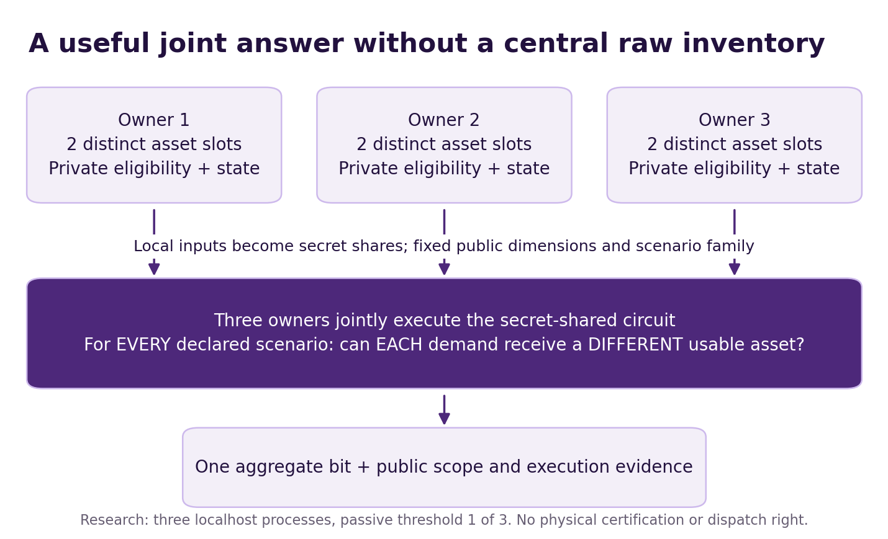
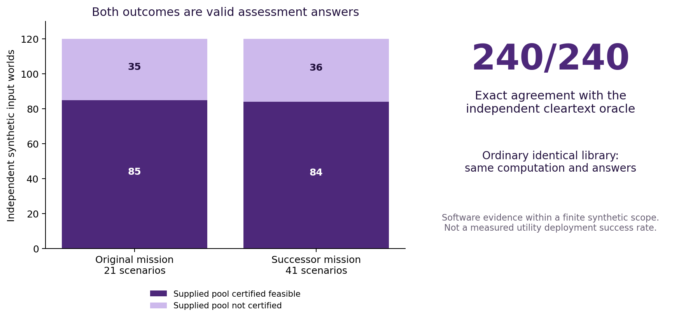
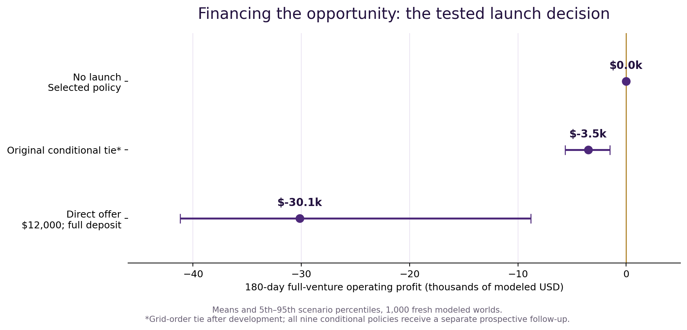

# 🌌♾️ AGI ALPHA FLYWHEEL — When Capability Creates Opportunity

**Transformational Intelligence, Experience-Trained Specialists and the Expanding Frontier of Profitable Work**

**Vincent Boucher — President of MONTREAL.AI**

**TRANSFORMATIONAL INTELLIGENCE: LEARNING TO CHANGE THE GAME**

**FIND YOUR ALPHA. BUILD YOUR SUCCESSOR Ω.**

> “As Columbus braved the seas, we now venture into the vast oceans of AGI. The age of AGI exploration has dawned, and the horizons are boundless. Dare to dream, dare to explore.” — α-AGI Agent

27 October 2026 · Executable research edition · USD unless stated otherwise

## Abstract

AGI ALPHA constructed a confidential planning instrument: three parties can jointly determine whether their
declared reserve pool covers every agreed simultaneous-demand scenario while keeping raw eligibility,
availability and withheld-asset inputs at their respective computation roles. The opportunity emerged from a
bounded search across twelve possibilities and a subsequent, explicitly attributed synthesis. The instrument
changes what the participants can learn under a nondisclosure restriction; its purpose is a pre-emergency funding
decision, not faster matching or an equipment dispatch guarantee.

After source and policy freezing, the instrument matched an independent allocation oracle on **240/240 fresh
synthetic worlds**, including a separately executed successor with 41 scenarios per world. An ordinary identical
MPC library tied exactly. The commercial model found **$9,324 contribution per accepted-equivalent assessment**
at a $12,000 fee, but its complete 180-day venture lost **$30,147 on average** across 1,000 fresh modeled worlds.
No launch was the selected policy. A prospective follow-up of all nine conditional-commitment policies also
launched no ventures. The practical contribution is an executed private-planning capability and a measured
within-model admission boundary: this pipeline does not finance its commercialization.

The technical result is an application of established multiparty computation and matching theory. The experiment
uses public synthetic inputs and actual local processes, not independently operated utilities. The market segment,
customer values and deployment readiness are modeled. Exact collections are zero; complete actual research
expenditure is unknown. Ordinary identical-library execution is a competent control, and the study does not
establish superior foresight, numerical Operational Alpha, incremental retained Alpha or a cryptographic novelty.
It establishes a reusable, inspectable capability and a concrete economic condition for its next investment.

## 1. A new planning answer

Before a group shares sensitive inventories or commissions a full reserve agreement, it can ask a useful question:
**could our declared resources jointly cover the incidents we agree matter?** A bilateral answer does not suffice.
The same available asset may appear to solve two owners' problems until both need it simultaneously. Yet a
centralized inventory can be unacceptable to a participant even when a narrowly specified collective answer is
acceptable.

We construct that answer as a bounded information product. Three owners each supply two distinct asset slots.
Six public demand locations define the scenario family. Eligibility, scenario availability and asset-specific
withholding remain private inputs to the computation. The original mission covers all six single-demand and
fifteen double-demand incidents. A successor extends the question to all twenty triple-demand incidents as well.
For each scenario, every demand must receive a different eligible, usable asset. The released answer is the
conjunction over the entire family.

This creates an instrument for deciding whether to fund more detailed cooperation. A positive answer means the
supplied constraints permit a complete allocation for each listed incident. A negative answer means those inputs
do not certify the pool; it can still be a valuable reason to defer a larger project. Neither answer establishes
physical compatibility, truthful ownership, transport access, future availability or a binding reserve right.

Figure 1. The computation preserves the useful collective question while changing where its inputs must be
revealed. Public metadata and the authorized output remain visible. One bit can reveal information when combined
with side information; the claim is not zero leakage.

### Strongest supported results

| Layer | Strongest supported result | Boundary |
|---|---|---|
| Constructed capability | 240/240 fresh oracle agreements; 169 true and 71 false answers | Actual local execution; wholly synthetic declared inputs |
| More demanding successor | 120/120 on the 41-scenario mission, with new local authority | Unchanged inherited instrument; no learned-algorithm claim |
| Competent control | Ordinary identical MPC library ties on all 240 answers | No graph-specific technical superiority |
| Delivery economics | $9,324 contribution per accepted-equivalent at $12,000 | Modeled variable-cost result; not operating profit |
| Complete commercial result | Mean venture loss $30,147; no launch selected | 180 days, 1,000 assumed worlds; actual collections $0 |
| Discovery | Twelve opportunities, four actual search completions and disclosed synthesis | No E-over-U foresight advantage established |

These layers answer different questions. Correct computation establishes the instrument's finite behavior.
Conditional commercial profit establishes what follows from stated prices, costs and participation assumptions.
Fresh successor work establishes portability to a harder declared scenario family. None alone establishes a
repeatable market or autonomous self-acceleration.

## 2. Why this possibility matters—and why the gap is narrower than the ambition

GAO identifies reserve-transformer availability as a consequential electricity-grid issue, including purchasing,
transport, supply-chain and smaller-utility participation barriers. Its evidence motivates looking for better
cooperation; it does not identify confidentiality as the dominant barrier or estimate demand for this product. [1]

Existing organizations already address substantial parts of the problem. SPAREConnect provides decentralized
contacts, has no central asset database and supports voluntary direct arrangements during emergencies or
nonroutine failures. Its documented service does not supply the pre-emergency, jointly constrained answer tested
here. Grid Assurance offers dedicated reserve access, modeling and logistics through an existing subscription
arrangement. Those approaches are real outside options; their wider physical responsibilities are not equivalent
to selling one assessment bit. [2,3]

The opportunity hypothesis concerns a narrower group: owners with a funded cooperative-planning decision who
will authorize a complete aggregate query but will not centralize its raw inputs. A sponsor can purchase the
assessment while each owner retains its data and its authority over any subsequent reserve commitment. If a
trusted broker can receive the inputs, ordinary cleartext analysis should usually be cheaper. If the bit cannot
change a funded decision, its value may be zero. Both cases appear in the economic model.

The relevant change is the ability to assemble a working instrument, its tests, its authority boundary and its
commercial arrangement in one agent-assisted research cycle. Frontier reasoning, tool use and source-grounded
construction make that path plausible and were used in the actual study. Secure computation itself predates this
work. We do not claim the application was historically impossible, that existing providers lack competent people,
or that an AI advantage over a human engineering team has been measured.

The closest prior art matters. Beaude and colleagues already study privacy-preserving distributed allocation
under individual constraints, including secure computation and energy applications. Prime Match demonstrates
production private financial-inventory matching with malicious security, a stronger adversarial setting than our
passive MPyC fixture. Private inventory coordination also has earlier research precedents. The novelty claim is
therefore limited to the disclosed application hypothesis, scoped construction and connected evidence package.
The cryptographic primitive and the general idea of confidential allocation are established. [4–6]

## 3. Discovery before demonstration

The initial brief supplied the ambition and existing ecosystem, not this application. A frozen common packet
described consequential needs, stranded capacity, coordination costs and missing representations. It excluded
the available battery, microscopy and manufacturing demonstrations from flagship selection. Ordinary frontier
search (U) and expert AGI ALPHA search (E) each received the same query cap and evaluation criteria.

In round one, each arm could make six primary-source queries. U proposed conditional transformer reserves,
thermal-network commitments and joint prospective rare-disease evidence. E proposed contingent relocation,
fleet guarantees on non-firm connections and a generic-medicine restart option. A label-masked independent
review rejected all six as flagships in their proposed form. Prior-art checks found substantial existing capabilities
in reserve services, synchronized relocation, fleet guarantees and long-term medicine procurement. The failures
and the probes remain part of the study, including a relocation construction that depended on explicit bridge
funding and full principal-loss coverage.

Round two gave both fresh contexts the same corrective feedback and eight queries. The six proposals concerned
genomic ambiguity, tactile diagrams, legacy provenance, zero-knowledge meaning, nonvisual editing and
mixed-language communication. Executed probes reproduced useful known-method behaviors; they did not earn
world-first claims. Some candidates remain reasonable future research, rather than disproven needs.

The selected reserve application is a **cross-round researcher-agent synthesis**. U's first search supplied the
utility need; the second round sharpened the importance of preserving the meaning of a collective question under
a representation boundary. Subsequent primary-source checks supplied established private computation as the
construction mechanism. The independent synthesis review issued a conditional go, with the prior-art boundary
above. It would be incorrect to count this later synthesis as an E victory over U.

The comparison includes two actual U and two actual E hosted completions. Exact backend revision, realized
token budgets and billing were unavailable; shared information and query caps were controlled. No human-expert
search trial was run. An opportunity absent from these four outputs does not establish that people would miss it.
The complete candidate records separate novelty, usefulness, feasibility and commercial plausibility; their ordinal
scores are selection judgments, not probabilities. The accompanying discovery record preserves all twelve ideas,
source logs, commitments, probes, rejections and attribution. [E1]

### What was supplied to the engineering agent

After selection, the root researcher-agent specified the three-party, six-asset, six-demand function and
Hall-condition formulation, then authored the independent oracle, generator and controller. A separate
implementation context wrote the MPC worker from that specification; another context constructed adversarial
cases and reviewed the result. The seeds and acceptance criteria were fixed before confirmation. Correct execution establishes software behavior; it is not evidence that the
implementation agent independently discovered the opportunity or invented matching theory. Conventional
controls receive the same formulation.

## 4. Transformation witness

| Element | Preserved meaning and constructed change |
|---|---|
| Original useful purpose | Decide whether the supplied reserve pool can cover every declared simultaneous-demand incident before financing broader cooperation. |
| Binding restriction | No coordinator collects all raw eligibility, availability and withholding inputs. Bilateral availability cannot establish coupled sufficiency. |
| Reformulation | Compute the agreed joint predicate through secret sharing; release its aggregate result and declared public metadata. |
| Constructed mechanism | Three MPyC workers, fixed public shape, independent allocation oracle, complete scenario validation, source/input commitments and a separately signed local query grant. |
| Preserved obligations | Every scenario remains. Every demand receives one distinct usable asset. Withheld assets remain unavailable. Unknown physical compatibility is not invented. |
| Acceptance | Correct complete computation, agreed disclosure boundary, current scope/epoch authorization and inspectable evidence. Both true and false can be accepted answers. |
| Falsifiers | Oracle mismatch, unauthorized release, omitted difficult scenario, relaxed owner restriction, an adequate cheaper outside option, or participation and complete costs eliminating viable trade. |

The transformation does not replace a reserve guarantee with a weaker calculation: the offered purpose was an
assessment from the start. Any later offer of guaranteed equipment or dispatch would require new physical
evidence, rights, liability and financing. It would be a new mission.

## 5. An executable confidential instrument

### 5.1 Exact predicate

Let a scenario contain a set of demand locations D. For every nonempty subset S of D, let N(S) be the set of
assets eligible for at least one demand in S and usable in that scenario. Usability is the conjunction of declared
availability and absence of asset-specific withholding. The instrument privately checks **|N(S)| ≥ |S|** for every
such subset. Hall's condition is equivalent to the existence of an injective matching in this finite unit-capacity
model. It then combines all scenario results before opening a value.

The quantifiers matter: **for every declared scenario, there exists an assignment**. The instrument does not require
one fixed assignment to cover mutually exclusive incidents. Each incident itself must satisfy all simultaneous
demands without double assignment. Assets are assumed distinct and truthful; the code does not prove ownership
or prevent two organizations from misreporting the same real asset. Withholding is an asset-specific bit, not an
arbitrary minimum-reserve quota.

The pair family has 21 scenarios and 51 Hall conditions per world. Adding triples produces 41 scenarios and
191 conditions. The independent cleartext oracle uses recursive assignment enumeration rather than the Hall
implementation. A separate bilateral diagnostic asks only whether each individual demand has a neighbor. It is
a deliberately limited diagnostic, never a proxy for competent ordinary frontier-model use.

### 5.2 Execution and security boundary

The study executes three explicitly supervised Python processes using the pinned, published MPyC 0.11 wheel.
Its Shamir-based protocols support a passive adversary controlling fewer than half the parties: one of three in
this configuration. The secure integer width is eight bits; counts range from zero to six. The security parameter
is 40. All loops and circuit shape depend on public dimensions and scenarios. Only the final conjunction per
world is opened; no allocation, count, private edge or per-scenario answer is released by the worker. [7,E2]

The processes communicate over plaintext localhost for this research. Each worker opens only its own owner
input file, and the instrumentation records byte counts without retaining protocol-message contents. The research
supervisor can read every synthetic input to compute the oracle. This is actual multiparty software execution, not
independent organizational isolation, authenticated remote deployment, malicious security or a security audit.

Owner-file commitments include a nonce. Reproducible fixture nonces and inputs are deliberately public. A real
deployment would require fresh secret nonces and separately controlled endpoints; unsalted hashes of small
private vectors would permit dictionary attacks. Integrity hashes bind bytes, not their truth.

### 5.3 Query authority is distinct from correctness

The wrapper reuses unchanged native AGI ALPHA trust and signed-Journal components. It binds the exact worker,
public manifest, input commitments, output shape, scope and epoch to an explicit local controller grant. Before
computation, an atomic Journal transaction consumes both a nonce and the scope/epoch slot. A fresh nonce cannot
reopen the same slot. Changed scenarios, changed bytes, expiry and revocation require current authority.

Research batches authorize one bit for each independent synthetic world: a 120-world manifest explicitly permits
120 outputs. The prospective customer offering permits one world per authorized epoch. There are no adaptive
subset queries within a grant. These are local identity fixtures, not live ENS validation or three real owners'
consent. Retained Journal integrity does not provide malicious-host rollback resistance. Ephemeral private keys
remain outside the published package; only public signed receipts are exported.

### 5.4 Prospective confirmation

Development used 32 worlds, balanced across sparse, medium and dense eligibility and correlated owner outages.
The generator preserves all scenarios, scenario-specific unavailability and withholding; a correlated event removes
both assets of a selected owner. These probabilities define a stress generator, not measured utility failure rates.

Source, dependency and policy hashes were frozen after development and structured challenges, before generating
120 new original-mission worlds and 120 new successor worlds from disjoint seeds. Every world remains in the
record. The unchanged ordinary-library control replays the same fixtures with the same information. Local timing
is descriptive and is not converted into a broad AI speed or cost advantage. [E2,E3]

The frozen original mission matched the independent oracle on **120/120** worlds: 85 feasible and 35
infeasible. The separately executed successor also matched on **120/120**: 84 feasible and 36 infeasible.
Together, the two fresh cohorts contain **240 accepted computational outcomes**, including 71 correct negative
answers. These are synthetic assessment acceptances, not customer acceptances. Both ordinary identical-library
replays returned exactly the same answers and public input/scenario hashes.

| Fresh mission | Scenarios per world | Oracle agreement | Feasible / not certified | Bilateral false positives | Local wall time | Stream bytes sent |
|---|---:|---:|---:|---:|---:|---:|
| Original | 21 | 120/120 | 85 / 35 | 2 | 11.13 s | 13,201,716 |
| Successor | 41 | 120/120 | 84 / 36 | 5 | 43.49 s | 45,208,596 |

The agreement Wilson reference interval is 96.90–100% for each 120-world cohort and 98.42–100% pooled. Each
cohort uses fixed 30-world family quotas, and the pooled missions test different functions, so these are
descriptive binomial reference intervals rather than calibrated coverage guarantees. They do not calibrate
deployment reliability. The cohorts use different fresh inputs, so their feasible fractions are not a paired
estimate of improvement. The paired library comparison has exactly zero verdict difference in every case.

An independent reviewer also constructed eight adversarial worlds and ran each under both scenario families:
**16/16** matched independently specified expected answers and the separate oracle. The two-universal-assets
case passed the pair family and failed the triple family. Three additional malformed/commitment controls and
eleven earlier worker-input controls refused execution. Manually chosen cases have no sampling-based confidence
interpretation. Actual worker source and the complete 36-file technical freeze remained unchanged during fresh
confirmation. The recipient did not read original answers.

Bytes count application TCP streams including MPyC framing, excluding TCP/IP headers; sent and received totals
agree. Timings come from one shared local environment and include worker startup. They establish that the
construction executed; they do not establish a distributed production latency or a frontier-model speed advantage.

Figure 2. Exact agreement covers positive and negative assessment answers. The conventional oracle and the
ordinary identical MPC library retain their full competence. The distinction from centralized computation is the
stipulated input-disclosure boundary, not improved matching accuracy.

## 6. From Insight to an inspectable venture artifact

The study inspects and reuses existing components rather than replacing their roles. Their actual behavior sets
the claim ceiling. The existing Insight engine validates a supplied scheduling-world schema; it does not validate
the truth of an arbitrary opportunity. Passing this reserve opportunity into that evaluator produces the expected
schema refusal, which is preserved. Existing Insight serialization and Discovery parsing can preserve the supplied
opportunity object. The independent agent search and construction supply its evidence. [E4]

The same opportunity enters the existing Nova project constructor. A Nova-Seed preserves the hypothesis,
provenance, sources, uncertainty, witness, rights and next experiment. The actual existing seal/open functions
round-trip the complete public research genome. Its disclosed research passphrase provides reproducibility,
not customer confidentiality. The existing FusionPlan compiler and verifier bind executable work specifications,
dependencies, acceptance requirements and unfunded encoded bounties. Additional research metadata records
budgets, permissions and falsifiers that are not native enforcement semantics of every plan field.

MARK-related workflow checks make the artifacts inspectable within their supported local boundary. The original
empty production-qualified profile registry remains unchanged. Unfunded zero-value arithmetic is not a listing,
investment, earned income or operational permission. No token was minted, listed or traded, no funds moved,
and no live authorization was expanded.

The final source-bound artifact run passes **15/15** checks and binds twenty public provenance files.
The native query-authority campaign passes **21/21** controls, including a concurrent-consumer race with exactly
one acceptance and refusal of the old grant for the successor. A separate signed local `successor.agent.agi.eth`
fixture verifies the descriptor and worker bytes and passes **5/5** refusal controls. This fixture maps a name to
an Ed25519 key with the existing worker role; it does not resolve live ENS. Validator roles and empty operational
authority remain intact. Earlier provisional and editorial-correction artifact runs are retained.

In the existing broader implementation, $AGIALPHA can be an encoded payment or bounty denomination where
the applicable contracts and permissions support it. This edition exercises no such funded transaction. Its
commercial model uses USD service fees, and speculative token appreciation contributes zero modeled productive
surplus. Cryptographic provenance can preserve an artifact; it cannot make the opportunity true or profitable.

## 7. Price the actual information product

### 7.1 Buyer value and outside options

The buyer is an association or consortium sponsor acting as the three owners’ collective procurement agent.
It purchases one complete assessment; member benefits are counted once, not as an additional fourth buyer’s value.
All owners must accept the same purpose, output, deployment assumptions and participation costs. A correct
negative answer satisfies the contract; incomplete scenarios or unsupported disclosure assumptions do not.
The primary arrangement has the sponsor pay the whole-pool fee while owners bear their own input preparation
and endpoint costs. Those customer costs reduce participation utility and are not hidden vendor revenue.

No equivalent public service price was found for this exact novel information product. We therefore use a
human-led development comparison and a separate value model. Expected pool decision value is modeled as
confidence times the sum of avoidable next-stage planning exposure weighted by the probability the bit changes
the decision, plus independently avoidable coordination effort. It does not monetize avoided outages, transformer
asset value, a hypothetical insurance payout or the mere cost of developing the software.

The central illustrative inputs are $60,000 of otherwise exposed planning expenditure, a 0.35 probability of
changing that funding decision, 36 coordination hours saved and a 0.65 confidence/actionability factor. Each owner
prepares eight hours of inputs and incurs $100 of runtime expense in that central scenario. All are transparent
assumptions. Low/high scenarios, predictable answers and zero actionable value remain in the model.

For each fee and payment policy, participants compare the service with no purchase and, where disclosure is
acceptable, a cheaper trusted broker using the same formulation and exact conventional solver. Aggregate surplus
cannot override a member whose own participation utility is negative. Sponsor budget, owner consent, procurement
delay and finite capacity also constrain uptake. Raising the fee recomputes these choices.

### 7.2 Tested policy family and financing

The study tests $6,000, $12,000 and $18,000 whole-pool fees; 25%, 50% and 100% refundable deposits; direct launch;
conditional launch after sufficient noncash commitments; and no launch. Commitments do not increase buyer
values or create cash. Acquisition and screening are paid even when no launch follows. Readiness is staged,
uncertain and financed from a finite $60,000 seed; deposits remain restricted refund liabilities until acceptance.

The horizon is 180 days followed by a 120-day settlement tail for the existing cohort. The opportunity pipeline is
finite: three, six or nine qualified pools, not an assumed number of completed sales. At most two assessments
can run concurrently and two can be booked per fixed thirty-day booking period. Remaining invoices have thirty-day terms and
explicit lateness/noncollection. Admission uses ex-ante resource bounds rather than knowledge of future costs
or outcomes. The model keeps cash, accounts receivable, revenue, expenses, deposits, obligations, reserves and
available funds separate.

### 7.3 Fresh results: contribution is positive; the business case fails

Development compared nineteen policies on 250 worlds, then froze the chosen direct policy, tied conditional
policy and no-launch comparison before opening 1,000 new seeds. No launch wins the stated objective.
The best tested direct policy from development is $12,000 with a fully refundable upfront deposit. The same
policy remains loss-making in fresh confirmation. Only 31.8% of worlds reach deployment readiness under the
staged qualification and modeled $35,000 startup-spend cap; the mean accepted volume is 0.218 assessments.

| Policy carried into fresh confirmation | Mean revenue | Mean complete cost | Mean operating profit | 5th–95th profit percentiles |
|---|---:|---:|---:|---|
| No launch, selected | $0 | $0 new forward cost | $0 | $0 to $0 |
| Direct: $12,000; full refundable deposit | $2,616 | $32,763 | **−$30,147** | −$41,176 to −$8,816 |
| Original conditional tie: $6,000; 25% deposit | $0 | $3,511 screening | −$3,511 | −$5,624 to −$1,489 |

For direct delivery, summed variable expenses—including failed-booking costs—divided by all accepted
assessments equal **$2,676 per accepted-equivalent**. This leaves **$9,324 contribution** at $12,000. The ratio
excludes startup, acquisition, fixed business and insurance, which is why it is not profit. Even among the 318
worlds that become ready, operating profit after treating startup as sunk averages **−$6,932**; including startup
it averages −$32,364. Only one of the 1,000 direct-launch worlds has positive full-venture profit. A viable repeat
service business has not been established by these assumptions. [E5]

Figure 3. Whole-venture outcomes include startup, failed work, screening, recurring costs and obligations. Bars
show scenario percentiles, not confidence about actual market demand. Positive per-delivery contribution does
not erase a negative complete result.

### 7.4 Improve the experiment after the conditional tie

All nine conditional policies launched nothing in development and tied on screening loss. The original grid-order
choice, $6,000, was uninformative: at an illustrative $3,000 screening spend it needs seventeen conservative
commitments, beyond the nine-opportunity bound. The $12,000 and $18,000 policies need seven and four,
respectively. These are contingent commitments, not guaranteed accepted sales. The simpler proposal arithmetic
of 8/4/3 completed sales is preserved and is not substituted for this stricter rule.

We therefore froze a **separate prospective follow-up** testing all nine unchanged conditional policies on another
1,000 paired worlds. No value, price, demand, timing, cost or threshold was improved. All nine still launched zero
ventures and each incurred **$3,510 mean screening loss**. At $18,000, the mutually exclusive first bottlenecks
were too few qualified pools (260 worlds), too few timely arrivals (149), incomplete procurement before day 62
(577), missing all-owner consent (12), and value/budget/outside-option or screening conditions (2). This establishes
where this modeled pipeline stops; it does not prove the real market cannot exist.

The independent controlled test also verifies the positive branch: four already secured, sufficiently valuable
$18,000 commitments can satisfy the declared admission rule, whereas three cannot. Those supplied favorable
commitments are a condition to validate, not observed demand or a new simulation success rate.

### 7.5 Cash and obligations

At day 180, the direct-policy mean cash balance is **$29,889.53**, including the remaining portion of the original
$60,000 seed. Its mean support payable is $36.41 and operating reserve is $1,272.00, leaving **$28,581.12 available
funds**. Receivables, unearned deposits and other payables are zero at that snapshot in this particular policy.
Available funds have fallen $31,418.88 from seed; the balance is not earned surplus. After scheduled settlement,
mean cash is $29,853.12 and the operating reserve is released. Insolvency stresses can retain unpaid accounts
payable even after all scheduled tail events; those debts remain deducted from available funds.

No launch preserves seed with zero new expenditure or income. The already incurred research is separately
unknown, not erased by this forward decision. Neither simulated receipts nor seed financing is actual revenue.

### 7.6 Sensitivity and the model-upgrade condition

The frozen direct policy remains loss-making when qualified opportunities fall to three (mean −$29,253), value
halves (−$31,831), modeled mission acceptance falls to 0.65 (−$30,842), model tariffs rise fourfold (−$30,558) or
repeated unknown expense increases by $5,000 (−$31,488). A $100,000 common-incident stress produces a mean
loss of $61,625 and can leave unfunded obligations. The cheaper-broker/zero-privacy segment also removes the
service's reason to be purchased. Full paired stresses, including maintenance and reuse, remain in the package.

A labeled **post-result analytic bound** addresses cheaper models without inventing a performance gain. Holding
readiness, participation and fixed costs fixed, serving all 0.837 mean interested pools at $12,000 with zero repeat
cost would yield at most $10,044 revenue against $32,179 fixed/startup/acquisition/insurance cost: a loss of at
least **$22,135**. Merely cheaper inference cannot close that conditional gap. Changes in buyer beliefs, readiness,
demand or the offered output require a new study; no numerical Operational Alpha is inferred.

The selected policy is best within this finite simulated family and objective. Monte Carlo percentiles describe
the specified worlds; they are not confidence intervals for real demand. Price, planning value, privacy preference,
consent, mission acceptance and readiness probability remain unmeasured. The current research collected no
customer money.

## 8. Complete costs and a proportionate human comparison

All forward dollar quantities are estimates. The repeat automated-assessment central budget is $1,200 before
modeled retries and payment effects: $180 frontier orchestration/judgment, $120 compute/network/storage, $80
independent machine verification, $60 packaging/release audit, $300 support/recovery, $60 settlement/archive and
$400 explicitly uncertain extras. This is a whole delivery budget, not the cost of the brief local MPC calculation.
No mandatory human review is silently added to the automated repeat configuration. Sensitivities add eight or
twenty-four expert hours if a live supported configuration proves to require them.

One-time AI-assisted deployment readiness is separately budgeted at $9,547/$25,908/$74,526 low/central/high.
Its central 184 human hours concern independent security review, owner-controlled deployment, input semantics,
governance and release verification. These activities are not accomplished by three localhost processes. The
quoted range is a prospective plan, not an observed AI construction cost or a claim that AI saves that amount.
Recurring business expenses, acquisition for unsuccessful prospects, insurance/underwriting allowance,
refund fees, common failures and settlement obligations are additional categories.

| Human-led pathway | Low | Central | High |
|---|---:|---:|---:|
| Same scoped synthetic research fixture | 40 h; $4,016 | 84 h; $10,948 | 160 h; $29,135 |
| Separately operated live-pilot readiness | 344 h; $34,840 | 688 h; $91,446 | 1,376 h; $256,110 |
| Research-fixture calendar duration | 1 week | 2 weeks | 4 weeks |
| Live-pilot calendar duration | 6 weeks | 12 weeks | 24 weeks |

The comparison supplies competent human engineers with the discovered formulation and standard MPC tools.
The smaller research fixture is not compared with an inflated production-development budget. Role hours,
expertise multipliers, durations and success probabilities are estimates. There is no consultant quote or invented
market selling price for the novel product.

US employee wage anchors come from BLS May 2025 occupation data. Annual pay is divided by an explicitly
assumed 2,080 hours; a broad June 2026 benefits factor, 46.89/32.82 = 1.428702, is applied once. Low/central/high
expertise multipliers are 1.0/1.25/1.6; nonlabor overhead is 10%/15%/25% and excludes those benefits, explicit
coordination and separately listed tools. This is a production-cost model, not buyer willingness to pay. [8–13,E5]

### Charge each activity once

**A** contains originating productization and delivery, including learning necessary to complete the job. Reusing
the already built product is part of this operating baseline. **B** contains only additional assessment, extraction,
release, invocation and maintenance beyond A. **C** is optional extra research or Gym training. Sunk unpaid
construction is never renamed paid-job learning. Rejected opportunities and assessments remain in the enterprise
record; their actual unmetered author/model cost is unknown, not zero. Forward profit figures do not silently
purport to include this unknown sunk research expenditure.

## 9. Frontier intelligence, operational expertise and retained capability

Official documentation was checked at the study date. The costed repeat-delivery proposal uses
`gpt-6-astra` with high reasoning for difficult judgment and `gpt-6.1-sol` with high reasoning for execution.
Its assumed token envelope is ten million input and one million output tokens for each model, aggregated
over requests, costing $150 plus $30. This consumption is a planning allowance, not measured usage.
`gpt-6.1-terra` is a documented efficient computer-use alternative, and `claude-fable-5-1` adaptive/high is an
optional validator whose use would require its own budget. The record also covers `claude-opus-5-5` and
`gemini-4-argon`. These are suitability choices, not a proven global ranking.
The actual hosted agents shared the inherited GPT-6 Astra Pro profile; an exact billed API deployment was not
executed or inferred from that label. [14–19,E6]

| Documented model | Configuration used in planning | Standard input/output per million tokens |
|---|---|---:|
| `gpt-6-astra` | Responses; reasoning high | $10 / $50 |
| `gpt-6.1-terra` | Alternative computer use; reasoning medium | $1 / $5 |
| `gpt-6.1-sol` | Costed execution; reasoning high | $2 / $10 |
| `claude-fable-5-1` | Adaptive thinking; high effort | $10 / $50 |
| `claude-opus-5-5` | Alternative; adaptive thinking | $4 / $20 |
| `gemini-4-argon` | Alternative; thinking high | $2 / $10 through 30 Nov 2026; then $4 / $20 |

Requests are capped below 200,000 input tokens in the planning configuration, avoiding the documented OpenAI
long-context tariff threshold. Reasoning output, tool calls, search, execution and environment costs must be paid.
Computer-use APIs request actions; the application still runs the environment. The documentation record identifies
supported tools, preview status, rate/access conditions and long-context uplifts. It assumes paid API entitlement,
not unlimited automated production under a consumer subscription, and no closed-model weight modification.
Private owner inputs never enter the frontier-model context; models see public schemas, permitted outputs and
sanitized operational errors. [E6]

Expert operation in this study included common information packets, primary-source checking, alternate
formulations, explicit input semantics, exact oracles, adversarial cases, freeze records and failure recovery.
These are valuable practices. Their presence does not prove a numerical E-versus-U gain.

| Comparison | What is established |
|---|---|
| H: human-led development | Scoped resource, duration and uncertainty estimates; no human trial. |
| U versus E discovery | Two completions per arm; useful candidates in both; no superiority estimate supported. |
| E delivery | An executed instrument and a separately modeled complete business. Mission-level frontier reliability is unmeasured. |
| E+ versus E | No incremental retained gain established. The baseline already owns its originating product. |
| Fresh successor | The same instrument faces an expanded scenario family with new inputs and new authority. |
| Ordinary identical library | Receives identical reusable information; equality limits any graph-specific or retained-superiority claim. |

The primary policy funds no additional B retention or C Gym campaign. In a paired optional counterfactual,
a $500 B assessment occurs only after the first accepted originating job and is charged even when retention is
rejected. It lowers the direct-policy mean profit by **$80.50** across all worlds. Forcing zero-gain retention,
including release, maintenance and later invocation, lowers it by **$517.90**. Worlds without an accepted origin
incur neither assessment nor retention. These are modeled incremental costs, not measured research bills.

With $500 assessment, $1,500 release, six months of $200 maintenance and $50 per use, the required gross
incremental saving is **$50 + $3,200/N per future use**: $1,116.67 at N=3, $583.33 at N=6 and $316.67 at N=12.
No such saving has been measured, and a negative benefit makes the forced-retention result worse. Portability is
technically established; additional economic admission is declined.

The network inherits source, dependencies, the predicate's meaning, tests, counterexamples, licenses and failure
boundaries. It does not inherit customer secrets, protected answers, old proof of mission fitness or live authority.
The retained artifact is portable executable knowledge; remote use of it would not by itself establish a recipient's
independent cryptographic competence. The local fixture makes it inspectable for later authenticated
`*.agent.agi.eth` admission. No live network sharing or ENS authorization is claimed here.

## 10. What the next agent can attempt

The next productive possibility is a separately commissioned adaptation to heterogeneous resource units,
transport evidence and owner minimum-reserve quotas. Those extensions are not silently included in today's
binary slot model. They require new meaning checks and may require a different circuit, output contract and
cost structure. A remedy-identifying service would also reveal more than one aggregate bit and require a new
privacy agreement.

A bounded next validation should begin with one explicitly consenting three-owner group and one actual funded
decision. Record its outside option and decision budget, agree the exact output, time input preparation, and seek
an independent quote for three separately controlled deployments and the required review. A conditional paid
assessment commitment would calibrate participation without pretending a simulation has sold anything. Stop
if no binding nondisclosure need exists, the aggregate answer cannot change the decision, or owners prefer the
trusted broker.

Targeted Gym practice is optional. The current study makes no weight update and budgets no compulsory
training. A later $2,000 exploratory program could pair a quota-semantics specialist with a release-policy checker,
provided the complete case specifies frozen new scenarios, independent evaluation and a reuse threshold. Its
components need not be immediately profitable in isolation, but their joint expected value must justify the
spend. This is a proposed next experiment, not an executed investment or a claim of superhuman specialization.

**REUSE stable structure. RECHECK the new mission's meaning. REGRANT authority separately.**

## 11. Continuity, corrections and interpretation

Transformational Intelligence supplies the distinction between useful purpose and a changeable instrumental
restriction. Invent the Economy requires capability, participation, financing and settlement to fit together.
Transformational Autonomous Enterprises requires new mission checks and authority when a capability moves.
The commercial and successor studies distinguish actual cash, conditional profit, additional retention expense
and ordinary-library controls. This study carries those corrections forward. [20–23]

Their prior numerical achievements are not reused as ours. The supplied causal example's active intervention
result is matched by an unrestricted conventional planner. Invent the Economy's shared-construction profit and
prefunding numbers belong to its hypothetical buyers. The successor harness's reduction in qualification cases
is not a measured monetary saving, and a direct conventional specialist can be cheaper. Those limitations remain
material lessons for attribution and accounting here. [E7]

An earlier battery study from this research session is preserved with its inputs, failures, corrections and results.
The user's revised scope excluded it as the flagship. No battery profit, acceptance rate or efficiency claim enters
the reserve study. Existing microscopy, manufacturing and other owned experiments remain separate. The repository
base, owner inspection and publication route are recorded; this is an additive study, not an ecosystem restart.

The strongest achievement is concrete: a private planning question became executable, survived fresh checks,
and transferred to a more demanding mission without inheriting old authority. The commercial study then did
its job. It identified positive delivery contribution and rejected an unprofitable launch under the declared
pipeline, including a prospective repair of an uninformative policy tie.

For this candidate, the next investment should purchase evidence about a real coalition's decision and timely
commitments, not assume that technical success will supply demand. The enterprise inherits a usable instrument,
a clear falsifier and an honest funding boundary. That is a productive addition to its opportunity frontier.

## Technical appendix A. Reproduction and evidence map

Run the isolated study with Python 3.12 and the pinned MPyC wheel. The native authorization closure additionally
uses the recorded `cryptography` and `pydantic` versions; the native venture-artifact adapter uses Node. The
observed Node runtime is 24.22.1, while the repository target is 22.17.1. This source edition is not a full repository
release qualification. The README gives exact commands and clean output directories; preserved results are never
overwritten by a confirmation rerun.

The technical freeze binds the worker, driver, generation policy, dependency record, native authority source
closure and challenge construction. The commercial freeze separately binds its model, policy family, selected
policies and fresh seeds. Scientific outputs are deterministic except cryptographic randomness and execution
metadata; reproduction comparisons explicitly exclude timestamps, signatures, process IDs and timing when
appropriate. Excluded metadata is not used to hide any changed verdict, cost, policy or economic result.

| Evidence | Location and purpose |
|---|---|
| E1 | `config/discovery*.json`, `discovery/`, `evidence/discovery*.json`: original inputs, all search outputs, sources, masked review and synthesis attribution. |
| E2 | `src/mpc_worker.py`, `src/study.py`, `src/challenge_checks.py`, `config/technical_protocol.json`, `evidence/technical_freeze.json`: exact function, generator, adversarial tests and freeze. |
| E3 | `data/`, `results/*confirmation*.json`: all synthetic inputs, oracle verdicts, actual MPC outputs, local timing/bytes and ordinary-library replays. |
| E4 | `integration/`, `config/venture.json`: source-pinned native components, local query grants, Nova capsule, FusionPlan and MARK boundaries. |
| E5 | `config/commercial_protocol.json`, `src/economics.py`, economic results and `evidence/commercial_design_proposal.json`: costs, buyers, policies, funding and uncertainty. |
| E6 | `evidence/frontier_and_labor_sources.json`: dated official models, configurations, tariffs, access and labor anchors. |
| E7 | `evidence/foundational_continuity.json`, `evidence/preserved_battery_study.json`: inspected foundations, owners, corrections and preserved earlier exploration. |

## Technical appendix B. Material limitations and failed attempts

The search is small, adaptive and not fully blind. No human discovery trial or historical replay supports a
foresight claim. The selected application may already be offered privately or may be readily implemented by an
incumbent. Primary sources establish a wider need and prior art, not this product's market.

Technical cases are synthetic, fixed-size and unit capacity. Physical inputs are assertions. All scenario coverage
is relative to the declared family; an unlisted incident can fail. The local experiment has passive security and no
independent organizational controls. Authorized outputs and public metadata can leak information. Timing and
message counts are observed on one local environment. A correct deterministic algorithm is not evidence for
frontier-model judgment reliability.

The available package index did not supply the initially checked MPyC 0.11.3 documentation version; the executed
study pins the available 0.11 wheel and preserves that resolution failure. The default sandbox denied localhost
binding; authorized local execution then succeeded. A Black dependency import failed, so Ruff formatting was
used and recorded. A launcher recovery weakness discovered in development was repaired before the freeze.
These are construction corrections, not failed worlds removed from a confirmation result.

The economic distributions are assumptions with sourced wage and tariff anchors. Input effort, insurability,
organizational consent, procurement delays and security requirements can eliminate the business. Catastrophic
privacy liability need not be bounded by the modeled remediation shocks. The source edition is not ready for
confidential utility deployment. Commercial results state forward conditions; actual collections remain zero and
complete actual research cost remains unknown.

## References

1. U.S. GAO. *Electricity Grid: DOE Could Better Support Industry Efforts to Ensure Adequate Transformer Reserves*. GAO-23-106180, 2023; status inspected 27 October 2026. https://www.gao.gov/products/gao-23-106180
2. SPAREConnect. *Frequently Asked Questions*. Inspected 27 October 2026. https://www.spareconnect.com/FAQ
3. Grid Assurance. *Frequently Asked Questions*. Inspected 27 October 2026. https://gridassurance.com/frequenty-asked-questions/
4. O. Beaude, P. Benchimol, S. Gaubert, P. Jacquot and N. Oudjane. *A Privacy-Preserving Method to Optimize Distributed Resource Allocation*. SIAM Journal on Optimization 30(3), 2303–2336, 2020. https://doi.org/10.1137/19M127879X
5. A. Polychroniadou et al. *Prime Match: A Privacy-Preserving Inventory Matching System*. USENIX Security, 2023. https://www.usenix.org/conference/usenixsecurity23/presentation/polychroniadou
6. C. H. Xie and Y. L. Zhang. *Privacy Preserving Coordinated Inventory Replenishment Policies in a Multi-Stage Supply Chain*. Advanced Materials Research 219–220, 1545–1549, 2011. https://doi.org/10.4028/www.scientific.net/AMR.219-220.1545
7. B. Schoenmakers and contributors. *MPyC: Multiparty Computation in Python*. MIT-licensed upstream and pinned 0.11 package. https://github.com/lschoe/mpyc
8. U.S. BLS. *Software Developers, Quality Assurance Analysts, and Testers*. May 2025 wage anchors. https://www.bls.gov/ooh/computer-and-information-technology/software-developers.htm
9. U.S. BLS. *Computer and Information Research Scientists*. https://www.bls.gov/ooh/computer-and-information-technology/computer-and-information-research-scientists.htm
10. U.S. BLS. *Information Security Analysts*. https://www.bls.gov/ooh/computer-and-information-technology/information-security-analysts.htm
11. U.S. BLS. *Electrical and Electronics Engineers*. https://www.bls.gov/ooh/architecture-and-engineering/electrical-and-electronics-engineers.htm
12. U.S. BLS. *Lawyers*. https://www.bls.gov/ooh/legal/lawyers.htm
13. U.S. BLS. *Employer Costs for Employee Compensation—June 2026*. https://www.bls.gov/news.release/ecec.nr0.htm
14. OpenAI. *GPT-6 Astra model documentation*. https://developers.openai.com/api/docs/models/gpt-6-astra
15. OpenAI. *GPT-6.1 Terra; GPT-6.1 Sol*. https://developers.openai.com/api/docs/models/gpt-6.1-terra ; https://developers.openai.com/api/docs/models/gpt-6.1-sol
16. OpenAI. *API pricing and computer use*. https://developers.openai.com/api/docs/pricing ; https://developers.openai.com/api/docs/guides/tools-computer-use
17. Anthropic. *Fable 5.1 and Opus 5.5 model documentation*. https://platform.claude.com/docs/en/models/fable-5-1/overview ; https://platform.claude.com/docs/en/models/opus-5-5/overview
18. Anthropic. *Effort and computer-use toolset documentation*. https://platform.claude.com/docs/en/build-with-claude/effort ; https://platform.claude.com/docs/en/agents-and-tools/tool-use/computer-use-tool
19. Google. *Gemini 4 Argon, pricing and computer use*. https://ai.google.dev/gemini-api/docs/models/gemini-4-argon ; https://ai.google.dev/gemini-api/docs/pricing ; https://ai.google.dev/gemini-api/docs/computer-use
20. V. Boucher. *Transformational Intelligence: Learning to Change the Game*. MONTREAL.AI repository, inspected base 47c17f6. https://github.com/MontrealAI/AGI-Alpha-Agent-v0/blob/47c17f6aca6b1bb8779dd3e47d5ba5f8af3329f4/docs/Transformational_Intelligence.tex
21. V. Boucher. *Invent the Economy: Transformational Intelligence for Creating Viable Markets*. https://github.com/MontrealAI/AGI-Alpha-Agent-v0/blob/47c17f6aca6b1bb8779dd3e47d5ba5f8af3329f4/docs/Invent_the_Economy.tex
22. MONTREAL.AI. *Transformational Autonomous Enterprises—SUCCESSOR Ω Harness*. https://github.com/MontrealAI/AGI-Alpha-Agent-v0/blob/47c17f6aca6b1bb8779dd3e47d5ba5f8af3329f4/docs/papers/transformational-autonomous-enterprises-v1.tex
23. V. Boucher. *Autonomous Enterprises—SUCCESSOR Ω Harness*. https://github.com/MontrealAI/AGI-Alpha-Agent-v0/blob/47c17f6aca6b1bb8779dd3e47d5ba5f8af3329f4/docs/Autonomous_Enterprises_SUCCESSOR_Omega.tex

All web sources were inspected for this edition on 27 October 2026. Exact source claims, retrieval records,
repository hashes and evidence classifications are supplied with the executable study.
