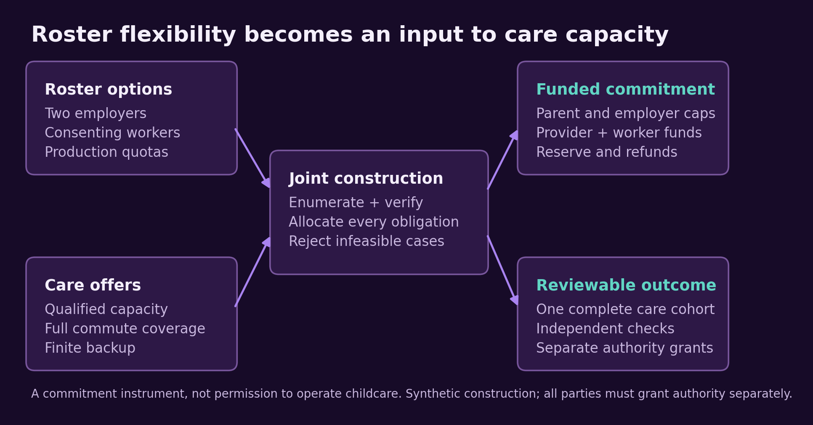
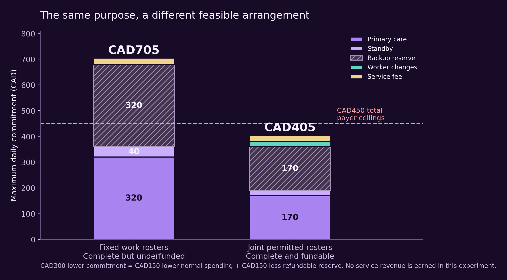
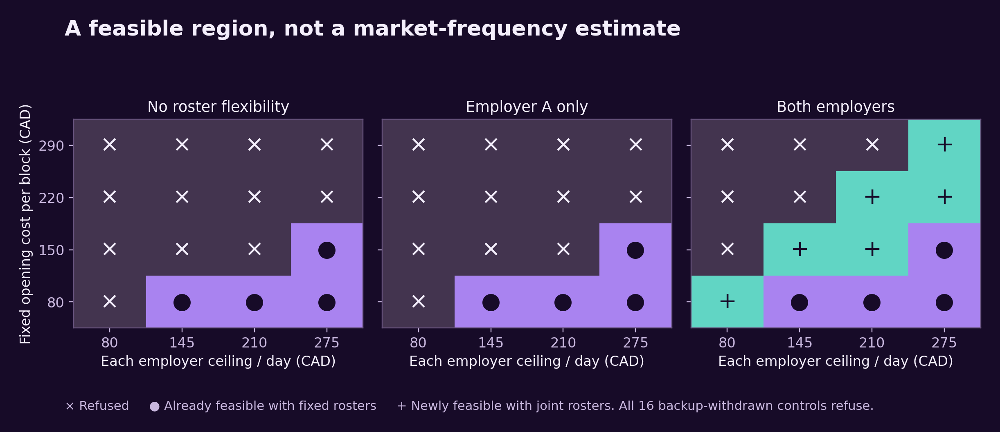
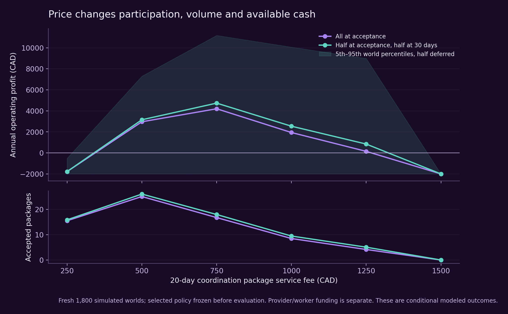
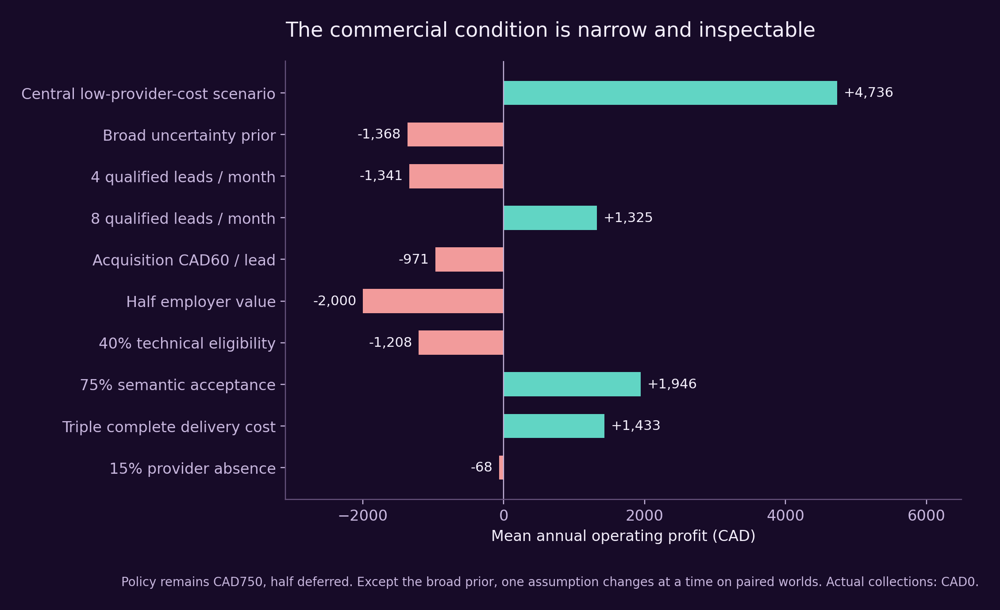

# 🌌♾️ AGI ALPHA FLYWHEEL — When Capability Creates Opportunity

**Transformational Intelligence, Experience-Trained Specialists and the Expanding Frontier of Profitable Work**

**Vincent Boucher — President of MONTREAL.AI**

**TRANSFORMATIONAL INTELLIGENCE: LEARNING TO CHANGE THE GAME**

**FIND YOUR ALPHA. BUILD YOUR SUCCESSOR Ω.**

> “As Columbus braved the seas, we now venture into the vast oceans of AGI. The age of AGI exploration has dawned, and the horizons are boundless. Dare to dream, dare to explore.” — α-AGI Agent

**Research edition 1.0 · 27 October 2026 · Executed synthetic construction and conditional commercial simulation**

## Abstract — Work schedules can become an input to care capacity

A child-care place can be missing because demand arrives at incompatible times, even when employers, parents and a provider could jointly support a useful opening. This study discovers and constructs a bounded response: consenting roster changes across independent employers are combined with a funded care-opening commitment, worker compensation and finite backup obligations. The output is a complete, independently checkable arrangement, rather than a schedule alone.

A frozen three-arm opportunity search generated twelve candidates. The selected opportunity was absent from the initial brief. In the connected synthetic example, the joint arrangement serves all four children, preserves every employer shift quota and reduces the maximum daily commitment from **CAD705 to CAD405**. An independently implemented oracle found **16 of 48 fresh cases** feasible only with the joint permissions and commitments. Competent conventional execution given the same formulation ties; historical novelty and superior discovery are unestablished.

The matched commercial offering is a verified **20-day coordination package**, priced at **CAD750**, with physical care supplied by the declared providers. Under explicit low-provider-cost, buyer-value and acquisition assumptions, fresh simulation supports **mean annual operating profit of CAD4,736**. The fifth-to-ninety-fifth world-percentile range is **−CAD1,999 to CAD11,174**; **22.3%** of these modeled businesses wind down early. A broad uncertainty prior has **mean loss of CAD1,368**, and a central wage-anchored provider-cost check defeats the original payer limits. These are material conditions, not realized commercial success. Actual service collections are **CAD0**.

The contribution is a tested opportunity construction, its feasible region, a complete commercial decision model and a native Insight → Nova-Seed → FusionPlan → MARK evidence path. Additional Operational Alpha and net retained Alpha remain separate questions. The executable evidence and earlier failures are preserved throughout.

## 1. The valuable possibility

Consider two employers whose workers have children needing care outside a convenient common schedule. Each employer can offer some voluntary roster alternatives, but neither controls the other employer's roster. A care provider can open an appropriate block if enough funded demand arrives together. Parents can express acceptable care locations and work options. A backup provider can make a finite, priced commitment. Individually, none of these parties owns the complete solution.

The opportunity is to treat **permitted work-time choices as a resource for constructing care capacity**. Demand is no longer a fixed histogram handed to a provider. It becomes a set of choices that can be combined, provided production, individual consent, complete care coverage, qualifications and payment obligations survive the change.

This is a plausible response to a documented restriction. Boston Fed reporting describes the difficulty of sustaining nontraditional-hours care when the timing and composition of demand are uncertain. Illinois Action for Children's provider research examines scheduling and staffing constraints in this setting. Those sources motivate the problem; they do not supply Montréal prices, actual participants or a measured pipeline for this offering. [1,2]

Existing organizations have substantial capabilities. Employers already redesign rosters; cooperatives already support child care; providers already reserve flexible places. The specific coordination difficulty is divided authority over the parents' production rosters, provider openings and funding. Our bounded review did not establish that every incumbent lacks an equivalent bespoke service. The study asks whether a complete arrangement can be made explicit, executable and economically inspectable under declared conditions.

What is available now in this research environment is a team of capable agents that can connect evidence across these domains, construct a finite instrument, run adversarial checks and express the resulting obligations in existing venture-artifact formats. This demonstrates a practical construction process. It does not establish that the underlying arrangement was impossible before 2026, that no human could have conceived it, or that these models are universally superior.

*Figure 1. The productive possibility is a complete agreement among independently controlled choices and obligations. Every physical participant, preference and offer in the executable demonstration is synthetic.*

## 2. Discovery before demonstration

### A bounded, frozen comparison

At 18:54:03 UTC on 27 October 2026, we froze the initial information and discovery protocol. No child-care application, intended winning candidate or later result was included. Three isolated model runs received the same broad question, evidence boundary, rubric and resource limits: ten search-query strings, ten page-open attempts, a nominal twenty-minute budget and four candidates per arm.

**U** used competent ordinary frontier-model research. **E** used an explicit expert protocol: identify the binding restriction, search for complementary capabilities and arrangements, challenge obvious formulations, inspect adverse prior art and propose a decisive construction. **H-proxy** applied conventional expert opportunity-search methods using the same model environment. H-proxy is not a human participant.

All three runs used the session's declared GPT-6 Astra Pro model label. Backend checkpoint, temperature, hidden reasoning allocation and token expenditure were not independently observable. Actual source searches and candidate reports were executed; they were not simulated model answers. The isolated contexts, original reports, failed retrievals, tool accounting and timings remain available in the discovery record. [D1]

The rubric separated novelty relative to prior art, usefulness, technical feasibility and commercial plausibility, weighted 30%, 30%, 25% and 15%. Scores were internal and unblinded. Each arm produced two provisional candidates above its novelty/usefulness gate, and each arm's top self-score was 2.30/4. One run per arm and these subjective scores support **no superiority inference**. Finding E1 in E's four candidates and not in the other eight does not establish a general foresight advantage.

| Candidate | Proposed productive possibility | Selection outcome |
| --- | --- | --- |
| U1 | Purchaser-conditional qualification of an alternative concrete source | Credible candidate; overlaps active shared-evidence work and needs a specific source/buyer case |
| U2 | Industrial discharge-timing contracts that create treatment flexibility | Credible alternative; physical calibration exceeds the first bounded construction |
| U3 | Contingent subscriptions for a shared electricity upgrade | Strong prior art limits discovery claim |
| U4 | Bridge-assay commissioning for archived space-biology samples | A specific scientific comparison and distinct instrument were not established |
| E1 | Joint employer rosters that make a care cohort fundable | Selected for a conditional constructive experiment |
| E2 | Precommitted relief coverage for small water utilities | Valuable alternative; existing operator-sharing, geography and common failures need deeper calibration |
| E3 | Service-obligation-backed flexible feeder access | Existing flexible-access arrangements anticipate major ingredients |
| E4 | Insured performance pools for reused EV batteries | A closely overlapping commercial offering already exists |
| H1 | A feeder cooperative with physically backed curtailment | Provisional candidate; cross-arm prior art narrows the remaining gap |
| H2 | A regional PFAS treatment uptime pool | Existing turnkey and mobile services are strong alternatives |
| H3 | Hospital-funded injectable manufacturing readiness | Existing hospital-backed supply organizations strongly overlap |
| H4 | Stewardship of public flood-buyout parcels | Paying demand, rights and hydraulic value remain insufficiently specific |

Selection favored a consequential restriction, a distinct active-work lane and a construction whose obligations could be tested completely. It did not rank the selected candidate as proven more valuable than U2 or E2. Root supplied the experimental implementation, synthetic cases, selection judgment and economics after discovery. E contributed the opportunity connection and its initial falsifiable construction; it was not supplied the final application in its input.

### What prior art permits us to claim

WorkFamily Solutions already describes reserved places that accommodate changing shifts and can be shared among children. Employer child-care cooperatives are established. Biarri describes delivered systems coordinating care-center staffing, enrollment and disruptions; OneHSN describes a pilot linking capacity, enrollment, contracts and funding. These are strong overlaps, not weak controls. [3–6]

The narrower construction joins **parents' work rosters across separate production employers** with a funded provider opening and finite contingencies. Care-worker rostering inside an existing center is a different variable, although its methods are useful components. The bounded searches did not resolve all academic, private-contract or customized-provider precedent.

Accordingly, our discovery claim is scoped: the search generated an opportunity absent from its supplied answer, and subsequent construction exposed additional feasible arrangements under a preserved purpose. We claim neither historical firstness nor an exclusive market gap. An existing coordinator assembling an equivalent outcome at comparable all-in cost would defeat the market-novelty hypothesis. Conventional execution parity after receiving the formulation limits execution superiority; it does not invalidate the utility of an explicit, checked agreement. [D2]

## 3. One connected example

### The original purpose

Two synthetic employers each require two interchangeable, appropriately qualified-for-the-model workers on an early four-hour shift and two on a late four-hour shift. There are eight workers, four of whom are parents. Initially, each employer has one parent on each shift. Every worker supplies an explicit permitted-shift set and a required compensation amount for changing shifts.

Each child needs the entire parental work interval plus travel time before and after. The origin's early care window is 05:30–10:30; the late window is 09:30–14:30. The provider offers declared capacity, named staff, qualification tags, availability and opening costs. These declarations are synthetic contractual inputs, not verified licenses or a legal staff-to-child ratio. More complex occupational skills, age-specific rules and actual provider eligibility must be represented and checked before a real mission can use the instrument.

The original useful purpose is preserved: employers receive all required staffing; workers stay within their permitted choices and receive the specified compensation; every child receives full modeled care coverage at an acceptable location; providers are funded for the declared obligations; each payer remains within its ceiling.

### The transformation

With fixed rosters, two children need early care and two need late care. The complete arrangement needs two primary openings and corresponding standby and reserve resources. The combined instrument can move one consenting parent and one consenting nonparent at each employer. All four children then attend one opening while each employer still has two workers on each shift.

There are 36 quota-valid joint rosters. Two support a fully funded origin arrangement. The selected deterministic solution uses the early opening. Across all declared normal or single-provider-absence worlds, each child receives 300 minutes of care. Employer output remains 1,920 worker-minutes per day. Four roster changes receive CAD5 each.

| Daily obligation, CAD | Fixed work rosters | Joint permitted rosters |
| --- | ---: | ---: |
| Primary care, including the declared opening costs | 320 | 170 |
| Backup standby | 40 | 20 |
| Fully reserved maximum backup activation | 320 | 170 |
| Required worker-change compensation | 0 | 20 |
| Coordination fee in the origin demonstration | 25 | 25 |
| **Maximum commitment** | **705** | **405** |
| Collective payer ceilings | 450 | 450 |
| **Funded outcome** | **No: CAD255 shortfall** | **Yes: CAD45 headroom** |

The reduction is not CAD300 of service profit. It comprises **CAD150 less normal-world spending and CAD150 less refundable reserve**. The coordinator's origin fee is CAD25; its complete business costs are evaluated separately. Provider money, worker compensation and unused reserves never become earned service revenue. [T1]

*Figure 2. A new funded arrangement appears below the same CAD450 payer ceiling. A reserve is a contingent liability and financing requirement, not ordinary consumption or provider profit.*

### Why both components matter

Pooling care with fixed rosters remains underfunded. Changing rosters without a provider opening commitment leaves no complete committed care plan. Combining the permitted changes with funding creates the acceptable arrangement. A competent ordinary coordinator with the same information and permissions produces the identical result.

This ablation identifies the complementary construction. It does not prove that ordinary organizations are unable to discover or negotiate it. The additional productive possibility is the funded cohort under the specified original constraints, rather than a claim about a faster solver.

## 4. The executable commitment instrument

The implementation enumerates permitted rosters, checks employer quotas, constructs complete care assignments for each declared contingency, validates provider staffing and location constraints, prices the obligations and allocates them through an integral funding flow. Exact enumeration and maximum flow are established methods. Their role is to construct and expose every obligation, not to serve as the novelty claim.

A separately coded verifier reconstructs the required schedules, care intervals, opening costs, compensation, contingency reserve and payer eligibility. It checks the serialized artifact as well as the underlying plan. An independent audit adds an exhaustive oracle, semantic fixtures, mutation tests and metamorphic integer-scale checks. Model agreement is not used as proof of validity. [T2]

For the symmetric origin, write F for a complete fixed opening cost, P for the daily coordinator fee and C for each employer's ceiling. With the origin's per-child, standby and compensation assumptions, the joint maximum obligation is:

**Joint commitment = 2F + 80 + P.**

Parents collectively commit at most CAD160 per day; employers contribute at most 2C. Thus a necessary funding condition for this symmetric construction is **2F + 80 + P ≤ 160 + 2C**. The executable allocator also enforces category and beneficiary restrictions, so an aggregate inequality alone is not treated as sufficient for arbitrary cases.

The origin uses F = 150, P = 25 and C = 145. At the selected commercial fee of CAD37.50 per operating day, the unchanged ceilings require F ≤ CAD166.25. This is a concrete supplier-cost boundary, not a supplier quote.

### A finite promise and separate authority

Backup covers mutually exclusive full-day states announced before care begins. It does not promise a mid-session transfer, unlimited emergencies or simultaneous survival after both providers disappear. The primary fee remains nonrefundable in the specified absence world; the activation reserve covers the additional backup cost. Ordinary safeguarding and emergency duties of an actual provider remain obligations to verify before any live contract.

The monthly wrapper constructs twenty day-specific witnesses using the same declared repeating cohort. It does not treat twenty repetitions as twenty independent generalization trials. Each day has its own case hash, permitted choices, evidence and required grants. Missing consent, changed inputs, expired grants, late notice or insufficient pass funding prevent fixture activation.

No authority is inherited from a previous case. The program produces a research packet; it does not sign an employment agreement, enroll a child, approve a license or move funds. The simulated consent checks distinguish the employer, worker, parent and provider roles. [T3]

## 5. Fresh results, corrections and the feasible region

The original constructor and checker were frozen before their first confirmation suite. That suite retained eighteen targeted cases and twenty-four fixed-seed mixed-constraint cases. Joint construction offered five packages and refused thirty-seven. Four cases became newly feasible relative to fixed-roster pooling; the ordinary same-formulation control tied all forty-two.

**All twenty-four mixed-constraint cases were refused.** Twenty-three encountered uncovered full care intervals; qualifications and unacceptable locations also caused refusals. The generator independently varied commute times up to sixty minutes while preserving five-hour care windows, alongside permissions, capacities and other restrictions. It samples many unprequalified situations. Its results cannot support a 75% market eligibility estimate, nor can they be erased by narrowing a later experiment. [T4]

A separate auditor prepared forty-eight fresh parameter cases before inspecting the source. An independent exhaustive oracle agreed with the constructor on all forty-eight: twenty-three were feasible even with fixed rosters, sixteen became feasible only with the joint arrangement, and nine remained infeasible. Thirteen semantic cases also agreed. These are different case-design questions, so their outcomes are reported separately rather than pooled into an attractive “success rate.” [T2]

The audit also found a real acceptance defect. The original standalone verifier accepted **8 of 26 corruptions**: four altered derived summaries and four rebound inputs outside its supported domain. It also had an artificial funding-edge limit for very large integer values. The normal constructor guarded the unsupported input scope, but the verifier alone was insufficient. Original source, accepted corruptions and audit results are preserved. A separately versioned correction strengthens complete-artifact checks and integer handling. After its source freeze, twelve genuinely fresh cases matched the independent oracle on feasibility, optimum cost and fee boundary: six offered and six refused, with three newly feasible relative to fixed rosters. All twenty fresh corruptions were rejected. The fresh audit family has two employers, four workers and two children; it is distinct from the eight-worker/four-child origin. The stronger checker also preserves all thirty-nine valid old witnesses and rejects the eight previously accepted corruptions. These are bounded confirmations, not a proof over every input or tamper class. No failed acceptance is reclassified as a pass. [T2]

### A prospectively frozen follow-up

After the mixed-constraint refusals, we froze an additional question: where is the symmetric arrangement fundable when qualified offers and complete commute coverage are present? The grid varies four opening costs, four employer ceilings and three permission patterns. Sixteen further controls withdraw backup; two additional missions test a renamed, retimed successor and its underfunded counterpart.

All sixty-six follow-up cases remain available. Nineteen are offered and forty-seven refused; all sixty-six tie the competent same-formulation control. The backup-withdrawn cases all refuse. These deterministic cells show a feasible region and complementary permissions. They are not a probability distribution over communities or customers. [T5]

*Figure 3. Green cells are newly feasible relative to fixed rosters; purple cells were already feasible; crosses are refused. Qualified physical offers are held fixed. The complete grid and all adverse cases are retained.*

## 6. The outcome worth buying

The priced offering is a **verified twenty-day repeating-cohort coordination and commitment package** for two employers, eight workers and four children. It includes the declared roster and care plans, all twenty day-specific witnesses, eligible payer allocations, finite reserve and refund rules, authority requirements, packaging and modeled monitoring/correction support.

The coordinator sells that complete package. Physical child care remains a separate provider service. Employer and parent acceptance, qualified physical capacity and sufficient advance funding are prerequisites; the software does not create qualified staff merely by declaring them available.

At the selected fee of CAD750, each daily allocation assigns the four parents CAD40 each to primary care. Each employer pays its own workers' compensation and half the remaining common cost, reserve and fee. The result is **CAD128.75 per employer per day**, below the CAD145 ceiling. The unchanged verifier checks this explicit allocation; it differs from the origin allocator's deterministic, unequal distribution.

| Twenty-day package, CAD | Amount and meaning |
| --- | ---: |
| Coordinator service fee | **750** |
| Primary care | 3,400 |
| Standby | 400 |
| Worker-change compensation | 400 |
| Maximum refundable backup reserve | 3,400 |
| **Separate customer pass funding** | **7,600** |
| **Maximum customer commitment including the fee** | **8,350** |
| Normal-world pass consumption | 4,200 |
| Service payment at package acceptance | 375 |
| Service receivable due thirty days later | 375 |

Only provider, worker and backup obligations are prefunded for care activation. The service payment and deferred receivable are separate; the coordinator bears credit risk on its deferred fee. Sixty day/state settlement checks reconcile pass funding with consumption plus refund in every declared daily state. These are executed conservation checks on simulated accounts, not observed deposits or settlements. [T3,E1]

### Human-led development resources

No equivalent observed service price was found for this precise construction. We therefore estimate competent human-led development resources rather than inventing a market price. Scope includes constraint intake, arrangement and contingency design, construction, verification and a reviewable package. It excludes physical care delivery and unobserved external licensing or legal approval.

Official Job Bank Montréal wage figures anchor the engineering, coordination and care-worker comparisons. The industrial-engineer reference is CAD30.55/44.94/65.19 per hour; the HR-officer reference is CAD25.00/31.25/46.63. Task hours and load factors remain analyst assumptions. A single composite load is applied once to the human development estimate; commercial margin is not silently added. [7,8]

| Human-led resource estimate | Low | Central | High |
| --- | ---: | ---: | ---: |
| First-cohort development effort | 21 h | 42 h | 79 h |
| Development production resource cost | CAD710 | CAD2,215 | CAD6,834 |
| Development calendar allowance | 1 week | 2 weeks | 4 weeks |
| Same-cohort monthly operating effort | 2.75 h | 6.25 h | 13.25 h |
| Monthly operating resource cost | CAD88 | CAD301 | CAD1,059 |

These estimates are sufficient for a modeled comparison. They do not prove that an AI package is accepted, that a buyer will pay its development cost, or that every new cohort needs the same effort. The complete reference retains external unknowns, a conditional feasibility judgment, a professional-role sensitivity and all task-level assumptions. Observed selling price remains null. Consequently, “50% of a human-service price” is not imposed on this novel offering. Our prices come from an explicit participation model; the human resource estimate supplies context. [E2]

## 7. Commercial delivery is tested before retained skills

### Complete agent and business cost

The prospective API configuration uses gpt-6-astra for difficult formulation and semantic review, gpt-6.1-sol for construction and repeated checks, and gpt-6.1-terra for bounded routine screen/document work. Official documentation supports those identifiers, advertised capabilities and unit prices at the study date. No paid API entitlement, immutable serving snapshot or mission success probability was verified. The actual research session is not a metered production benchmark. [9–11]

Assumed per-attempt usage totals 0.8 million Astra input and 0.15 million output tokens; 2.4 million Sol input and 0.32 million output tokens; and 0.2 million Terra input and 0.03 million output tokens. Output budgets include reasoning. The cost model assumes every API request stays below 200,000 input tokens, avoiding the documented long-context threshold; no cache discount or unlimited subscription production is assumed. At the assumed USD/CAD conversion of 1.40, inference is CAD33.39 per attempt.

| Category A cost assumption | CAD |
| --- | ---: |
| Inference across formulation, construction, review and packaging | 33.39 per attempt |
| Execution, source tools, storage and monitoring hosting | 25.50 per attempt |
| Expected retries and post-acceptance correction | 8.00 per attempt |
| **Complete modeled attempt cost** | **66.89** |
| Early technical refusal | 15.00 |
| Qualified-lead acquisition | 20.00 per lead |
| Business overhead | 400.00 per active month |
| Launch operating cost | 800.00 once |

The complete business result includes unsuccessful attempts, refusals, acquisition, active-month overhead, launch and deferred-payment loss. The CAD66.89 attempt cost is not presented as the entire cost of an accepted sale. No arbitrary manual review is added to the automated construction configuration. Counterparty decision time is included in buyer participation, and provider administration is included in the declared provider costs.

Learning necessary to produce a package belongs to A. Additional skill assessment, extraction, sharing, invocation and maintenance belong to B. Extra unpaid experimental construction or Gym work belongs to C. The historical research cost is unmetered; a separately identified CAD1,100 planning estimate is not a measured bill or paid-job learning. [E3]

### Price as a participation decision

The tested family contains fees of CAD250, 500, 750, 1,000, 1,250 and 1,500, each with all-at-acceptance or half-at-acceptance/half-at-thirty-days terms. The model requires every employer's expected incremental value to cover its fee share. Parent participation is a separate joint-coalition assumption; provider/worker financial constraints are enforced by the construction.

For each employer, gross value is the assumed number of prevented unfilled shifts, drawn from {2,4,6,8,10,12} per month, multiplied by CAD140–260 of incremental contribution per shift. This is an explicit scenario of enabled production, not a measured avoided loss. Expected care contribution, backup use, reserve financing and two hours of employer coordination time are deducted. Buyer confidence, outside options, competition and liquidity then reduce the available surplus.

At the central inputs, each employer's private monthly cost before the fee is CAD696.875: CAD500 expected normal pass spending, CAD85 expected backup activation, CAD21.25 reserve financing and CAD90.625 of coordination opportunity cost. At the selected terms, the employer needs approximately **CAD1,353 of gross monthly enabled value** to support its CAD375 fee share. At CAD200 per prevented shift, this is about **6.8 prevented unfilled shifts per employer per month**. The study has not observed that benefit.

Higher prices reduce participation. CAD1,500 also exceeds the exact origin-derived monthly fee ceiling of CAD1,400 and attracts no accepted business in this specification. Competition is modeled through explicit outside-option haircuts, including a stronger-response sensitivity; no general strategic equilibrium or incentive-compatible truth-revelation result is claimed.

### Frozen policy and fresh confirmation

The selected policy is **CAD750, half payable at acceptance and half thirty days later**. Selection used 600 modeled development worlds. Before fresh confirmation, code, configuration, selected policy and seeds were frozen. The corrected commercial edition uses 1,800 fresh worlds, twelve selling months and one runoff month. It allows twelve qualified leads and at most six full attempts per active month, CAD2,500 opening finance, a CAD500 business reserve and early wind-down when further operation cannot be financed.

A first economic edition is retained. Independent review found that its quality sensitivity could change subsequent random leads and that its minimum-cash label described month ends. The corrected edition separates quality and per-job random streams, measures intramonth cash, and labels external customer closure as an assumption. It uses new seeds without changing costs, buyer values or the price family. Thus the main results below are from a genuinely fresh corrected confirmation, not a rewritten favorable world set. [E4]

| Fresh central scenario, twelve selling months plus runoff | Mean CAD unless stated |
| --- | ---: |
| Accepted twenty-day packages | **17.95 packages** |
| Earned service revenue in the simulation | **13,459** |
| Collected service cash in the simulation | **13,325** |
| Deferred-payment loss | 134 |
| A: delivery, refusals, correction and launch | 2,240 |
| A: customer acquisition | 2,367 |
| A: business overhead | 3,983 |
| **Complete A operating cost** | **8,590** |
| Contribution before fixed overhead and launch | 9,518 |
| **Operating profit** | **4,736** |
| Complete cost plus credit loss per accepted package | 486 |
| Closing company cash, including opening finance | 7,236 |
| Required business reserve at runoff | 500 |
| Spendable cash above reserve, including unconsumed seed | 6,736 |
| Historical B assessment planning charge | 120 |
| Historical C research planning estimate | 1,100 |
| Profit after those separate B/C planning charges | 3,516 |
| **Actual service collections** | **0** |

The mean simulated customer pass funding is CAD136,386, recorded outside company cash and outside earned revenue. Initial finance is also excluded from revenue. B/C planning charges are shown once; the working-capital paths assume historical research was financed separately or already sunk. Actual complete research expenditure remains unknown.

The world-percentile profit range is −CAD1,999 to CAD11,174; 22.3% of central modeled businesses wind down. Monte Carlo standard error of the conditional mean is about CAD105. Neither this numerical uncertainty nor the modeled positive-profit frequency is an empirical probability of commercial success.

*Figure 4. CAD750 with half deferred is best within the selected central policy family. Every policy sees the same fresh worlds. This is a conditional decision result, not a globally optimal real-world price.*

## 8. The conditions that can overturn the commercial case

The broad uncertainty analysis still holds the origin low provider cost assumption fixed; supplier-cost calibration is separate. It varies lead volume, acquisition cost, customer value, competition, technical eligibility, acceptance, complete delivery cost, overhead, provider absence and payment loss. For the selected policy, its mean operating result is **−CAD1,368**. Its fifth-to-ninety-fifth world-percentile range is approximately **−CAD1,996 to CAD995**, and 93.8% wind down. The best price within that broad sensitivity family is CAD1,000 with half deferred, but changing the price does not establish robust profitability. The selected policy is not retroactively replaced. [E5]

Several single changes overturn the central result: four qualified leads per month, CAD60 acquisition per lead, half the assumed employer value, 40% technical eligibility, or a 60% competitive haircut. A 15% provider-absence rate is approximately break-even at a small loss. Lower model costs help, but they do not create absent demand or qualified care capacity.

*Figure 5. Demand, acquisition and physical/provider conditions dominate the commercial question. All adverse modeled worlds and early wind-downs are retained.*

### Supplier cost is a first-class falsifier

The CAD150 fixed provider opening is an assumption close to a low wage-based construction. Job Bank reports Montréal early-childhood-educator wages of CAD16.60/24.00/30.03 per hour. Five hours, assumed employment burdens of 1.20/1.35/1.50, and CAD50 of separate facility/provider administration give illustrative fixed opening costs of **CAD149.60/212.00/275.23**. These are resource estimates, not provider quotes; staffing eligibility and standby terms also require verification. [12,E6]

At the central CAD212 fixed opening, the selected-priced daily package needs **CAD541.50**, above the original CAD450 aggregate payer limit. The instrument correctly refuses it. Raising each willing employer's ceiling to CAD200 restores technical fundability, but the employer's private cost and willingness to pay change too. **The CAD4,736 profit result is not imported into that higher-cost case.** The same caution applies if a credible backup retainer exceeds the assumed CAD20 per day.

The supported commercial statement is therefore precise: **the complete coordination service has modeled profitability under the stated low-provider-cost, demand and acquisition assumptions; supplier terms and buyer participation remain unresolved for a real offering.** The broader analysis does not support an unconditional launch recommendation. This is why the technical contribution leads the paper, with the commercial opportunity presented prominently and conditionally.

## 9. Operational Alpha and retained Alpha

| Comparison | What this study establishes | What remains unestablished |
| --- | --- | --- |
| H: competent human-led development | Transparent resource, duration and verification model | Actual human trial, quote, time study or selling price |
| U: ordinary frontier-model discovery | Four grounded candidate outputs from an executed isolated run | Population-level discovery performance or delivery reliability |
| E: expert operation | Four candidate outputs; selected opportunity construction and verification workflow | General E-over-U discovery or accepted-output superiority |
| Conventional executor with the same formulation | Exact feasibility/cost parity on the studied cases | Any exclusive execution capability |
| E+: newly retained instrument | Changed successor construction and six fresh recipient-process missions; exact same-information library parity | Positive net retained Alpha or a durable network moat |

The central commercial model assumes no measured Operational Alpha increment. Its 90% semantic acceptance and 75% technical eligibility are uncertain mission-level assumptions, not derived from prompt quality, model benchmarks or a mixture of synthetic test cases. Sensitivities include ordinary operation matching or outperforming expert operation. There is no need to erase a conditional profitable E service because E+ adds no net value.

The changed successor mission renames participants and resources, retimes work and care, and uses heterogeneous location-specific commute requirements and new prices. The inherited instrument constructs a CAD466 package with the new required 1,140 child-minutes per state; its underfunded counterpart refuses. The new mission's meaning is recomputed. Its care requirement differs because its declared travel times differ, not because the origin's requirement was relaxed. A conventional executor receives the same capability. [T5]

A further six-case policy was frozen before code handoff and outcome generation. Two local recipient routes received only the public constructor and checker: one from the authenticated assessment-access copy, one from an ordinary library. Twelve separate processes produced identical complete documents after elapsed-time fields were removed: each route offered four cases and refused two. No evaluation answers were copied. Execution was separately authorized local research, not an execution right inferred from a verifier signature or live ENS identity. This is technical portability with exact ordinary-library parity; execution costs are unmetered and economic advantage is unestablished. [T6]

For B, the planning model charges CAD120 for assessment, CAD180 for extraction, CAD3 per invocation and an illustrative CAD15 per month of maintenance. With twenty-four future uses and CAD15 gross savings per use, the total incremental result is **−CAD192**, or **−CAD72** forward-looking after treating the assessment as sunk. Break-even is forty uses including that historical assessment, or thirty future uses excluding it. These saving amounts are assumptions, not measured model-token reductions. Network admission is **HOLD**.

The code and synthetic evidence remain available for assessment. A local authenticated fixture uses existing verifier roles, exact artifact hashes, a recipient, mission, rights and expiry; it does not claim live ENS authorization or production qualification. Remote access would in any case be service access, not proof that a recipient acquired internal expertise. [R1]

The adversarial correction changes the executable verifier and preserves failed assessments. It is useful specialist development, not closed-model weight training. Additional Gym investment is optional and uncommitted. A bounded next investment would combine provider-cost/eligibility evidence with consent and financing checks, because those components become useful together. Its falsifier is a fully priced, individually acceptable real intake that still cannot fund the arrangement. No fixed reinvestment fraction, compulsory training campaign, superhuman label or self-acceleration claim follows.

## 10. Insight, Nova-Seed, FusionPlan and MARK

The study reuses the repository's actual implementations rather than constructing a parallel venture system. Existing foundational work supplied distinctions that guide this experiment: preserve purpose across transformations; separate possibility, arrangement, finance and exchange; reuse stable structure while rechecking meaning and regranting authority. Their earlier profit totals and technical outcomes are not observations for this offering. [13–15]

**Insight.** The actual discovery runs generate and review candidates. The native bounded Insight evaluator then constructs and recomputes a source-linked dossier for the selected research object. Its four supplied assessment intervals are subjective review signals, not probabilities or independently authenticated facts. A one-candidate native dossier is not a second cross-arm search comparison.

**Nova-Seed.** The native plaintext draft remains unchanged and retains its original one-review-job meaning. A separate research annex contains opportunity provenance, uncertainties, the transformation witness, rights, evidence and the next experiment. It is unminted, unfunded and unsealed. A hash establishes integrity of recorded bytes, not truth, novelty or foresight.

**FusionPlan.** The actual native compiler produces four unsubmitted executable milestone specifications for construction, fresh confirmation, complete economics and review publication. The research study runs separately through its reproduction wrapper; the native adapter does not execute these commands or submit a venture. Each milestone binds the complete annex digest, including commands, dependencies, acceptance criteria, CAD planning budgets, permissions and falsifiers. The CAD1,100 planning budget is independent of the fixed unsubmitted token-format fixtures; no conversion into token value is claimed.

**MARK.** The adapter uses canonical ABI and qualification/profile functions for local inspection. It verifies commitments and rejects unsupported public-qualification and funding claims. It does not connect a wallet, send RPC, mint, list, fund or submit jobs. A research artifact is not an approved venture deployment. Applicable $AGIALPHA behavior here is limited to native protocol-format inspection; token appreciation is never counted as productive surplus.

The selected bundle recomputes through the actual native functions. Three native tamper cases and four MARK boundary cases are rejected, with nine additional adapter robustness checks retained. The original validator roles and source-pinned deployment requirements remain authoritative. [N1]

## 11. What the enterprise inherits

The enterprise inherits a precise question, a bounded instrument, an explicit cost and participation model, counterexamples, a stronger verifier and a source-linked venture research packet. It does not inherit customer consent, licenses, provider availability, guaranteed demand or authority to operate a new mission.

This is the flywheel investigated here: valuable work can create an instrument that reduces future construction burden, but each additional retention decision must earn its own cost. The available opportunity is to make small, complicated arrangements inspectable enough to evaluate and, if counterparties agree, commission. The productive frontier expands only where the complete arrangement preserves useful obligations and has credible participation.

The next useful validation is narrow: one anonymized option sheet from two employers; a provider's complete opening, standby and backup terms; explicit parent/worker choices; and a competent incumbent's equivalent arrangement or estimate. Apply the unchanged corrected verifier and compare actual buyer ceilings with the feasible region before any commitment. Measure the cost and time of that intake and whether each employer can defend the required enabled-value threshold. This would test both the claimed transaction gap and the most consequential commercial assumptions. It is a proposed future calibration step; no outreach or financial action occurred in this research edition.

## 12. Reproduction and evidence boundaries

The repository package includes the frozen discovery inputs and all twelve candidate reports; source and model registers; every technical case and result; v1 failures and separately versioned corrections; independent oracle/audit code; economic configurations, seeds and full world outputs; the explicit monthly package; finite settlement checks; native linkage artifacts; figures; and publication sources.

Use the included README and `src/reproduce.py`. Core construction, verification, economics and local native checks are reproducible without a paid model API, customer account, live ENS or wallet. Regenerating the original model-generated discovery prose is not deterministic: the exact historical outputs and source logs are preserved instead. Scientific reproduction reproduces the software study, not the unobserved physical or commercial world.

| Evidence component | Status |
| --- | --- |
| Source research and discovery outputs | Executed model-assisted research, with backend/cost observability limits |
| Rosters, provider offers, people, consents and buyer ceilings | Synthetic cases and declared assumptions |
| Construction, independent checking, correction and native commitments | Executed local software |
| Official model identifiers/prices and wage references | Externally sourced facts at the stated dates |
| Buyer value, demand, acquisition, mission acceptance and finance | Explicit calibrated scenarios and sensitivity priors |
| Physical care, employment changes, live authorizations and customer payments | Not executed; actual service collections zero |
| Complete historical research expense | Unmetered; planning estimates are separately labeled |

Review publication is additive under the existing repository process. The browser reader, PDF and reproducible archive are immutable review artifacts once their links are verified. They do not replace a canonical release, main-branch qualification or the authority of existing deployment owners.

## References and technical evidence

**External and foundational sources**

[1] Federal Reserve Bank of Boston. [Inside a child-care void: parents working nontraditional hours](https://www.bostonfed.org/publications/six-hundred-atlantic/season/two/bonus-episode-inside-a-child-care-void-what-about-parents-working-nontraditional-hours.aspx). Retrieved 27 October 2026.

[2] Illinois Action for Children. [Child Care During Nontraditional Hours](https://www.actforchildren.org/nontraditional-hour-child-care-research-project/). Retrieved 27 October 2026. Provider research context; no Illinois cost estimate is transplanted.

[3] WorkFamily Solutions. [Frequently Asked Questions](https://www.workfamilysolutions.nl/en/faq). Primary marketed-service description; retrieved 27 October 2026.

[4] North Dakota Association of Rural Electric Cooperatives. [Child Care Cooperatives](https://www.ndarec.com/child-care-cooperatives). Organizational prior art.

[5] Biarri. [Childcare Operations Optimisation](https://biarri.com/biarri_case_studies/childcare-operations-optimisation/). Implementer's project account; outcomes not independently validated here.

[6] One Human Service Network. [Childcare Connect contract management and reporting](https://www.onehsn.com/onehsn-enhances-childcare-connect-with-a-new-contract-management-and-reporting-module-copy/), 19 December 2024. Primary pilot announcement.

[7] Government of Canada Job Bank. [Industrial engineer wages, Montréal](https://www.jobbank.gc.ca/marketreport/wages-occupation/22441/geo25154). Updated 19 November 2025, 2024 reference. Direct-fetch limitations and primary search evidence are recorded.

[8] Government of Canada Job Bank. [Human resources officer wages, Montréal](https://www.jobbank.gc.ca/marketreport/wages-occupation/12522/geo25154). Updated 19 November 2025; reference and retrieval details in the human-development register.

[9] OpenAI. [GPT-6 Astra model documentation](https://developers.openai.com/api/docs/models/gpt-6-astra). Retrieved 27 October 2026.

[10] OpenAI. [GPT-6.1 Sol model documentation](https://developers.openai.com/api/docs/models/gpt-6.1-sol). Retrieved 27 October 2026.

[11] OpenAI. [GPT-6.1 Terra model documentation](https://developers.openai.com/api/docs/models/gpt-6.1-terra). Retrieved 27 October 2026. Alternatives, access conditions and pricing qualifications are recorded in the model register.

[12] Government of Canada Job Bank. [Early childhood educator wages, Montréal](https://www.jobbank.gc.ca/marketreport/wages-occupation/5189/geo25154). Updated 19 November 2025, 2023–2024 reference. Retrieved wage ranges are not supplier quotes.

[13] MONTREAL.AI. [Transformational Intelligence](https://github.com/MontrealAI/AGI-Alpha-Agent-v0/blob/47c17f6aca6b1bb8779dd3e47d5ba5f8af3329f4/docs/Transformational_Intelligence.tex). Exact source reviewed at the repository baseline.

[14] MONTREAL.AI. [Invent the Economy](https://github.com/MontrealAI/AGI-Alpha-Agent-v0/blob/47c17f6aca6b1bb8779dd3e47d5ba5f8af3329f4/docs/Invent_the_Economy.tex). Exact source reviewed at the repository baseline.

[15] MONTREAL.AI. [Transformational Autonomous Enterprises](https://github.com/MontrealAI/AGI-Alpha-Agent-v0/blob/47c17f6aca6b1bb8779dd3e47d5ba5f8af3329f4/docs/papers/transformational-autonomous-enterprises-v1.tex). Its inheritance principle is reused without importing its performance results.

**Inspectable study records**

[D1] [Discovery freeze](../discovery/PROTOCOL_FREEZE.json), [initial information](../discovery/INITIAL_INFORMATION.json), original [U](../discovery/arms/U.json), [E](../discovery/arms/E.json) and [H-proxy](../discovery/arms/H_proxy.json) outputs, and [selection record](../discovery/SELECTION_RECORD.json).

[D2] [Adverse prior-art review](../sources/CHILDCARE_PRIOR_ART_REVIEW.json) and [post-selection novelty probe](../sources/POST_SELECTION_NOVELTY.json).

[T1] [Origin input](../technical/origin_case.json), [original complete comparison](../technical/origin_result.json) and [corrected origin comparison](../technical/origin_result_v2.json).

[T2] [Independent audit and corrections](../results/INDEPENDENT_AUDIT.json), [original accepted corruptions](../technical/independent_audit/v1_unexpected_acceptances.json) and executable audit code in the source directory.

[T3] [Monthly commitment package](../technical/monthly_package/CONTRACT.json), [all twenty day witnesses](../technical/monthly_package/DAY_WITNESSES.json) and [finite settlement checks](../economics/FINITE_SETTLEMENT_CHECK.json).

[T4] [Original forty-two-case confirmation](../technical/fresh_suite_summary.json) and [original policy freeze](../technical/FROZEN_TECHNICAL_POLICY.json).

[T5] [Follow-up boundary and successor results](../technical/boundary_summary.json) and [prospective follow-up freeze](../technical/FROZEN_BOUNDARY_POLICY.json).

[T6] [Fresh local-recipient portability](../technical/recipient_transfer/SUMMARY.json), [policy freeze](../technical/recipient_transfer/POLICY_FREEZE.json) and [recorded process commands](../technical/recipient_transfer/PROCESS_LOG.json).

[E1] [Current commercial result](../economics_v2/COMMERCIAL_RESULT.json) and [complete fresh worlds](../economics_v2/FRESH_WORLDS.json).

[E2] [Human-led development reference](../sources/HUMAN_DEVELOPMENT_REFERENCE.json).

[E3] [Complete current cost configuration](../config/economic_config_v2.json), [model register](../sources/model_register.json) and [assumption register](../sources/ASSUMPTION_REGISTER.json).

[E4] [Commercial policy freeze](../economics_v2/POLICY_FREEZE.json), [v1 accounting review](../economics/INDEPENDENT_REVIEW.json), [v2 review addendum](../economics_v2/INDEPENDENT_REVIEW_ADDENDUM.json), [corrections](../economics_v2/CORRECTION_RECORD.json) and [reporting notes](../economics/REPORTING_CORRECTIONS.json).

[E5] [Paired sensitivities](../economics_v2/SENSITIVITY.json), [broad uncertainty](../economics_v2/BROAD_UNCERTAINTY.json) and [Operational/retained Alpha](../economics_v2/ALPHA_RESULTS.json).

[E6] [Provider wage calibration](../economics/PROVIDER_COST_CALIBRATION.json). Its higher-cost variants have no imported commercial result.

[N1] [Selected native linkage](../integration/selected-run-v2/verification.json), [source/component map](../sources/COMPONENT_MAP.json), [research annex](../integration/selected-run-v2/research-annex.json) and [adapter robustness checks](../integration/native-linkage-format-fixture/robustness.json).

[R1] [Research-access and retention record](../technical/research_access_fixture_v2/RESULTS.json). Local fixtures are distinguished from live authorization and network admission.
