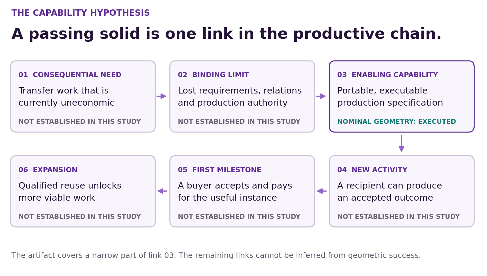
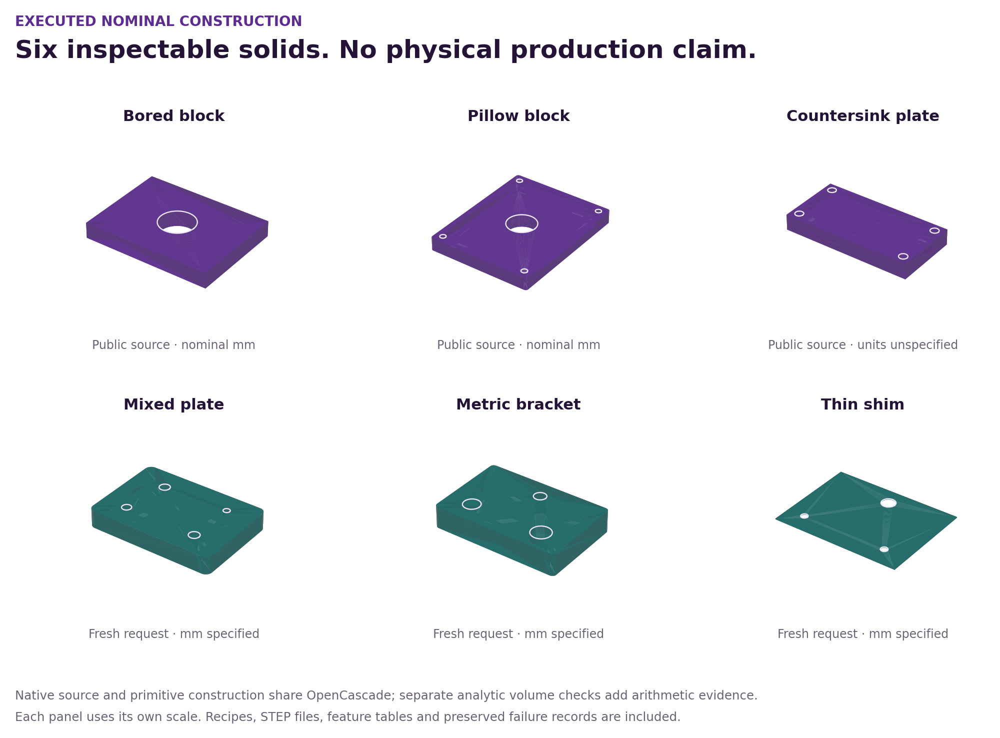
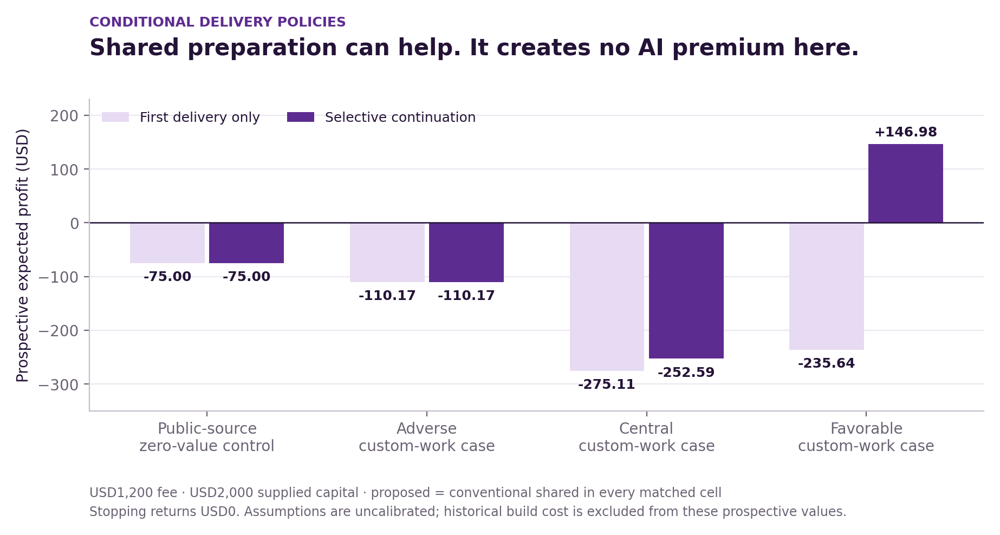
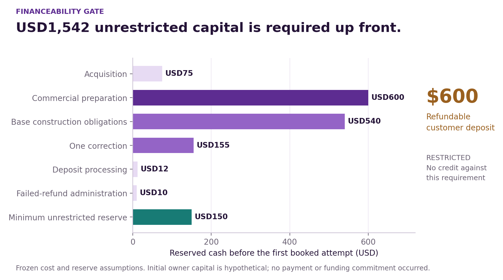

# AGI ALPHA FLYWHEEL — When Capability Creates Opportunity

## Transformational Intelligence, Experience-Trained Specialists and the Expanding Frontier of Profitable Work

**Vincent Boucher — President of MONTREAL.AI**  
**27 October 2026 · Portable production study · Edition 01**

**FIND YOUR ALPHA. BUILD YOUR SUCCESSOR Ω.**

### Research status

**No transformational flagship is admitted.** This edition constructs a working conventional nominal-CAD artifact, preserves the original failed execution, confirms fresh geometric requests, and evaluates complete conditional delivery policies. It does not demonstrate a newly feasible commercial production activity. No customer acceptance, sale, collection, physical qualification, incremental Alpha, trained specialist or profitable compounding is claimed.

## Executive finding

The productive possibility investigated was **portable construction**: a specification could become an executable capability that another competent producer can use and revise without rebuilding its meaning. If that capability reduced the minimum economical production batch or allowed an otherwise unavailable production route, it could support a consequential enterprise. That is the hypothesis, not the result.

The strongest executed construction is a small, source-bound nominal feature recipe. It regenerates three public CadQuery examples as valid solids and STEP files, and a separately authored checker accepts three new parameter requests. The artifact includes editable inputs, geometry, feature tables, independent arithmetic, reproducible comparisons and preserved corrections. Its immediate beneficiary would be a CAD software developer seeking an inspectable test artifact. Such usefulness is plausible; no beneficiary has accepted or purchased it.

The decisive comparison prevents a stronger claim. The original free CadQuery programs already generate the source solids and retain dimensional relationships that our nominal recipe does not retain. Commercial direct modeling also permits editing imported geometry without recovering its original history. Executable CAD reconstruction and manufacturing-feature recognition are established prior art. A successful reconstruction therefore does not establish that AGI ALPHA changed the productive frontier. [1–4]

The economics are equally bounded. A hypothetical USD1,200 conformance package produces a positive prospective expected profit of **USD146.98** only in the favorable base-price scenario with selective continuation and ordinary shared preparation. The equally equipped conventional shared provider obtains exactly the same result. The central scenario loses **USD252.59**; all first-delivery-only scenarios lose. The modeled public-source zero-value control selects stopping. It assumes no incremental willingness to pay for reproducing geometry already available from free source; no buyer refusal or zero-value assessment was observed. These are finite analyst scenarios, not observed commercial results. [E4]

The decision is to **retain the supporting artifact, stop this formulation as the flagship, and require a real buyer-defined capability constraint before further venture construction**. The next permissible research step is a prepared case-acquisition protocol; customer outreach, new spending commitments, financial transactions and physical execution were not performed. An existing tool may solve that next case, in which event the conventional solution should win.

## 1. The enterprise hypothesis and its missing causal link

AGI ALPHA's ambition is to construct capabilities that expand what organizations can produce. A relevant improvement must change an accepted outcome, the resources needed to obtain it, or the set of beneficiaries who can obtain it. Better prose, a passing demonstration and a large adjacent market do not establish that change.

For this edition the proposed chain was:

**Unusable or expensive design transfer → loss of executable production meaning → source-bound constructive representation → another producer can create and revise an accepted artifact → previously uneconomic jobs become feasible → a paid first instance → repeated delivery across qualified families.**

Every arrow needs evidence. The study establishes that a narrow constructive representation can regenerate nominal geometry. It does not establish preserved design intent, a new producer's manufacturing capability, a buyer's acceptance or a reduction in the minimum economical job size. Those absent links determine the verdict.

A useful representation must distinguish four kinds of information. Nominal geometry describes an ideal shape. Design relationships describe how dimensions and features should change together. Product requirements include tolerances, materials, finish and intended function. Production authority identifies who may accept and release a particular use. None follows automatically from the others. NIST's PMI work makes a related distinction between machine-readable semantic information and graphical annotations, and already provides model/derivative conformance workflows. [5]

The enterprise would need to preserve enough of all four to make production transfer economically dependable. The present recipe covers only a bounded part of the first category. It is intentionally prevented from becoming evidence for the entire enterprise.

## 2. Bounded discovery tournament

Five materially different constructions were investigated before the supporting artifact was built. Selection used four ordered gates: a consequential beneficiary; a surviving enabling distinction after prior art; a meaningful first deliverable; and a defensible path to economic significance. Convenient execution was considered only after those gates. No candidate cleared all four, so there is no admitted shortlist of billion-scale ventures. The discovery narrative and cross-candidate scale normalization were reconstructed after the search; they are not a timestamped tournament preregistration. The separately frozen construction, confirmation and economic protocols have their own records.

### 2.1 Component-family resurrection

The need is continuation of useful equipment whose essential digital component has become unavailable. The binding limitation is often component-specific engineering and qualification cost, particularly for small installed fleets. The proposed capability was a reusable family of behavioral contracts, replacement implementations and validation obligations. A first customer would receive an executable replacement design and explicit bench-test obligations; later family members would reuse only the stable structure.

This construction emerged from asking whether productive assets could be restored instead of replaced. Prior art changed its formulation. Siemens already documents obsolete-FPGA retargeting with equivalence among old netlists, RTL and new implementations. A commercial case also reports an adopted replacement module combining a different IC with protocol translation. Thus neither emulation nor formal equivalence is the missing invention. [6,7]

The remaining experiment would have to show a previously uneconomical fleet becoming economical after complete device-specific electrical, timing and support costs. The strongest challenger receives the same specifications, IP, reusable contracts and revised objective. A second-device comparison against an ordinary library is indispensable. The current environment lacks target hardware and an authorized real component case; a small simulated state machine would omit the essential transformation. **Disposition: reserve, with no flagship admission.**

### 2.2 Mechanical-response compilation

The need is a manufactured structure that supplies a requested stiffness, strength or energy-absorption response. The binding limitation is reliable translation from desired behavior to repeatable physical performance, including process variability. A mechanical-response compiler would generate geometry within an experimentally supported process envelope; a buyer would receive a fabricated, tested insert and its reproduction package.

The apparent opportunity narrowed under primary-source review. ExMech already combines robotic fabrication and testing with multiobjective active learning for plate-lattice discovery. Its experiment includes a nine-workstation platform and fresh mechanical tests. An offline optimizer on that dataset would provide weaker evidence than the published construction. [8]

The falsifier is conventional parametric design and active learning with the same physical budget, materials and objectives. A new design requires a new physical test; choosing an existing specimen does not substitute for it. Manufacturing access, durability, returns and repeatability remain indispensable. **Disposition: reject this formulation for the bounded study.**

### 2.3 Telecom infrastructure as an atmospheric instrument

The productive possibility was obtaining useful atmospheric measurements without deploying a new dense sensor network. The initial reformulation sought drop-size distributions rather than ordinary rainfall totals. Beneficiaries could include hydrological operators and weather-data services; the enabling capability would invert existing communication measurements with calibrated uncertainty.

That connection was already investigated directly. A 2020 paper uses colocated microwave links to estimate parameters of drop-size distributions and describes sensitivity to baseline stability and quantization. The CoMMon dataset provides a year of paired microwave-link and conventional weather observations. The availability of unusually convenient data does not restore the vanished novelty claim. [9,10]

The strongest challenger includes the published inversion and established rainfall tools under whole-event, held-out calibration. A useful first offering would need to improve an actual operating decision relative to radar, gauges and doing nothing. Data rights, extreme-event failures and service coverage remain commercial constraints. **Disposition: reject the generic construction; retain the connection as prior art.**

### 2.4 Deployment-specific recovery of legacy software capability

The need is retaining a useful legacy function under a new deployment constraint, such as memory safety. Instead of migrating an entire codebase, the proposed construction would produce only the required deployable slice, with compatibility and malformed-input evidence. A buyer would receive a runnable replacement library rather than a migration report.

The generic mechanism is crowded. DARPA's TRACTOR program targets automated C-to-Rust translation; Galois describes a combined symbolic/AI translation and equivalence approach. This does not mean every target is solved, but it prevents treating the broad architecture as a discovery. [11,12]

A surviving experiment requires a specific public library, real downstream requirement and complete outcome that maintained native implementations or competent translation cannot already deliver. No such target was established in the bounded search. Missing compiler or deployment access would block only dependent work, but inventing a toy target would fail the beneficiary gate. **Disposition: stop until a real counterexample is acquired.**

### 2.5 Constructive manufacturing interoperability

The original construction sought an editable, executable production package that would survive tool and supplier changes. A first digital milestone could be useful to a CAD/CAM developer even before any physical part was made. Larger expansion would require recurring accepted transfers that make previously rejected work economical.

Two discoveries altered the formulation. First, a historical NIST page says several test cases were not modeled within its original project. That is not evidence of a current missing model, and associated drawings can require model-derived dimensions. Second, direct modeling can edit imported geometry without recovering a history tree. The conventional challenger therefore removes part of the supposed problem. [1,13]

CAD-Recode, conventional feature recognition and semantic PMI further constrain the claim. We stopped the generic flagship formulation and retained a tightly limited nominal-CAD construction as supporting work. No original design intent is inferred from shape. No G-code, machine process or physical tolerance is produced. **Disposition: supporting conventional artifact; flagship stopped.** [2–5]

### 2.6 Billion-plus significance is an admission test

For each candidate, the economic ambition is stated as **USD cumulative incremental customer benefit over ten years**, after the customer's acquisition, integration and operating costs. This metric is not provider revenue, profit or valuation. The following are required scale witnesses, not forecasts:

| Construction | Mechanism that could create large value | What prevents a billion-scale admission now |
|---|---|---|
| Obsolete components | Preserve productive fleets that bespoke replacement cannot economically serve | Eligible fleets, incremental preserved value and remaining qualification cost unmeasured |
| Mechanical response | Repeatedly deliver physical performance unavailable at the customer's viable cost | No new specimen, accepted response or cost advantage |
| Telecom instrument | Improve consequential decisions with useful observation coverage unavailable otherwise | Incremental decisions, permissions and accepted service value unmeasured |
| Legacy software slice | Retain valuable functionality under binding deployment requirements | No specific unsolved target or accepted replacement |
| Portable production | Reduce repeated transfer work enough to admit previously rejected jobs | Free source and established CAD methods already supply the tested outcome |

A large exposure can justify investigation. It cannot supply the missing adoption, causal effect or price evidence. The detailed dossiers retain arithmetic thresholds and uncertainties for all five candidates. No unvalidated threshold is promoted into an addressable-revenue estimate. [E1]

## 3. What discovery changed

The discovery record preserves formulation changes rather than presenting the final choice as inevitable. Component replacement moved from individual emulation to the minimum economical fleet size. Lattice design moved from simulation success to fresh physical-response confirmation. Telecom sensing moved from rainfall to drop-size distributions, then stopped when direct prior art was found. Software recovery moved from general translation to an unsolved deployment-specific counterexample. Manufacturing moved from recovering lost history to testing whether recovery was necessary at all.

The manufacturing screen exposed a particular source-reading trap. A historical absence statement was initially promising. Checking the complete context prevented it from becoming a claim that an artifact did not currently exist. The associated drawings' dependence on CAD information also prevented missing dimensions from being silently invented. These corrections happened before construction. [13]

The final case source was therefore changed openly to three licensed public CadQuery educational examples. They are appropriate for a reproducible engineering check; they are not representative industrial purchase orders. That downgrade is material. It means the build cannot satisfy the mandate's commercially representative confirmation requirement, and it cannot rescue the stopped flagship.

This bounded study makes no claim to have searched all domains or exceeded human foresight. It identifies the specific constructions inspected, the evidence that changed them and the point at which further investment ceased to be justified.

## 4. The working supporting deliverable

The package contains a small nominal feature language, a CadQuery constructor, three historical reference cases, three new researcher-specified requests, STEP/STL/SVG outputs, machine-readable feature tables and a replay command. The original upstream scripts and Apache-2.0 license are preserved byte-for-byte at CadQuery commit `8178185a24a035c9af7f4679033be14267f6a6ef`. [14,E2]

The supported geometry is a rectangular stock with optional vertical corner fillets and nonintersecting through holes, counterbores and countersinks. Inputs explicitly identify dimensions and feature positions. The constructor refuses the tested exterior intersections, overlapping hole envelopes, unsupported hole types and nonfinite geometry. These are geometric admission rules, not a comprehensive service-security boundary.

The source interpretation was authored by an assistant reading the original programs. It was not produced by an autonomous drawing parser or STEP reverse compiler. Material, physical tolerances, surface finish, datum semantics, machining strategy and release authority remain unspecified.

| Source case | Constructive content | Material limit |
|---|---|---|
| Ex002 bored block | Centered stock and a central through hole | Nominal dimensions only |
| Ex003 pillow block | Rounded outside corners, center bore and four counterbores | Comment and executable inset differ; executable semantics preserved |
| Ex019 countersinks | Four countersinks in a thin rectangular stock | Physical units are absent from the source |

Ex003's rectangle is `length − 12` by `width − 12`. Its hole centers are consequently six units from each stock edge, although the comment describes twelve as the inset. The artifact records that discrepancy. Ex019's exporter labels STEP coordinates in millimeters, but the source does not establish that millimeters are its intended physical units. An exporter convention cannot create missing product requirements. [E2]

The recipe also loses a source dependency: changing Ex003's length from 80 to 90 moves the original native bolt centers from ±34 to ±39, whereas changing only the recipe's stock length leaves its explicitly stored coordinates at ±34. This is why the deliverable is called an explicit nominal feature recipe. The study does not claim design-intent recovery or automatic preservation of parametric relationships. [E3]

### 4.1 What a recipient can actually use

A recipient can inspect each parameter, regenerate the admitted nominal solid, read its feature table, compare it with the reference, export neutral geometry and supply a new explicit feature request. The complete package remains usable if the larger venture stops. The stronger statement—someone receives an accepted commercially useful outcome—requires a buyer-defined task and has not been established.

A proposed customer would receive a specified environment and a source-bound result, with one correction cycle and an agreed recipient-run acceptance check. The proposed scope excludes general input intake, arbitrary downloaded scripts and machine operation. The historical comparator executes only the reviewed, frozen public examples. Customer-specific reuse would require explicit permission.

## 5. Frozen experiment, failure and confirmation

Before the first run, the source files, feature program, acceptance criteria and original constructor were frozen. Acceptance required a valid single solid, nominal bounding dimensions, analytic net volume, Boolean equivalence with the native source and STEP roundtrip checks. The volume tolerance is a computation criterion: `max(10⁻⁶, 10⁻⁸ × |analytic reference volume|)` in model-unit cubed. Bounding dimensions have a separate absolute threshold of `10⁻⁷` model units. Neither is a manufacturing tolerance. [E2]

The first execution accepted **0/3** cases. All three had matching volumes and zero measured Boolean symmetric-difference volume against their source constructions, but bounding-box checks failed after STL export populated a triangulation cache. The original code and failed reports remain unchanged. A separate measurement amendment used exact-geometry bounds. It accepted **3/3** historical cases without relaxing the original geometric criteria. A further scope-hardening version added input rejection checks and again accepted the same three cases. These are corrected historical reproductions, not independent new trials. [E2]

The current constructor was then frozen at SHA-256 `5c2be43b6e014a34465eb249d6f30e5e278c9a0975f0d8fc59a6ccc8cf4b058e`. A separate role specified three new requests only after that freeze: a mixed-feature plate, a metric bracket and a thin shim. A separately authored native CadQuery construction and analytic-volume function checked each request; export and bounding-box helpers were reused from the constructor. All three were accepted, with zero measured Boolean symmetric-difference volume. Six predeclared out-of-scope geometric inputs were refused. [E3]

| Evidence family | Result | What it establishes |
|---|---:|---|
| Original frozen construction | 0/3 accepted | Original measurement failure remains a failure |
| Corrected historical construction | 3/3 accepted | Narrow reproduction after an explicit amendment |
| New post-freeze geometric requests | 3/3 accepted | Reuse for three newly specified nominal inputs |
| Predeclared geometric refusals | 6/6 refused | Those six boundary cases are handled |
| Additional feature-ID probes | 0/2 refused | Missing/duplicate identifiers remain an unresolved semantic gap |
| Supplementary complete STEP comparison | 6/6 equivalent | Same-case exported geometry remains equivalent |

Both geometric paths and Boolean comparisons use OpenCascade. Separate source code and independent arithmetic reduce some correlated errors; they do not provide independent-kernel or physical validation. The examples and new requests are also too few and too constructed to estimate an industrial failure rate.

### 5.1 Evidence-admission corrections

The separate review identified weaknesses in the initial supplementary verifier: it trusted summary counts, allowed empty evidence through vacuous predicates and did not sufficiently bind per-output recipes. These defects did not change the six observed solid comparisons, but they prevented a complete integrity claim. The initial verifier and failing empty-evidence probe are preserved; an additive revision binds exact identities, check sets, recipe content and case membership, then exercises modified-input refusals. The final verification receipt contains the actual scope and results. The reviewer also implemented the supplementary-verifier correction; its repair checks are self-checks rather than an independent review of that corrected code. The initial constructor critique came from a separate agent in the same session. [E3]

The original frozen scientific checker is preserved even where it has inadequate wrapper behavior. The supported replay entry point verifies frozen source and protocol identities and rejects a failed report. A changed input does not inherit the old freeze merely because a report repeats the old label.

## 6. The two commercial milestone tests

**Test A: a useful outcome if the venture stops.** The delivered source, nominal geometry and comparison cases are usable software artifacts. A CAD developer can inspect and reuse them under the included licenses. This is a plausible standalone use, not observed customer value. The original free source remains an explicit alternative.

**Test B: success makes an indispensable transformational capability more credible.** This test is not met. The experiment does not show a formerly inaccessible production activity, recovery of design relationships, a new downstream machine capability or an economic boundary crossed by the proposed method. The conventional source already does the central constructive work, and an ordinary library can retain the same artifact.

Consequently the first delivery is retained as supporting engineering. It is not presented as the small instance that validates the larger enterprise. A credible future instance must include a real constraint—for example, an accepted transfer the strongest conventional workflow cannot deliver within the buyer's cost or deadline—and must retain that constraint in the first experiment.

## 7. Commercial foundation: a proposed scope, not a sale

The economic model evaluates a hypothetical future **source-bound nominal CAD conformance/test package with explicitly supplied variants**. The base fee is **USD1,200 per finally accepted package**. The fee is an unvalidated price assumption. It is not a quote received from a customer, a price assigned to the public tutorials or a measured willingness to pay. [E4]

Proposed terms are concrete enough to review: a fifty-percent refundable deposit remains restricted until acceptance; the remaining balance is due thirty days after acceptance; one correction cycle is included; failure earns no fee and requires a full deposit refund; accepted digital support is reserved and costed. Acceptance is targeted for day 21, balance collection for day 51 and support close for day 66. These dates are assumptions, not operational performance.

The comparison matches responsibility as well as output. The outside option is a competent provider using the same free tools and generic asset, or doing the work internally. The human-service reference uses 6, 16 or 28 assumed hours at USD100 loaded hourly cost. BLS reports USD50.05 per hour as the May 2025 median wage for mechanical engineers; doubling that wage is an explicit burden assumption, not a vendor billing quote. [15]

| Cost item | USD | Status |
|---|---:|---|
| Acquisition per prospect | 75 | Assumed; charged on refusals |
| Source intake | 50 | Assumed |
| Construction | 250 | Assumed |
| Independent digital validation | 150 | Assumed |
| Handoff | 50 | Assumed |
| Compute and storage | 20 | Assumed; actual model bill unknown |
| Permissions/administration | 20 | Assumed |
| One correction | 155 | Charged when required |
| Accepted support | 100 | Reserved and paid |
| Failed refund administration | 10 | Charged on failure |
| Additional commercial preparation | 600 | Once for shared delivery; per booking for separate delivery |
| Selective continuation coordination | 120 | Charged only when expanding |
| Payment processing | 2% | Applied to gross receipts, including deposits later refunded |

The service model is complete only within those stated finite obligations. Actual insurance, licensing, legal responsibility, unrestricted capital and the scope of customer-specific integration remain unknown. They block commercial admission instead of being entered as convenient zeros. The study's actual total cost is also unknown; no profitable historical result is claimed.

## 8. Three accounts, kept separate

### 8.1 Provider account

The provider ledger separates accepted revenue, collections, refunds, bad-debt expense, costs, deposits, reserves and unrestricted cash. Capital is not revenue. An unpaid final balance does not become cash merely because the artifact is accepted. A failed attempt retains acquisition, preparation, construction, correction and refund costs.

At the base price, a fully collected clean first booked delivery with one acquisition costs USD1,339 including commercial preparation and payment processing, leaving **USD−139**. One correction changes that to **USD−294**. The clean first-delivery break-even price is **USD1,341.84**, and the corrected first-delivery break-even is **USD1,500**, under the stated assumptions. A later clean delivery after shared preparation has a break-even price of **USD729.59**, excluding the separate USD120 cohort-continuation charge. These are arithmetic thresholds, not recommended prices or observed savings. [E5]

An illustrative USD2,400 historical build charge is counted once in a separate full-history column. It is not a measurement of this research session. The model does not charge paid-work learning a second time as fictional research. Additional extraction, validation and upkeep are priced separately when considered.

### 8.2 Customer account

Customer value is the value of the accepted outcome relative to the best feasible outside option. Net benefit deducts the fee and USD150 assumed integration effort; a failed attempt also costs the buyer USD150. Participation requires nonnegative expected net benefit under the disclosed acceptance probability. Procurement can still refuse.

For the actual public tutorials, the zero-incremental-value control assigns no new buyer benefit over the free native source. It produces no purchase. This is a deliberately transparent modeled control, not an observed customer rejection. The other value distributions apply only to hypothetical future commissioned work.

### 8.3 Conditional future venture account

The prospective ten-year opportunity is kept outside the finite delivery-policy expected value. It does not rescue a losing pilot. No valuation, equity return, token value or arbitrary small chance of a billion-dollar outcome enters the model.

## 9. Whole-business construction and matched comparisons

Three arrangements receive the same geometry method, generic asset, input information, quality assumptions and customer events. Separate preparation pays USD600 setup on every booked order. Conventional shared preparation pays it once. The proposed arrangement also pays it once and is otherwise identical. This isolates the value of ordinary shared preparation; it grants no exclusive advantage to AI. [E4]

The finite horizon contains three prospect slots, ninety days apart. A latent common state persists across the cohort: a viable market, procurement contraction or a common qualification gap. In the qualification-gap state, every booked attempt fails. Consequently outcomes are correlated; three attempted deliveries are not three independent chances at success.

The model enumerates clean acceptance, acceptance after correction, failure, refusal, balance payment and default. It compares stopping, delivering the first instance only and delivering with selective continuation. Exact rational probabilities sum to one. The archive contains **7,122 weighted histories**, **36 main cells** and **48 price/capital sensitivity cells**. These are model paths and arithmetic cases, not commercial observations. [E4]

| Scenario, shared arrangement | First only: expected profit | Selective: expected profit | Selective loss probability |
|---|---:|---:|---:|
| Public-source zero-value control | USD−75.00 | USD−75.00 | 100.00% |
| Adverse hypothetical work | USD−110.17 | USD−110.17 | 100.00% |
| Central hypothetical work | USD−275.11 | USD−252.59 | 86.76% |
| Favorable hypothetical work | USD−235.64 | USD146.98 | 37.75% |

Stopping has zero incremental revenue, cost and profit. The proposed and conventional shared arrangements tie in all twelve matched scenario/policy cells. Separate preparation never selects expansion at the base price. In the favorable scenario, shared preparation changes the modeled whole-cohort decision even though the first delivery is unattractive alone. This is a legitimate complementary-work result under assumptions; it is not evidence of an AI-specific mechanism.

At USD1,500, the most favorable frozen sensitivity cell reaches USD769.48 prospective expected profit with sufficient modeled capital. That is the best tested cell in a small assumed grid, not a universal optimal price. Higher prices can change participation, and none of the demand curves is calibrated with buyers.

## 10. Profitability, financeability and information

Before taking a deposit, the cash rule reserves the worst-case remaining delivery, correction, refund and minimum operating cash. The first booked order requires **USD1,542 of initial unrestricted capital**, including acquisition and the USD150 minimum reserve. A refundable deposit cannot fund that obligation because it must remain available for refund. [E4,E5]

The base model supplies USD2,000 of hypothetical owner equity. It neither claims that the funds exist nor authorizes their use. Capital sensitivity evaluates USD1,000, 1,500, 2,000 and 3,000. Undercapitalized missions are declined; this is why some modeled cash shortfalls become finance refusals rather than manufactured insolvencies. Committed external credit and a separately accepted paid preparation milestone are possible alternatives, but neither is assumed available.

The selective policy observes only the first prospect's actual modeled outcome. It updates common-state probabilities, then expands only when the posterior expected incremental profit of the remaining two slots exceeds coordination cost and the cash gate is satisfied. It cannot see hidden state or future outcomes. Reinvestment is optional, and stopping remains available after success or failure.

Information has value only when it changes that later decision. With the same ready asset and sufficient cash, the maximum extra information fee is **USD23.75** in the central scenario and **USD52.08** in the favorable scenario; it is zero in the adverse and public-source controls. The pilot's delivery cost remains in the policy comparison. Subtracting it again as an information charge would double-count it. These ceilings are conditional on the frozen model, not recommendations to purchase research. [E4]

No scenario's positive expected profit overrides the absent buyer, input permissions, scope qualification or available funds. Commercial admission remains **HOLD**. The flagged billion-scale enterprise remains **STOP for this formulation**.

## 11. A scale test without a valuation shortcut

The Census 2022 machine-shop table reports **17,163 establishments and 16,876 firms**. This is a source-backed population anchor, not the number of eligible buyers. [16]

The explicit scale target is **USD1 billion cumulative net customer benefit over ten years**, after service price and buyer integration. At an assumed USD250 net benefit per accepted outcome, the target requires **four million accepted outcomes**. With the frozen adoption ramp from 0.5% to 30% of establishments, it requires approximately **203.55 accepted outcomes per active shop per year**. At twenty outcomes per year, the same ramp yields only **USD98.26 million**. [E4,E5]

At four million outcomes and USD1,200 per accepted package, gross provider revenue would arithmetically be USD4.8 billion over ten years. This is a conditional multiplication, not addressable or obtainable revenue. Provider profit would depend on complete delivery, acquisition, failure and support costs at that volume; it is not estimated. Valuation is not estimated.

The mechanism remains plausible only if accepted portable capabilities unlock repeated work that customers otherwise cannot obtain economically. The current examples do not establish that premise. NIST's historical estimates of substantial interoperability losses justify the domain's importance, while explicitly acknowledging incomplete knowledge about the causes and extent of those losses. They cannot be booked as this enterprise's savings. [17]

## 12. Operational Alpha, retained capability and specialists

**Operational Alpha is not measured.** Frontier assistance performed source research, decomposition, construction, adversarial review and correction. The study did not run a randomized matched comparison of ordinary use, competent operation and the proposed method using the same model and resources. The successful correction therefore supports the corrected artifact, not a quantitative claim that the operating method is superior.

**Retained capability exists as an artifact; retained Alpha is not established.** A recipient can reuse the constructor on new explicit inputs, as the three post-freeze requests demonstrate. An ordinary library can hold the identical source and inputs. No transport graph, identity fixture or extra packaging creates an incremental benefit by itself. In the economic retention test, USD600 extraction/validation plus three months at USD50 upkeep adds USD750. With no demonstrated saving over the same ordinary library, the optional retention investment is rejected. At ten future uses with an assumed 80% usability rate and USD100 hourly value, break-even requires exactly 0.9375 incremental hours saved per usable reuse; positive net benefit requires more. That saving remains unobserved. [E4]

**Gym-trained specialists are not trained or evaluated.** No model weights are updated. No specialist-superiority, recursive-improvement or autonomous-compounding claim is made. A future specialist needs fresh work, an unchanged task standard, the same frontier-model baseline and complete training, evaluation, deployment and maintenance cost.

**Live identity and authority are not exercised.** There is no live `*.agent.agi.eth` authentication in this study. Reusable structure would still need a fresh mission meaning, current data rights and regranted execution authority. Historical successful evidence does not authorize another customer's files or a machine operation.

## 13. Frontier resources and cost provenance

The host identifies the active reasoning model as **GPT-6 Astra Pro**; delegated agents inherit the parent configuration. Official documentation opened during the study lists `gpt-6-astra`, its reasoning and computer-use support, and standard API prices of USD10 per million input tokens and USD50 per million output tokens. These document the available model family and a price reference. They are not a billing receipt for this hosted conversation. [18,19]

The exact dated backend snapshot, per-agent token consumption, cache mix and monetary charge were not surfaced. No explicit temperature or reasoning override was supplied. Actual model cost is therefore **unknown**, not zero. The experiment does not compare unobserved model names or assume that a longer prompt improved performance.

Executed tools include public-source retrieval and the GitHub connection. Local computation used Python, CadQuery 2.7.0 and `cadquery-ocp 7.8.1.1.post1`, alongside exact-rational accounting. LaTeX and local browser/rendering checks prepared the publications. The environment record contains observed versions and artifact hashes. Computer-use documentation was checked; source research used the purpose-built retrieval tools. Browser automation was used for publication QA, not for a claim of autonomous industrial operation. [E6]

There is no calibrated physical simulation in this edition. CAD construction and nominal geometry checks are actual software executions. The economics are uncalibrated conditional scenarios. Neither category supplies an unexecuted breakthrough, observed demand or actual collections.

## 14. The next consequential decision

The next study should begin with a concrete unavailable outcome, not another generic compiler demonstration. A prepared intake request should ask a willing beneficiary for one nonconfidential production-transfer problem, its actual outside options, authorized source files, accepted-output criteria, deadline, price ceiling and cost of doing nothing. No outreach was performed here.

The candidate advances only if the strongest conventional challenger receives the same revised problem and cannot already supply the required outcome within the relevant commercial bound. If direct editing, ordinary scripted CAD or an existing supplier solves it, that is the appropriate solution. A new construction would then have to preserve the essential constraint in its first delivery: required semantics, recipient environment, actual acceptance and full responsibility.

The prospective gate sequence is:

1. **Admit the need.** Obtain a specific buyer-defined useful outcome and input permissions; stop when an existing adequate alternative eliminates the claimed gap.
2. **Freeze the contract.** Fix output, numerical and semantic acceptance, corrections, price assumptions, deposits, reserves and scope of authority.
3. **Construct and challenge.** Deliver the actual artifact; test fresh requests and the strongest matched conventional solution. Preserve failures.
4. **Choose delivery policy.** Compare stopping, a single delivery and selective expansion using complete cost and cash, without terminal venture speculation.
5. **Retain selectively.** Keep only assets whose incremental fresh-use benefit exceeds transfer and maintenance cost; ordinary libraries remain the control.

The present decision stops before the first gate has been satisfied for a commercial opportunity. The supporting artifact can still be used and improved. It does not become the flagship through publication quality, passing checks or an ambitious title.

## 15. Additive implementation, publication and reproducibility

This work occupies only `studies/agi-alpha-portable-production-v1/`. Repository inspection found main at `3947e4ec8fd74ad40e13e8ff825a149fa98a10e9`, public release v1.46.1 and an existing integration/publication allocation under PR #4988. The study preserves earlier papers, failed evidence, runtime owners and protected test boundaries. It introduces no replacement scheduler, production ledger, authority service or release process. [20,E6]

The related CAD/QIF study in PR #4980 remains an evidence-audit contribution. This edition constructs nominal solids and explicit feature outputs; it does not replace that study or relabel its findings. Native lifecycle and enterprise interfaces remain owned by their existing implementation lanes. No native-runtime integration or released specialist implementation is claimed here. [21]

The repository's mixed-source publication policy applies to new code, data and HTML. This draft therefore uses a pinned GitHub reading edition and download tree for review. Canonical catalog inclusion, research release assets and Pages deployment remain subject to the existing owner's full qualification and sequencing. No passing local artifact check is substituted for those gates. [22]

The replay command writes into a new directory and refuses an existing destination. It verifies source and protocol identities before reexecution, reproduces the known geometry cases and checks the resulting evidence. A disclosed case rerun is reproduction, not another fresh trial. STEP timestamps and elapsed times may change; semantic equivalence is the replay target. A SHA-256 file inventory remains available for exact artifact inspection; hashes are not digital signatures or evidence of authority.

The economic model and its separately implemented arithmetic audit have their own pre-execution freeze. The parent also reconstructs key cash, cost and scale identities without importing the model. This improves reviewability; it does not validate assumed probabilities or costs. Full repository setup, hosted checks and production release qualification are not represented as completed.

## 16. Claims and evidence

| Claim | Evidence | Limit that changes its meaning |
|---|---|---|
| Five constructions investigated; none admitted | Discovery dossiers and primary-source comparison | Bounded search; no proof that all opportunities are exhausted |
| Three source geometries reproduced | Historical acceptance records and exact source files | Corrected run follows a preserved 0/3 failure |
| Three new requests accepted | Frozen fresh protocol, separate checker and outputs | Researcher-specified, small nominal domain; no industrial sample |
| Six STEP geometries preserved | Supplementary full Boolean comparisons | Same geometry kernel |
| Proposed/shared conventional tie | Finite scenario results and arithmetic audit | Equal assumptions deliberately prevent invented AI advantage |
| Favorable selective prospective profit positive | USD146.98 at the base price | Uncalibrated assumptions; 37.75% loss probability |
| First-order cash requirement | USD1,542 independently reconstructed | Hypothetical funding and scoped obligations |
| Actual receipts zero | Study actual-account declaration | Complete actual cost and profit remain unknown |
| No operational/retained/specialist Alpha | Explicit assessment and ordinary-library control | No matched frontier-model experiment or training |

The complete machine-readable claim map names each supporting path and its evidence class: observed execution, source-backed fact, assumption, inference or unestablished claim. Detailed failures are preserved beside the accepted artifacts. The intended publication is a reviewable research record, not peer-reviewed acceptance or deployment evidence.

## Evidence index

- **E1 — Discovery:** `discovery/tournament.json`, `discovery/discovery_log.json`, physical dossier and manufacturing prior-art review.
- **E2 — Historical construction:** `data/public/SOURCE_MANIFEST.json`, `protocol/FROZEN_PROTOCOL.md`, versioned constructors and `results/construction_v1*/acceptance.json`.
- **E3 — Fresh and adversarial evidence:** `protocol/FRESH_FREEZE.json`, `protocol/FRESH_CONFIRMATION.json`, `results/fresh_confirmation/acceptance.json`, `evidence/independent_audit.json`, supplementary verification and preserved verifier history.
- **E4 — Economics:** `economics/inputs.json`, `freeze.json`, `results-r1/results.json`, exact weighted history archive, financing record and separate arithmetic audit.
- **E5 — Independent arithmetic reconstruction:** `evidence/root_economic_reconstruction.json`.
- **E6 — Provenance and publication:** `evidence/environment.json`, `evidence/execution_record.json`, `PUBLICATION_HANDOFF.md` and final delivery inventory.

## References

1. Siemens. *Synchronous Technology: editing imported 3D CAD data.* [Primary product documentation](https://solidedge.siemens.com/en/solutions/products/3d-design/synchronous-technology/). Accessed 27 October 2026.
2. Rukhovich et al. *CAD-Recode: Reverse Engineering CAD Code from Point Clouds.* ICCV 2025. [Author project](https://cad-recode.github.io/).
3. Quaoar Studio. *Analysis Situs: Recognize CNC milling features.* [Primary documentation](https://www.analysissitus.org/features/features_recognize-cnc-milling-features.html).
4. CAx Interoperability Forum. *CAx implementation and interoperability resources.* [Forum](https://www.mbx-if.org/home/cax/).
5. NIST. *MBE PMI Validation and Conformance Testing Project.* [Project documentation](https://www.nist.gov/ctl/smart-connected-systems-division/smart-connected-manufacturing-systems-group/mbe-pmi-validation).
6. Siemens. *Questa Equivalent FPGA retargeting flow.* [Primary white-paper summary](https://resources.sw.siemens.com/en-GB/white-paper-questa-equivalent-fpga-retargeting-flow/).
7. Emergent Automata. *Drop-in replacement for an obsolete part.* [Supplier-reported case](https://www.emergentautomata.com/obsolete-part-replacement). Supplier account, not independently audited commercial evidence.
8. Hu et al. *Experimental mechanician for plate lattice metamaterial discovery.* Nature Communications 17, 3933 (2026). [DOI 10.1038/s41467-026-70675-x](https://doi.org/10.1038/s41467-026-70675-x); [full article](https://pmc.ncbi.nlm.nih.gov/articles/PMC13128949/).
9. van Leth et al. *Estimating raindrop size distributions using microwave link measurements: potential and limitations.* Atmospheric Measurement Techniques 13, 1797–1815 (2020). [DOI 10.5194/amt-13-1797-2020](https://doi.org/10.5194/amt-13-1797-2020).
10. Špačková et al. *A year of attenuation data from a commercial dual-polarized duplex microwave link with concurrent disdrometer, rain gauge, and weather observations.* Earth System Science Data 13, 4219–4240 (2021). [DOI 10.5194/essd-13-4219-2021](https://doi.org/10.5194/essd-13-4219-2021).
11. DARPA. *Translating All C To Rust: TRACTOR.* [Program](https://www.darpa.mil/research/programs/translating-all-c-to-rust).
12. Galois. *CRISP & CLEAR.* [Project description](https://www.galois.com/project/crisp-clear). Development aims are distinguished from evaluated results.
13. NIST. *Test Case PMI Annotation Browser.* [Historical project context](https://pages.nist.gov/CAD-PMI-Testing/models.html); [current downloads](https://www.nist.gov/ctl/smart-connected-systems-division/smart-connected-manufacturing-systems-group/mbe-pmi-0).
14. CadQuery contributors. *Examples and Apache-2.0 license*, commit `8178185a24a035c9af7f4679033be14267f6a6ef`. [Immutable source tree](https://github.com/CadQuery/cadquery/tree/8178185a24a035c9af7f4679033be14267f6a6ef/examples).
15. U.S. Bureau of Labor Statistics. *Mechanical Engineers, Occupational Outlook Handbook*, May 2025 wage statistics. [Primary source](https://www.bls.gov/ooh/architecture-and-engineering/mechanical-engineers.htm).
16. U.S. Census Bureau. *2022 Economic Census, EC2200BASIC, NAICS 332710.* [Primary table](https://data.census.gov/table/ECNBASIC2022.EC2200BASIC?q=332710).
17. NIST. *Inadequate Modeling Data Costs Billions to US Manufacturers.* 12 February 2020, updated 3 February 2025. [Primary summary](https://www.nist.gov/news-events/news/2020/02/inadequate-modeling-data-costs-billions-us-manufacturers).
18. OpenAI. *GPT-6 Astra model documentation.* [Official documentation](https://developers.openai.com/api/docs/models/gpt-6-astra). Accessed 27 October 2026.
19. OpenAI. *API pricing; computer use.* [Pricing](https://developers.openai.com/api/docs/pricing); [computer-use documentation](https://developers.openai.com/api/docs/guides/tools-computer-use). Accessed 27 October 2026; not a session invoice.
20. MontrealAI. *SUCCESSOR Ω public integration checklist, issue #4850.* [Coordination record](https://github.com/MontrealAI/AGI-Alpha-Agent-v0/issues/4850); [study scope comment](https://github.com/MontrealAI/AGI-Alpha-Agent-v0/issues/4850#issuecomment-6458290271).
21. MontrealAI. *AGI Alpha Flywheel opportunity-discovery v4, PR #4980.* [Existing research](https://github.com/MontrealAI/AGI-Alpha-Agent-v0/pull/4980).
22. MontrealAI. *Research-paper publication policy*, inspected at main `3947e4ec8fd74ad40e13e8ff825a149fa98a10e9`. [Exact policy](https://github.com/MontrealAI/AGI-Alpha-Agent-v0/blob/3947e4ec8fd74ad40e13e8ff825a149fa98a10e9/docs/agent/PAPER_UPLOADS.md).

## Authorship and research disclosure

Vincent Boucher's title and byline are supplied at the commissioning user's request. Research, implementation, analysis and publication preparation were AI assisted. Review roles shared a session and workspace; they were not independent human peer reviewers. Public examples retain their original license. No proprietary customer data, credentials, payment operation, live financial action, machine operation or external outreach was used. This edition preserves a useful conventional artifact and a stopped venture claim so successors can start from the actual evidence.
