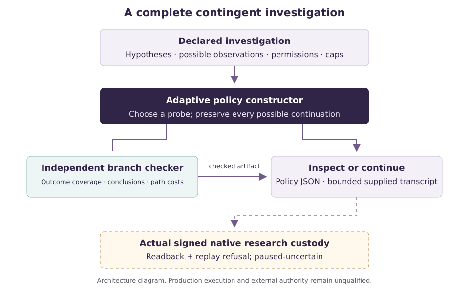

::: {.abstract}
An enterprise may know which observation it wants next yet lack a justified investigation that it can complete within its resources. This edition constructs a bounded investigative means inside AGI ALPHA: an adaptive policy over finite hypotheses and set-valued observations, with a checked worst-case path budget. The inspected native predecessor proposes one immediately affordable, greedily selected read; a recent research instrument constructs static robust measurement portfolios. The new operation makes observation-dependent continuation explicit, while preserving the separation between computational evidence and permission to act. The instrument agrees with an independent exact adaptive control on 24/24 frozen cases; 12 cases admit verified policies and the remaining cases are correctly classified within the finite model. The static control solves 8/24, while all six malformed-input probes are refused. The cases are independently authored within the same research team, not field measurements or evidence of autonomous scientific discovery. Conventional adaptive optimization is the primary comparator. Three downstream possibilities remain HOLD; this campaign executes no commercial exchange and establishes no profit-funded successor. The contribution is a source-bound investigative operation and its bounded evaluation, with the larger economic chain stated at the stage the evidence reaches.
:::

**TRANSFORMATIONAL INTELLIGENCE: LEARNING TO CHANGE THE GAME.**

*Discover the limit. Invent the missing means. Deliver the value. Expand what comes next.*

# The next useful observation is a construction problem

Consider a scientific or operational question with several explanations still possible. One permissible test may be cheap and informative, but lead to a branch on which all remaining useful tests exceed the budget. Another first test may separate fewer pairs immediately while leaving a complete, affordable investigation on every branch. Selecting an attractive next observation and constructing an investigation that can finish are different operations.

This difference matters before a proposed capability can become a reliable input to production. A material classification, an equipment diagnosis or the interpretation of an interrupted operation may require a decision under bounded measurement ambiguity. The enterprise needs to know both what a measurement could resolve and what remains possible after an unfavorable observation. A policy that succeeds only on its preferred branch does not discharge that obligation.

The present construction addresses this finite interface gap. It receives supplied hypotheses, allowed probes, possible observations and explicit resource limits. It constructs a contingent policy, or reports that no policy was found within the stated finite model and limits. It does not discover the physical hypotheses, calibrate a sensor or determine that the question is commercially valuable. Those remain separate investigations.

The scope is deliberately concrete: one additional native means of investigation, one frozen authored evaluation, retained competent alternatives, and a publication tied to the executed source. The ambition remains an enterprise whose useful constructions expand its subsequent opportunities. This edition does not infer that whole enterprise from a successful planning calculation.

# What the preceding chapters actually established

The sources were read at repository revision `12770c22b4a9f90f2013bbfb64242f912ba5071e`. Four LaTeX sources and the actual *Out-Evolve* PDF were preserved with Git-blob identity checks. Their findings motivate this chapter; they are not new measurements performed here.

*Transformational Intelligence* separates the user's purpose, a problem formulation and the instrument used to assess it. Its exact causal example distinguishes a passive information ceiling from an authorized intervention; an unrestricted optimal planner matches the active result. The example therefore establishes a formulation-dependent mechanism, not a new causal algorithm or measured frontier-agent superiority [@ti]. This edition keeps the same distinction: a new native interface need not beat a conventional algorithm that already expresses it.

*Out-Evolve*, revised 20 October 2026, makes construction of useful structural assumptions central. Its conditional response-family example reduces the number of exact scalar calibrations from 1,048,576 to 211 only after a degree-two restriction is justified. Calibration agreement alone cannot establish that restriction, and bounded errors can amplify by a factor of 721. Its retained exact laboratories use supplied grammars; unrestricted competent alternatives tie, and a proposed attempt to join the laboratories failed [@outevolve]. We inherit its requirement to state uncertainty and construction costs, without presenting a finite response table as qualified physics. The repository's LaTeX wrapper references sibling inputs that were not obtained here; the actual PDF, rather than that incomplete wrapper, supports this reading.

*Invent the Economy* joins a capability to a voluntary commercial arrangement and a feasible financing schedule. Its supplied four-buyer reference can have positive expected contribution yet require substantial prefunding; its successor example can remain profitable but unaffordable from earned surplus. Ordinary unrestricted enumeration matches the reference decisions [@economy]. We retain the distinction between opportunity, accepted exchange, accounting profit and available cash. No fictional buyer is introduced to turn this study into a business result.

The 23 October *Transformational Autonomous Enterprises* edition studies mission-relative revalidation. Reusing generic module checks reduces repeated checking while fresh semantic acceptance and separate authority remain necessary. A direct specialist matches quality and has lower pooled CPU cost in the reported finite workload [@tae]. Its historical byline is MONTREAL.AI / Writer #4; that identity is preserved. This edition's byline is Vincent Boucher, President of MONTREAL.AI.

The immediate software predecessors add sharper constraints. Native `flywheel_probe.py` maps each hypothesis and probe to one exact observation string, then selects the next read by separated cross-result pairs per query unit. It checks immediate affordability and binds the observation epoch and source. It does not produce a complete contingent tree or a worst-case path-cost certificate. PR #5008 already constructs static robust experiment portfolios, with bounded gain/error, terminal outages and independent circuit comparisons [@portfolio]. Merely adding noise or selecting a portfolio would duplicate that work. The new investigated dimension is conditional continuation under set-valued observations.

# The instrument and its native boundary



The input names a finite hypothesis set $H$, a finite set of experiments $E$, a positive integer cost $c_e$ for each experiment, a permission flag, and a nonempty set $O_e(h)$ of possible observations for every hypothesis-experiment pair. A hypothesis is a supplied model alternative, not an empirically established description of the world. Different hypotheses may permit the same observation.

At a node, the remaining hypothesis set is $S\subseteq H$. After performing experiment $e$ and observing $o$, the compatible set becomes

$$S_{e,o}=\{h\in S:o\in O_e(h)\}.$$

Every possible observation branch must be covered. The uncertainty semantics are adversarial and memoryless within the stated table: any observation permitted by the true hypothesis may occur at an invocation. No experiment is repeated along a path. This model can be conservative when physical errors have additional correlation structure; it can also be wrong if the supplied observation sets omit actual behavior.

For available experiments $A$ and remaining depth $d$, the minimum worst-case cost obeys the finite Bellman recurrence

$$V(S,A,d)=\min_{e\in A\,\text{allowed}}\left[c_e+\max_{o\in\bigcup_{h\in S}O_e(h)}V(S_{e,o},A\setminus\{e\},d-1)\right].$$

A singleton has cost zero. An unresolved set with no admissible continuation has infinite cost. The implementation's declared limits additionally bound search states, path cost and depth; exhaustion of a computational cap is distinct from proved infeasibility. The objective is minimum worst-case cost under a hard depth cap. Reported policy depth is descriptive, not a claim of globally minimum depth among all minimum-cost policies. A pre-data review exposed that tie distinction; the prospective protocol amendment and original formulation are retained.

This is conventional finite robust decision-tree optimization, implemented as an investigative operation. Diagnosis trees with worst-case and expected testing costs have established algorithmic literature [@cicalese]. No new Bellman principle or optimal-experiment-design theorem is claimed, and the cited approximation algorithm is not reproduced here. The useful artifact is a checkable policy with its original inputs, costs and branch obligations. A separate checker traverses the policy against the original observation sets, recomputes every compatible set, verifies permissions and no-repeat constraints, and checks all terminal conclusions and path caps. Agreement with another optimizer and correctness of an offered certificate answer related but different questions.

The additive package is `contrib/discovery_means_v1`, installed as `agi-discovery-means` 0.1.0 alongside the native editable distribution 1.47.0. The interface accepts 2–8 hypotheses, 1–12 experiments and 1–8 symbols per prediction set; input and emitted-policy bytes each have a 250,000-byte ceiling. Search is bounded by 100,000 states and 20 CPU seconds; expanded policy output is capped at 5,000 nodes. A resource stop returns `incomplete`, not `infeasible`. Strict input validation rejects malformed names, duplicate identifiers, missing predictions, unrecognized fields and booleans presented as integers.

The first integration receipt exercised installed native schemas and predecessor compatibility only. A subsequent actual native journey used `Discovery.apply`, `ProtectedLibrary`, `Journal`, `CostLedger` and `DurableCheckpoint` to register an opportunity, witness, bundle and source-bound observation of a locally executed instrument artifact. Readback matched, replay of the signed operation was refused, and the run made zero RPC calls. Its final bundle state is correctly `paused-uncertain`, with all three A/B/C cost buckets incomplete. Research-only ephemeral role keys do not qualify a real identity or production authority. The general native executor was not used; no customer acceptance, provider execution or physical action is claimed.

The policy does not grant execution authority. It does not convert a declared experiment into a physical measurement, reset a failed commercial obligation or permit a retry of an uncertain external side effect. Existing mission evidence, custody and authorization remain separate. Unsupported observations require reassessment of the model; they are not silently assigned to the nearest convenient branch.

# A bounded campaign with protected completion resources

The instrument was chartered before any downstream application qualified. The charter allowed one instrument, up to two development revisions, 24 confirmation cases and six invalid-input probes. Its additional elapsed-time ceiling was 75 minutes, allocated as 35 minutes for construction, 20 for evaluation and 20 protected for evidence and publication. Three downstream possibilities could be considered; the side-probe allowance and unadmitted application-construction allowance were both zero. No new expenditure or external paid model call was authorized.

The common finite comparison permits at most 100,000 search states per solve. The independently authored confirmation family uses at most four hypotheses and six experiments. The generator and protocol were fixed before instrument-source access; the evaluator generated a seed only after the construction was frozen. All cases, source identities and results are retained. Once the bank is published, rerunning it is reproduction, not fresh confirmation.

The task families test adaptive branching, overlapping observations, permission restrictions, irreducible pairs, cost caps and depth caps. These were designed to expose the specified mechanisms. They are not an IID draw from a real scientific or commercial population. The evaluation reports all denominators; a confidence interval over these authored cases would not establish prevalence or real-world effectiveness.

The primary comparator is an independently implemented exact adaptive solver with the same case bytes, allowable probes and per-path caps. A static robust portfolio solver tests whether committing to every selected experiment can be more costly than an observation-dependent route. The native singleton predecessor applies only where its actual contract accepts the input. Its inability to represent set-valued uncertainty is not a substitute for comparison with a competent unrestricted method. Ordinary-library reuse, frontier-generalist and prompt-only evidence receive their own explicit status below.

Two diagnostic ablations change an assumption and then judge the proposed policy against the original case. One ignores permission restrictions. The other replaces each possible-observation set with its lexically first member. An apparently successful policy under an easier altered model counts as invalid when it violates the original permissions or misses an original branch. These controls test whether a favorable answer was purchased by weakening the task.

# What the executed comparison supports

The frozen pass yields **24/24 correct finite decisions**, with **12/24 verified feasible policies** and **12/24 infeasible cases**. The exact adaptive control ties all 24 decisions and optimal costs. The static control is feasible in 8/24 cases.

| Designed family | Cases | Correct | Instrument feasible | Adaptive control feasible | Static feasible |
| --- | --- | --- | --- | --- | --- |
| adaptive advantage | 4 | 4 | 4 | 4 | 0 |
| cost cap | 4 | 4 | 0 | 0 | 0 |
| depth cap | 4 | 4 | 0 | 0 | 0 |
| irreducible pair | 4 | 4 | 0 | 0 | 0 |
| overlapping observations | 4 | 4 | 4 | 4 | 4 |
| permission constraints | 4 | 4 | 4 | 4 | 4 |

Across the 24 sequential calls, instrument wall time totals 0.012266 s and CPU time 0.012269 s; the independent adaptive control totals 0.008918 s wall and 0.008905 s CPU. These descriptive local measurements are not complete construction costs or a normalized model-efficiency benchmark. The four cases where contingent feasibility exceeds static feasibility are designed mechanism tests, not four independent scientific discoveries.

All 6/6 invalid-input probes are refused under the declared validation check. The complete case-by-case policies, rejected inputs and counterfactual ablation audits remain in `evidence/evaluation/results.json`. A failed altered-model policy is evaluated against the original case, not accepted under its relaxed assumptions.

| Comparison | Observed status | Scope and evidence |
| --- | --- | --- |
| Independent exact adaptive control | 24/24 correct; 12 feasible | Ordinary Python/stdlib conventional minimax, same cases and caps; all optimal costs tie. |
| Static robust portfolio control | 8/24 feasible | Same finite set-valued predictions and path budget; four designed adaptive-gap cases. |
| Actual native singleton predecessor | 4/4 matched cases; 12/12 worlds | Executed real flywheel_probe module. Other 20 cases outside contract, not failures; external wrapper enforces depth. |
| Fresh hosted generalist | 24/24 correct; 12 valid policies | Blinded inputs; self-authored ordinary solver; model identity and full cost unverified. |
| Fresh hosted prompt-guided arm | 24/24 correct; 12 valid policies | Same task/caps; guidance supplied; no instrument executable; optimal cost ties. |
| Third-party optimal-design or diagnostic library | NOT RUN | Stdlib control is not a third-party library benchmark. Classical literature is credited. |
| LLM-IDEA / ASBench | Source inspected; NOT RUN | Relevant primary prior art; no reported benchmark scores are reproduced. |

Twelve focused development checks passed. Independent confirmation verified all 12 feasible policy trees against the original cases and rejected all six malformed inputs. Counterfactual ablations exposed four policies that became unsafe when permission restrictions were removed and one when an uncertainty set was collapsed. A review also found that memoized search-state counts alone did not bound expanded tree serialization; the correction added node/byte accounting, bounded expansion and CPU guards before the source freeze. State and output refusal have executed checks; CPU expiry and whole-campaign budget enforcement do not have a completed adversarial test.

Both fresh hosted-session controls independently constructed ordinary Python exact solvers from the same blinded task bytes. Each produced 24/24 correct decisions and 12 accepted feasible certificates with matching optimal costs. Neither inherited the instrument executable; the access statements are same-team statements, not external isolation proof. The exact hosted model identity, hidden reasoning-token use, billed cost and repeated-run performance were not independently metered. These are exploratory generalist and prompt-guided controls, not a ranked frontier-model or cost-efficiency benchmark. The instrument and frozen primary evaluation were not retuned after their outputs.

The installed custody path is actual but narrowly qualified. Observed Python was 3.12, Pydantic 2.14.1 and cryptography 45.0.7; the latter is below the native project's required >=50.0.1. Full setup, locked dependency qualification, generic native execution and the complete stale-evidence regression remain blocked. R34 and R35 retain BLOCKED rather than receiving a broad integration pass.

The decisive interpretation is at the correct level. A contingent tree can expose an affordable investigative action unavailable through the inspected next-read interface, and a static portfolio may pay for branches that a contingent policy never visits together. Neither observation proves a discovery advantage over an equally equipped adaptive solver. If the conventional solver ties, that tie belongs in the result. Better access to a known operation can still be useful engineering; it does not by itself establish a new economy.

\newpage

# Three possible consequences, each separately held

| Possibility | Proposed missing means | Decision / missing evidence |
| --- | --- | --- |
| Circular industrial materials | A constraint-aware instrument that constructs an admissible perturbation and measurement protocol, produces a separating witness between plausible material hypotheses, and independently validates the inference under noise. | HOLD: no source-bound industrial limitation, rights-cleared task, physical validation or buyer case obtained by this review. |
| Mathematical research | A theorem-to-executable-specification bridge that detects mismatch between natural-language claim, formal hypotheses and downstream computational use; counterexample construction for rejected finite instances. | HOLD: verification automation is established; no evidence of a consequential newly enabled tool or superiority over competent existing checking. |
| Distributed production | An executable experiment or production witness that tests newly constructed resource transformations and exposes which capability change is necessary to make the target feasible. | HOLD: possible native integration family, not a fresh admitted application; prior repository constructions must be read and reused before claiming any advance. |

These are substantially different productive horizons: materials qualification, mathematical tooling and distributed production. None is admitted merely because it can be encoded as a finite table. The unchanged downstream gate requires a consequential useful outcome, a substantiated predecessor limitation, an essential construction, a credible alternative comparison and an executable evidence path. The material and distributed-production cases still lack independently supplied acceptance requirements and physical or operational observations. The mathematical case faces established formal verification and counterexample tools, without evidence here of a new accepted downstream capability.

Recent primary-source work reinforces the need for a strong comparison. LLM-IDEA investigates identifiability-driven experimental agents and distinguishes inadequate search from limitations of a declared design class [@llmidea]. Autonomous Science Bench separates budgeted experimental selection from subsequent prediction and ranking [@asbench]. These are relevant precedents and potential evaluation resources, not experiments reproduced by this campaign. The selected LLM-IDEA diagnostics were retrieved with their source and licensing information; retrieving code is not executing its agent. Public mathematical manuscripts and vendor computer-use announcements likewise do not establish that their capabilities have been invoked successfully on this task [@openaimath; @science].

# Economics and the successor boundary

This campaign executes **zero real commercial transactions and zero simulated commercial transactions**. Actual customer revenue and collections are zero. It does not build a payment mechanism, claim buyer acceptance or operate a commercial accounting campaign. The actual native research CostLedger retains incomplete costs; it is not evidence of enterprise profit. No downstream application passed admission, and the separately bounded side-probe allowance was zero.

Measured program execution time, search-state counts and problem-declared query units belong to different categories. Query units are synthetic inputs to the finite planning problem. Runtime observations concern the executed programs. Complete billed model tokens, research construction cost, tool charges and attributable monetary profit are not exposed by the available meter and remain unknown. Existing session resources are research support, not retained earnings. No profit-funded investment or paid successor construction follows.

The inherited accounting requirements remain explicit even where no new financial component makes them executable here. In particular, positive accounting profit with inadequate unrestricted cash must defer investment without changing the profit result; refundable deposits and escrow must remain restricted; and opening equity or debt cannot be described as earned-profit funding. The R01–R37 appendix records applicability and actual evidence status, rather than claiming passes from an unexecuted commercial system.

The next successor could reuse the policy representation and checker when confronted with a separately qualified investigation. That is a prospective option. A claim of retained value would require fresh accepted work, a competent ordinary-reuse comparator, actual construction and lifecycle cost, and a valid funding account. No such successor-value result is established in this edition.

# Use, reproduce and inspect

The executed limited research installation used an editable native distribution and add-on, reusing the session's existing dependencies. From a complete source checkout, the repository-prescribed full setup remains `FULL_INSTALL=1 ./codex/setup.sh`. That setup did not complete here: no offline wheelhouse was available, and the sparse checkout lacked the preflight module. A clean locked release installation is therefore not claimed.

```sh
python3 -m venv --system-site-packages .venv-discovery
.venv-discovery/bin/python -m pip install --no-deps --no-build-isolation -e . -e contrib/discovery_means_v1
.venv-discovery/bin/python -m discovery_means.cli contrib/discovery_means_v1/examples/adaptive.json --output /tmp/policy.json
.venv-discovery/bin/python -m discovery_means.cli contrib/discovery_means_v1/examples/adaptive.json --transcript contrib/discovery_means_v1/examples/transcript.json --output /tmp/continued.json
```

The authored example uses a 1-unit screen followed by a 2-unit branch-specific test. Every contingent path costs at most 3 units, whereas buying both branch tests costs 4. Its supplied `screen=R2`, `right=c` transcript identifies `H2`; these are authored symbolic observations. The CLI reports a checked policy, finite infeasibility or incomplete computation, and never executes imported probes.

The actual native custody journey is separately reproducible with a new private directory:

```sh
.venv-discovery/bin/python -m discovery_means.native_run contrib/discovery_means_v1/examples/adaptive.json --private-directory /tmp/discovery-fresh-private --output /tmp/native-journey.json
```

It exercises the installed signed native custody path with ephemeral research roles. It records opportunity, witness, bundle and locally executed evidence, checks readback, and refuses replay. Private keys and state are not publication artifacts. The expected bundle state is `paused-uncertain`; incomplete cost buckets remain incomplete.

A portable replay also ran from an unrelated working directory, preserving the frozen sources:

```sh
.venv-discovery/bin/python studies/discovery-means-v1/reproduce.py --repo-root . --out /tmp/discovery-replay-fresh
```

It reproduced all 24 instrument, adaptive-control and static-control outputs, six malformed-input refusals and all 12 native predecessor worlds, and re-audited the saved hosted outputs. Re-auditing does not rerun a hosted model. Full input schema, limits, development commands and environment qualifications are in `contrib/discovery_means_v1/README.md`.


The user journey is to specify a meaningful finite investigation, inspect the declared hypotheses and observation uncertainty, set permitted experiments and resource caps, construct a policy, and inspect the policy and independent evidence before taking any separately authorized action. The first useful output is an artifact that explains what can and cannot be resolved under the supplied model. A browser reader describes that executed path; it is not a second implementation of the product.

Base repository commit: `12770c22b4a9f90f2013bbfb64242f912ba5071e`. Instrument SHA-256: `fd876e0967a4b4a311449e597d47a7da58bb3926895cdd004ece58dcf78d1da5`. Frozen task manifest SHA-256: `95a6181c8bb85fc03b57577dcc1050420a03a139ed25bdfc5c667fff6ac0f0e3`. Evaluation result SHA-256: `894da46616fcd90fee499ddc05dc6447d3438f0fca0f1a34dde8cb08ee2c12ce`.

The construction and evaluation are source-bound local artifacts, not a merged release. Native predecessor code is pinned separately at SHA-256 `cb386ad3dc3001a585351730a7ba4476ec5657c5215c3e9a26c3194e122594c7`. The manifest and source-freeze receipts identify the exact loaded algorithm. Historical source references below link to verified repository locations; source retrieval does not qualify an unexecuted release.

Publication is an additive review edition. The existing preceding editions, source identities and publication owner are preserved. Code and HTML make this a mixed contribution requiring the normal full software qualification route; a passive-paper lane cannot qualify it. The local source/evidence package does not imply a main merge, installed production release or canonical Pages deployment. Stable public reading links for this edition are pending the authorized publication route and served-byte verification.

# The frontier left by this construction

| Link | Status and scope |
| --- | --- |
| Predecessor constraint | Established for inspected finite native contract and static portfolio study. |
| Investigative operation | Implemented and installed as an additive research package; conditional finite minimax. |
| Finite confirmation | 24/24 oracle agreement; conventional and hosted adaptive ties. |
| Native custody | Actual signed path, readback and replay refusal; paused-uncertain. |
| Operating qualification | BLOCKED: locked environment, costs and generic execution/permits incomplete. |
| Field application | HOLD for all three candidates; no field validation or admitted construction. |
| Protected exchange | NOT RUN; zero actual or simulated commercial transactions. |
| Profit and available cash | Complete cost/profit unknown; collections and earned investment zero. |
| Funded successor | NOT RUN; no capability funded by retained earnings. |
| Canonical release | Pending authorized full software route, served-byte verification and owner gates. |

The most useful next experiment begins with an independently supplied investigation whose uncertainty table and resource limits can be defended against actual measurements. It should include cases where adaptivity saves useful resources, cases where static or direct methods suffice, and cases where the finite model is inadequate. Acceptance should measure the resulting scientific or productive decision and the complete cost of reaching it.

The wider ambition is an enterprise that constructs the means to discover its next worthwhile activity. This edition contributes only the bounded links its evidence establishes. Its instrument cannot manufacture an absent buyer, a justified physical model, a favorable economy or permission to deploy. Its value is that the next investigation can begin with an explicit, checkable policy and with the remaining uncertainty visible.

# Appendix: inherited regression requirements

The following matrix preserves all 37 inherited intents. PASS refers only to the stated executed component or documentary evidence procedure. NOT APPLICABLE does not establish system-wide compliance. NOT RUN, BLOCKED and FAIL retain their reasons. Supplemental instrument checks do not replace these requirements.

Status totals: BLOCKED: 2; NOT RUN: 35.

Common source for all entries: the pinned base repository and additive `contrib/discovery_means_v1` source identified above. Each entry retains its own applicability reason, including partial instrument/governance evidence. The machine-readable matrix additionally retains complete target, procedure and receipt fields. NOT RUN does not convert any requirement to NOT APPLICABLE.

## R01 · Technically Conventional, Commercially Profitable

**Intent.** The conventional method ties or outperforms the proposed method technically, but the autonomous product remains profitable. **Expected.** Commercial GO if its own commercial criteria pass; no unsupported technical-superiority claim.

**Status: NOT RUN.** No downstream application admitted, commercial system implemented, exchange executed, or successor investment funded. Required test retained, not treated as inapplicable. Historical fixtures would establish only their exact historical scope.

## R02 · Technically Impressive, Commercially Losing

**Intent.** A novel method wins its technical benchmark but earns insufficient revenue to cover complete enterprise costs. **Expected.** Preserve technical result; reject commercial profitability.

**Status: NOT RUN.** No downstream application admitted, commercial system implemented, exchange executed, or successor investment funded. Required test retained, not treated as inapplicable. Historical fixtures would establish only their exact historical scope.

## R03 · Profitable Base Business, Uneconomic Specialist

**Intent.** Base delivery is profitable, but retaining a specialist costs more than its incremental value. **Expected.** Continue base delivery; reject the optional investment.

**Status: NOT RUN.** No downstream application admitted, commercial system implemented, exchange executed, or successor investment funded. Required test retained, not treated as inapplicable. Historical fixtures would establish only their exact historical scope.

## R04 · Positive Cash, Negative Profit

**Intent.** Cash comes from opening capital, debt, deposits, or payment timing while operating results remain negative. **Expected.** No profitability claim.

**Status: NOT RUN.** No downstream application admitted, commercial system implemented, exchange executed, or successor investment funded. Required test retained, not treated as inapplicable. Historical fixtures would establish only their exact historical scope.

## R05 · Positive Profit, Incomplete Project Payback

**Intent.** Current operating profit is positive, original development remains unrecovered, and unrestricted cash can finance a new investment. **Expected.** Permit economically justified investment while reporting incomplete payback and the actual funding source.

**Status: NOT RUN.** No downstream application admitted, commercial system implemented, exchange executed, or successor investment funded. Required test retained, not treated as inapplicable. Historical fixtures would establish only their exact historical scope.

## R06 · Positive Accounting Profit, Insufficient Unrestricted Cash

**Intent.** Use an explicit synthetic regression fixture: opening cash is 0; earned revenue is 1,000; recognized expenses are 600; collections are 650; cash payments for those expenses are 600. Accounting profit is therefore 400, closing cash is 50, and outstanding receivables are 350. Required reserves of 20 and a separate, nonoverlapping working-capital requirement of 30 leave no unrestricted cash for a proposed investment of 200. **Expected.** HOLD INVESTMENT — LIQUIDITY. Make no investment commitment or cash outflow. Preserve accounting profit of 400, cash of 50, and receivables of 350. Report the 200 funding shortfall separately. Do not relabel the profitable period as a loss, treat receivables as collected cash, consume protected liquidity, or claim that the investment was profit-funded. Reassess only after a valid change in available funding and within the resource budget.

**Status: NOT RUN.** No downstream application admitted, commercial system implemented, exchange executed, or successor investment funded. Required test retained, not treated as inapplicable. Historical fixtures would establish only their exact historical scope.

## R07 · Unfunded Liability

**Intent.** The company incurs an obligation but cannot immediately pay it. **Expected.** Preserve the liability and expense under the applicable accounting treatment.

**Status: NOT RUN.** No downstream application admitted, commercial system implemented, exchange executed, or successor investment funded. Required test retained, not treated as inapplicable. Historical fixtures would establish only their exact historical scope.

## R08 · Development Double-Counting Trap

**Intent.** Capitalized development appears as a cash outflow and later as accounting amortization. **Expected.** No duplicate cash cost or inconsistent profit treatment.

**Status: NOT RUN.** No downstream application admitted, commercial system implemented, exchange executed, or successor investment funded. Required test retained, not treated as inapplicable. Historical fixtures would establish only their exact historical scope.

## R09 · False Profit-Funded Investment

**Intent.** An investment is paid from opening equity or borrowing. **Expected.** No earned-profit-funded claim.

**Status: NOT RUN.** No downstream application admitted, commercial system implemented, exchange executed, or successor investment funded. Required test retained, not treated as inapplicable. Historical fixtures would establish only their exact historical scope.

## R10 · Failed Delivery And Refund

**Intent.** Execution consumes AI resources but fails independent acceptance, or the committed deliverable is unavailable after a simulated payment. **Expected.** Do not earn or release payment for unperformed obligations. Retain incurred costs; execute the applicable refund or recover the buyer's conforming paid entitlement within the declared rules. Record fees, revenue adjustments, and unresolved obligations correctly. A funding or acceptance flag cannot override the actual failed delivery.

**Status: NOT RUN.** No downstream application admitted, commercial system implemented, exchange executed, or successor investment funded. Required test retained, not treated as inapplicable. Historical fixtures would establish only their exact historical scope.

## R11 · No Successor Advantage

**Intent.** An inherited capability works technically but adds no incremental accepted economic value. **Expected.** No retention-advantage claim, while the base business may continue.

**Status: NOT RUN.** No downstream application admitted, commercial system implemented, exchange executed, or successor investment funded. Required test retained, not treated as inapplicable. Historical fixtures would establish only their exact historical scope.

## R12 · Blue Sky Hold, Positive Commercial Probe

**Intent.** A separately bounded probe supports a profitable conventional offering, but the seven-question Blue Sky admission record remains unresolved. **Expected.** Preserve Commercial GO and downstream Blue Sky HOLD simultaneously. Confine the commercial probe to its side cap; block diversion of protected instrument research, evaluation, publication, and admitted downstream allocations. Profit alone cannot promote the candidate. In the same regression, verify that a chartered instrument construction/evaluation/publication can proceed within its own budget before any downstream GO, and that relabeling application development as instrument work is rejected.

**Status: NOT RUN.** Instrument pre-admission allowance and zero side-probe budget are declared in charter; enforcement regression against relabeled application spending has not executed.

## R13 · Resource Limit With Protected Completion Capacity

**Intent.** The next search, implementation, retry, or pivot would exceed its allowance or consume resources reserved for adequate testing, settlement, reconciliation, and finalization. **Expected.** Reject the new discretionary action and execute bounded closeout within declared limits. Preserve instrument and downstream budget identities, completed checks, adverse outcomes, unsettled balances, liabilities, and unfinished claims. Do not reset budgets or use downstream HOLD to cancel already reserved instrument evaluation/publication. Record unperformed required checks as NOT RUN or BLOCKED, never PASS or fabricated inapplicability.

**Status: NOT RUN.** Finite lane limits and protected completion are declared; budget exhaustion/closeout enforcement regression has not executed.

## R14 · Resource Quantities × Rates, Without Fictional Overhead

**Intent.** Use a fixture containing successful delivery, development, verification, retries, failed work, acquisition, and maintenance. Specify each resource quantity and rate, including a documented fixed charge where applicable. Seed the old model with fictional staff costs and an unsupported lump-sum allowance. **Expected.** The corrected cost total equals the sum of justified resource charges under the declared allocation policy. Remove unsupported modeled costs, preserve genuine AI-native costs and liabilities, identify estimates and uncertainty, and charge no resource twice. Unknown material usage is not silently zero. Profit may increase, decrease, or remain unresolved according to the corrected evidence.

**Status: NOT RUN.** Resource ledger is required. Complete billed model/tool usage is unavailable; no corrected quantity-times-rate fixture or complete cost conclusion has executed.

## R15 · Free Tool Versus Equivalent Completed Service

**Intent.** One zero-license-price alternative requires supported setup, execution, verification, or integration to deliver the same accepted result. A second free alternative demonstrably completes that result with negligible residual effort. **Expected.** Compare the first alternative using its justified completion requirements; do not assign a free completed service by assumption. Permit the second to win on its demonstrated terms. Apply the same buyer-effort accounting to AGI ALPHA and keep buyer costs separate from provider costs.

**Status: NOT RUN.** No downstream application admitted, commercial system implemented, exchange executed, or successor investment funded. Required test retained, not treated as inapplicable. Historical fixtures would establish only their exact historical scope.

## R16 · Unsupported Frictionless Diy And Invented Buyer Friction

**Intent.** Supply one buyer-choice case that assumes effortless do-it-yourself completion without evidence, and another that assigns arbitrary inconvenience to suppress a free competitor. **Expected.** Label the first as a stress case unless supported for the primary market; reject or replace the second with justified activity-level estimates. Neither unsupported assumption may determine the primary profitability conclusion.

**Status: NOT RUN.** No downstream application admitted, commercial system implemented, exchange executed, or successor investment funded. Required test retained, not treated as inapplicable. Historical fixtures would establish only their exact historical scope.

## R17 · Preserved Originals And Untouched Confirmation

**Intent.** Correct costs and buyer-choice assumptions after inspecting an original run, then attempt to reuse that run as fresh confirmation or overwrite its ledger. **Expected.** Preserve the original artifacts and versioned correction record. Allow archived repricing only as a diagnostic. Require frozen corrected assumptions and genuinely fresh scenarios for confirmation; a later policy change invalidates that set as untouched evidence for the changed policy.

**Status: NOT RUN.** Protocol and instrument freeze, preserved prefreeze revisions, and independently authored confirmation inputs are recorded. The full original-ledger overwrite, correction, and post-policy-change confirmation rejection regression has not executed.

## R18 · Earned-Cash-Funded Capability With Fresh Delivery Benefit

**Intent.** Trace accepted deliveries to earned revenue and collected payments, reconcile all genuine costs and protected obligations, and test whether the remaining unrestricted earned cash covers a capability's complete construction cost. Then execute the capability on fresh work against the strongest practical pre-investment alternative under matched conditions. **Expected.** Report profit-funded construction only when the funding ledger supports it and the capability was actually constructed. Report improved delivery only when fresh acceptance evidence and complete lifecycle costs establish the stated benefit. Insufficient liquidity defers investment without erasing profit; sufficient cash without useful improvement does not establish a successful capability flywheel. A positive complete chain is recognized when all of these independent conditions pass.

**Status: NOT RUN.** No downstream application admitted, commercial system implemented, exchange executed, or successor investment funded. Required test retained, not treated as inapplicable. Historical fixtures would establish only their exact historical scope.

## R19 · Fresh Campaign, No Inherited Shortlist Or Settings

**Intent.** Provide historical application choices, budgets, rates, constructions, and qualified positive or negative findings from preceding editions. Use them legitimately for continuity and instrument development, then attempt to load their shortlist or stale settings as predetermined downstream answers, universal vetoes, or untouched confirmation. **Expected.** Preserve and read the actual lineage, reuse qualified constructions, and use historical work for the instrument's development without erasing publication continuity. Reject unexamined transfer of application choices, settings, or verdicts; require independently justified current assumptions, at least three materially different downstream possibilities before application commitment, and a bounded current budget. Reject historical cases relabeled as fresh confirmation and a mere repackaging of an old result as the new construction.

**Status: NOT RUN.** Exact lineage was read and three materially different current downstream horizons were source-reviewed. No domain feasibility probe or full attempted stale-shortlist/settings/confirmation-leakage rejection procedure was executed.

## R20 · Small Profit Without A Consequential Enabling Path

**Intent.** A polished autonomous service earns a few dollars of simulated profit but neither tests an indispensable enabling construction nor supports a causal path to substantially greater productive possibility. A separate narrow transaction does directly test such a construction under a credible admission case. **Expected.** Preserve the first result as commercial evidence only, with Blue Sky HOLD and its side-probe cap. Do not disqualify the second merely for its small price; assess its actual enabling evidence and expansion path. Neither price nor presentation substitutes for the admission test.

**Status: NOT RUN.** No downstream application admitted, commercial system implemented, exchange executed, or successor investment funded. Required test retained, not treated as inapplicable. Historical fixtures would establish only their exact historical scope.

## R21 · Earlier Candidate Reopening And Post-Selection Reuse

**Intent.** Attempt to resume an earlier candidate because code is available, then present a separate case with documented new evidence materially changing its residual constraint or enabling construction. **Expected.** Refuse convenience-only application reopening. Permit materially changed evidence from the instrument to support a new downstream admission case without sunk-cost preference. Reuse relevant predecessor and Dev components once the instrument's capability need is justified, even before downstream admission; make application-specific selection separately. Preserve provenance and never claim old assets as newly invented or funded by later receipts.

**Status: NOT RUN.** Relevant predecessor/Dev components were inspected, and native protocol, schema and evidence-custody services were reused with source hashes. No combined convenience-only reopening versus materially changed admission/provenance regression has executed.

## R22 · Buyer Declines Prefunding

**Intent.** An outcome has value, but a buyer lacks liquid funds or finds escrow lock-up, trust, or refund conditions worse than a credible alternative. **Expected.** Allow refusal or the permitted alternative. Record lost conversion and any preview/acquisition costs. Do not inject cash, force prepayment, or treat elimination of unpaid invoices as proof of commercial success.

**Status: NOT RUN.** No downstream application admitted, commercial system implemented, exchange executed, or successor investment funded. Required test retained, not treated as inapplicable. Historical fixtures would establish only their exact historical scope.

## R23 · Nonpayment, Failed Funding, And False Receipts

**Intent.** An otherwise acceptable artifact exists privately, but escrow is unfunded, payment is only pending, the buyer supplies a forged receipt, or settlement fails before the release condition is met. **Expected.** Withhold the complete useful output and maintain justified costs and liabilities. Release only if the frozen assurance conditions or a separately qualified credit exception actually pass. Do not mark revenue as collected or the investment as funded.

**Status: NOT RUN.** No downstream application admitted, commercial system implemented, exchange executed, or successor investment funded. Required test retained, not treated as inapplicable. Historical fixtures would establish only their exact historical scope.

## R24 · Preview Leakage And Release-Bypass Attempts

**Intent.** Attempt to recover the complete useful output through repeated previews, a direct URL, API response, cache, logs, or an unprotected decryption key before payment assurance. **Expected.** Enforce the gate at every tested boundary. If enough value leaks to substitute for purchase, preserve the failure, include the resulting nonpayment economics, and revise only in training. A cosmetic paywall is not accepted as a release control.

**Status: NOT RUN.** No downstream application admitted, commercial system implemented, exchange executed, or successor investment funded. Required test retained, not treated as inapplicable. Historical fixtures would establish only their exact historical scope.

## R25 · Independent Acceptance And Two-Sided Dispute

**Intent.** Submit conforming work followed by a strategic buyer rejection, defective work with a seller's claimed success, and a substituted artifact after verification. Include validator error and an inconclusive case. **Expected.** Bind independent evidence to the actual order and artifact, apply frozen adjudication and remedy rules, charge evaluation costs, and retain unresolved restrictions where required. Neither a seller assertion nor an unsupported buyer claim automatically transfers all funds.

**Status: NOT RUN.** No downstream application admitted, commercial system implemented, exchange executed, or successor investment funded. Required test retained, not treated as inapplicable. Historical fixtures would establish only their exact historical scope.

## R26 · Duplicate Settlement, Refund, And Concurrent Events

**Intent.** Replay payment and release messages, resend a refund, and race refund with settlement for the same order. **Expected.** One economic effect per event identifier, no creation or double spending of funds, no duplicate entitlement charge, and valid reversing events for legitimate later remedies. Totals and state transitions reconcile after retries.

**Status: NOT RUN.** No downstream application admitted, commercial system implemented, exchange executed, or successor investment funded. Required test retained, not treated as inapplicable. Historical fixtures would establish only their exact historical scope.

## R27 · Interruption At Payment And Delivery Boundaries

**Intent.** Interrupt before and after funding confirmation, acceptance, settlement commitment, artifact entitlement, and refund execution; restart with delayed or reordered messages. **Expected.** Recover the durable state without duplicate charges, premature output, or lost obligations. A paid buyer receives the conforming artifact or the contractually required refund. Do not claim distributed atomicity unless the executed protocol establishes it under the tested failure model.

**Status: NOT RUN.** No downstream application admitted, commercial system implemented, exchange executed, or successor investment funded. Required test retained, not treated as inapplicable. Historical fixtures would establish only their exact historical scope.

## R28 · Escrow Is Not Reinvestable Profit

**Intent.** Use a synthetic fixture with 1,000 in third-party escrow for unperformed work, enterprise cash of 100, separate genuine obligations of 70, and a nonoverlapping liquidity reserve of 30. A proposed capability costs 200. **Expected.** Earned revenue from that order is 0; escrow is restricted; unrestricted enterprise cash is 0. Hold the 200 investment without treating escrow as seller collections, profit, or financing. After valid performance and earned release, recalculate with actual fees and remaining restrictions rather than releasing cash by assumption.

**Status: NOT RUN.** No downstream application admitted, commercial system implemented, exchange executed, or successor investment funded. Required test retained, not treated as inapplicable. Historical fixtures would establish only their exact historical scope.

## R29 · Chargeback Or Delay After Acceptance

**Intent.** A delivery passes acceptance, but payment remains on hold or a later chargeback reverses a previously released receipt. **Expected.** Preserve the correctly earned revenue unless the applicable accounting conditions require an adjustment, but record the delay, reversal, loss, fee, or liability correctly. Reassess reserves, funding attribution, and investment capacity. Do not erase chargeback risk because escrow or prepayment was used.

**Status: NOT RUN.** No downstream application admitted, commercial system implemented, exchange executed, or successor investment funded. Required test retained, not treated as inapplicable. Historical fixtures would establish only their exact historical scope.

## R30 · Justified Credit Exception And Default

**Intent.** A simulated buyer qualifies for limited post-delivery credit, then pays late or defaults. A second buyer exceeds eligibility or exposure limits. **Expected.** Permit early full delivery only in the qualified case; enforce the cap, record receivables, financing, losses and recoveries, and retain the uncollected-cash restriction. Reject the second exception. Do not treat either case as risk-free settlement.

**Status: NOT RUN.** No downstream application admitted, commercial system implemented, exchange executed, or successor investment funded. Required test retained, not treated as inapplicable. Historical fixtures would establish only their exact historical scope.

## R31 · Protected Payment, Uneconomic Participation

**Intent.** The mechanism prevents unpaid output but its fees, lock-up, distrust, delays, or dispute burden reduce participation and profit below the independently declared commercial threshold. **Expected.** Preserve the successful control result while withholding Commercial GO. Improve terms only on training scenarios within budget; do not force buyers to accept or suppress costs.

**Status: NOT RUN.** No downstream application admitted, commercial system implemented, exchange executed, or successor investment funded. Required test retained, not treated as inapplicable. Historical fixtures would establish only their exact historical scope.

## R32 · Frozen Mechanism, Fresh Paired Evaluation, Funded Construction

**Intent.** Compare mechanism versions on matched fresh exogenous scenarios after freezing their rules. Let buyer choices differ. Trace accepted, protected deliveries through earned release and net unrestricted cash to an actually constructed capability and its fresh accepted use. **Expected.** Preserve original and training runs, separate ledgers by arm, report paired participation and economic outcomes, and qualify the funded loop only when the full chain passes. Parameter changes require a new version and untouched confirmation. A mechanism that reduces defaults but fails profitability, liquidity, or useful construction does not establish the completed flywheel.

**Status: NOT RUN.** No downstream application admitted, commercial system implemented, exchange executed, or successor investment funded. Required test retained, not treated as inapplicable. Historical fixtures would establish only their exact historical scope.

## R33 · Repository Preflight Without Application Capture

**Intent.** Present current repository instructions, overlapping active ownership, and an available historical demo before discovery begins. **Expected.** Inspect governance and coordination, preserve ownership, and read preceding papers and HOLD evidence to diagnose the instrument need. Do not let an installed historical demo become the predetermined application. Compare at least three materially different downstream possibilities before application commitment; historical development and sensible Dev reuse are allowed, but not fresh-confirmation leakage or arbitrary transfer of authority.

**Status: NOT RUN.** Current repository instructions, coordination, overlapping changes and preceding source/evidence were inspected; three distinct downstream horizons remain HOLD. The full adversarial application-capture regression and consequential domain feasibility probes were not executed.

## R34 · Detached Demo Does Not Qualify As Integration

**Intent.** A standalone script or browser demo uses ecosystem names, produces useful artifacts, and reports simulated profit but bypasses the applicable installed native path. **Expected.** Preserve its bounded technical or economic evidence, but withhold installed-native integration qualification. Storing the script in the repository or calling it a FusionPlan does not replace an executed, supported operating connection.

**Status: BLOCKED.** Narrow actual native evidence-custody path executed; full installed instrument operating qualification remains BLOCKED by incomplete A/B/C cost buckets, full dependency requirements and absent generic execution/permit path. This is no longer merely a detached demo, but it is not complete native execution qualification.

**Partial evidence.** Actual installed Discovery.apply/ProtectedLibrary/Journal/CostLedger/DurableCheckpoint recorded opportunity, witness, bundle and source-bound local artifact observation; readback matched and replay refused. General native executor not used; final state paused-uncertain.

## R35 · Exact-Source Installation And Stale Evidence

**Intent.** Install one revision while presenting acceptance or cost records from another; then repeat with a clean installation, correctly identified artifact, and matching fresh records. Include a changed dependency or configuration after freeze. **Expected.** Reject mismatched or stale qualification, expose the loaded source/package identity, and require affected checks on the actual tested bytes. Recognize the clean matching path when it passes. A previous branch or release pass cannot qualify a later merged revision automatically.

**Status: BLOCKED.** Exact-file matching is supported; full locked build/native operating qualification and adversarial stale-evidence fixture are not established. Keep BLOCKED rather than promoting file matching to all-source qualification.

**Partial evidence.** Frozen solver hash matches 24-case evaluation and actual native custody receipt; installed source modules exercised. Full locked dependencies and stale-source/dependency mismatch regression remain incomplete.

## R36 · Relevant Non-Reuse And Irrelevant Modules

**Intent.** One relevant component is not reused for a documented incompatibility, while another module is unrelated to the selected product. An attempted replacement also tries to omit a mandatory security boundary. **Expected.** Accept justified component choices without forcing irrelevant modules into the product. Retain mandatory controls, require the replacement's integration and acceptance evidence, and reject the security bypass. Reuse quantity is not the integration metric.

**Status: NOT RUN.** Read-only component and security-boundary review is recorded, and narrow native custody preserves authority restrictions. The full incompatibility/irrelevant-module/mandatory-security-bypass rejection regression has not executed.

## R37 · Additive Ownership And Release Boundaries

**Intent.** An isolated contribution encounters an owned concurrent change or a required review, test, signature, or publication permission it does not have. **Expected.** Preserve other work and historical evidence, avoid destructive edits or unauthorized publication, record the exact blocked action, and deliver the permitted source/tests/evidence or scoped handoff. No force-push, rewritten tag, fabricated authorization, or disabled gate may convert the state to released.

**Status: NOT RUN.** Local additive scope is authorized; current review/release ownership and final changed-source checks pending. No merge/release/publication authority assumed.


# Appendix: exact-source reading and evidence index

The portable source/evidence package retains the following paths. The original research-session evidence hashes are recorded in the build receipt; the packaged copies permit local review without relying on a signed-in tool citation.

| Evidence | Location and interpretation |
| --- | --- |
| Charter and pre-data protocol | `studies/discovery-means-v1/evidence/charter.json` and `evaluation/protocol.json`; limits, planned families and prospective amendment |
| Frozen cases and exact results | `evaluation/task_manifest.json`, `evaluation/results.json`; all case bytes, policies and six invalid probes |
| Hosted controls | `evaluation/agent_comparison.json`, arm prompts, sources, outputs and usage receipts; exploratory same-session controls |
| Native matched predecessor | `evaluation/native_predecessor_results.json`; four compatible cases, twelve worlds |
| Reproduction | `reproduce.py`, `evaluation/portable_replay_receipt.json`; replay from unrelated working directory |
| Installed construction | `contrib/discovery_means_v1/evidence/source-freeze.json`, `development-tests.txt`, `native-journey.json`; actual narrow native custody |
| Frontier and downstream holds | `evidence/frontier.json`, `evidence/downstream_gates.json`; each candidate's seven questions |
| Economics | `evidence/costs.json`; explicit zero commercial quantities and unknown full cost |
| Regressions | `regressions/R01-R37-applicability.json`, `source-review.json`; exact requirements, target, procedure, result and status |
| Historical source identity | `evidence/lineage/lineage_map.json`, `source_identity_receipt.json`; four exact LaTeX files and actual Out-Evolve PDF blob checks |
| Publication build | `publication/build_publication.py`, `publication_facts.json`, `build_receipt.json`; fail-closed inputs and output hashes |

Historical source links: [Transformational Intelligence](https://github.com/MontrealAI/AGI-Alpha-Agent-v0/blob/12770c22b4a9f90f2013bbfb64242f912ba5071e/docs/Transformational_Intelligence.tex), [Out-Evolve](https://github.com/MontrealAI/AGI-Alpha-Agent-v0/blob/12770c22b4a9f90f2013bbfb64242f912ba5071e/docs/Out_Evolve.pdf), [Invent the Economy](https://github.com/MontrealAI/AGI-Alpha-Agent-v0/blob/12770c22b4a9f90f2013bbfb64242f912ba5071e/docs/Invent_the_Economy.tex), [Transformational Autonomous Enterprises](https://github.com/MontrealAI/AGI-Alpha-Agent-v0/blob/12770c22b4a9f90f2013bbfb64242f912ba5071e/docs/papers/transformational-autonomous-enterprises-v1.tex), and [PR #5008](https://github.com/MontrealAI/AGI-Alpha-Agent-v0/pull/5008). The exact paths are reconciled against the lineage identity receipt during the publication build review. The Out-Evolve wrapper's missing sibling inputs prevent claiming complete local LaTeX reconstruction; the PDF itself was retrieved and read.

# References

::: {#refs}
:::
