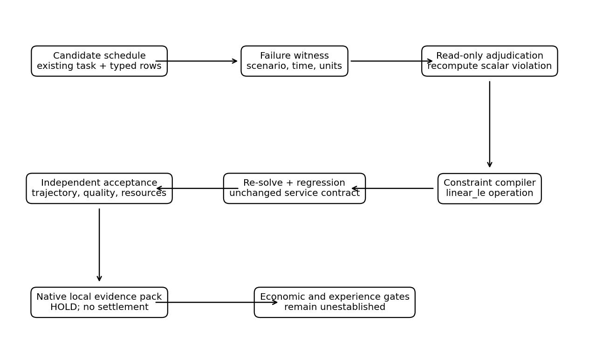
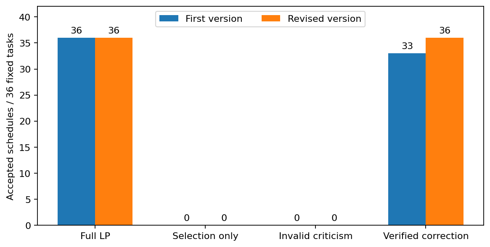
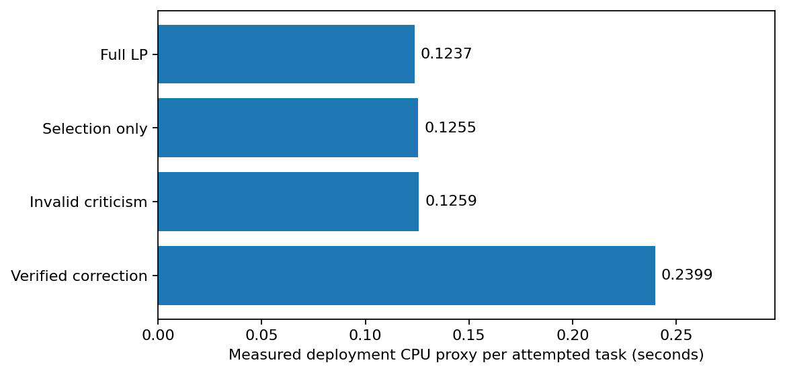
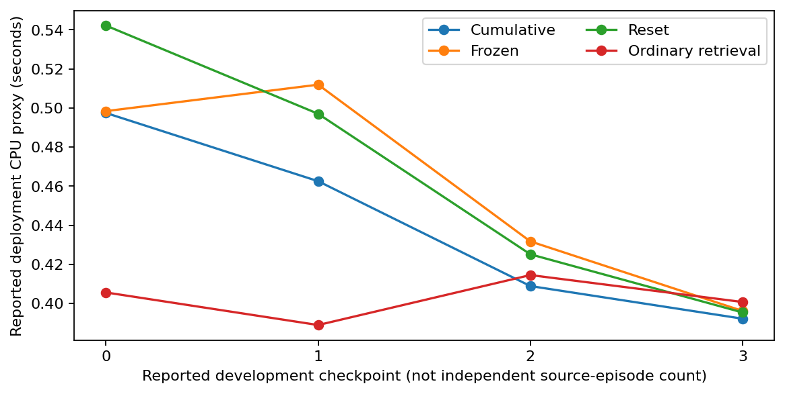
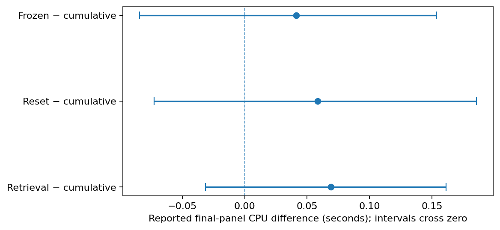
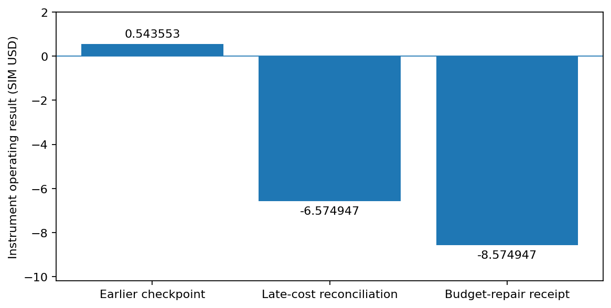

# Abstract {.unnumbered #abstract}

**From verified criticism to executable repair—and the limits of economic compounding.** An invention-automation machine must do more than recognize an analogy, select a familiar solver, or reject an inadequate answer. A validated failure must change an executable construction; that construction must improve useful work against competent alternatives; and complete accounts must establish whether it enables the next construction. We audit the actual AGI ALPHA developer artifacts and implement an additive corrective-constraint compiler inside the existing mission and evidence flow. In a fresh, frozen exploratory panel of 36 finite operational models, the repaired version accepts 36/36 schedules after generating 594 independently checked constraints. A full conventional linear program also accepts 36/36 and uses less measured deployment compute: {{cpu_corrective}} versus {{cpu_lp}} CPU-proxy seconds per attempted task. The earlier correction version accepted 33/36 because three repairs exceeded the unchanged CPU limit. Read-only audits reproduce all 288 new native records and validate all 1,220 generated constraints across both versions. Separately, 128 saved developer transfer/successor certificates replay successfully but establish no accepted-output advantage. Current simulated accounts reconcile an instrument operating loss of **8.574947 SIM USD**, despite an earlier positive checkpoint; unrestricted earned funds are zero. Battery reuse, difficult textile sorting, and small-building energy services remain unadmitted opportunities, not verified loss-making cohorts. Historical eight-arm and learning summaries do not establish practical synergy or progressive usefulness, and their full raw archive was not recovered. The result is an executed closure of a narrow criticism-to-construction gap and a consequential negative audit—not a demonstrated economic transformation, general invention engine, or completed flywheel.

**Keywords:** invention automation; structural transfer; counterexample-guided construction; productive inheritance; complete-cost accounting; procedural verification; AGI ALPHA.

**Author:** Vincent Boucher, President, MONTREAL.AI. **Status:** local research edition; not externally peer reviewed, deployed, or remotely published. The ambition is to turn each verified invention into a means of discovering, constructing, and economically enabling the next. That ambition is the hypothesis, not the result.

# The missing link is construction, not another certificate {#finding}

The strongest new finding is specific. A critic can now produce a failure witness that becomes an executable constraint in the same mission that produced the faulty schedule. The compiler does not merely name a better method: it creates a numerical operation, applies it, and returns a different dispatch artifact. A separate checker then evaluates the artifact against the original obligations. This closes a real implementation gap in the inspected developer source.

The strongest comparator is equally important. A conventional linear program, given the same finite task and complete constraint set, already produces an accepted answer on every task in the new panel. The corrective procedure does not open a new feasible activity relative to that comparator. It reconstructs constraints that the comparator can incorporate directly, and its measured overhead is higher. A successful repair is therefore not automatically a useful invention advantage.

The economic evidence narrows the conclusion further. In a separately recovered structural-transfer campaign, all five technical arms produce the same accepted classification counts. The current instrument ledger is loss-making after its recorded late expenses, and its funded control performs no worse on the successor comparison. None of the newly screened real-world prospects has an admitted cohort whose baseline loss and treatment profit are both supported by complete evidence. These are three distinct boundaries—technical attribution, economic identification, and source completeness—not one generic lack of confidence.

This edition does not substitute the reserve-scheduling fixture for the intended business transformation. It uses the fixture to close the constructive feedback defect, preserves the conventional winner, audits the existing commercial evidence, and identifies precisely what a substantive next campaign must establish. The implementation and checks are part of the contribution; the manuscript records them.

## Research questions and decision standard

We distinguish three questions that are often collapsed into the phrase “the flywheel works.” First, can verified criticism cause an actual executable correction? Second, can that correction, structural transfer, or accumulated experience outperform the strongest competent complete workflow under comparable information and resources? Third, does the improvement turn the *same admitted activity and cohort* from negative to positive complete-cost profit, leaving settled surplus that finances a useful additional construction?

Only the first question receives a positive bounded answer here. The second receives a negative result on the new finite panel and remains unestablished more broadly. The third is not identified for a real cohort and is not supported by the recovered simulated instrument accounts. This distinction avoids dismissing useful engineering while preventing a component result from being promoted into a business or intelligence claim.

For clarity, “invention” in the narrow implementation result means a newly constructed task-specific executable artifact relative to the inspected predecessor. It does not mean a new theorem, a previously unknown optimization algorithm, an autonomously invented physical mechanism, or worldwide scientific priority. The writer supplied the compiler architecture and allowed operation language; the program generated numerical constraints and schedules within that language.

# Continuity: what the existing series already established {#continuity}

The series is an input to this work, not a collection of titles to repeat. We inspected canonical source identities, the available full manuscripts, bibliographies, code, and retained evidence at their actual scope. Two complete local TeX sources match their canonical Git blobs exactly. A third full TeX manuscript was recovered and likewise matched. The retained *Out-Evolve* PDF is complete, but its local TeX root contains unresolved section inputs; we do not claim that its source package can be rebuilt from the recovered root alone. Appendix A records these limits.

## Four inherited contributions

*Transformational Intelligence: Learning to Change the Game* separates authorized purpose from inherited formulation and evaluation. Its exact two-world example has a passive-information ceiling of one half and an intervention policy with accuracy $8191/8192$ under at most twelve queries. An unrestricted optimal planner matches the result. The reusable lesson is a purpose-preserving formulation change with an explicit information bridge, not a claim that an LLM discovered a new causal algorithm. Its local exact-model code and bibliography were inspected [@ti].

*Invent the Economy* makes technical and contractual arrangements jointly editable. A supplied four-buyer example supports a shared construction under assumed values and success probability, while cash timing can still prevent entry. Its 2,240-case finite grid and independently implemented event checker do not establish real buyer commitments. We retain the separation of technical correctness, participant acceptance, operating contribution, financing, and realized exchange; we do not reuse its hypothetical prices as current demand [@economy].

*Out-Evolve* asks what must be built to make subsequent discovery possible. Its conditional response-family calculation contrasts $2^{20}=1,048,576$ arbitrary binary-configuration readings with $1+20+190=211$ readings when a qualified degree-two structure genuinely holds. The structure must be earned, not assumed from modular-looking components. Its compatible-extension argument and retained operator work motivate construction prerequisites and mission-relative revalidation. They are not a measured industrial speedup or a physical platform constructed in this campaign [@evolve].

The canonical *Autonomous Enterprises: Build the Means of Building* makes inheritance operational in a bounded arithmetic foundry. It reports that an inherited convolution program reduces a specified inverse construction and qualification from 78,016 to 30,912 declared work units. Joint construction costs 808,420 rather than 1,226,276 units under the stated isolated-build comparison; unrestricted joint planning matches it. Those are counted operations under supplied classical templates, not currency or proof that an autonomous invention policy is superior. We recovered its full canonical TeX, including the bibliography and limitations, but not its matching complete foundry companion. These figures remain attributed historical results, not a fresh writer reproduction [@enterprise].

{{continuity_table}}

## What this paper adds—and does not add

The present addition is the executable path from a scalar failure witness to a typed constraint and a regenerated artifact. It reuses the developer's task model, baseline solver, workbench, mission compiler, final checker, and evidence-pack format. It also adds read-only reconstruction of the new constraints using an algebraically different coefficient calculation, plus reconciliation of the latest available commercial ledger rather than an obsolete positive checkpoint.

It does not claim to re-establish every preceding theorem or to reproduce every earlier large experiment. It does not add a learned physical observation channel, a qualified real business cohort, or a demonstrated better invention policy. Recovered source is not automatically installed authority. The newly located original SUCCESSOR Omega Strategy Laboratory v0.1.0 is a separate bounded research prototype: its 51 tests pass in this environment, but its 193,536 historical policy/control executions were not all rerun. Its validated expression grammar, evolutionary search, frozen candidates, and rejection of unsupported promotions are useful precedents, not evidence that AGI ALPHA already possesses general strategy invention [@omega].

# Source truth, architecture, and experimental custody {#custody}

## Four evidence lineages, kept separate

The supplied and recovered material contains related but nonidentical studies. Combining their counts would manufacture a larger experiment than actually occurred.

{{lineage_table}}

The first lineage is the original compounding-discovery source and aggregate tables. The supplied answer reports a 2,184-case fixed panel and interrupted predecessor runs, but the large complete raw archive was not mounted and was not recovered from the visible Library search. We reran its 71 tests and inspected its mechanisms. We can verify arithmetic consistency in its CSV summaries, not reconstruct its original pairing, bootstrap intervals, exposure history, or every native pack. Its numerical findings are therefore explicitly *reported historical results* throughout this edition [@dev].

The second lineage is a recovered structural-transfer package with actual per-task artifacts, source freezes, a saved checker, a protected-exchange simulation, and SQLite histories. We replayed 128 certificates and independently recomputed the latest financial snapshots from the databases. This package supports a stronger artifact-level audit, but its numerical market assumptions remain simulation assumptions [@transfer].

The third lineage is the invention-automation first-cycle registry. It has executable software and a small economic fixture, but all real opportunities are UNKNOWN. Its useful role is to preserve screening choices and expose what has not yet been admitted [@firstcycle]. The fourth lineage is the new writer extension and its two explicitly exploratory pilots. Every new task, result, witness, constraint, protocol, native pack, and read-only audit is included.

## Repository identities and authority boundaries

The Alpha source base is commit `12770c22b4a9f90f2013bbfb64242f912ba5071e`. The delivered development workspace is a sparse reconstruction with exact required upstream dependencies, not a full clone or a clean release checkout. The original archive's 68 available source entries still match byte-for-byte after the additive work. The new code is isolated under `studies/agi-alpha-compounding-discovery-v1/writer_extension/`; the paper occupies a new subdirectory of that same study.

Current repository metadata was read through the connected GitHub interface. The inspected Fleet, Jobs, and Manager heads are recorded in Appendix A. Fleet's instructions preserve inactive restores, source-pinned qualification, STOP records, and explicit spending authority. The Jobs and Manager discovery receivers declare local inspection, unsupported submission, unprovisioned external execution, and no authority. Their currency routes are alternatives: `jobs-agialpha` / `AGIALPHA18` and `manager-usdc` / `USDC6`, not two charges for one job. Root `AGENTS.md` retrieval returned 404 for Jobs and Manager; relevant source and README boundaries were inspected instead. We did not run their complete native acceptance suites or claim that these routes were commissioned.

The new experiment uses the actual Alpha `createWorkbench` interface, not a replacement simulator with a similar name. It emits seven-node compiled job graphs, mission/release/integrity digests, an inspectable `dispatch.json`, and the original local-execution restrictions. Pack inspection verifies identities and bindings; it labels imported evidence `UNAUTHENTICATED_HISTORICAL_IMPORT`. Final records retain **admission HOLD**, **settlement NOT_CONNECTED**, and no active authority. An intact digest proves byte identity, not physical validity, customer acceptance, or external reviewer independence.

## Procedural separation, not institutional independence

The builder does not receive the evaluation optimum. The final JavaScript checker is unchanged and calculates trajectories directly. A separately assembled Python matrix formulation provides the optimum reference. The witness adjudicator does not import the builder or solver. A later read-only audit recomputes generated coefficients using closed products of retention factors rather than the builder's forward-vector recurrence.

These separations help expose implementation errors, but all roles operated in one AI-assisted session and share the same machine, task specification, and numerical libraries. Both linear-program formulations use HiGHS. No independent institution certified the result. Furthermore, hashes do not create access control: the builder and checker files are locally administered. The protocol records that outputs were not used for within-panel tuning, not that a separate security domain cryptographically concealed every case from the authoring process.

# Opportunity admission before economic transformation {#opportunities}

The central business question is whether an instrument can make an important previously unprofitable activity profitable. That question needs an identified operator, activity, input cohort, ownership boundary, service obligation, location, horizon, and best existing complete route. The recovered opportunity registry does not yet supply that complete object for any of its three prospects. A promising bottleneck is not a demonstrated negative-profit cohort.

## Battery second life

The candidate beneficiary is a repurposer deciding how to qualify and route retired packs into a specified storage service. The material questions include acquisition price, remaining life, diagnosis, handling, safety qualification, assembly, warranty, and terminal disposal. Cobb and colleagues model maximum acquisition prices using a process-based repurposing model and life-adjusted comparison with new storage; the institutional abstract supports chemistry- and application-dependent economics, not a universal loss statement or a current supplier quote [@cobb]. The PNNL charging-station study is another existing techno-economic route, not an unserved blank slate [@charging].

Virtual reference electrodes are already published prior art. The inspected abstract describes estimating an internal electrode state from ordinary cell signals after training on specially measured cells. We neither constructed that instrument nor validated its use on retired heterogeneous packs [@virtual]. An admissible comparison must include competent diagnosis, whole-pack reuse where feasible, recycling, and life-adjusted new storage. Without actual asset condition, ownership, acquisition, warranty, and buyer obligations, neither the baseline loss nor the treatment's break-even bound can be identified. Status: **UNKNOWN**, not rejected and not promoted.

## Difficult textile recovery

The proposed operator is a sorter or recycler facing a specified difficult feedstock and an accepted output-purity requirement. Existing NIR methods and NIST's NIR-SORT reference database are incumbent resources, not new inventions by the campaign [@nist]. IOM's research description identifies difficulties with carbon-black textiles and small elastane fractions while describing an ongoing instrument-development program; it does not validate this campaign's sensor, yield, throughput, or economics [@iom].

A potentially consequential construction would change what is observable or separable while preserving downstream quality. The aluminum-sorting precedent is instructive: PNNL describes chemically changing an alloy's observable appearance and using optical sorting. This is existing work, not a transferable guarantee for textiles and not our invention [@alloy]. No new reagent, instrument, textile measurement, batch acceptance, buyer price, or lifecycle cost was executed here. A classifier score without accepted material and all-cohort processing costs would not establish profitable recovery. Status: **UNKNOWN**.

## Small-building energy services

The candidate activity is a bounded monitoring and intervention service for a fixed portfolio of small buildings. Current contractor arrangements and Commercial Building Energy Saver are incumbent alternatives; the latter's tool scope is not automatically a free completed onsite service [@cbes]. The LBNL contractor study already investigates reducing transaction costs through existing HVAC relationships. Its early pilot table extrapolates from two sites; a separate demonstration involved 16 contractors and 24 sites. The 2016 report and its historical monetary assumptions cannot be treated as 2026 quotes or a currently loss-making cohort [@buildings].

The recovered three-case fixture explores batching and precommitment under invented fees and costs. It keeps screening and rejected-case costs, which is useful software behavior. But a supplied 25% batching discount is not an invented production improvement, and a prepaid amount exceeding a fixture's fee exposes why its cash field is not a protected settlement proof. We reran five fixture tests without changing it. Its baseline, unbounded, and bounded profit outputs remain software examples, not evidence that a real contractor business crosses break-even. Status: **UNKNOWN**.

{{opportunity_table}}

## The cost-and-value bridge that is still missing

For a fixed admitted cohort $\mathcal C$, define complete-cost operating contribution under instrument $z$ as

$$
\begin{aligned}
\Pi_z(\mathcal C)={}&R_z+S_z-C^{\mathrm{acquire}}_z-C^{\mathrm{measure}}_z-C^{\mathrm{produce}}_z\\
&-C^{\mathrm{accept}}_z-C^{\mathrm{support}}_z-C^{\mathrm{terminal}}_z-C^{\mathrm{capital}}_z-C^{\mathrm{instrument}}_z.
\end{aligned}
$$

$R_z$ is earned accepted revenue, $S_z$ net salvage or recovery, and the cost terms include every admitted input, including rejected, abstained, reworked, and unsold outputs. Real external labor and supplier costs remain where unavoidable. “Autonomous” does not erase them. Shared research costs are additionally reported at enterprise level; they are not charged again as fresh research for every delivery.

A useful threshold test requires credible bounds on both $\Pi_0$ and $\Pi_1$, with unchanged exogenous conditions and service obligations. A robustly negative baseline requires its relevant upper bound to be below zero; a robustly positive treatment requires its relevant lower bound to exceed zero. An attractive point estimate with an interval spanning zero does not establish the claimed crossing. Non-entry, disposal, replacement, and another investment are separate outside options, not interchangeable baseline profits.

For the three candidates, the missing cohort data leave these bounds unresolved. We therefore cannot reject an opportunity because its optimistic bound supposedly fails: that bound has not been identified. Nor can we promote it by inserting favorable prices. The next decisive resource is not another random seed. It is an authorized, lawfully accessible cohort record with complete obligations and a measured discriminating intervention. No customer contact, physical operation, or purchase was authorized or undertaken in this edition.

# The actual construction engine {#mechanism}

## Inspected predecessor: transfer and selection without correction

The developer's A mechanism stores supplied structural principles and checks applicability; its S mechanism composes a finite menu of supplied interval and linear-programming methods. Additional adversarial checks run after the winning method is selected. They can identify a defect or an applicability limit, but do not compile a new corrective method back into that decision. Turning C off does not turn off final correctness checks. That distinction is sound; the absent feedback edge is the implementation gap [@dev].

Our extension keeps the inherited task and acceptance contract. Its only generated operation is a bounded numerical inequality in an allowlisted language. The writer supplies the compiler and search loop. At runtime, reproduced failures determine which extra inequalities are constructed and added. No language model is called during a task. This is a counterexample-guided construction mechanism within supplied mathematics, related to established synthesis from partial programs rather than a newly invented general discovery algorithm [@sketch].

{#fig-mechanism width=96%}

## Typed operational model

Each task specifies a horizon $T=48$, five supplied scenarios, an initial stock, a reserve trajectory, a capacity, conversion factors, losses, power caps, and optionally a ramp limit. The state unit is cubic metres for water, thermal kilowatt-hours for industrial heat, or kilowatt-hours for charging. These are three unit-labelled model domains with the same scalar recurrence, not three separately validated physical industries.

For scenario $k$ and time $t$,

$$
x_{k,t+1}=a_{k,t}x_{k,t}+\Delta t\bigl(\eta_{k,t}u_t-d_{k,t}\bigr),\qquad
\ell_{t+1}\leq x_{k,t+1}\leq U.
$$

Here $a$ is dimensionless retention, $u$ is power in kW, $\Delta t$ is hours, $\eta$ converts electrical energy to the declared stock unit, and $d$ is stock consumed per hour. The objective maximizes a common event-period reduction $r$, subject to power and ramp constraints. The same dispatch $u$ must serve all declared scenarios. The oracle measures the optimum of this finite linear model, not statistical or physical reliability beyond it.

The structural map preserves conservation-like accumulation, loss, supply, and demand relationships. Units are explicit. Applicability requires the supplied linear dynamics and constraints. Nonlinear equipment behavior, hidden shared limits, unmodeled failures, changing prices, and actual operating obligations lie outside the claim. The mapping itself was supplied by the task designer; no autonomous search discovered that these physical domains share a recurrence.

## Witness to executable inequality

The starting candidate includes all power/ramp requirements and the inventory constraints for scenario zero. This is a deliberately incomplete candidate for studying repair; it is **not** the strongest baseline. All scenarios are available to every arm, and the complete LP uses them directly.

The critic finds the first violated inventory bound, scanning scenarios and then time. The witness contains the task hash, scenario index, time index, state unit, observed stock, required bound, and prefix length. “Minimal” here means the shortest violating prefix in the first selected scenario. The implementation does not establish global minimality across all scenarios or a minimal explanation among arbitrary causal descriptions.

The adjudicator independently recomputes that scalar prefix from the unchanged task and candidate. Wrong units, mismatched identity, malformed indices, nonfinite values, and unreproduced claims are rejected. A valid witness is converted to a `linear_le` operation. Writing

$$
A_{k,t}=\prod_{h=0}^{t}a_{k,h},\qquad
b_{k,t}=A_{k,t}x_0-\Delta t\sum_{j=0}^{t}d_{k,j}\prod_{h=j+1}^{t}a_{k,h},
$$

and

$$
w_{k,t,j}=\Delta t\,\eta_{k,j}\prod_{h=j+1}^{t}a_{k,h},
$$

\Needspace{7\baselineskip}

The lower-stock obligation becomes

$$
-\sum_{j=0}^{t}w_{k,t,j}u_j\leq b_{k,t}-\ell_{t+1}.
$$

The upper-stock obligation uses the opposite coefficient sign and $U-b_{k,t}$. Empty products equal one. The coefficients have stock-unit/kW dimensions; the right-hand side has stock units. These rows are consequences of the original service contract, not a relaxed replacement for it. The final model may not change market parameters or the acceptance judge to make a repair pass.

The interpreter permits only task-bound `linear_le` operations of the declared shape. Generated operations cannot invoke a shell, network, hardware, or real transaction. The development process's authorized tools are distinct from generated-strategy capabilities. A maximum of 128 new cuts and a two-second candidate CPU limit bound each attempt; final resource acceptance also observes worker CPU externally. The common final checker retains the 0.999 useful-quality floor and the inherited abstract-work ceiling.

## An actual counterexample-to-adaptation trace

The retained task `writer-exploratory-0796104bb23547932bef`, seed 89110, is the industrial-thermal/shared-linear case. Its capacity is 1,476.643381 thermal kWh and initial stock 959.818198 thermal kWh. The first candidate claims a reduction of **536.049417 kW**. In scenario 1, after the fifth step, its stock is **264.220505 thermal kWh**, below the required **265.795809**. Independent scalar recomputation gives a violation of **1.575304 thermal kWh**.

The compiler produces the concrete additional constraint

$$
\begin{aligned}
-0.907916553u_0-0.910922454u_1-0.913938307u_2\\
-0.916964144u_3-0.920000000u_4\leq-1485.227448635.
\end{aligned}
$$

This row is not a verbal recommendation. It enters the next optimization call. Fourteen validated additions lead to a reduction of **515.076648 kW**, matching the independent finite-model optimum. The direct trajectory checker reports a maximum numerical bound violation of approximately $4.6\times10^{-12}$ stock units, below its declared tolerance. The complete before schedules, witness, adjudication, row coefficients, final schedule, and native pack are preserved; Appendix C gives the exact record path.

The causal improvement is from an invalid partial-model schedule to a valid complete-contract schedule. It is not an improvement over the full LP, which starts with the relevant constraints and returns the same optimum. Nor does the row by itself constitute reusable domain-general knowledge: it is bound to one task's parameters. A reusable compiler is an engineered tool; a learned strategy that improves how future tools are invented would need a different experiment.

{{supplied_table}}

# Frozen exploratory pilots and verification {#methods}

## Why a targeted pilot, not another expensive factorial

The developer already attempted a full eight-arm A/S/C comparison, but the missing constructive feedback edge made a new broad factorial premature. We instead test the narrow causal mechanism before any business or general-intelligence claim. The four arms are the complete conventional LP; a scenario-zero partial model with no constructive correction; the same partial model exposed to a deliberately wrong-unit criticism; and the validated corrective loop.

The two incomplete arms are **mechanism ablations**, not competitive service alternatives. Their purpose is to test whether the new edge changes the artifact and whether unvalidated criticism is refused. Their failure cannot establish superiority over competent ordinary methods. The full LP remains the primary useful comparator. All arms have the same current-task information, allowed solvers, resource ceilings, and final acceptance checks; they differ in whether and how constraints are constructed.

Each panel contains 36 task identities: three seeds, three unit-labelled domains, and four structures—shared linear dynamics, ramp coupling, scenario-dependent loss, and time-varying parameters. Horizon and scenario count are fixed. Arm order is randomized by a recorded deterministic ordering seed. The panel is a finite component test, not a sampled customer population. Domain labels do not make mathematically related tasks independent scientific domains.

The protocol and source hashes are written before evaluation begins. Version 2's record is timestamped **2026-10-29T12:37:43Z** and declares the scope **EXPLORATORY**. It explicitly leaves the minimum economic gain unset because no admitted economic activity exists. There is no model-weight training or history update. No final-panel answer enters learning memory. These measures preserve the bounded test, but the earlier campaign's complete sequential error ledger was not recovered; changing versions cannot create new confirmatory permission.

## First version: correctness was not enough

The first fixed panel used base seeds 70101, 70202, and 70303. The corrective procedure accepted 33 of 36 tasks; three repairs exceeded the unchanged CPU gate. All 36 complete-LP tasks passed. The first tool call terminated after 75 records. We verified no controller remained active and completed the 69 predeclared missing records in recorded segments without changing candidate or checker code. Original records and interruption metadata were preserved. Some aggregate controller costs could not be reconstructed completely, so we do not present a complete monetary cost for this segmented run.

The diagnosed overhead included recalculating an invariant task digest for every stored constraint on each solve. A versioned repair hoisted that calculation outside the row-validation loop. It did not remove identity checks, alter constraints, loosen tolerances, change the two-second ceiling, or edit the final evaluator. The first version's source snapshot and failed results remain available and retired as exploratory development evidence.

## Second version: fresh tasks, same acceptance

The second panel used fresh base seeds 88101, 88202, and 88303. All 144 arm/task records completed in one block. Parent and child CPU were measured, native workbench overhead was recorded, and saved artifact digests were retained. The reported wall time is 23.053901 seconds; parent CPU is 2.007817 seconds and children CPU 21.201086 seconds. Peak child resident memory reported by the operating system was 126,576 KiB. These are run measurements, not the total cost of designing, researching, writing, verifying, and packaging the campaign.

Because versions use different task panels and execution histories, the change in their measured CPU is not a randomized causal speedup estimate for the digest optimization. The defensible observations are that the identified redundant work was removed, the next frozen version passed the resource gate on all fresh cases, and the conventional reference remained cheaper. No holdout was repeatedly tuned until success.

## What independent checking actually checked

The original study's 71 tests, the original Omega laboratory's 51 tests, the first-cycle fixture's five tests, and 14 new corrective tests passed in this environment. Counts belong to distinct suites, not independent scientific replications. The new tests exercise compiled rows, witness rejection, malformed operations, wrong units, and unchanged obligations. No test was weakened to turn a preferred result green.

After both panels, read-only native inspection reproduced all **288** pack/binding and final-acceptance records. A separate coefficient audit validated **626** generated additions in version 1 and **594** in version 2, using a closed-product calculation rather than the builder's forward recurrence. It recomputed 72 finite-model optima and checked all 72 deliberately invalid-criticism rejections. The unchanged original source and the version-2 freeze hashes were also checked. This is strong evidence of the specific local mechanism, not an external safety certification or proof against every numerical library defect.

# Technical results: repair succeeds, the baseline still wins {#technical-results}

{{new_results_table}}

Both complete LP and corrective construction pass every task in the revised panel. Each has 12/12 accepted cases in each unit-labelled domain. The two incomplete ablations pass none. Every wrong-unit criticism is rejected, and therefore cannot silently become an executable constraint. That control establishes evidence gating, not an ability to recognize all forms of irrelevant criticism.

The corrective arm constructs 594 new rows across 36 tasks. Its accepted normalized quality has a minimum within approximately $2.1\times10^{-15}$ of one. The useful comparison is thus a tie in finite-model quality. The construction is more expensive: its deployment CPU proxy per attempted task is **{{cpu_corrective}} seconds**, versus **{{cpu_lp}} seconds** for the complete LP. This proxy adds observed worker CPU, native-process CPU, and allocated evaluation-oracle CPU. Candidate self-reported CPU is a subset and is not added again. All failed attempts remain in the totals.

{#fig-acceptance width=90%}

{#fig-cpu width=92%}

## No general synergy claim follows

These results do not test a multiplicative discovery advantage. The mechanism uses a supplied cross-domain recurrence and a writer-designed operation language. It performs finite constraint construction, not open-ended strategy invention. The ablations identify the utility of constructive feedback relative to an intentionally partial candidate; they do not isolate independently learned A, S, and C contributions on consequential business work. The primary competent alternative already implements the complete mathematical specification.

The appropriate technical decision is therefore **GO for this bounded corrective component, HOLD for superior useful capability**. A component can be correct and useful for engineering the broader system without being the best production path for its current application. Retaining the full LP as the preferred route prevents the research mechanism from degrading delivery merely because it has a more ambitious name.

## The preserved eight-arm result

The inherited A/S/C study reports 144/144 accepted outputs in every arm. The full combination's mean usefulness is slightly below the complete LP due to numerical approximation, not substantively above it. Its reported CPU proxy is 1.099252 seconds per accepted output, versus 0.781836 for neither mechanism and 0.745085 for the conventional portfolio reference. Complete numbers are retained in Appendix D [@dev].

The declared aggregate interaction contrast was

$$
I=\mu_{111}-\mu_{100}-\mu_{010}-\mu_{001}+2\mu_{000}.
$$

The reported estimate is $5.00324\times10^{-7}$ with interval $[2.91796,7.08873]\times10^{-7}$, versus a practical threshold of 0.02. This is a sum-of-interactions contrast on the declared additive scale, not by itself a pure three-way interaction coefficient and not a multiplicative effect. Its tiny positive value arises because overlapping components do not incur the same small approximation error twice. The combination does not acquire useful superiority by that arithmetic. We verified the contrast's consistency with the supplied means; without the raw paired archive, we cannot independently recreate its confidence interval.

The historical transfer table also preserves 288 applicability-refused requests across A-enabled arms and 288 valid, quality-neutral transfer requests. A refusal is not a harmful delivered transfer; an accepted fallback can still solve the task. No inference about real-world transfer rates follows from the fixture mixture. The new edition does not relabel those old outcomes as new evidence.

# Experience: distinguish retained assets from improved invention {#experience}

A library can grow while usefulness does not. A previously checked artifact may lower the cost of one later operation; that is productive reuse. A genuine compounding claim is stronger: accumulated experience must causally improve the process of discovering or constructing future useful capabilities after acquisition, retrieval, adaptation, maintenance, and verification costs.

The recovered original compounding summaries compare cumulative, frozen, reset, and ordinary-retrieval modes. The final panel reports 72 accepted outputs for every mode. Cumulative mean deployment CPU is 1.309692 seconds, versus 1.351033 frozen, 1.368085 reset, and 1.378608 retrieval. The reported paired differences favor cumulative in point estimate, but every interval crosses zero. Reset and frozen are also closely related implementations of the same fixed policy in a largely stateless task setting, which limits the breadth of the comparison [@dev].

{{learning_table}}

{#fig-history width=92%}

{#fig-intervals width=92%}

Lifecycle accounting changes the interpretation again. Summing the three reported learning streams gives cumulative deployment/acquisition CPU of **{{learning_cumulative_total}}**, frozen **{{learning_frozen_total}}**, reset **{{learning_reset_total}}**, and ordinary retrieval **{{learning_retrieval_total}}** seconds under their stated acquisition rules. A sensitivity that charges all modes for collecting the same later history is separately retained. Neither accounting convention can turn an uncertain deployment comparison into a demonstrated better invention process. These are CPU proxies; model authoring and campaign costs are not monetized completely.

The new corrective pilot deliberately has no cross-task memory. Its 594 rows are task-bound constraints, not 594 learned transferable scientific principles. The reusable compiler was engineered in this session; there is no causal comparison showing that earlier generated rows made later invention cheaper or more successful. No new “0, 4, 8, 12 episodes” table is fabricated. **Experience GO remains unestablished.**

A future admissible learning test would retain the failure *family*, its applicability assumptions, the transformation rule, and measured costs, not reuse a previous final schedule under a new identifier. Current inputs, strong tools, task difficulty, and total budgets would remain comparable across cumulative and ordinary-retrieval controls. Such a test is a continuation requirement, not a result of this paper.

# Economic audit: a profitable checkpoint was not a profitable campaign {#economics}

## The evidence that can be audited

The structural-transfer package contains more than a report: task artifacts, saved checkers, simulated receipts, expense events, investment records, and SQLite histories. Its five technical arms each produce 24 accepted certificates: four feasible schedules and twenty infeasibility certificates. An accepted infeasibility certificate is a valid analytical output, not a completed feasible operation. Across all 120 primary certificates and eight successor certificates, the saved checker succeeds. There is no accepted-output advantage for the instrument over ordinary reuse, target specialist, coded generalist reference, or enterprise without the instrument [@transfer].

The “frontier generalist” label in that package does not mean a live frontier model solved each case. The implementation includes a coded comparator and an authoring-token allowance. We preserve its actual identity rather than treating its name as a defeated AI competitor. Physical delivery and real market demand were not observed.

## Reconciliation from the latest database, not a stale report

The earlier instrument snapshot showed 9.200000 SIM USD revenue, 8.656447 expense, and **+0.543553** operating profit. Late post-gate regression, documentation, audit, writer-allowance, and retention expenses added **7.118500**, changing profit to **−6.574947**. A subsequent developer budget-repair receipt added **2.000000**, producing the current **−8.574947**. These historical snapshots remain unchanged and separately hashed.

The writer's first replay compared the current database with the older cost-reconciliation snapshot and failed its expected-value checks. Inspection found the already-recorded later repair receipt. We did not erase or “fix” the database to recover the positive figure; we replayed the read-only auditor against the latest versioned receipt. Instrument, control, and full-refund snapshots then all reconciled. The initial failed audit is retained as evidence of a source-version mismatch, not concealed as a successful first attempt.

{{cost_bridge_table}}

{#fig-profit width=94%}

The late expenses include explicit estimates under reference-rate assumptions rather than metered provider invoices. Deterministic steps are not assigned fictional language-model calls, but unmetered authoring and closing work remains estimated. The present writer's additional research, implementation, checking, and manuscript work is **not** silently inserted into the earlier developer's ledger, and is not zero. Its measured local resources are recorded separately; exact inference cost is unknown. Consequently the ledger's loss is an auditable recorded scenario result, not a complete externally validated economic measurement of every resource consumed across conversations.

## Profit, cash, reserves, and payback are different quantities

The latest instrument database contains revenue **9.200000**, expenses **17.774947**, profit **−8.574947**, cash **30.304453**, a tail reserve of **18.400000**, and working capital of **1.000000**, all in SIM USD. Available cash after those restrictions is **10.904453**. **Unrestricted earned funds are zero.** Cash remains because financing capital is present; cash remaining is not evidence of profit.

The funded control has revenue **11.000000**, recorded expenses **10.604113**, and operating profit **+0.395887**. Its larger remaining cash is not a matched claim of a real profitable customer business. Its wider project still carries unrecovered research costs, and its simulated offering is not the newly screened cohort. The instrument's explicitly recorded cumulative project result is **−40.304617**, including separately identified inherited research and seed costs without charging them again per delivery.

{{financial_table}}

{#fig-cash width=96%}

The protected simulator recognizes reserved commitments before computing free funds. The read-only audit checks exact integer accounting, expense-payment bounds, receipt/event consistency, provider-binding fields, historical investment reservations, and wallet conservation. Its signature checks use the local simulation provider's assumptions; they do not establish an independent external payment provider or real finality. No actual wallet, key, payment, token trade, or native transaction was accessed or authorized.

## No identified negative-to-positive crossing

A transformation claim would require the same admitted cohort to have a credible negative complete-cost baseline and a positive complete-cost treatment, caused by the constructed instrument. The recovered evidence shows neither. In the transferable scheduling study the strong comparator already solves the model. In the structural-transfer market, the instrument has a worse recorded operating result than the funded control. In the three real-world prospects, the cohort and cost/value bridge remain unestablished.

Nor do the 216 refusal worlds in the original compounding source establish a market. They exercise a qualification/refusal gate, with zero orders, not measured demand and competitive customer selection. A zero result in that fixture does not identify the market value of a physically validated future instrument. Conversely, predicted customer benefit is not AGI ALPHA license revenue, token demand, or ownership value.

We do not report NPV because the required coherent cash-flow horizon, investment alternatives, financing convention, and calibrated uncertainty are not available for a real admitted cohort. We also do not double-count capital outlay and depreciation or reserve transfers and the underlying obligation. Profit, payback, liquidity, investment attractiveness, and value capture remain separate decisions.

# Protected exchange and the successor link {#successor}

The recovered simulation traces offer, inspection, acceptance, receipts, refunds, liabilities, and reserved investment. Its current instrument history has 46 simulated orders, 333 events, and one investment record. The control has 55 orders, 392 events, and one investment record. These are generated exchange histories under declared rules, not customer observations. A sufficiently equivalent free completed service is a legitimate adverse alternative, but the package's exact-free-output case is a sensitivity scenario, not proof that such a current service exists.

A historical 0.25-SIM-USD investment event can remain a genuine chronological event in the simulator even after subsequent lifecycle accounting reverses the apparent surplus. The correct response is not to delete the event or to call the entire subsequent construction free. It is to ask which funds were available at the decision, which costs were omitted or later incurred, and whether the completed successor produced an incremental return that covers its construction and lifecycle obligations.

The saved successor comparison has four fresh pairs. Both instrument and funded no-instrument control accept all four. The predecessor's exact interface cannot express the new shared-capacity obligation; two old relaxed schedules violate it. Thus a meaningful new interface capability was constructed relative to that restricted predecessor, but the competent funded control also constructs it. The attributable accepted-output advantage is **zero**. This is precisely why “new compared with old code” is not equivalent to “caused by the proposed transfer engine.”

The instrument's recorded successor feature net return after its reported lifecycle charges is **−6.832946 SIM USD**; the control's is **−0.217140**. The later 2.00 budget-repair expense is explicitly assigned to seed repair, not to that successor feature, and is not subtracted from the feature twice. Current unrestricted earned funds in the instrument account remain zero. A full-refund branch yields profit **−26.974947**, cash **11.904453**, and investment stopped, while preserving construction expenses already incurred.

The new writer corrective compiler is **not** claimed to have been financed by those SIM earnings. It was constructed with the existing authorized local tools and zero new external spending. Its measured compute and unmetered authoring costs belong to the writer continuation record. An archive, a prompt, an activated existing tool, or a higher capital variable would not satisfy earned construction; neither does this unfunded-by-earnings component repair establish that link retroactively.

# Related mechanisms and the boundary of analogy {#related-work}

Cross-domain transfer can be valuable when a relationship, invariant, observation, or construction method survives a change of domain. The scientific obligation is to identify the preserved structure and the assumptions that do not transfer. Merely relabelling the same recurrence as water, heat, and charging is not evidence of an intelligence autonomously discovering an unexpected analogy.

Counterexample-guided synthesis and sketching already connect proposed programs, specifications, and verification. The inspected Berkeley source emphasizes supplying high-level structure rather than deriving every insight from nothing. Our construction is narrower still: it compiles violated inequalities in a supplied linear family. The distinct contribution is integration with this repository's mission and evidence flow and an audited negative comparison, not priority for synthesis or constraint generation [@sketch].

Current primary OpenAI materials reinforce the need to distinguish output, supporting artifacts, and scientific understanding. The October 26 release describes different expert-community review strategies. The inspected `openai/math` README states that artifacts come from an unreleased internal model, have heterogeneous verification status, and are research data rather than uniformly polished papers. Its Lean/Comparator instructions describe additional verification tooling; we inspected those instructions but did not install or run that proof environment. None of those announcements establishes access to the proprietary model here or validates our runtime's performance [@openai2026; @openaimath].

The practical lesson is not that verification is unnecessary until an expert can check everything. It is that every claimed transition must have the right evidence object: a reproduced witness for a defect, an executable adaptation for a repair, a matched competent comparison for a capability gain, cohort accounts for an economic crossing, and chronological funded construction with a fresh control for a flywheel. One object cannot stand in for all the others.

# Limits, failure modes, and retained negative evidence {#limits}

## What the new experiment cannot identify

The new models are generated, finite, linear, and known to all arms. They do not contain real site measurements, chemical uncertainty, heterogeneous battery histories, physical safety qualification, tariff negotiation, buyer commitments, or complete lifecycle costs. The quality ceiling is already reached by the conventional solver. Therefore even perfect correction cannot establish a new feasible activity in this model family relative to that solver.

The 36 tasks per version cover a declared finite design, not a probability sample of productive work. They share a generator and substantial mathematical structure. We report exact observed counts and retained records rather than interpreting 36/36 as a universal success probability. The 594 constraints are not 594 independent discoveries. The irrelevant-criticism control covers a wrong unit, not every adversarial or misleading criticism. The implementation's “minimal witness” is prefix-local, not a globally smallest explanation.

The authoring system has pretrained knowledge. A clean task context does not establish that it has never encountered constraint generation, energy scheduling, or a relevant analogy. No model weights were trained, and no live frontier-model baseline was paid for or invoked. “Autonomous” applies only to the bounded deterministic execution loop once the writer-designed program runs, not to unattended business ownership or general scientific strategy invention.

The generated-row interpreter is a restricted numerical interface, not a security qualification for arbitrary hostile submitted programs. The writer supplies the compiler; the pilot checks its emitted rows and witness units. Some descriptive row metadata are not independently enforced by the solver interface. The demonstrated trust boundary therefore covers these generated artifacts, not unrestricted third-party strategy submissions.

The arms share task information, final acceptance, and candidate resource ceilings. Their realized orchestration and checking work differ and are charged in the recorded deployment proxies. This is not a claim of exact total-lifecycle budget parity: authoring, opportunity research, and several historical resource quantities remain unmetered. Neither the acceptance tie nor a descriptive compute comparison establishes a general discovery-efficiency result.

## Inference and resource limitations

The original 2,184-case archive and its complete error-budget/exposure ledger are unavailable in this edition. Its aggregate plots and intervals are inherited claims. The new frozen panels are prospective as recorded locally, but remain exploratory because there is no recovered campaign-wide confirmatory allocation, no economic minimum-effect threshold, and no independently administered hidden-case service.

CPU counters have limited resolution and process scope. Startup, serialization, orchestration, numerical warm-up, and tool-call segmentation can affect measured performance. We count the observed parts without double-counting contained CPU, but do not equate those totals to a complete invoice. Version 1 has incompletely reconstructed controller costs. Authoring-model inference, earlier human or AI effort, and some historic acquisition costs remain unknown. A tight arithmetic ledger inside SIM does not eliminate uncertainty about the assumptions used to price or generate its events.

The global eight-hour planning allowance and all preceding consumption could not be reconstructed from the recovered first-cycle registry. This continuation does not assume a fresh eight-hour budget. It performed small replays, two bounded component pilots, source inspection, and publication preparation while measuring current local use. Additional storage remained below the supplied two-GiB ceiling, with more than two GiB free. Verification and publication QA received a separately tracked allocation. The exact final resource checkpoint accompanies the package; unknown earlier consumption is retained as unknown.

## Negative results that remain first-class artifacts

The retained record includes the first version's three CPU refusals; all 72 invalid criticisms; zero accepted partial-model schedules in both panels; the conventional solver's victories on cost; the original reported absence of practical A/S/C synergy; the unestablished learning effect; the stale-financial-snapshot audit failure; the late-cost reversal of profit; the successor's zero advantage over its funded control; and the three UNKNOWN opportunity admissions. Earlier developer failures and snapshots are not overwritten.

A further limitation concerns the series source recovery itself. The complete canonical enterprise TeX was verified by Git blob, but its matching foundry companion was not recovered. The *Out-Evolve* section inputs were not recovered. This limits fresh reproduction of those prior editions, not compilation of the present standalone paper. The current source package states the difference instead of quietly substituting an adjacent manuscript.

# Decisions and the next falsifiable construction {#decisions}

{{decisions_table}}

The mission remains **NOT COMPLETE**. What now exists is an additive, tested corrective-constraint compiler and a more accurate source/economic record. Its strongest demonstrated utility is that a verified defect changes an executable artifact while the original acceptance requirements remain intact. The strongest conventional comparator still solves the tested work with lower observed compute.

The next substantive campaign needs an admitted activity whose loss driver is not already removed by the competent baseline. For battery reuse, that could require a specified asset cohort and validated diagnostic or routing intervention; for textiles, measured difficult-feedstock observability and accepted recovery; for buildings, current all-in delivery obligations and an independently measured reduction in a binding transaction or execution cost. These are alternatives to investigate, not prescribed winners. Missing data or physical authority should stop their dependent claims, not erase the executable work already completed.

Within any selected opportunity, the next falsifiable test is a paired comparison of the actual new instrument with the best complete existing route under the same cohort, obligations, information, and total budgets. Only after a substantive useful pilot should broader structural-transfer, strategy-synthesis, criticism, and cumulative-experience ablations expand. Retained experience must improve a later construction after its own acquisition and reuse costs; it is not enough for the system to store more artifacts.

No broad new authority is presumed. The exact missing conditions are cohort data and rights, justified cost/value bounds, the relevant physical or external validation where necessary, a reconciled remaining resource allowance, and a prospectively allocated confirmation procedure. Publication, deployment, paid calls, customer contact, and native transactions remain separately unauthorized. The local package is a complete current research edition and a resumable operating record, not a claim that those boundaries have been crossed.

\Needspace{10\baselineskip}

# Contributions and research transparency {.unnumbered #contributions}

Vincent Boucher supplied the research direction and mission requirements and is the requested author of this edition. AI assistance in the present session performed source retrieval, code inspection, additive implementation, deterministic execution, separate checker development, arithmetic auditing, drafting, and document production. The original developer artifacts are attributed separately and retain their own source identities. No external reviewer, customer, institution, or collaborating scientist is invented or implied. Procedural role separation was used; organizational independence was not achieved. All financial events described as SIM are simulations. No real paid transaction, external deployment, or remote publication occurred.

# Appendix A. Source identities and continuity limits {#appendix-sources}

## Repository snapshot table {.unnumbered}

{{repo_table}}

The Alpha base commit was read from GitHub and the relevant original source dependency identities were preserved. Fleet's repository instructions and current head were inspected. Jobs and Manager receiver-source declarations were inspected; full runtime deployment, on-chain state, and release qualification were not independently verified. An “available source” row is not an “authorized execution” row.

The core existing paths used directly are `examples/successor-workbench/engine.mjs`, the mission/compiler dependencies identified in the source manifest, and the study's `interfaces/judge.mjs`, `engine/tasks.py`, `engine/oracle.py`, and `engine/solvers.py`. New code does not modify protected ownership, production deployment, payment configuration, or those original acceptance files.

## Canonical series identity table {.unnumbered}

{{series_table}}

The earlier revised-enterprise package and later foundry-v2 package located nearby are preserved as separate historical editions; neither is silently substituted for the canonical `Autonomous_Enterprises.tex` cited in the continuity matrix. The full *Out-Evolve* PDF's bibliography and limitations were read; its include-only TeX root is not a complete editable source package. No inherited theorem count is claimed as a new writer execution.

## Current external-source scope {.unnumbered}

All cited primary web sources were inspected on 29 October 2026. The battery-cost publisher full text was unavailable; the institutional abstract and bibliographic record were used, with no monetary estimate taken from a search snippet. The virtual-reference-electrode publisher/PMC path was restricted; the PubMed abstract and metadata were inspected. The LBNL PDF's relevant table was rendered. OpenAI's README, Lean-library README, and Comparator instructions were inspected as artifacts; no Lean build was executed. These access boundaries appear in the bibliography and claim map.

# Appendix B. Protocol, controls, and inference history {#appendix-protocol}

{{protocol_table}}

The final quality check computes every declared scenario's trajectory and compares reduction with an independently formulated finite-model optimum. Accepted schedules must preserve power, ramp, inventory, and unit requirements and satisfy the unchanged resource gate. The checker is outside the candidate's allowed operation language. Candidate CPU and observed worker CPU are both considered by the final gate. One tick is added to the observed worker measurement as a conservative allowance for its resolution.

The standard `check.mjs` helper is not used to discard independent CPU evidence in the audit. The read-only replay explicitly passes the saved observed worker CPU to `enforceResourceAcceptance`, exactly as the executed native path did. This matters because self-reported candidate compute alone was inadequate in an earlier developer run. All new native packs retain their local admission and settlement limits.

The primary useful outcome is accepted original-contract output within the fixed budget, with achieved reduction relative to the full LP. Resource-use comparisons are descriptive. The sample allocation tests the implemented mechanism across a finite balanced design; no business-derived practical threshold exists. No new formal hypothesis rejection is claimed. The protocol says EXPLORATORY, and its status is not upgraded because 36/36 passes were obtained.

The original historical inference record contains an invalid resource-accounting run, a later quarantined interruption record, and segmented completion. Those descriptions come from the supplied report and remain attributed because their complete raw records were not recovered. The present version-1 interruption is different: its 144 raw records, segment plans, and read-only audit are included. Version 2 completed in one recorded block with unchanged source hashes. New versions do not reset the earlier campaign's missing confirmation history.

\clearpage

# Appendix C. Reproduction and artifact map {#appendix-reproduction}

## Build the publication without rerunning experiments {.unnumbered}

The full package retains the following workspace layout. The root reconstruction script restores the developer evidence from its original archive before any audit. Publication build steps do not use a network connection or shell escape.

```text
invention_automation_edition_v1/
  README.md
  audit/                         read-only audit programs and outputs
  recovered/                     original developer evidence archives
  series/                        source archives and identity record
  dev_source/AGI-Alpha-Agent-v0/
    studies/agi-alpha-compounding-discovery-v1/
      engine/                    unchanged developer algorithms
      interfaces/                unchanged final judge
      writer_extension/          additive compiler, tests, fixed panels
      papers/invention-automation-v1/
        main.tex                 editable LaTeX entry point
        body.tex                 editable complete paper body
        references.bib           editable bibliography
        manuscript.md            synchronized authoring source
        index.html               complete offline browser edition
        data/                    audited JSON and tables
        figures/                 vector and raster figures
        build.py                 synchronized build
```

From the paper directory:

```bash
python generate_figures.py
python build.py
```

The build reads the same audited data for tables, LaTeX, and HTML. It runs Pandoc's citation processor against `references.bib`, then compiles with `pdflatex -no-shell-escape` twice. The bibliography is therefore editable and actively used even though a separate BibTeX executable is not required. Editing `body.tex` directly is possible; regenerating from `manuscript.template.md` will overwrite that generated body, so retain direct TeX edits in the authoring source for synchronized editions.

## Replay the original and new checks {.unnumbered}

From the study root, with Python and dependencies described in the environment manifest:

```bash
export OPENBLAS_NUM_THREADS=1 OMP_NUM_THREADS=1 PYTHONPATH=.
python -m pytest -q tests
python -m pytest -q writer_extension/test_corrective.py
```

From the top-level package root:

```bash
python prepare_recovered.py
node audit/replay-pilots.mjs
python audit/replay_constraints.py
python audit/assemble_evidence.py
```

These replays read saved outputs; they do not revise candidates or claim a fresh holdout. The read-only ledger replay and saved-certificate replay commands are supplied in the root reproduction README with their exact archive paths. To run a *new exploratory* panel, choose a new output directory and record the exposure in the inference ledger; rerunning the published seeds is reproduction, not fresh confirmation.

```bash
python writer_extension/pilot_v2.py --output evidence/my-reproduction
```

The CLI refuses to overwrite an existing output directory. A reproduction's CPU and wall time will differ with hardware and load; numerical artifacts and scope should be compared under the documented tolerance. The inherited sparse source was tested with Node 22.16.0 here, while the repository guide names 22.17.1; this mismatch is disclosed, not represented as full release qualification.

## Worked-trace location and proof objects {.unnumbered}

The worked trace is in

```text
writer_extension/evidence/pilot-v2/records/
writer-exploratory-0796104bb23547932bef-corrective.json
```

Its sibling task file, native pack, before schedules, witness, constraint coefficients, resource record, and final adjudication are retained. The scalar-product audit checks each generated row against the same specification. The raw records are never replaced by the table in the paper. `data/audited.json` binds the numerical presentation to the source artifacts; the claim map includes the relevant SHA-256 values.

## What cannot be reproduced from this package alone {.unnumbered}

The original 2,184-case raw compounding archive remains missing. Its tables can be regenerated from the supplied aggregate CSVs, but its original paired uncertainty procedure cannot be independently replayed without those records. The canonical enterprise foundry companion and the missing *Out-Evolve* section inputs are not reconstructed from prose. Physical validation, real demand, actual payment, deployed native execution, and a live frontier-generalist task comparison were not performed. No reproduction command is invented for an unexecuted claim.

# Appendix D. Complete inherited aggregate tables {#appendix-historical}

These tables preserve the developer's reported outcomes, not a new writer experiment. The CSVs are included unchanged, and their arithmetic is reproducible. Their missing raw archive remains a material limit on inferential reanalysis.

{{historical_factorial_table}}

The conventional LP reference reports 48/48 accepted outputs at 0.771381 CPU-proxy seconds per accepted output. The applicability-aware conventional portfolio reports 48/48 at 0.745085. No all-arm quality advantage is hidden by reporting only a weak baseline. The original full combination is approximately 40.6% more expensive than the no-mechanism arm by that proxy.

{{historical_contrast_table}}

The contrast scale is normalized useful quality, not probability of a general scientific discovery. The practical threshold was 0.02. A very narrow interval inside this finite model cannot compensate for a negligible effect, weak external calibration, or absent raw pairing. The reported cost interaction can reflect shared overhead without creating absolute cost superiority.

{{historical_lifecycle_table}}

“Equal-history collection” is a separate sensitivity that adds later history acquisition to the controls; it is not a justification for removing real acquisition costs from the cumulative learner. The final-panel interval table in the main text remains inconclusive under the reported method. No new estimate is fabricated from aggregate means.

# Appendix E. Economic identities and source uncertainty {#appendix-accounting}

The recorded SIM databases use integer micro-units. The manuscript divides those amounts by one million for display; it does not convert AGIALPHA into USDC, assign a token price, or combine two native routes. A new unit of external authority is not created by using a familiar currency name in a simulator.

Let $K_t$ be cash, $E_t$ restricted escrow, $L_t$ liabilities/reserves, $W_t$ committed working capital, and $J_t$ an investment reservation. A diagnostic available-cash quantity is

$$
A_t=K_t-E_t-L_t-W_t-J_t.
$$

Whether a system may invest is stricter: it must also have unrestricted *earned* funds, no unmet material obligation, a feasible construction, and an authorized resource envelope. Capital injections can increase $K_t$ without increasing earned profit. Reserve transfers restrict cash without themselves being an additional expense; the underlying expected obligation and later payment must be recognized consistently. A positive projected receipt is neither settled revenue nor current cash.

In the recovered latest instrument snapshot, the published reserve/working-capital arithmetic is $30.304453-18.400000-1.000000=10.904453$ SIM USD. That cash availability coexists with an operating loss and zero unrestricted earned funds. The refund branch consumes the protected exposure, retains construction costs, and stops investment. The audit reproduces these identities; it cannot establish that the simulator's dispute frequencies, assumed customer values, provider availability, or shadow prices match an external market.

The extra 2.00 repair charge belongs to the developer's seed-repair record, not the already reported successor feature return. The original research and seed costs are included once in cumulative project results. Current writer costs are separately metered where possible and otherwise UNKNOWN. Thus the manuscript neither hides research recovery nor charges every historical research expense again for each delivery.

# Appendix F. Claim map, failures, and continuation state {#appendix-claims}

{{claim_table}}

The machine-readable map adds exact artifact hashes, source revision, comparator, uncertainty, verification scope, and limitations to these identifiers. The full evidence manifest lists delivered source and record hashes; checksum files cover the final edition and its package. A checksum demonstrates reproducibility custody, not correctness by itself.

The continuation record preserves the failed first panel, the repaired version, both source freezes, the original aggregate results, the latest three financial snapshots, the stale-snapshot audit failure, and all current blockers. It prohibits reclassifying exposed panels as untouched, claiming that the compiler was earned-funded, or presenting the three UNKNOWN prospects as established unprofitable industries. It also records the exact original archive and companion sources that were not recovered.

The next useful handoff is not another assertion that “the machine is coming online.” It is an operating record that makes the next claim earnable: a specified missing construction, a discriminating check, an honest strong alternative, complete costs, and a preserved path back to every prior failure.


# Companion evidence access {.unnumbered #evidence-access}

The complete research package retains the raw records and source tree. The browser edition contains the whole paper and embeds its figures; the links below require the accompanying local directory.

[Audited numerical data](data/audited.json), [machine-readable claim map](claim-map.json), [human-readable claim map](claim-map.md), and [build and reproduction guide](README.md) identify the numerical source of this edition. The companion root's `audit/` directory holds read-only replay receipts, while `writer_extension/evidence/` in the study holds both the failed first pilot and the revised panel. No evidence link denotes a newly published public service.

# References {.unnumbered #references}

::: {#refs}
:::
