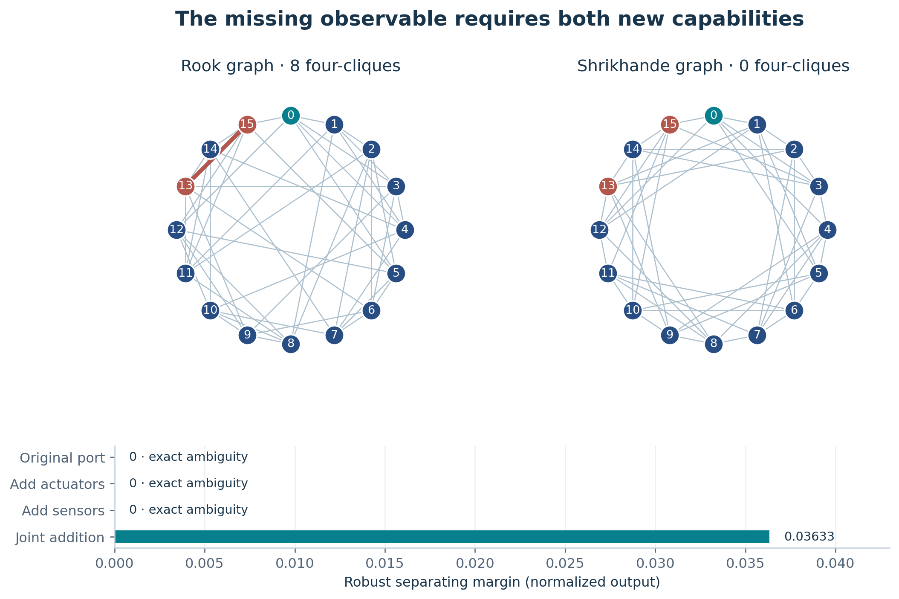
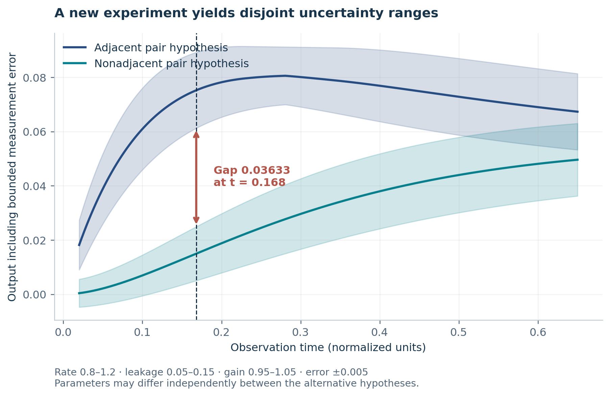
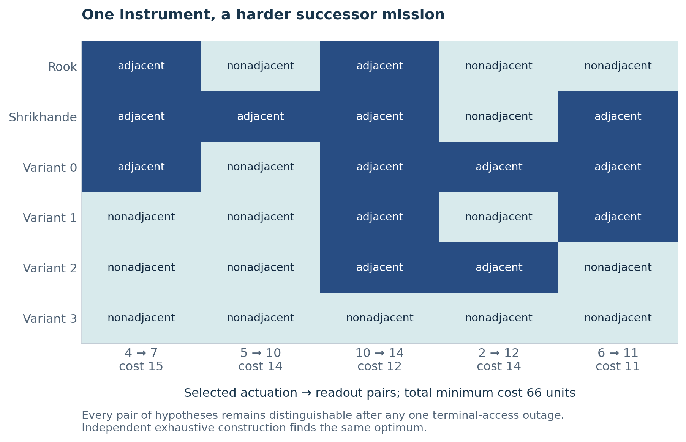
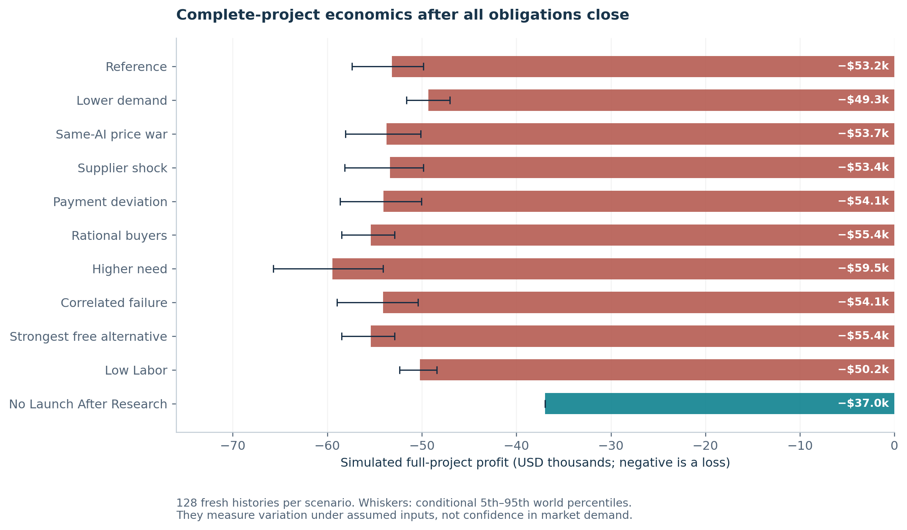

# AGI ALPHA FLYWHEEL — The Possibility Engine

**Vincent Boucher · President of MONTREAL.AI · 28 October 2026**

## Abstract

A scientific question can be impossible for an existing instrument and possible for an instrument that has not yet been assembled. This study constructs a bounded example of that transition. Two nonisomorphic synthetic diffusion-network models have identical responses at their original interface for every input waveform. Adding actuators alone does not help. Adding sensors alone does not help. A jointly constructed actuator–sensor experiment separates the alternatives under independently uncertain rates, leakage, gain and bounded measurement error. We implement a reusable constructor, export executable circuit models, compare with independent algebraic and exhaustive alternatives, and challenge a successor to distinguish six hypotheses while tolerating a terminal-access outage. We then simulate the complete enterprise that would sell the narrow computational design offering. The useful result is an executed change in scientific answerability within a declared model family. It establishes neither a new theorem nor a physically commissioned instrument, and conventional construction can obtain the same outcome. Fresh confirmation passes 42 technical cases and 336 independent circuit checks. An ordinary-library successor ties all twelve comparisons. The conditional enterprise model estimates a USD53,187 mean full-project loss for the selected offering, supporting a stop decision. The commercial decision is determined by complete costs and strategic alternatives, rather than inferred from technical success. The larger research direction is an enterprise that can construct the means through which its beneficiaries discover what becomes possible.

# A question that needs a different instrument

Imagine a laboratory confronting two explanations of the world. Both fit every observation it can make. Collecting more data through the same interface cannot decide between them. The laboratory’s next productive act is to construct an experiment that changes what can be observed.

That is a different task from choosing the best answer inside a fixed menu. It requires discovering which missing capability would make an answer obtainable, building that capability, and arranging for its use. The enterprise we want to investigate would accept a beneficiary’s scientific or productive purpose and help construct the means that make it achievable. Its deliverable would sometimes be a result; sometimes an instrument; sometimes a coordinated combination of participants and capabilities that none could sustain alone.

This paper begins that ambition with a concrete construction. In our example, one added capability has zero distinguishing value, another added capability also has zero distinguishing value, and their combination makes a previously impossible distinction robustly answerable. The complementarity is proved from exact integer identities and exercised by executable software. It is not inferred from an enthusiastic description of a possible business.

**Study scope.** The network construction, optimization, exported circuit execution, numerical comparisons and finite checks are executed computational work. All buyers, contracts, commercial acceptance, receipts, refunds and enterprise outcomes are simulated. Human effort and commercial quantities are transparent estimates unless explicitly identified as measured. No hardware was fabricated or commissioned. Research source publication and software release qualification are separate activities.

## What changed

The beneficiary’s purpose is held fixed: distinguish the supplied internal network hypotheses within a stated uncertainty envelope. The old means are a single actuation/readout port. The new means are a permitted joint actuation/readout addition, an observation protocol, and a constructor that can produce a more demanding portfolio for a successor.

The distinction matters because a genuine information limit cannot be removed by a more confident answer. For the original interface, no waveform can produce evidence favoring one of the two exact models over the other. Changing the interface is an organizational and engineering possibility; claiming an answer from the unchanged interface would be a scientific error.

The result changes an attainable activity in the model. It does not show that modern experimental-design specialists lack the relevant methods. They do not: network identifiability, sensor allocation and controlled excitation have substantial prior art \[1, 2\]. Our conventional challenger is therefore allowed to redesign the instrument too. Its tie limits the advantage claim without erasing the new capability of the constructed apparatus.

# Exploration before commercial entry

We began with valuable future activities, then asked which constraints were fundamental and which were inherited arrangements. Four substantially different directions survived the initial imagination stage.

| Future activity                                                | Missing means                                                                    | Constraint classification                                                         | Campaign decision                                                |
|----------------------------------------------------------------|----------------------------------------------------------------------------------|-----------------------------------------------------------------------------------|------------------------------------------------------------------|
| Ask a scientific question the current instrument cannot answer | A new intervention and readout, with a purpose-preserving construction method    | Information impossibility at fixed access; changeable access architecture         | Construct and test                                               |
| Obtain a useful mechanism absent from a component catalogue    | A representation linking required behavior, local stock and verified fabrication | Physical behavior is binding; design and production representation are changeable | Preserve; avoid duplicating the active portable-production study |
| Undertake production that no participant can support alone     | A jointly feasible technical core, commitments and allocation of risk            | Resource limits bind; institutional and economic composition can change           | Preserve; active production-frontier work already owns this lane |
| Combine dispersed facilities into a new scientific instrument  | Shared timing, calibration, interventions, data rights and acceptance            | Local hardware limits bind; coordination can change                               | Future direction; no facility access in this campaign            |

The selection was motivated by a direct link between missing means and a newly answerable question. Dataset availability was not the starting criterion. The first attempted search enumerated 53,271 rooted tree descriptions of orders two through fourteen without finding the desired pair of nonisomorphic, rooted Laplacian-indistinguishable trees. The unsuccessful code and result remain in the evidence directory. We then changed representation to a classical strongly regular graph family with an explicit algebraic obstruction. This was a material development pivot, not a relabeling of the unsuccessful search as discovery.

The seven transformation tests are explicit:

1.  **Beneficiary outcome:** obtain an executable experiment that separates specified hidden transport hypotheses that the existing interface cannot distinguish.
2.  **Changed constraint:** treat the available intervention/readout interface as constructible, while preserving the scientific question, allowed locations, uncertainty and cost limits.
3.  **New means:** a joint-access constructor, a robust output envelope, usable circuit inputs and a minimum-cost experiment portfolio.
4.  **Frontier reason to attempt it now:** accessible reasoning and coding systems can join algebraic investigation, tool construction, numerical execution and adversarial checks in a bounded campaign.
5.  **Commercial entry:** a tightly scoped computational experiment-construction package for a team that can still change prototype access.
6.  **Connection to the transformation:** delivery must create the discriminating experiment; a report about ambiguity alone does not satisfy the enabling claim.
7.  **Successor possibility:** distinguish a larger family while preserving discrimination after access fails, rather than merely rerun the original binary example.

These statements admitted an exploratory construction. They did not pre-admit a commercial flagship. Application relevance, practical alternatives and complete economics remain separate tests.

# Reassessing the frontier

The relevant frontier is the combination of reasoning, coding, tool use, scientific representations, execution and verification. A model announcement alone does not supply a new production capability. We distinguish public evidence, tools available here, and the construction still required.

| Development                             | Dated primary evidence                                                 | Accessible in this study                                                                        | What remains to be built or tested                                                     |
|-----------------------------------------|------------------------------------------------------------------------|-------------------------------------------------------------------------------------------------|----------------------------------------------------------------------------------------|
| GPT-6 Astra                             | Official release and API changelog, 3 September 2026                   | Exposed model capability in this environment                                                    | Task-specific representations, independent acceptance and measured total delivery cost |
| GPT-6.1 Terra                           | Official release and API changelog, 26 October 2026                    | Exposed model option; no separate Terra trial in this campaign                                  | A cost-aware routing experiment with correction and review included                    |
| OpenAI mathematical research collection | Public repository, inspected commit `7ef5c0cc` (full pin in reference) | Manuscripts and public formalizations; not the unnamed internal producing model                 | Statement alignment, independent checking and practical finite-size implementation     |
| Academic-community collaboration        | OpenAI release, 26 October 2026                                        | Public mathematics and computer-science artifacts; physics materials not public in that release | Scientific interpretation and useful instruments, with community scrutiny              |
| AlphaEvolve                             | Original white paper, 2025; impact update, 2026                        | Public method and examples; production service access unestablished                             | A domain evaluator, safe execution and fair comparison                                 |
| OpenEvolve                              | Public maintainer source                                               | Accessible open implementation scaffold                                                         | Domain invention and independent evidence; not a substitute for either                 |
| BootLoops                               | Primary scientific account and toolkit, October 2026                   | Public toolkit and protocols                                                                    | New-domain qualification and proof that inherited means help the next mission          |

The sources support attempting a missing construction; they do not establish its success \[3–10\].

A particularly useful boundary comes from the newly released ETH manuscript. We inspected its actual LaTeX and the separately described formalization scope. The manuscript claims a fixed-width exact counting algorithm with an asymptotic subexponential bound; its public formalization scope has a different logarithmic factor. The technique overview explicitly permits exhaustive search for finitely smaller instances. This does not provide a practical general SAT solver, a demonstrated commercial crossover, or access to the internal system that produced it \[11, 12\]. The lesson for this campaign is narrower: changes in representation can reopen productive search, but translation into a usable instrument is work that must be executed.

## Cost-adjusted capability

The inspected standard API catalog lists USD per million input/output tokens of 1/5 for Terra and 10/50 for Astra. These are reference rates, not this session’s billed costs \[13\]. For an illustrative 20,000 input and 5,000 output tokens, the corresponding arithmetic is USD0.045 and USD0.45. It would be misleading to infer total delivery cost from those amounts: repeated attempts, tools, verification, engineering judgment and support can dominate.

The proposed production routing uses deterministic numerical code for repeated calculations, inexpensive schema-checked models for routine extraction, and stronger reasoning for changing representations, diagnosing failures and assessing scientific significance. This campaign did not execute a randomized routing benchmark. Its economic model therefore uses disclosed inference allowances and human-hour estimates rather than an invented model-efficiency result.

# Applying the intellectual program

The actual predecessor manuscripts provide implementation obligations, not only titles to cite. They also preserve earlier failures and conventional ties. We continued the repository at `12770c22b4a9f90f2013bbfb64242f912ba5071e`, inspected issue 4850 and active research/release ownership, and confined this work to a new study directory \[14, 15\].

| Program                                 | Operational consequence in this study                                                                                                                                           |
|-----------------------------------------|---------------------------------------------------------------------------------------------------------------------------------------------------------------------------------|
| Transformational Intelligence           | Keep the beneficiary’s purpose and acceptance fixed while changing the means. Prove which old constraint matters. Allow the conventional alternative equal freedom to redesign. |
| OUT-EVOLVE                              | Construct useful structure instead of merely assuming it. Charge construction and qualification before discussing inherited capability.                                         |
| INVENT THE ECONOMY                      | Search technical means and voluntary arrangements together, but only enter an implemented technical core into the delivery model. Separate profit, liquidity and authority.     |
| Transformational Autonomous Enterprises | Retain an executable method while rechecking the meaning and acceptance of each new mission. Inheritance does not transfer approval.                                            |
| Out-Learn and Out-Think                 | Change what observations or representations are available when further learning inside the old interface cannot resolve the question.                                           |
| Out-Design and Out-Strategise           | Put new capacity where it changes feasibility. Ask whether the beneficiary actually needs the model distinction or could act robustly without it.                               |
| Out-Execute                             | Preserve unaffected capabilities, failures and obligations; isolate the new construction behind explicit inputs and outputs.                                                    |

The original OUT-EVOLVE TeX at the inspected repository head is a wrapper. We read the actual PDF rather than treating that wrapper as the complete paper. The source map records the precise predecessor paths and reading scope \[16–24\].

The program names are used only at their implemented scope. This study supplies a local candidate and retained constructor for SUCCESSOR $\Omega$. Its evidence manifest supports provenance and reproducibility. It does not mint a Nova-Seed, submit a FusionPlan, exercise MARK settlement, or claim production admission through Insight. Those existing systems retain their own schemas, permissions and qualification. Tokenization would not resolve the outstanding application or demand questions.

# Constructing complementary observability

## The physical-model contract

Let $A$ be the adjacency matrix of a sixteen-node, undirected, six-regular graph, and let $L=6I-A$ be its Laplacian. For uniform edge rate $k>0$, uniform leakage $\lambda\geq0$, actuation vector $e_a$, and readout gain $g>0$, the modeled dynamics are

$$\dot x(t)=-(kL+\lambda I)x(t)+e_a u(t), \qquad y(t)=g e_s^\top x(t).$$

We use the zero-state response, with $x(0^-)=0$ before the input; a normalized impulse is equivalently represented by depositing a unit initial charge and then allowing passive relaxation. The labels identify accessible terminals. The first mission supplies two possible internal graphs. It does not ask the constructor to infer an arbitrary unknown graph from data. Linear dynamics, uniform parameters, common interpretation of labels, and the stated uncertainty model are acceptance conditions, not findings about a physical device.

The two graphs are the classical $4\times4$ rook and Shrikhande graphs. Both are strongly regular with parameters $(16,6,2,2)$ \[25\]. We relabel the rook graph so that its node-zero neighbors match the Shrikhande graph’s node-zero neighbors. The resulting networks are still nonisomorphic: one has eight four-cliques and the other has none. The independent checker verifies this directly from all four-node subsets.

## Why the old instrument cannot answer

Exact integer arithmetic establishes

$$A^2=4I+2J, \qquad AJ=JA=6J,$$

where $J$ is the all-ones matrix. Consequently, every analytic matrix function of $L$ lies in the span of $I,A,J$, with common scalar coefficients for the two graphs. Their equal node-zero adjacency rows therefore imply equal node-zero rows of

$$H(t)=\exp\bigl[-(kL+\lambda I)t\bigr].$$

For matching $k,\lambda,g$ the responses are equal; with independently unknown parameters, the two original-interface response families are identical. The claim does not assert equal outputs for arbitrary different parameter realizations. Symmetry gives equal columns too. Thus the following all have identical model responses:

- actuation and sensing at node zero;
- arbitrary added actuators while node zero remains the only sensor;
- arbitrary added sensors while node zero remains the only actuator.

Convolution extends impulse-response equality to every admissible input waveform. More samples, better fitting and a more elaborate waveform at these interfaces cannot identify the model. This is an exact finite-model obstruction; it is stronger than a numerical failure to find a difference.

## The missing means

The two adjacency matrices differ at 100 ordered off-diagonal entries away from node zero. An actuator and sensor placed at one of these pairs produce different responses. Either addition alone remains uninformative, but the joint addition is informative.

Write $z=\exp(-4kt)$. An adjacent pair has impulse response

$$h_1(t)=\frac{g e^{-\lambda t}}{16}(1+2z-3z^2),$$

while a nonadjacent pair has

$$h_0(t)=\frac{g e^{-\lambda t}}{16}(1-z)^2.$$

At common parameters their difference is $g e^{-\lambda t}(z-z^2)/4$. A positive common-parameter difference is insufficient for robust classification: each alternative may have a different unknown rate, leakage and gain. The constructor bounds each alternative’s entire output range separately.

The nonadjacent polynomial is monotonic in $z$. The adjacent polynomial has its sole interior stationary point at $z=1/3$. Evaluating the endpoints and this stationary point gives the extrema over the continuous rate interval. Gain and leakage are positive monotonic factors. Additive measurement error then expands each range by $\varepsilon$ on both sides. A certified experiment requires a positive gap exceeding the numerical guard.

The implemented bounds use analytic extrema evaluated in IEEE-754 with outward padding of $10^{-12}$. The exact graph identities are integer checks; the elementary exponential bounds are not a machine-checked floating-point theorem. Independent numerical execution checks the actual exported model, and the margin is many orders of magnitude larger than the numerical tolerance.

## A usable computational instrument

`src/engine.py` accepts a bounded JSON brief: two through eight validated hypotheses, a finite list of permitted actuation/readout pairs, positive integer experiment costs, a time grid, independent uncertainty ranges, and an optional outage requirement. It rejects unsupported graph families rather than applying the special formulas indiscriminately.

For each candidate experiment, the constructor determines which pairs of hypotheses it separates robustly. It then solves a minimum-cost covering problem. For a terminal-access-outage mission, a constraint is created for every hypothesis pair and every possible inaccessible terminal. Every experiment using that terminal is removed together. This models the correlation that would be missed by treating lost measurements as independent.

The solver returns a portfolio, exact integer coverage witness, nominal parameters, noise-inclusive response intervals and a source-bound report. It also exports a SPICE circuit for every selected model/experiment combination. The RC analogue uses unit capacitances, edge conductance $k$, and leakage conductance $\lambda$. An initial capacitor charge represents the normalized impulse. A separate ideal readout implements $g$.

This exported initial condition is a computational protocol. A physical realization would need a charging procedure, isolation switch, timing model, tolerances, calibration and acceptance on the actual fixture. The current artifact makes those questions concrete; it does not conceal them inside a price estimate.

<figure>

<figcaption aria-hidden="true">Complementary access changes answerability. The exact original-port obstruction persists under either single-sided addition. Joint access exposes a difference in hidden adjacency.</figcaption>
</figure>

# Executed results and independent challenge

## Primary construction

The development uncertainty box is $k\in[0.8,1.2]$, $\lambda\in[0.05,0.15]$, $g\in[0.95,1.05]$, and additive error $\pm0.005$ in normalized output units. The permitted observation times range from 0.050 to 0.500 in increments of 0.001.

The selected observation time is 0.168. Including independent uncertainty and measurement error, the nonadjacent response lies in approximately $[0.00501235,0.02493955]$ and the adjacent response in $[0.06126991,0.08926951]$. The separating margin is approximately **0.03633036**. The current and both single-sided arms are infeasible; the joint arm obtains the minimum declared cost of **14 construction units**. These units specify a finite design objective, not a hardware quotation or dollars of profit.

A conventional independent algebraic constructor obtains the same separation. Independent enumeration matches the minimum cost. This is a successful construction and a conventional tie. There is no exclusive algorithmic or operational advantage result.

<figure>

<figcaption aria-hidden="true">Robust output bands for the constructed experiment. The alternatives have independently uncertain parameters; the selected time maximizes their certified separation on the declared grid.</figcaption>
</figure>

## Numerical execution

The independent circuit checker reads and stamps capacitances, conductances, initial conditions and readout gain from the exported netlist; it does not import the constructor’s response formulas. It integrates Kirchhoff’s equations with DOP853. A separately obtained free ngspice simulator executes the same circuit inputs.

All **32 development circuit exports** passed both independent routes under the predeclared absolute tolerance of $10^{-6}$. The fresh campaign then executed **336 unique circuits** across the 24 constructive fresh cases; all passed, while the twelve proper refusal cases emitted no circuits. Maximum fresh disagreement was $1.80\times10^{-14}$ for the independent ODE against the primary prediction and $8.59\times10^{-9}$ for ngspice against that prediction. The fresh circuit batch took 6.253 seconds. These measurements exclude obtaining dependencies, writing the instrument and reviewing its scientific scope.

Agreement validates the numerical circuit implementation within its declared tolerances. It does not establish that a manufactured thermal device follows the exact uniform graph model. Nonuniform components can even make the original interface informative, thereby defeating the exact-obstruction premise when transferred to hardware.

## Freeze and fresh confirmation

Acceptance criteria, scientific source, independent checkers, seed-generation code and economic policy were frozen before fresh verifier-issued seeds. No confirmation outcome was used to alter the selected policy or scientific acceptance threshold. The evidence records the freeze digest, seed issuance and every generated case.

The final source freeze is `e1ccee55bf1269fd3fc0932538782a2eaaa1eeda31cf06880435708fd74e33d7`, binding 22 scientific, checking and economic files. Fresh confirmation passed **42 of 42 cases**: 24 binary cases, 12 six-hypothesis successor cases and six malformed-input controls. The binary cases produced twelve valid constructions and twelve required refusals. All twelve successor portfolios met their specified no-outage, one-experiment-outage or one-terminal-access-outage requirement, and independent enumeration matched feasibility and minimum cost. All 22 frozen file hashes were unchanged afterward.

The 36 actual primary CLI invocations took 39.76 seconds in total; their independent finite checks took 1.24 seconds. These are local computational measurements, not a full-project productivity ratio. Fourteen pre-freeze analytic and input/export controls also passed. Strict source lint passed. The strict typing attempt remained unqualified because SciPy type stubs were absent; full repository coverage, platform qualification and release checks were not performed in this isolated study.

“Independent” here means a separate same-session implementation and checking role. It does not mean an independent institution, external scientific peer review, hidden model-compute equality, or a human-expert trial. The conventional challenger had the original mathematical purpose and the same permission to construct added means. The study therefore supports specific correctness and scope claims, not general superiority of one search process.

# A successor that can ask a different question

The successor receives the retained constructor and a new mission: distinguish six supplied network hypotheses, while preserving every distinction after access to any one terminal is lost. It must choose a portfolio rather than a single binary experiment. A shared-terminal access outage can remove several experiments simultaneously. The internal vertex and network dynamics remain unchanged; this does not model removal of a component or a changed Laplacian.

On the development mission, the constructor produces five experiments at cost **66 units**. An independently implemented exhaustive search confirms the optimum with a different, equally good five-experiment portfolio. This is useful evidence that the retained method can formulate and solve a materially different output problem. It is also an explicit conventional tie.

The twelve fresh successor tasks all produced independently minimum-cost portfolios, with total declared costs ranging from 21 to 65 units. An isolated ordinary-library copy containing 163 source and predecessor artifact files (1,817,888 bytes) reproduced every complete successor result exactly. Copying took 0.023 seconds and the twelve library CLI invocations took 14.61 seconds. Source discovery, semantic integration and long-run upkeep were not empirically timed; the enterprise model charges separate effort estimates. No unplanned user intervention was needed during these frozen deterministic runs, but expert scientific judgment was used to select the family, interpret the obstruction and repair development errors.

An ordinary directory containing the same source and artifacts is a mandatory control. The constructor’s portability is useful, but a wrapper or successor label cannot receive credit for capabilities already available by copying that directory. No specialist was trained in this campaign, and there is no evidence of cumulative parameter learning. “Experience-trained specialists” remains part of the broader research program; this paper establishes reusable executable structure at a bounded scope.

The next missing means are apparent. A real successor would need to handle nonuniform and uncertain components, imperfect actuation, missing hypotheses, calibration drift and access costs that share fixed installation work. It would also have to decide when the model label matters to the beneficiary. Sometimes the best productive act is to design a robust action that works for every remaining model, rather than buy an additional measurement.

<figure>

<figcaption aria-hidden="true">The successor portfolio separates six model hypotheses while tolerating one terminal-access outage. Colored cells show the modeled adjacency class observed by each selected experiment.</figcaption>
</figure>

# The first offering and its adoption route

The candidate beneficiary is a prototype or scientific-instrument development team before access locations are fixed. The offering is a **Computational Experiment Construction Pack**. The tested scope is deliberately narrow: validated sixteen-node regular-graph models with known labels and the stated uniform-parameter assumptions. A promise to solve arbitrary thermal networks would bury an unbuilt generalization inside the business model.

The deliverable contains the agreed finite hypotheses, exact current-interface obstruction where applicable, a permitted joint experiment or portfolio, source and circuit inputs, uncertainty envelopes, failure limits, independent recalculation and a recipient handoff. Acceptance concerns those computational outputs. Physical installation and successful diagnosis of a customer’s device are separate work.

A plausible adoption route is a small, independently assessed design commission followed by a recipient-run circuit/fixture exercise. The buyer retains its supplied models and confidential project information. The generic constructor can be reused under the repository’s Apache-2.0 terms, while project-specific reuse requires explicit rights. A failed enabling search must not be marketed as a successful transformed capability. Any fee for a feasibility assessment would be a separately described conventional offering.

The important outside options are real. Topology identifiability is an established field. Thermal transient analysis, equivalent-network reconstruction and model calibration are established activities. PyRth offers free analysis components, and Siemens provides existing thermal-characterization products \[1, 26–29\]. A buyer satisfied with an equivalent model, or able to implement the short algebraic construction internally, should rationally decline this commission. Neither comparison is a failure of the buyer to understand the vision.

## Why complementarity does not automatically create a business

The scientific example proves a form of technical complementarity: the joint experiment has value that neither single-sided addition supplies. Economic complementarity is an additional question. Participants may disagree about scope, disclosure, access rights, liability or who pays for the shared work. Buyers may wait for others to fund an open implementation. Suppliers may change terms. The same coordination arrangement must also be available to a conventional provider.

A supplemental shared-commissioning calculation considers three consenting sponsors at an assumed USD4,000 each. Shared integration and coordination cost USD2,250; per-sponsor validation costs USD750, giving USD4,500 for the cohort before the common USD36,200 research investment. Independent 70% consent would produce only 34.3% unanimous participation; a common refusal factor makes it worse. Failed cohorts refund restricted pledges and retain their coordination expense.

At these assumptions, twelve committed sponsors cover the simplified subtotal for shared research, integration, coordination and validation. That is a necessary arithmetic threshold, not a complete enterprise profit result: acquisition, financing, support, warranty and exit would raise it. No twelve sponsors have been identified. The same conventional arrangement receives identical rights and costs and ties by assumption. Open-source availability permits a waiting or free-riding outcome, so technical complementarity does not guarantee coordinated demand.

There is no tokenized asset value in the accounts. Provenance binds the exact deliverable to its inputs and supports reproduction; it does not make someone want the deliverable or authorize deployment.

# A complete simulated enterprise

## Strategic choices

The model is a finite-horizon stochastic game with explicit, bounded behavior. Buyers privately draw values, budgets, internal capacity, urgency and relationship value from declared analyst distributions. They can buy, self-deliver, choose a competitor, use a free alternative, wait or decline. A logit rule represents bounded rationality; a separate best-response scenario removes that assumption. Values and success probabilities are hypotheses, not estimates learned from the mathematical confirmation cases.

The competitor has the same modeled technical quality as the enterprise. It selects among matching, undercutting and premium-bundle offers using a public archetype sample rather than buyers’ private realized information. A same-AI scenario permits imitation and a further price reduction. Supplier scenarios change inference terms and available capacity. Common quality shocks correlate correction and warranty exposure.

At collection, buyers can strategically withhold payment. The deviation calculation compares the invoice retained with expected enforcement exposure and lost relationship value. The enterprise pursues collection only when its modeled expected recovery exceeds the stated collection cost. The low-enforcement scenario therefore challenges an assumption that an accepted invoice automatically becomes cash.

The enterprise chooses price, restricted deposit and capacity, negotiates within a bounded discount, refuses excess capacity, and stops new sales under a frozen trailing-contribution or cash rule. Existing delivery and support obligations survive that stop. These are transparent behavioral rules, not a claim that the model identifies a unique equilibrium of an actual market.

## Costs and accounting

The modeled initial construction charges 96 research hours at USD125, 40 failed-discovery hours at USD125, 120 development hours at USD100, 32 independent-validation hours at USD125, and 16 documentation hours at USD100. Inference, compute and tools add USD1,600. The total is **USD36,200** before financing and exit. These are replacement-effort assumptions for a complete staffed delivery process, not a time sheet of this assistant session.

Prospect and order costs include qualification, negotiation, ten delivery hours, four verification hours, inference, compute, tools, corrections and further checks when needed, support, warranty and collection. Acquisition, maintenance, operations and financing continue at the enterprise level. The full assumptions file supplies hours, rates and uncertainty scenarios. Every cost category is charged; a missing quotation is not silently turned into zero.

The journal uses integer cents and balanced postings. Refundable deposits enter restricted cash against a customer-deposit liability. Acceptance releases the deposit and recognizes an invoice. Collections settle receivables. Correction, bad debt, warranty, support and exit have explicit entries. A credit draw is financing, not revenue. Shared development is charged once. No speculative terminal asset value or future successor benefit is capitalized to improve the result.

The modeled company starts with USD80,000 of equity and a USD20,000 credit limit at 12% APR, plus stated facility fees. Funding terms are assumptions. Selling lasts at most twelve months, followed by six months of runoff. The final check requires every contract to close, every receivable to collect or write off, and every deposit, support provision, refund obligation and debt balance to unwind. An independent checker reconstructs the books from journal events.

## Development, redesign and confirmation

The original grid tested prices of USD6,000, USD8,000 and USD10,000, with two deposit fractions and two capacities. Because those prices could make the test unnecessarily unfavorable against internal and free options, one bounded redesign added USD3,000, USD4,500 and USD6,000. The two grids contain 24 policy entries and 20 unique parameter combinations. Both were scored under the corrected common model on twelve development seeds and six disclosed design-weighted scenarios; the original source and results remain archived. Demand and buyer values were not increased to rescue the offer.

The selected attempted offer quotes **USD4,500**, holds a **50% restricted deposit**, permits **two new contracts per month**, and applies the frozen stop rule from month five. Its policy and all assumptions were fixed before confirmation. Confirmation ran 128 fresh histories in each of ten scenarios, plus 128 same-seed conventional counterparts and 128 stop-after-research counterparts. All **1,536 complete trajectories** are retained, with **385,682 journal events** and **1,828 contracts**. Separate reconstruction checked every account and 228 aggregate statistics. The supplementary raw reference records were saved after their original summaries, using unchanged frozen functions and the identical seed bank; their summaries matched exactly.

| Scenario                    | Mean full-project profit | Mean operating contribution | Accepted packs | Loss histories |
|-----------------------------|-------------------------:|----------------------------:|---------------:|---------------:|
| Reference                   |            USD-53,187.20 |               USD-15,887.20 |           1.62 |        128/128 |
| Lower demand                |            USD-49,293.28 |               USD-11,993.28 |           0.60 |        128/128 |
| Same-AI price war           |            USD-53,735.23 |               USD-16,435.23 |           1.12 |        128/128 |
| Supplier shock              |            USD-53,359.49 |               USD-16,059.49 |           1.59 |        128/128 |
| Strategic payment deviation |            USD-54,054.56 |               USD-16,754.56 |           1.62 |        128/128 |
| Rational buyers             |            USD-55,407.00 |               USD-18,107.00 |           0.00 |        128/128 |
| Higher need                 |            USD-59,480.93 |               USD-22,180.93 |           3.77 |        128/128 |
| Correlated failure          |            USD-54,091.56 |               USD-16,791.56 |           1.48 |        128/128 |
| Strongest free alternative  |            USD-55,407.00 |               USD-18,107.00 |           0.00 |        128/128 |
| Lower operating labor       |            USD-50,199.90 |               USD-12,899.90 |           0.00 |        128/128 |

The reference mean full-project return is **USD-53,187.20**, including **USD-15,887.20** operating contribution. Mean recognized revenue is USD6,648.82, gross collections are USD6,778.76, and total project cost is USD59,836.02. Collections and revenue differ because deposits, refunds and bad debts have different timing and recognition. Every terminal deposit, receivable and support/refund obligation is zero after runoff.

The reference fifth-to-ninety-fifth world percentile range is **USD-57,403.12 to USD-49,832.99**. Its mean’s Monte Carlo standard error is USD231.12; this is sampling precision conditional on the model. The estimated conditional loss rate is 100% (128/128) in each scenario, not a measured probability about a real market. Mean reference peak funding need is **USD53,877.96**; the largest observed requirement across all scenarios is **USD70,241.74**. The worst observed full-project loss is **USD68,654.39**.

The reference world averages 70.75 leads, 38.55 qualified prospects, 1.91 negotiations, 1.70 signed contracts and 1.62 accepted packs. It averages 0.336 correction events, 0.086 failed deliveries and 0.141 withheld invoices. Modeled human effort is 512.75 hours, including 304 startup hours; operational verification accounts for 7.48 hours. All reference histories stop new sales in month five. No renewal or successor investment occurs. A modeled increase in leads can worsen losses when paid qualification grows faster than accepted work.

An optimistic necessary break-even calculation at the selected USD4,500 price requires about **39.5 signed contracts** over a full year, above the policy’s 24-contract capacity. Excluding sunk research still requires about **21.5 contracts** under that calculation’s favorable exclusions. At full capacity, its price floor is approximately **USD5,890.08** before discounts, bad debt, collection costs and other adverse factors. A price floor is not evidence that buyers will pay it. The stronger free alternative and deterministic rational-choice scenarios obtain zero sales.

Stopping after the completed research retains its cost and the archive/exit cost: **USD−36,950**. It avoids a further **USD16,237.20** of expected loss relative to the reference attempt. Doing nothing before commissioning any research would have a different, zero-cost baseline. The current decision does not erase the completed study’s estimated cost.

<figure>

<figcaption aria-hidden="true">Complete-project economic scenarios. All amounts are simulated USD and include the stated construction, selling, delivery, support, financing and exit costs. Sampling uncertainty does not measure confidence in the demand assumptions.</figcaption>
</figure>

A positive unit contribution can coexist with a losing enterprise because qualification, customer acquisition, maintenance and shared construction remain to be paid. Conversely, conventional technical parity need not destroy a business if customers value reliable delivery. The present model must decide that question from its actual alternatives and costs, not from a presumption that either outcome follows from the scientific result.

# Expansion as a staged construction

The first stage would be worth expanding only if it supported a more general ability to construct informative experiments for real beneficiaries. Its next investment is not an automatic percentage of hypothetical profit.

The proposed sequence separates three decisions. First, obtain a beneficiary problem for which distinguishing the supplied alternatives changes a concrete action and where existing methods do not meet the required delivery terms. Second, execute a capped fixture experiment with externally specified calibration, timing and error bounds. Third, extend the constructor to a broader model family only after independent evidence shows that the extension changes attainable questions at acceptable cost.

The frozen enterprise requires at least twelve accepted deliveries, two renewals, USD12,000 operating contribution and sufficient usable cash before considering a USD4,000 successor experiment. It also requires the lower-bound expected incremental benefit to at least cover the experiment cost. The conservative assumed probability/value pair, 0.2 and USD8,000, gives only USD1,600 expected benefit, so it fails that gate. Neither the probabilities nor the conditional values are empirical findings. A later USD20,000 integration stage stays separate and unfunded. No speculative future value is counted in current profit, and no simulated trajectory funds a successor experiment.

An appropriate redesign would first establish whether an external team’s decision actually changes when the hidden topology is known. A subsequent fixture trial would need independently specified nonuniform-component bounds, initialization and readout calibration, incomplete-hypothesis controls and comparison with an unrestricted specialist. Until those conditions are met, the narrow service should not finance a larger mission through assumed sales.

A worthwhile experiment needs an explicit decision it can change. If the value of avoiding an incorrect commitment is $V$, an evidence-gathering experiment of cost $C$ needs sufficient probability of changing the decision that the expected avoided loss exceeds $C$. The model does not substitute an enormous imagined payoff for that missing probability. Uncertain market probabilities remain ranges, and stop remains available.

## Billion-plus significance

The proposed scale metric is **cumulative incremental beneficiary value in constant USD over ten years**, after beneficiaries’ adoption and operating costs. It is not revenue, provider profit or valuation. A claim of USD1 billion requires a grounded count of reachable beneficiaries, adoption, useful missions per beneficiary, net value per accepted mission and delivery capacity.

At an assumed USD2,500 net incremental value per accepted pack, the threshold is 400,000 useful packs over ten years: 40,000 per year and 10,000 active beneficiaries buying four per year. At the current assumed capacity of 24 packs per team per year, that requires about 1,667 delivery teams and 160,000 verification hours annually before acquisition and exceptions. At USD500 net value, the required volume is five times larger; at USD10,000 it is one quarter as large.

No reachable population of 10,000 beneficiaries, relevant adoption rate or incremental value of USD2,500 has been established. The arithmetic is therefore a falsifiable scale requirement, not a forecast or a billion-dollar business claim. The present narrow graph family does not justify that reach. A broader qualified instrument, materially lower total review burden, repeatable customer acquisition and demonstrated beneficiary value would all be necessary.

The gap between a compact numerical witness and that scale is the research agenda. It includes model generality, physical qualification, beneficiary demand, distribution, reusable rights, exception handling and the capacity of a team to review what it constructs. Reducing the cost of generating candidate code does not remove those bottlenecks.

# Decision and contribution

**Stop the tested narrow commercial offering; retain the construction and redesign the application bridge before any expansion.** The demonstrated result is a model-family change in scientific answerability, supported by independent finite checks and actual circuit-software execution. The complete conditional enterprise model favors not launching the selected offer after the completed research. The strongest free alternative makes the commercially relevant problem especially clear.

The campaign has therefore not established a commercially consequential physical flagship. It also does not reject the broader possibility of intelligence constructing useful instruments. It identifies the specific next burden of proof: a beneficiary problem that needs the new observable, a practical permitted realization, and delivery economics that survive equally equipped alternatives. A new theorem or exclusive algorithm is unnecessary; evidence that this combination changes a real productive activity is necessary.

The scientific contribution is an executed, inspectable instance of **complementary means changing answerability**. The original question is retained; the old impossibility is explicit; the missing access is constructed; and the successor is given a harder mission. The result is especially useful because the conventional alternative ties. It prevents the rhetoric of transformation from depending on an exclusive algorithm that the evidence does not support.

The commercial contribution is a completed conditional decision process, including strategic alternatives, costs, liquidity, failure and exit. Technical success does not compel launch. A successor inherits the instrument and the refusal conditions together.

The larger possibility remains consequential: an enterprise whose work is to construct the missing means of discovery and production. This campaign supplies one exact bridge from an impossible observation to an obtainable one. Turning that bridge into a broad, sustainable business requires the next independently accepted construction.

**Find your Alpha. Build your successor $\Omega$. Invent what becomes possible.**

# Limitations beside the claims

The graphs and their algebra are classical. The study does not claim a new graph-theory result, a new law of physics, a new actuator-placement theorem, an invention beyond all human foresight, or superiority over the unrestricted conventional method.

The model class is narrow, the labels are known, and hypotheses are supplied. An unknown physical network can fall outside the family. Manufacturing variation, nonlinear behavior, unknown initial conditions, unmodeled forcing, gain errors or timing uncertainty can invalidate the classification guarantee. A finite candidate-family distinction is weaker than general topology identification.

The current numerical evidence runs an electrical analogue in software. It does not show physical heat-flow performance. The independent checker and expert-AI baseline are separate work roles under one session, not external peer review. No hidden reasoning budget or human-intervention cost was experimentally equalized across models, so no aggregate AI-productivity ratio is reported.

The enterprise distributions are analyst assumptions. Simulation standard errors describe finite-sample precision under those assumptions. They do not establish confidence in demand, willingness to pay, effort rates, delivery probabilities, enforcement or adoption. Complete actual session cost was not metered; the project model uses a complete disclosed estimate instead of claiming actual profit.

The retained source is portable. An ordinary library can contain that source too. Portability therefore does not establish an exclusive retained-capability advantage, specialist training, self-acceleration or autonomous compounding.

# Reproducibility and developer handoff

The study is additive under `studies/possibility-engine-v1/`. Original manuscripts, prior failures, runtime, catalog, workflow definitions, credentials and release ownership are preserved. The runnable constructor requires the pinned numerical versions recorded in the environment receipt. The independent graph and portfolio checkers use separate implementations.

A recipient can run the primary useful construction with:

``` bash
python3 src/engine.py evidence/development/joint/input.json --output /tmp/possibility-joint
```

The successor input is `evidence/development/successor/input.json`. The full reproduction guide covers the frozen confirmation replay, independent accounting reconstruction, optional ngspice execution and publication rebuild. Replays use a new output directory; preserved evidence is not overwritten.

`FREEZE.json` binds the scientific source and acceptance material. The economic freeze separately binds its model, assumptions and selected policy. The final package manifest binds deliverables and evidence, including failed attempts. A passing local study is not a released production runtime. New HTML and code remain subject to the repository’s full source-qualification lane \[30\].

## Preserved failures and corrections

| Record                         | Failure or limitation                                                                  | Disposition                                                                                      |
|--------------------------------|----------------------------------------------------------------------------------------|--------------------------------------------------------------------------------------------------|
| Rooted-tree search             | No desired nonisomorphic rooted pair found in 53,271 candidates through order fourteen | Preserved; changed representation to a classical regular-graph witness                           |
| Initial nominal export         | Rate, leakage and gain were hardcoded even when a supplied box excluded them           | Original source retained; midpoint parameters and explicit readout gain added before freeze      |
| First circuit parser           | Newly exported ideal readout directive was not recognized                              | All original parser failures and checker source retained; explicit supported gain handling added |
| Simulator dependency retrieval | Initial isolated simulator lacked a required library                                   | Failure retained; public package dependencies resolved without a system install                  |
| Initial commercial grid        | High prices risked testing only offers unattractive against self-delivery              | Original evidence retained; one bounded lower-price redesign before confirmation                 |
| Practical promotion            | No physical fixture, customer commissioning or general model family established        | Commercial and physical claims remain limited; successor gates are explicit                      |

## Claim-to-evidence map

| Claim                                   | Authoritative local evidence                                        | Limit                                                             |
|-----------------------------------------|---------------------------------------------------------------------|-------------------------------------------------------------------|
| Fixed-interface impossibility           | Independent integer graph identities and proof note                 | Exact declared family and labels                                  |
| Joint access enables robust distinction | Primary input/result, interval formulas, independent protocol check | Continuous stated parameter box; numerical exponential evaluation |
| Usable circuit outputs                  | Generated netlists, ngspice logs, independent ODE records           | Circuit simulation, not hardware                                  |
| Minimum cost and successor feasibility  | Independent enumeration and fresh cases                             | Supplied finite candidate set and objective                       |
| Ordinary-library parity                 | Isolated recipient replay with identical artifacts                  | Portability; no retention-specific advantage                      |
| Complete enterprise results             | Frozen policy, every world and journal, separate accounting audit   | Conditional assumptions, not market validation                    |
| Publication identity                    | Final manifest, source commit and readback receipts                 | Source edition and canonical release are distinguished            |

# References

<div id="refs" class="references csl-bib-body hanging-indent" entry-spacing="1">

<div id="ref-vanwaarde" class="csl-entry">

1\. H. J. van Waarde, P. Tesi, and M. K. Camlibel. *Topology identification of heterogeneous networks: Identifiability and reconstruction*. Automatica. 2021. <https://arxiv.org/abs/1909.11054v2>.

</div>

<div id="ref-shi" class="csl-entry">

2\. S. Shi. *Topological aspects of linear dynamic networks: Identifiability and identification*. 2021. <https://publications.pvandenhof.nl/Theses/Shi_PhDThesis_2021.pdf>.

</div>

<div id="ref-astra" class="csl-entry">

3\. OpenAI. *GPT-6 astra*. 2026. <https://openai.com/index/gpt-6-astra/>.

</div>

<div id="ref-terra" class="csl-entry">

4\. OpenAI. *Introducing GPT-6.1 terra*. 2026. <https://openai.com/index/introducing-gpt-6-1-terra/>.

</div>

<div id="ref-academic" class="csl-entry">

5\. OpenAI. *Working with academic communities to build scientific understanding*. 2026. <https://openai.com/index/building-scientific-understanding-with-academic-communities/>.

</div>

<div id="ref-mathcollection" class="csl-entry">

6\. OpenAI. *Mathematical research collection, pinned october 26 snapshot*. 2026. <https://github.com/openai/math/tree/7ef5c0cc5ca4b0e072b7a050fca09ab24bc6fa3a>.

</div>

<div id="ref-alphaevolve" class="csl-entry">

7\. Google DeepMind. *AlphaEvolve: A gemini-powered coding agent for designing advanced algorithms*. 2025. <https://storage.googleapis.com/deepmind-media/DeepMind.com/Blog/alphaevolve-a-gemini-powered-coding-agent-for-designing-advanced-algorithms/AlphaEvolve.pdf>.

</div>

<div id="ref-alphaevolveimpact" class="csl-entry">

8\. Google DeepMind. *AlphaEvolve: Impact update*. 2026. <https://deepmind.google/blog/alphaevolve-impact/>.

</div>

<div id="ref-openevolve" class="csl-entry">

9\. OpenEvolve contributors. *OpenEvolve: Open-source evolutionary coding agent*. 2026. <https://github.com/algorithmicsuperintelligence/openevolve>.

</div>

<div id="ref-bootloops" class="csl-entry">

10\. M. Schwartz. *Claude-shaped science and the BootLoops toolkit*. 2026. <https://www.anthropic.com/research/claude-shaped-science>.

</div>

<div id="ref-eth" class="csl-entry">

11\. OpenAI. *The exponential time hypothesis is false: Public AI-produced manuscript, october 25 version*. 2026. <https://github.com/openai/math/blob/7ef5c0cc5ca4b0e072b7a050fca09ab24bc6fa3a/preprints/The-Exponential-Time-Hypothesis-is-False-October-25-2026/build/main_full_version.tex>.

</div>

<div id="ref-ethscope" class="csl-entry">

12\. OpenAI. *Formalization scope note 378: The exponential time hypothesis is false*. 2026. <https://github.com/openai/math/blob/7ef5c0cc5ca4b0e072b7a050fca09ab24bc6fa3a/lean/docs/378.md>.

</div>

<div id="ref-models" class="csl-entry">

13\. OpenAI. *API model catalog and standard prices*. 2026. <https://developers.openai.com/api/docs/models>.

</div>

<div id="ref-repo" class="csl-entry">

14\. MONTREAL.AI. *AGI alpha agent: Inspected source commit 12770c22*. 2026. <https://github.com/MontrealAI/AGI-Alpha-Agent-v0/tree/12770c22b4a9f90f2013bbfb64242f912ba5071e>.

</div>

<div id="ref-ownership" class="csl-entry">

15\. MONTREAL.AI. *Issue 4850: SUCCESSOR omega integration and active ownership*. 2026. <https://github.com/MontrealAI/AGI-Alpha-Agent-v0/issues/4850>.

</div>

<div id="ref-ti" class="csl-entry">

16\. V. Boucher. *Transformational intelligence: Learning to change the game*. 2026. <https://github.com/MontrealAI/AGI-Alpha-Agent-v0/blob/12770c22b4a9f90f2013bbfb64242f912ba5071e/docs/Transformational_Intelligence.tex>.

</div>

<div id="ref-outevolve" class="csl-entry">

17\. V. Boucher. *Out-evolve: Building the means of discovery and production*. 2026. <https://github.com/MontrealAI/AGI-Alpha-Agent-v0/blob/12770c22b4a9f90f2013bbfb64242f912ba5071e/docs/Out_Evolve.pdf>.

</div>

<div id="ref-economy" class="csl-entry">

18\. V. Boucher. *Invent the economy*. 2026. <https://github.com/MontrealAI/AGI-Alpha-Agent-v0/blob/12770c22b4a9f90f2013bbfb64242f912ba5071e/docs/Invent_the_Economy.tex>.

</div>

<div id="ref-tae" class="csl-entry">

19\. MONTREAL.AI. *Transformational autonomous enterprises: SUCCESSOR omega harness*. 2026. <https://github.com/MontrealAI/AGI-Alpha-Agent-v0/blob/12770c22b4a9f90f2013bbfb64242f912ba5071e/docs/papers/transformational-autonomous-enterprises-v1.tex>.

</div>

<div id="ref-outlearn" class="csl-entry">

20\. V. Boucher. *Out-learn*. 2026. <https://github.com/MontrealAI/AGI-Alpha-Agent-v0/blob/12770c22b4a9f90f2013bbfb64242f912ba5071e/docs/Out_Learn.tex>.

</div>

<div id="ref-outthink" class="csl-entry">

21\. V. Boucher. *Out-think*. 2026. <https://github.com/MontrealAI/AGI-Alpha-Agent-v0/blob/12770c22b4a9f90f2013bbfb64242f912ba5071e/docs/Out_Think.tex>.

</div>

<div id="ref-outdesign" class="csl-entry">

22\. V. Boucher. *Out-design*. 2026. <https://github.com/MontrealAI/AGI-Alpha-Agent-v0/blob/12770c22b4a9f90f2013bbfb64242f912ba5071e/docs/Out_Design.tex>.

</div>

<div id="ref-outstrategise" class="csl-entry">

23\. V. Boucher. *Out-strategise*. 2026. <https://github.com/MontrealAI/AGI-Alpha-Agent-v0/blob/12770c22b4a9f90f2013bbfb64242f912ba5071e/docs/Out_Strategise.tex>.

</div>

<div id="ref-outexecute" class="csl-entry">

24\. V. Boucher. *Out-execute*. 2026. <https://github.com/MontrealAI/AGI-Alpha-Agent-v0/blob/12770c22b4a9f90f2013bbfb64242f912ba5071e/docs/Out_Execute.tex>.

</div>

<div id="ref-shrikhande" class="csl-entry">

25\. S. S. Shrikhande. *The uniqueness of the L2 association scheme*. Annals of Mathematical Statistics. 1959. <https://aeb.win.tue.nl/drg/graphs/Shrikhande.html>.

</div>

<div id="ref-ziegeler" class="csl-entry">

26\. N. J. Ziegeler, P. W. Nolte, and S. Schweizer. *Optimization-based network identification for thermal transient measurements*. Energies. 2021. <https://www.mdpi.com/1996-1073/14/22/7648>.

</div>

<div id="ref-cauer" class="csl-entry">

27\. E. Schulz, C. Strössner, and C. Grötzbach. *Identifiability of cauer thermal networks: Author listing, accepted IEEE transactions on power electronics*. 2026. <https://erickschulz.dev/publications/src/data/publications/identifiability-cauer-thermal-networks/>.

</div>

<div id="ref-pyrth" class="csl-entry">

28\. PyRth contributors. *PyRth: Thermal transient analysis toolkit*. 2026. <https://github.com/nizie002/PyRth>.

</div>

<div id="ref-siemens" class="csl-entry">

29\. Siemens. *Simcenter thermal testing and T3STER*. 2026. <https://www.siemens.com/en-gb/products/simcenter/simulation-test/thermal-testing/>.

</div>

<div id="ref-publicationpolicy" class="csl-entry">

30\. MONTREAL.AI. *Research paper publication and full source-qualification policy*. 2026. <https://github.com/MontrealAI/AGI-Alpha-Agent-v0/blob/12770c22b4a9f90f2013bbfb64242f912ba5071e/docs/agent/PAPER_UPLOADS.md>.

</div>

</div>
