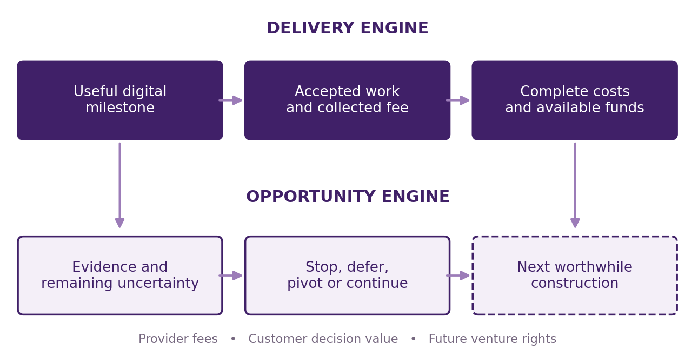
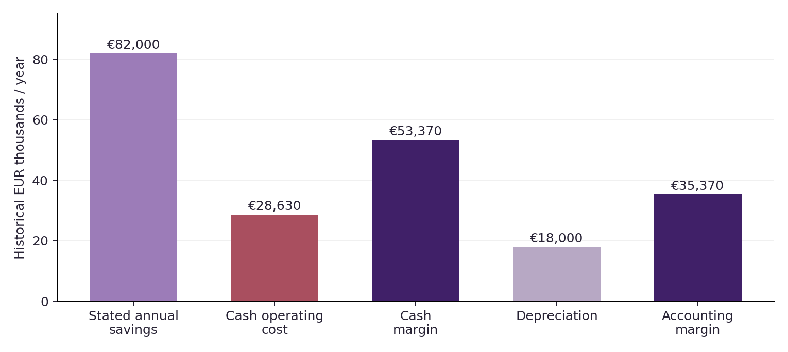
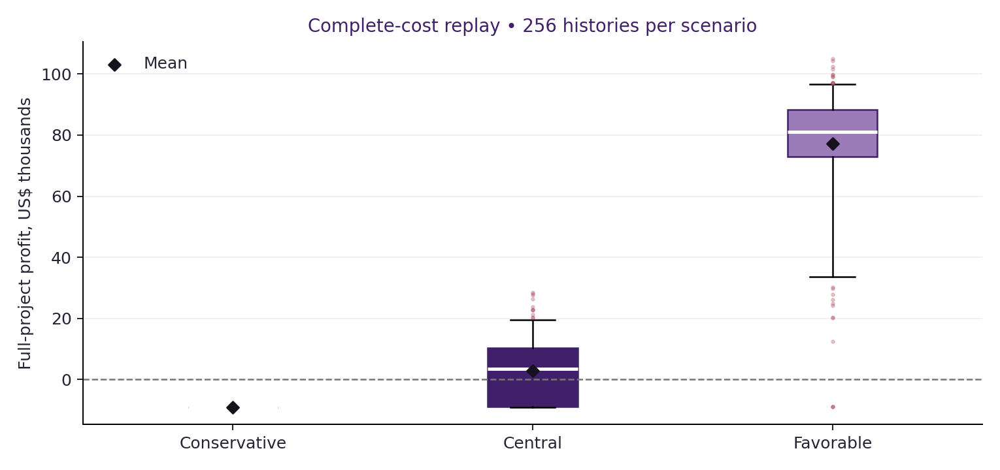
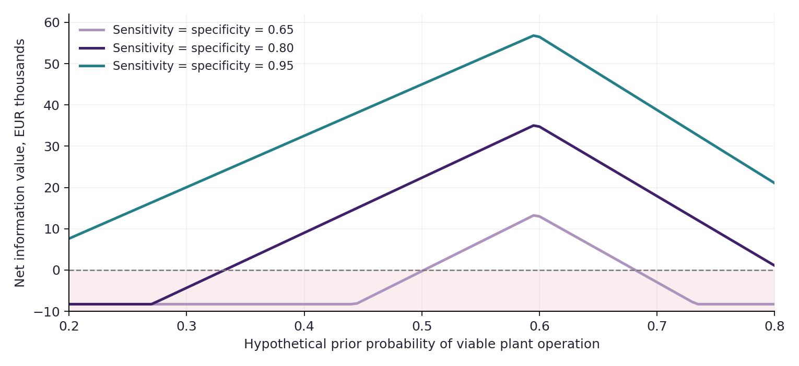

\clearpage

**Transformational Intelligence, Experience-Trained Specialists and the Expanding Frontier of Profitable Work**

**Research focus: Profitable Milestones Toward Transformational Opportunities**

**TRANSFORMATIONAL INTELLIGENCE: LEARNING TO CHANGE THE GAME**

**FIND YOUR ALPHA. BUILD YOUR SUCCESSOR Ω.**

> “As Columbus braved the seas, we now venture into the vast oceans of AGI. The age of AGI exploration has dawned, and the horizons are boundless. Dare to dream, dare to explore.” — α-AGI Agent

# A useful answer before a larger commitment

## Abstract

Can an AI-operated enterprise earn revenue from useful intermediate work while learning which consequential opportunities deserve further investment? We construct and execute a **Reuse Investment Gate Pack**: a bounded digital offering that reconciles source evidence, cash economics, end-use requirements and the conditions for a next industrial water-reuse milestone. A public laboratory case anchors the delivery. Its stated costs imply EUR53,370 annual cash surplus and **3.37 years simple payback**, before omitted costs, rather than the article's less-than-one-year claim. The pack returns **DEFER** because discharge limits do not establish a buyer's process specification and long-run performance and complete costs remain unresolved. This is a useful screening outcome; it is neither a demonstrated new treatment process nor a validated plant investment.

Three independently implemented workflows face 64 frozen confirmation cases. Ordinary and expert implementations each meet 62; one discrepancy violates a strict sign rule and one exposes an input-representation ambiguity. The conventional decimal evaluator matches all declared cases. Both failures remain preserved, and a separately labelled recovery wrapper uses the conventional calculation. No incremental Operational Alpha is established.

A frozen commercial policy selects a US$3,500 fee against a US$5,200 equivalent-scope labor estimate. An accounting review then identifies missing settlement-period overhead. Preserving the original 256 fresh histories per scenario, we perform a separately labelled correction replay with all 33 weeks of overhead reserved and charged. Mean full-project profit becomes **−US$9,000, +US$2,962 and +US$77,279**. The central case loses money in 40.6% of histories; the conservative case attracts no orders. These are conditional scenarios, not estimated probabilities of business success. The model requires US$10,000 opening capital and admits no optional retained-capability investment. A separate illustrative customer experiment can change a stop decision, but its modeled information value is not revenue or value already delivered by this pack. Actual customer acceptance and collections are zero; complete actual cost and profit remain unknown.

\Needspace{20\baselineskip}

## The result in three horizons

| Horizon | What this edition supplies | Decision supported |
|:--|:--|:--|
| First deliverable | Source-grounded executable gate pack, corrected cash arithmetic, uncertainty bounds and next-measurement requirements | Deliver this bounded screening scope; keep the physical project deferred |
| Next milestones | Explicit information-value and liquidity calculations, including negative cases | Buy additional evidence only when it can change the relevant decision and is independently funded |
| Larger possibility | A conditional path to a portfolio of industrial reuse projects; a defined billion-euro deployment threshold | Investigate eligibility, buyer demand, site engineering and finance before assuming scale |

The central commercial claim is modest but consequential: **a specified useful decision product can have positive modeled delivery economics even when the larger project is unresolved**. The present work establishes that conditional proposition, a functioning digital artifact and its limitations. It does not establish actual willingness to pay, repeatable sales, a superior model, a new market or a self-financing sequence of breakthroughs.

{width=95%}

# Opportunity: making small reuse projects worth investigating

## A consequential need and a narrower entry point

Industrial water reuse can substitute a fit-for-purpose local supply for some freshwater demand. The World Bank describes conditional potential of 430 million cubic metres per day and up to US$340 billion of investment by 2040. Its account emphasizes proximity of source and use, enabling policy, investment and viable delivery arrangements. These figures frame a consequential sector; they do not measure AGI ALPHA's customers, revenue or capturable profit [@worldbank2025].

The opportunity hypothesis is that some smaller source–buyer pairings are expensive to prepare relative to their project size. A portable, explicitly limited decision product might make them worth investigating in stages. The initial buyer is a plant owner, reuse developer or engineering adviser deciding whether to spend on a site-specific pilot or design study. The purchased uncertainty is concrete: **what presently supports this proposal, what can invalidate it, and which missing measurement could change the next commitment?**

The transformation under investigation is a change in how progress is specified and purchased. A buyer need not buy a guaranteed successful plant or commission the entire engineering program at once. It can buy an independently checkable gate, retain the resulting instrument and choose its next action. This is a proposed commercial packaging and evidence arrangement, not a claim that staged engineering or water reuse was invented here.

Three candidates were screened within the declared budget. Industrial reuse was selected for an inspectable public case with consequential unresolved decisions, not because its economics were assumed favorable.

| Candidate | First digital milestone | Selection result |
|:--|:--|:--|
| Industrial reuse | Source-to-use evidence and investment gate | Selected; published inputs permit a useful anchored delivery |
| Conditional grid access | Feasible import/export envelope on a public feeder | Deferred; a public model cannot supply utility-specific permission or protection data |
| Refrigerant recovery pool | Assay-dependent compatibility and collection decision | Deferred; public totals do not supply batch assays, logistics or buyer terms |

The grid candidate also faces substantial established prior art: flexible interconnection already appears in the DOE roadmap [@doe]. The discarded candidates remain documented in the evidence package. Neither is represented as a failed physical technology.

## Existing provision is capable

WaterTAP already supports treatment-train modeling, simulation, optimization and technoeconomic assessment. IFC's Scaling ReWater already addresses preparation costs, standardized agreements and financing. EPA maintains industrial-reuse resources. These are substantive alternatives and potential complements [@watertap; @ifc; @epa]. A qualified consultant using them can deliver the same class of analysis. This study does not demonstrate that existing organizations are unable to serve the proposed buyer, or that our integration is commercially unique.

What may be feasible now is more affordable production of a small, customized, executable evidence product through capable model operation and deterministic verification. That is the commercial hypothesis tested conditionally below. The model-assisted source audit and implemented instrument are observed; low-cost customer acquisition and willingness to pay are not.

## What “billion scale” measures

Our bottom-up scale threshold is **6,000 qualified projects × EUR180,000 capital per project = EUR1.08 billion cumulative plant deployment by 2040**, using the public case's historical euro cost basis. It is not a valuation or forecast. Identifying 6,000 suitable, financeable and adopting projects remains an unmet requirement. Current costs could differ substantially from the 2021 reference.

The case reports 100,900 cubic metres of annual feed across its streams and proposes 85% recovery. Applying those case assumptions to 6,000 equivalents gives approximately **1.41 million cubic metres per day** of recovered water. That volume is a scenario, not new measured capacity. The EEA portal's more than 60,000 industrial sites illustrates a broad prospect universe; it does not establish the number eligible for this use [@simonic2021; @eea].

The scale accounts must not be added. At US$3,500 per first pack, 6,000 completed, accepted and collected orders would produce US$21 million of cumulative gross service receipts before costs, if one provider served every site. A 1% share would be only 60 packs and US$210,000. Plant investment is mostly expenditure by project owners and financiers. Annual customer savings accrue under their actual operating arrangements. No ownership or return on the larger venture is acquired merely by selling a gate pack.

# The offering: useful progress with a defined acceptance boundary

## A complete commercial scope

The **Reuse Investment Gate Pack** supplies one source-grounded input record; an executable cash and quality screen; uncertainty and incompatibility witnesses; a gap register; a next-measurement plan; a machine-readable decision; and a readable delivery report. The modeled turnaround is three business days after complete authorized inputs. This timing is a service hypothesis, not a measured customer service-level record.

Required inputs are a specified non-potable industrial use, product-water observations or explicitly assumed intervals, a separately identified buyer specification when available, capital and cash operating assumptions, and evidence status for site performance, residuals, hazards, hydraulics and commercial participation. Unknown inputs remain unknown. The instrument does not predict reactive mixing, design treatment equipment, certify health or regulatory compliance, control a plant or infer a process specification from a discharge limit.

Acceptance concerns the contracted work: accurate source transcription, reconciled cash and accounting arithmetic, correct conditional decisions, explicit gaps and a runnable reproducible package. A technically negative opportunity can produce an accepted deliverable if this question was agreed beforehand. Missing the scope, making unsupported claims or failing the agreed checks is a delivery failure. The simulation includes correction and refund obligations for those failures; “learning happened” is not an alternate acceptance criterion.

The price hypothesis is US$3,500, selected before confirmation from three same-scope offers. The modeled arrangement reserves a 30% deposit until acceptance and invoices the remaining balance afterwards. One in-scope correction is included within ten business days. A failed final acceptance is refunded; payment-processing charges and spent delivery resources remain provider costs. No such contract was offered or executed during this study.

## Rights and the three value accounts

| Account | Beneficiary and basis | What is excluded |
|:--|:--|:--|
| Delivery profit | Provider: accepted service revenue less complete attributable costs | Customer savings, plant capital, token proceeds |
| Customer value | Buyer: usable instrument or a better subsequent decision, net of price and adoption burden | Provider profit as an additional independent benefit |
| Future venture upside | Whoever later owns the relevant rights and bears the capital and operating risks | Any automatic claim by the service provider |

This public study uses open material and synthetic fixtures. The published case retains its CC BY attribution; new study code follows the repository's Apache-2.0 convention. A future client arrangement would need to specify data access, delivery rights and any permission to retain generic components. No private customer data, plant ownership or royalty right is inferred here. Information acquired while completing the paid scope is charged once; additional retention or training is a separate decision.

# The executed milestone

## What was built and what it computes

The instrument evaluates intervals of capital, annual savings and cash operating cost. For discount rate $r$ and horizon $T$, let

$$A(r,T)=\sum_{t=1}^{T}(1+r)^{-t},\qquad C=\sum_j C_j.$$

Cash margin is $S-C$; accounting margin additionally subtracts depreciation. With interval endpoints denoted by subscripts,

$$\mathrm{NPV}_{\min}=(S_{\min}-C_{\max})A-K_{\max},$$
$$\mathrm{NPV}_{\max}=(S_{\max}-C_{\min})A-K_{\min}.$$

Depreciation is never deducted again in cash flow. Simple payback is reported only for positive annual cash margins. The cost screen is conditional on the declared scope and completeness flag; a favorable partial NPV does not assert that missing costs are zero.

For product quality, the tool checks supplied concentration intervals against separately supplied process limits. It does not calculate treatment performance from raw chemistry. A lower concentration bound above a buyer limit gives a definite incompatibility witness; an upper bound above the limit gives unresolved quality risk. Exact equality meets the specified bound. Input types, units, interval order and finite numerical values are validated; booleans are not numbers.

The decision sequence is frozen: reject malformed input; refuse unsupported use; stop if even optimistic economics are negative or supplied process limits are definitely incompatible; otherwise defer any unresolved evidence, adverse robust economics or uncertain quality; only then indicate a **conditional next milestone**. Even that last label carries no operating authorization.

## The anchored public delivery

The public laboratory study reports an RO process for mixed industrial wastewaters. Its cost table gives EUR180,000 plant capital and cash operating components of EUR7,730 energy, EUR3,900 chemicals, EUR11,000 labor and EUR6,000 discharge per year. Against stated annual savings of EUR82,000, the arithmetic is as follows [@simonic2021].

| Quantity | Reconciled value | Evidence boundary |
|:--|--:|:--|
| Annual cash operating cost | EUR28,630 | Published projected items |
| Annual cash margin | EUR53,370 | Calculated from those items |
| Annual accounting margin | EUR35,370 | Also subtracts EUR18,000 depreciation |
| Simple payback | 3.3727 years | Before omitted costs and financing |
| NPV at 12%, ten years | EUR121,552 | Discount rate and constant cash flows are analytical assumptions |
| Annual omitted-cost headroom | EUR21,513 | Extra annual cost that exhausts the stated-input NPV |

The article's less-than-one-year payback statement is not supported by that table under this interpretation. We do not infer misconduct or a complete alternative engineering appraisal from the inconsistency. The useful result is a traceable reconciliation that prevents a customer decision from silently depending on the unsupported figure.

More importantly, its stated maximum concentrations are discharge criteria. They do not establish the buyer's process-water requirements. Short-duration membrane observations also do not establish sustained uptime; the paper contains differing statements about cleaning around 200 minutes. We therefore leave the operating evidence unresolved. The published observations remain attributed to the original work, while our output is a digital screen of the record.

The delivered decision is **DEFER**. Eight evidence domains remain open: buyer specification, long-run pilot, site pretreatment, residuals route, relevant nonchemical hazards, hydraulic fit, offtake and complete costs. This does not reject industrial reuse. It identifies the conditions under which the next commitment should be reconsidered. The quoted annual headroom can help prioritize cost discovery, but it cannot compensate for an unmet process requirement.

{width=95%}

## Model operation and confirmation

The exposed model identity was `gpt-6-astra`. The root and three delegated sessions handled continuity, primary-source review, ordinary implementation, independent checking and economics. The expert workflow used decomposition, source inspection, tools, code execution and recovery. No separate paid model API, private customer system or live plant was accessed. Serving revision, temperature, token usage and provider billing were not exposed and remain unknown.

The ordinary implementation received the same original scope and acceptance requirements. It was not deliberately weakened. The expert arm additionally used the coordinated source audit and an explicit pre-freeze review of cash/depreciation semantics. Each arm had its own development checks. The independent conventional evaluator used decimal arithmetic and a direct discounted-flow sum. All implementation and generator hashes were committed to the local freeze record before the generator ran. This records workflow order and integrity, not an independently trusted timestamp.

The 64-case confirmation bank contains valid, missing-evidence, adverse, malformed, near-zero and boundary cases. It is synthetic and finite. Passing it cannot estimate real customer acceptance or general engineering correctness. Numerical comparison tolerances are separated from exact decision comparisons.

| Frozen implementation | Matches out of 64 | Material interpretation |
|:--|--:|:--|
| Ordinary competent operation | 62 | One strict-sign defect and one representation ambiguity |
| Expert operation | 62 | Same discrepancies; no incremental Operational Alpha |
| Conventional decimal evaluator | 64 | Matches the declared finite-bank expectations; not institutional external validation |

The clear defect occurs at a tiny negative NPV: binary arithmetic rounds it to zero and permits a conditional next milestone. Its monetary magnitude is immaterial, but the strict rule is violated. The second case concerns decimal literals whose binary representations cancel differently. Of 63 cases with an unambiguous original requirement, ordinary and expert pass 62. The ambiguous case is retained, not removed to improve a headline.

The conventional evaluator also supplied the numerical reference values, so its numerical self-match is not independent validation. Manually declared decision labels and the post-confirmation exact-rational adjudication provide separate checks on the disputed cases. The reported 64/64 is therefore a declared-expectation match, not a third independently verified accuracy estimate.

Recovery is explicit. The original source, results and failures are unchanged. A separate delivery wrapper uses the frozen conventional evaluator and explicitly handles numeric representation. Its post-confirmation diagnostic checks are labelled as such, not presented as a second untouched holdout. The public-case decision and substantive cash result are unchanged. This repairs the delivered path without claiming that the original expert arm passed its confirmation.

The full three-arm execution, including repeated oracle calls, used approximately 0.037 CPU seconds and 0.038 elapsed seconds in the recorded first run. These timings measure deterministic checking, not model inference, authoring effort or business delivery time. They do not establish a model cost advantage. Independent implementations under one controller also do not constitute an independent engineering institution.

# Provider economics: a priced service with a downside

## Price and participation

The same-scope human comparator is a transparent estimate: 32 hours at US$125/hour, multiplied by 1.30 for overhead, totaling **US$5,200**. The scope includes source and cost reconciliation, the executable instrument, evidence and sampling-plan specification, verification, packaging and one correction round. A 24–48 hour and US$100–175/hour range gives US$3,120–10,920 with the same overhead factor. These are estimates, not vendor quotes or evidence of willingness to pay. BLS employee wages provide only a reasonableness reference and are not consulting rates [@bls].

The policy considered US$1,500, US$2,500 and US$3,500, keeping scope and quality constant. It maximized a weighted development expectation across conservative, central and favorable scenarios after capacity and first-job funding checks. The weights, 0.25/0.50/0.25, are declared planning preferences. They are not probabilities inferred from this study. The selected US$3,500 price is about 33% below the central human estimate; that discount is an outcome of the supplied model, not a prescribed rule.

Participation depends on a hypothetical reservation-price range, a trust factor and an outside-option check including switching effort. These variables represent the customer's ability to decline or use an established provider. They are not calibrated from buyer interviews. In the conservative scenario the reservation ceiling is below the selected price, so booking probability is zero. The globally selected policy is consequently **not robust across the declared scenarios**.

The booking calculation requires those reservation amounts to be **net maximum fees after switching effort**. The original configuration did not explicitly settle this interpretation. A preserved post-confirmation sensitivity instead treats them as gross buyer value and subtracts the US$300 switching burden. Central no-shock booking probability then falls from 15.22% to 10.65%, and the corrected analytical full-period expectation falls from US$10,795 to US$3,777. Under the common shock, the latter interpretation gives −US$6,099. This ambiguity further limits the demand claim; it is not resolved by silently redefining the original assumptions.

## Full costs, once

The base central delivery allowance is US$1,000: US$800 for possible nonautomated client integration or administration, US$100 for model operation, US$20 infrastructure and US$80 packaging. The eight-hour labor allowance is a stress assumption for a future commercial configuration, not observed labor or a mandatory human scientific-review gate. It excludes acquisition, packaging, correction and support charged separately. The supported digital computation does not insert such a gate. A zero-residual-labor sensitivity is also reported.

Failed first passes can incur a US$300 correction; support is US$100 per attempt. Acquisition costs US$80 per qualified lead, including leads that never book. The model adds payment fees, bad debt, unsuccessful attempts and bounded correction. It also charges US$2,400 commercial setup and US$120 per week of maintenance, administration, responsibility/insurance allowance and infrastructure over all 33 selling and settlement weeks. Setup is a planning allowance for launching this service, not a measurement of this manuscript's full research cost. Actual authoring, inference and orchestration costs remain unmetered.

The accounting avoids two common duplications. Expected earned revenue minus bad-debt expense is equivalent to expected collections; both are not subtracted as separate lost revenues. Cash operating cost and depreciation are separate, so capital is not paid twice. Learning necessary to finish the initial work remains in delivery account A. Only additional retention or investment would enter B or C.

| Central unit, no common shock | US$ per booked attempt |
|:--|--:|
| Expected earned revenue | 3,255.18 |
| Base delivery | 1,000.00 |
| Expected correction | 18.00 |
| Support | 100.00 |
| Payment fees | 97.81 |
| Expected bad debt | 68.36 |
| Acquisition allocation | 525.71 |
| Expected contribution after acquisition | **1,445.29** |

This contribution does not pay all fixed costs by itself. A booked attempt can fail; a qualifying artifact can be rejected; an accepted invoice can be uncollected. The no-shock central first-pass probability is 0.94, correction rescue is 0.65, acceptance conditional on delivery is 0.95 and collection of the balance conditional on acceptance is 0.97. These are explicit analyst assumptions. The 62/64 software result is not used to estimate them. Customer adoption of the output and plant technical viability are separate variables.

## Fresh campaign and complete-cost correction

After selecting the price, the source and configuration were frozen. The study then ran 256 fresh seeded histories per scenario, with two concurrent delivery slots, correction delays, payment delays and a common campaign shock. The shock simultaneously depresses booking, delivery, acceptance and collection while increasing cost. Unconditional job outcomes are therefore dependent. Seven runoff weeks settle remaining obligations; the selling horizon is 26 weeks.

Independent review found that the original policy reserved overhead for selling weeks but not settlement. Its original mean results of −US$9,000, +US$6,477 and +US$78,885 are preserved as incomplete-cost confirmation outputs. The correction reserves and charges all 33 weeks, inherits the same price and seeds, and reruns every cash-prefix intake decision. No price or demand assumption is retuned. The following **corrected replay**, not a new untouched holdout, is the primary complete-cost result.

Changed admissions can consume random draws differently. Reusing seeds therefore does not hold every exogenous event fixed, and corrected-minus-original means are not a paired causal estimate of the overhead effect. Both executions and their complete ledgers are retained.

| Scenario | Mean full-project profit | Profitable histories | Mean booked attempts |
|:--|--:|--:|--:|
| Conservative | **−US$9,000** | 0/256 | 0.00 |
| Central | **+US$2,962** | 152/256 | 7.49 |
| Favorable | **+US$77,279** | 253/256 | 35.64 |

The central 5th and 95th percentiles are approximately **−US$9,000 and +US$19,530**. Its worst observed history loses US$9,000. All conservative histories exhaust the allowed US$9,000 exposure while protecting a US$1,000 buffer. Even the favorable scenario has three losing histories. The fractions are outcomes under chosen scenarios, not empirical confidence intervals for a real business. Reserving the added overhead reduces central bookings as well as paying an extra US$840; merely subtracting US$840 from the old mean would miss this financing effect.

The model has cash-based intake and stopping, but it does not perform Bayesian demand learning or repricing. Persisting with acquisition despite no conservative orders is a preserved failure of the selected campaign. A shorter demand-discovery launch may be better; it has not been substituted after observing confirmation. The evidence supports offering a bounded pilot for a separately authorized buyer test, not automatically funding the entire modeled campaign.

{width=95%}

## Decision-changing sensitivities

At the central no-shock price and corrected cost assumptions, the analytical full-project break-even booking probability is about **8.20% per qualified lead**. The assumed booking probability is 15.22%; common shocks and cash constraints reduce realized activity. This analytical threshold is not a substitute for the simulated financing path.

The one-factor sensitivities identify practical reversal points. Central acceptance falling to 0.60 makes analytical full-project expectation negative. Acquisition cost rising from US$80 to US$320 per lead also makes it negative. A US$1,500 model-operation allowance per attempt produces a loss under the other unchanged central assumptions. The 24-hour residual-effort stress case loses money, whereas the zero-hour configuration remains more favorable. Those calculations are not measured automation savings.

The model does not include unlimited warranties, catastrophic plant liability or open-ended redesign. Its maximum exposure applies to the specified screening service with bounded correction, not a guarantee against all possible business loss. A broader responsibility would require a different offering and new economics.

# Financing: available cash is a separate gate

The simulation starts with **US$10,000 of external seed at time zero**. It is not delivery revenue. Under the corrected central commitments, sufficient funding for setup, the complete 33-week fixed-cost reserve, buffer, one acquisition attempt and a worst-case first job is US$8,945 without a shock and US$9,295 in the common-shock state. This startability bound assumes that the first acquired lead books; it does not guarantee a sale or finance indefinitely unsuccessful acquisition. Zero seed is refused. The manuscript does not presume that the user has provided or authorized these funds.

The conservative shock-state threshold is US$10,410, exceeding the supplied US$10,000. A profitable-looking or requested job cannot bypass that admission refusal. The current evidence does not establish financeability in every declared state.

At each event, available funds are cash less refundable deposits, payables, completion and support reserves, remaining committed overhead, the operating buffer and any module-maintenance obligation. Earned but uncollected balances are not cash. Intake first checks that the entire bounded obligation fits, then ranks eligible options. This preserves the earlier project's liquidity-before-ranking correction [@prior4979].

The ledger uses integer cents. A separate Decimal auditor reads its event CSV without importing the producer. The corrected replay checks 768 histories and 185,135 event rows with 1,113,882 arithmetic assertions. These verify cash, accrual and reserve reconciliation; they are repeated consistency checks, not that many independent commercial experiments. The original 189,586-row ledger and its independent audit also remain available.

Corrected central mean terminal cash is US$12,962. After the buffer and final winddown it leaves US$11,962 of unrestricted operating funds, or US$1,962 mean net incremental availability above the original seed. The mean **positive-only** amount above seed is US$5,512 because that statistic clips loss worlds to zero. It is not pooled or guaranteed reinvestable profit. Conservative histories leave no available operating funds above their buffer.

The provider can preserve an option without exercising it. The study evaluates additional digital sampling-plan modules with US$1,200 and US$2,500 construction ceilings, maintenance, uncertain scope fit, technical failure and foregone delivery capacity. Only collected surplus above the protected original seed and obligations may fund them. **No module qualifies in any of the 768 histories.** Its modeled benefit does not justify complete cost at the time funds become available. Optional-investment and no-investment controls consequently match.

# Customer information value: when another milestone earns its cost

The gate pack itself does not measure whether the plant is viable. It identifies the decision structure and missing information. A possible next empirical test must therefore be evaluated as a separate future purchase. We demonstrate the calculation with explicit hypothetical prior and test-performance ranges; none is estimated from the public laboratory case.

\Needspace{7\baselineskip}

Let $\theta$ denote viable or nonviable operation and $a$ the decision to invest or stop. The value of sample information is

$$\mathrm{EVSI}=\mathbb E_y\!\left[\max_a\mathbb E[U(a,\theta)\mid y]\right]-\max_a\mathbb E[U(a,\theta)].$$

For the illustration, successful operation has the partial-table NPV EUR121,552; failure loses the EUR180,000 capital. Stopping has value zero. The viability prior is 0.50 and the hypothetical test has sensitivity and specificity 0.80. Without testing, investment has expected value −EUR29,224, so the best modeled action is to stop. A positive signal raises the posterior to 0.80 and makes conditional investment worth EUR61,242; a negative signal lowers it to 0.20 and retains stop. Each signal has probability 0.50 in this example.

Gross EVSI is **EUR30,621**. A hypothetical US$8,000 test fee is converted using an explicitly fixed scenario of US$1.10 per EUR, not a current exchange-rate claim. Subtracting that EUR7,273 fee and EUR1,000 delay burden gives **EUR22,348 net illustrative value**. The buyer, not this service provider, captures that conditional decision benefit. The US$8,000 is not added to modeled provider receipts: no such test is sold or delivered here.

The model sweeps priors 0.20–0.80 and sensitivity/specificity 0.65–0.95, including uninformative and no-action-change controls. When no test outcome changes the best decision, gross information value is zero and the fee makes the purchase unattractive. A very large sector market never enters this calculation. It uses the actual decision's bounded payoffs.

{width=95%}

This example is a decision instrument, not an instruction to invest. The physical project's current decision remains DEFER because buyer specifications, long-run operation and omitted costs are not established. The binary viable/nonviable model collapses several risks into two outcomes. The stated delay burden is an aggregate allowance, not a modeled project schedule. Before an actual purchase, the buyer would need defensible priors, a validated measurement protocol, site-specific consequences and financing for the test itself.

# Alpha only when it improves the next job

Profitable delivery does not require a claim of superior discovery or self-improvement. Here the ordinary and expert implementations have the same original confirmation failures. The conventional method supports the corrected path. The observed benefit is usable delivery and evidence discipline; incremental Operational Alpha is unproved.

The reusable source and report structure survive this work. That is an asset, not proof that a recipient performs better. The optional module analysis gives an ordinary library containing the same asset exactly the same economic opportunities. There is no extra value assigned to graph membership, transfer events or a specialist label. No qualifying retained-capability investment or Gym training is claimed. Choosing not to spend is a valid opportunity-engine outcome.

The foundations explain why this distinction matters. Transformational Intelligence treats a construction and discriminating experiment together, with the original purpose kept intact. Invent the Economy already shows that positive expectation and sufficient cash are different conditions. Transformational Autonomous Enterprises reuses stable checks while revalidating mission meaning and authority, and counts shared ancestor costs only once [@transformational; @economy; @enterprises]. The new contribution is the executed paid-progress scope and its connected decision and cash study, not a reproof that profitable-looking projects can run out of money.

# Ecosystem continuity and evidence status

The study is additive to repository main `3947e4ec8fd74ad40e13e8ff825a149fa98a10e9`. Current owners and issue 4850 were inspected. Active placement, runtime integration, numerical-repair and other research lanes remain intact [@coordination]. No shared homepage, publication catalogue, authority registry or release tag is replaced.

An executed local adapter reuses the existing `CostLedger`, journal, trust and signature machinery. Nine actual cost categories are entered as unknown; completeness sealing refuses and actual profit and available funds remain null. Fictional offers and pending invoices cannot create cash. Main's ledger does not implement the active branch's full deposit-custody path; an unsupported deposit command is refused without mutation. Our simulation's deposit logic is therefore not claimed as production runtime integration.

The adapter also compiles and verifies a two-job FusionPlan using existing code. Its 200 AGIALPHA base units are a local test fixture, never US$200 or service revenue. A tampered acceptance field fails verification. A valid signature on deliberately false arithmetic still fails a separate truth check, demonstrating the difference between content integrity and factual support. Local revocation blocks replay, and simulated authority is explicitly regranted rather than inherited.

Insight/Nova-Seed handoff records bind the opportunity, original scope, decision and evidence. They do not perform live admission. No `*.agent.agi.eth` identity is verified, no validator role is replaced, and MARK remains **NOT_EXECUTED**. USDC and applicable AGIALPHA utility remain distinct. Token issuance, appreciation and treasury capital are excluded from delivery revenue. Node 24.22.1 was available for the local plan check; this is not the repository's Node 22.17.1 release qualification.

\Needspace{18\baselineskip}

## Claim-to-evidence map

| Claim | Supporting artifact | Scope |
|:--|:--|:--|
| Published cost reconciliation and DEFER | Input record, delivery JSON, source provenance | Executed digital screen of published aggregate inputs |
| Original-arm conformance and failures | Freeze, 64 inputs, all outputs, adjudication | Finite synthetic confirmation; failures preserved |
| Conditional delivery profit | Frozen economics, 768 histories, event ledgers | Model assumptions, not receipts |
| Cash preservation | Prefix ledgers and Decimal audit | The declared cost ceilings and obligations |
| Information value | Branch calculation and sensitivity grid | Hypothetical next test; not current customer benefit |
| Native interface reuse | Local adapter, source bindings and outputs | Local rehearsal; no live identity or settlement |
| Actual commercial success | No supporting receipts | Not established |

# What the evidence justifies next

The first useful milestone is complete as a research delivery: a source-grounded pack, executable supported path, preserved failures and full conditional economics. It can be reviewed and reproduced without a model API key or payment. The next commercial step would be a separately authorized bounded buyer pilot with an agreed original question, price and acceptance criteria. It must measure demand, complete provider bills, real input preparation, corrections and collection. None of those measurements can be replaced by the present simulator.

For the public physical case, the next engineering commitment remains deferred. A buyer-specific specification and representative operating evidence could change that decision. The illustrative EVSI shows how to evaluate such a test, including the option to stop. It does not supply the missing probability calibration or authorize laboratory expenditure.

For the enterprise, the central service scenario is promising enough to justify further scrutiny, while the conservative loss rules out describing the selected campaign as robust. All optional retained modules fail their full incremental hurdle. The appropriate sequence is therefore **useful delivery, evidence-bound commercial testing, and selective continuation**. Compounding is a possible later result that this study deliberately does not award to repeated activity alone.

\newpage

# Appendix A. Frozen assumptions and probability structure

The complete machine-readable configuration is included. The following parameters summarize the three scenarios before their shared shock.

| Parameter | Conservative | Central | Favorable |
|:--|--:|--:|--:|
| Qualified leads per week | 2 | 3 | 4 |
| Cost per lead, US$ | 120 | 80 | 60 |
| Trust booking factor | 0.20 | 0.35 | 0.50 |
| Reservation-price range, US$ | 1,800–3,400 | 2,200–4,500 | 3,000–6,000 |
| Nonautomated integration effort, hours | 14 | 8 | 5 |
| Model allowance, US$ | 180 | 100 | 70 |
| First-pass delivery probability | 0.86 | 0.94 | 0.98 |
| Correction rescue probability | 0.55 | 0.65 | 0.75 |
| Acceptance given delivery | 0.85 | 0.95 | 0.98 |
| Collection given acceptance | 0.90 | 0.97 | 0.99 |
| Buyer adoption given acceptance | 0.50 | 0.70 | 0.85 |
| Shared shock probability | 0.25 | 0.15 | 0.10 |

All quantities in this table are analyst scenarios. The shared shock multiplies booking by 0.65, cost by 1.25, first-pass delivery by 0.90, acceptance by 0.95 and collection by 0.90. Conditional random draws are independent given that common state; unconditional outcomes are correlated. Plant viability is outside this provider delivery process. A useful negative pack may be accepted, while a failed pack is corrected or refunded.

The pricing development expectation omits the stochastic cash-path realization that confirmation subsequently imposes. Consequently its selected-policy weighted expectation is not the confirmation mean or corrected replay mean. The corrected fixed overhead commitment makes initial liquidity conservative but also limits exit flexibility. Releasing a cancellable cost would require a changed contract and a new prospective configuration, not a retrospective adjustment to these histories.

# Appendix B. Preserved lineage and failures

This edition does not erase prior findings. The shared-observation study reports a small positive origin contribution but a negative full campaign and zero fresh orders. The active placement study similarly distinguishes positive unit contribution from a negative initial campaign. The purpose-preserving study retains broader defects and corrects liquidity-before-ranking. Their review sources are cited rather than relabelled as canonical releases [@prior4981; @prior4996; @prior4979].

New preserved findings include the public payback inconsistency, unresolved end-use specification, uncertainty in sustained operating evidence, two original numeric discrepancies, omitted settlement overhead, conservative zero demand and the rejection of both optional modules. A failed initial public retrieval was recovered through the Europe PMC open XML service; the source identity and CC BY attribution are retained. No blocked access, credentials or operational authority was bypassed.

The numeric recovery wrapper is an engineering correction after the first confirmation. Its diagnostics do not erase the original 62/64 result. The byte-level freeze is useful for detecting edits and reproducing the ordering of this workflow; it is not an independent certification of foresight.

# Appendix C. Reproduction and publication

The bounded study screened three candidates, constructed one digital offering, implemented one ordinary and one expert arm, used one independent conventional evaluator and ran one original 64-case confirmation bank. It executed 768 commercial histories and a finite information-value sensitivity grid. No external spending, customer contact or live transaction was authorized or performed. The execution record distinguishes machine timing from unexposed model usage and monetary cost.

The core screening and economic study uses Python's standard library. The native interface check additionally uses the pinned existing repository dependencies and Node. Publication uses Pandoc, XeLaTeX, Matplotlib and Poppler. Python 3.12.14 was observed. The small dependency check passed; the repository environment check reported missing Google ADK. Six static typing findings remain in the frozen original economics source; its execution and arithmetic audit pass. The native import-following type check was interrupted without a verdict. Local scoped checks and the executable study do not replace full repository integration, browser, security and release gates.

From the study directory, the companion documents these commands:

```bash
python src/deliver.py inputs/published_case.json
python src/run_study.py
python src/economics.py --help
python src/native_adapter.py
```

Run reproduction commands in a clean extracted copy. `run_study.py` replays the preserved bank and refuses changed frozen sources; it updates replay timing and the replay flag while the separate first-confirmation evidence stays immutable. Replaying published cases is not a new holdout. The economics reproduction command uses the supplied frozen configuration; its exact invocation and ledger audit are given in the companion README. The native adapter requires the original repository context and must not be described as a standalone production install.

The companion contains the manuscript, LaTeX, bibliography, figures, PDF, browser edition, executive brief, code, inputs, freezes, ledgers, sensitivities, provenance, failures and an unposted LinkedIn draft. Publication follows the existing owner's qualification sequence. This is an additive review edition; canonical Pages deployment is not asserted. Public-link verification is recorded in the companion.

\clearpage

# References
